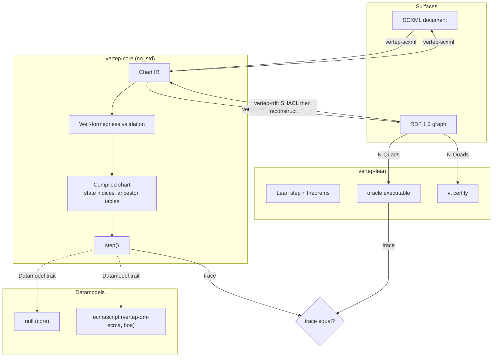
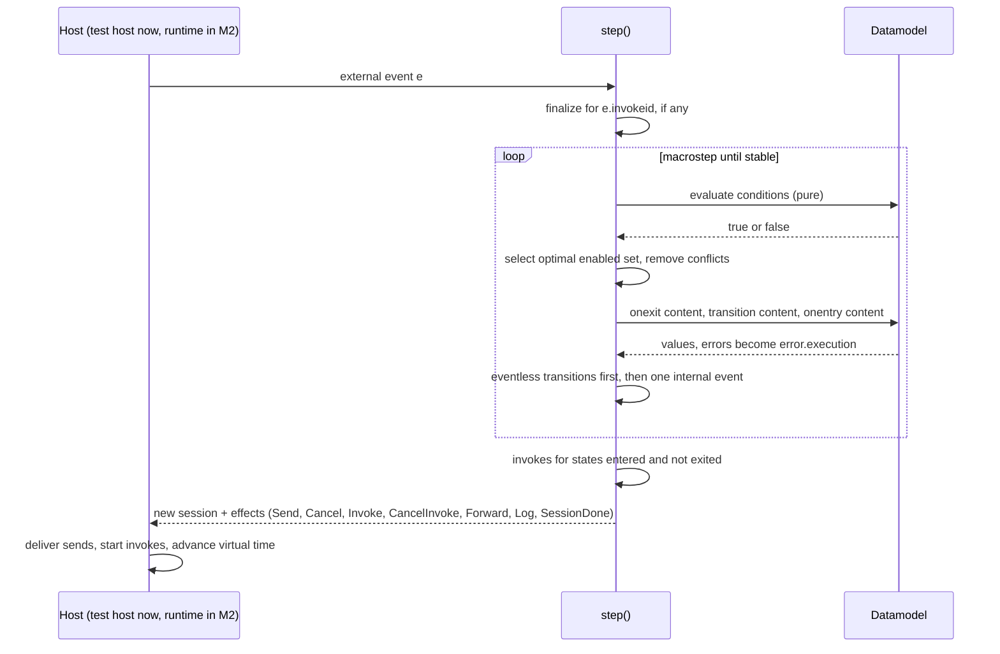
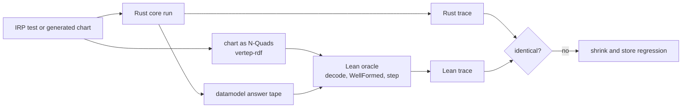
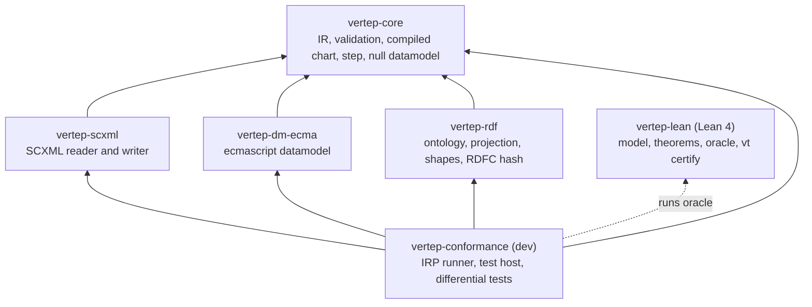

## Context

The repository is empty apart from the tg and OpenSpec scaffolding; see proposal.md for why M0 comes first. The architecture is fixed by the accepted decisions in `tg.md/decisions.md`: SCXML semantics are normative ([[decisions#SCXML semantics are normative]]), a typed Rust IR is the hub and RDF a lossless projection of it ([[decisions#IR is the hub]]), executable content runs through a pluggable datamodel with pure guards ([[decisions#Pluggable datamodel]]), the ontology is a modular `vt:` vocabulary on RDF 1.2 ([[decisions#Modular vt ontology on RDF 1.2]]), charts are content-addressed ([[decisions#Content-addressed chart versions]]), Lean is the reference model and Rust is checked against it ([[decisions#Lean verification bridge]]), the core is `no_std` ([[decisions#No-std core and tokio shell]]), and full SCXML comes before everything else ([[decisions#Full SCXML first]]).

The external rules this design must respect:

- [[constraints#SCXML interpretation algorithm]] binds the step function, its order of operations and the conformance gate.
- [[constraints#RDF is open-world]] binds reconstruction: a chart is read back only from a graph that SHACL has closed.
- [[constraints#Proc macros run at compile time]] binds the IR crate: it must build without RDF or I/O so the M1 macros can use it.
- [[constraints#Aeneas supports a Rust subset]] binds the step kernel: written so that a later Aeneas translation stays possible.

## Goals / Non-Goals

**Goals:**

- One chart IR and one step kernel shared by every later milestone, with no I/O, no async and no clock in it.
- Conformance with every mandatory W3C IRP test for the `null` and `ecmascript` datamodels, enforced in CI on Rust and on Lean.
- A Lean model whose executable `step` agrees with Rust on every conformance test and on generated charts.
- Chart identity by content: the same chart from any surface gets the same version IRI.

**Non-Goals:**

- No actors, mailboxes, journals, timers or stores; the conformance host is in-memory and test-only (M2 delivers the runtime).
- No type language, Rust DSL, YAML or CEL (M1); M0 values are dynamic.
- No `xpath` datamodel and no Basic HTTP Event I/O Processor; the tests needing them are listed as optional.
- No RDF 1.1 fallback; it belongs to the storage capability in M2.
- No Aeneas proofs in M0.

## Decisions

### D1. Session state is a value; the datamodel is a mutable component of it

`step(&CompiledChart, Session, Input, &mut dyn Datamodel) -> (Session, Vec<Effect>)`. The session value holds the configuration as a bitset over states numbered in document order, history records, the internal queue, active invocations, the send-id counter and the binding status of data items. The datamodel keeps its own state behind the trait because ECMAScript engines are mutable; determinism is guaranteed by [[openspec:datamodel#Deterministic Evaluation]] and replay by [[openspec:datamodel#Datamodel Snapshot]].

- Rejected: a fully immutable datamodel value, which would copy the ECMAScript heap on every microstep.
- Rejected: an `async` step, which would break [[openspec:scxml-interpretation#Pure Step Function]] and the Lean correspondence.

### D2. The IR is canonical; a compiled chart is derived

Validation turns a well-formed IR into a compiled chart with dense state indices in document order, parent and ancestor tables, precomputed transition domains and default entries. Appendix D's set operations become bitset operations. The compiled chart is never serialized; only the IR is, so [[openspec:chart-model#Chart Equality]] and [[openspec:chart-rdf#Round Trip Identity]] stay about one structure.

- Rejected: interpreting the IR directly, which makes `selectTransitions` and exit-set computation quadratic in practice.

### D3. Every interaction is an effect

The step emits `Send`, `Cancel`, `Invoke`, `CancelInvoke`, `Forward` (autoforward), `Log` and `SessionDone` effects in document order. Delays are durations in the effect, not timers. This is what lets the same kernel run under the M0 test host, the M2 tokio shell and the Lean oracle.

### D4. Guard purity is enforced by the datamodel, not trusted

The ecmascript datamodel evaluates conditions against a read-only view of the session scope whose set and define traps throw; a throw becomes an evaluation error, the condition is false and `error.execution` is queued ([[openspec:datamodel#Guard Purity]]). `Math.random` is replaced by a generator seeded from the session input and `Date` reads the input timestamp.

- Rejected: snapshot-and-compare after every condition, which is correct but costs a heap walk per guard.
- Rejected: trusting chart authors, which would make replay in M2 unsound.

### D5. The Lean model abstracts the datamodel as an answer tape

Lean cannot run ECMAScript, so the Lean `step` treats the datamodel as an oracle. The Rust run records every datamodel request and its answer; the Lean run consumes the tape and must request exactly the same operations in the same order ([[openspec:formal-model#Executable Step Semantics]]). For the `null` datamodel Lean evaluates `In()` itself. The theorems quantify over all tapes, so they hold for every datamodel.

### D6. The oracle and the certifier read charts as RDF

Charts cross from Rust to Lean as N-Quads of their projection, decoded by the Lean reconstruction that [[openspec:formal-model#RDF Round Trip Theorem]] proves. One exchange format therefore also exercises the RDF projection on every differential test. Traces are JSON Lines with one record per macrostep.

- Rejected: a separate JSON chart format for Lean, which would add a second, unproven codec.

### D7. Namespace and chart IRIs

The Vertep namespace is `https://w3id.org/vertep/vt#` (persistent, redirectable), used both as the SCXML extension namespace and as the ontology namespace. A chart version IRI is `urn:vertep:chart:sha256:<hex>`; node IRIs are minted under it from state identifiers and document positions. The projection uses no blank nodes, so RDFC-1.0 canonicalization never needs its blank-node labelling search and is linear in practice ([[openspec:chart-rdf#Canonical Chart Hash]]).

- Rejected: blank nodes for transitions and content, which make hashing depend on RDFC's worst-case path and make node references unstable.

### D8. Document order is explicit in RDF

Every ordered member carries `vt:order` ([[openspec:chart-rdf#Explicit Ordering]]); `rdf:List` is not used for document order because it is awkward to query in SPARQL and fragile under partial updates. This is required by [[constraints#SCXML interpretation algorithm]], since transition priority is document order.

### D9. SHACL shapes are proven equal to WellFormed

Rules that SHACL Core cannot state directly (for example "a history default transition targets descendants of the history's parent") are expressed with SPARQL-free SHACL Core paths over explicit containment properties the projection materializes (`vt:ancestor`). The equivalence is a theorem ([[openspec:formal-model#Shapes Equivalence Theorem]]) checked with LeanRDF's validator, and also tested empirically on generated charts ([[openspec:chart-rdf#SHACL Shapes For Charts]]).

- Rejected: SHACL-SPARQL constraints, which LeanRDF does not model and which many stores do not run.

### D10. Conformance suite variants are generated once and pinned

The IRP `.txml` templates are turned into `ecmascript` and `null` variants by a pinned XSLT step run by a script; the generated files and their content hash are committed, and CI checks the hash ([[openspec:scxml-conformance#IRP Suite Import]]). Every expected deviation lives in an allow-list with a reason, and an unexpected pass fails ([[openspec:scxml-conformance#Expected Deviation Allow List]]).

### D11. Dependencies

- `vertep-core`: `no_std` + `alloc`, no third-party runtime dependencies besides a bitset and a small-vector crate.
- `vertep-scxml`: `quick-xml` for streaming parsing with positions.
- `vertep-dm-ecma`: `boa_engine`, behind the `ecmascript` feature.
- `vertep-rdf`: `oxrdf` and `oxttl` with RDF 1.2 enabled; an RDFC-1.0 implementation checked against the W3C RDFC test suite (adopted if a conforming crate exists, otherwise written in the crate); a SHACL Core validator for the Rust-side test.
- `vertep-lean`: LeanRDF at a pinned revision, Lean toolchain pinned.

### D12. Crate layout for M0

### D13. Throwaway integration spike

A spike under `spikes/journal-llm/`, outside the workspace members, wires the M0 kernel to an append-only journal in tiramemsu and a stub LLM decider choosing among enabled events, to surface problems in journaling effects, replay and recorded model output before M2 is designed in detail. Its findings are written to `tg.md`; its code is deleted when M2 starts and nothing depends on it.

## Risks / Trade-offs

- [Appendix D has known ambiguities and errata] → Follow the Recommendation text, record any interpretation as an allow-list reason or a decision in `tg.md`, and let the Lean model make the chosen reading explicit.
- [boa's ECMAScript coverage gaps fail IRP tests unrelated to SCXML] → Allow-list them with the engine issue as reason; the datamodel trait keeps a QuickJS-based implementation possible.
- [The Lean oracle is too slow for large generated corpora] → Run the full differential corpus nightly and a bounded sample on every pull request; compile the oracle natively.
- [Shapes cannot express a well-formedness rule] → Materialize the needed derived triples in the projection (D9), and if a rule still cannot be expressed, the equivalence theorem fails and the gap is visible rather than silent.
- [Generated state identifiers change hashes when a chart is edited] → Generated identifiers are derived from document position, so edits change hashes only for structurally changed charts, which is the intended content-addressing behavior.
- [The read-only proxy for guards misses a mutation path, such as a mutating method on an object value] → Proxies wrap values reached from the scope recursively; the snapshot-compare check runs in debug builds and in the conformance harness as a backstop.

## Migration Plan

None; this is the first code in the repository. The spike is deleted at the start of M2.

## Open Questions

- Which RDFC-1.0 crate, if any, passes the W3C RDFC suite with RDF 1.2 triple terms; the fallback is an in-crate implementation, which does not change the specs.
- The exact default microstep budget per macrostep; any finite default satisfies [[openspec:scxml-interpretation#Macrostep Execution]].
