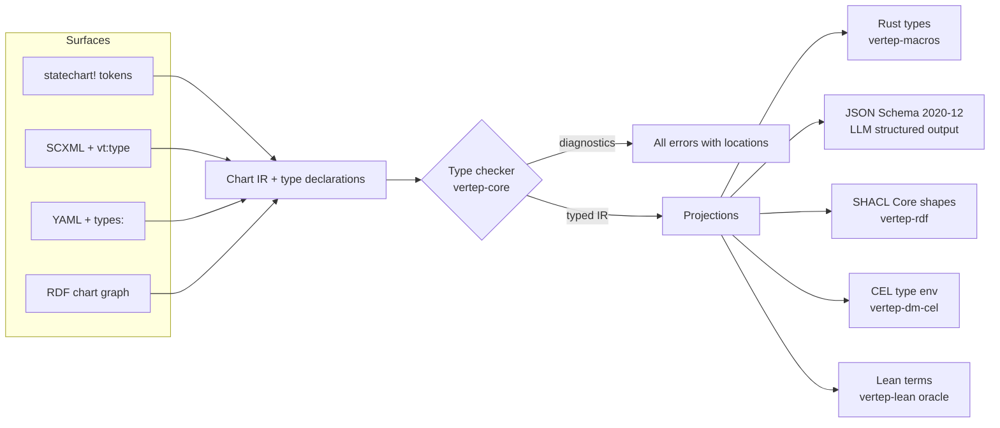
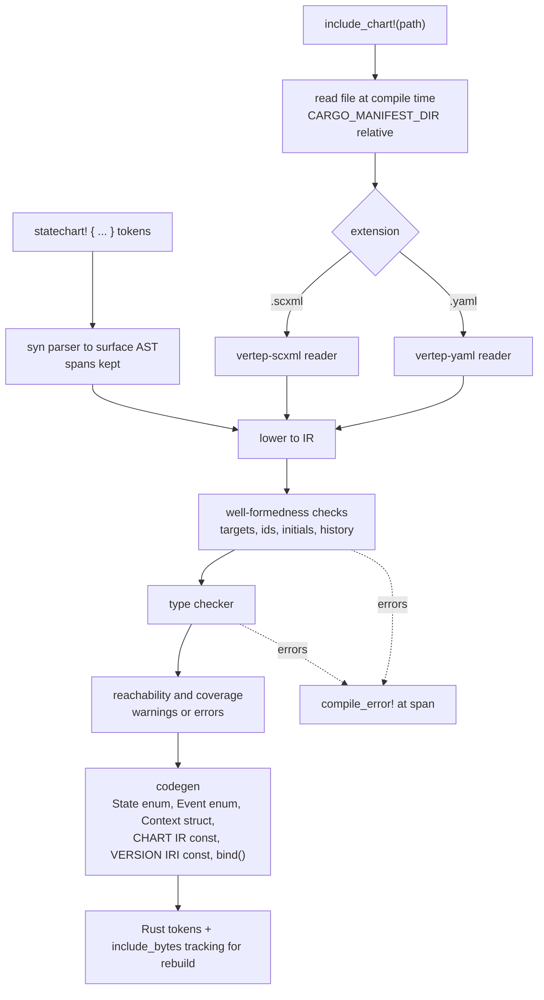
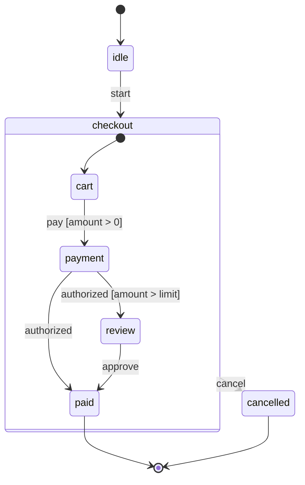

## Context

M0 delivers the untyped chart IR, the SCXML interpretation algorithm in a pure `step`, the `Datamodel` trait with `null` and `ecmascript`, the RDF projection with SHACL and RDFC-1.0 hashing, and the Lean model. See proposal.md for why M1 adds types and typed authoring surfaces.

The design is bound by these accepted decisions and constraints:

- [[decisions#One IR type language]]: one type language in the IR, projected to every target; typing is opt-in.
- [[decisions#IR is the hub]]: every surface lowers into the IR; no surface talks to another directly.
- [[decisions#Pluggable datamodel]]: `rust` for the macro DSL, `ecmascript` for imported SCXML, CEL for YAML and LLM-written charts; guards are pure.
- [[decisions#Lean verification bridge]]: properties are proven in Lean and checked against Rust by differential testing.
- [[decisions#Modular vt ontology on RDF 1.2]]: types appear in RDF under the chart module with SHACL shapes.
- [[decisions#No-std core and tokio shell]]: the type language and checker live in the `no_std` core.
- [[decisions#Content-addressed chart versions]]: named types are content-addressed the same way charts are.
- [[constraints#Proc macros run at compile time]]: macros build the IR in the compiler and cannot consult a store.
- [[constraints#RDF is open-world]]: SHACL shapes, not RDFS inference, define what a well-typed value is in RDF.

## Goals / Non-Goals

**Goals:**

- One type checker in `vertep-core` used by every surface, by the macros at compile time, and by the runtime when charts are loaded dynamically.
- Projections whose agreement with the checker is tested on generated corpora and, for the type language itself, proven in Lean.
- The same typed Rust API from `statechart!`, `include_chart!("x.scxml")` and `include_chart!("x.yaml")`.
- A CEL datamodel safe enough to be the only datamodel allowed for untrusted, LLM-written charts in M3.

**Non-Goals:**

- Generics or type parameters in the type language; named types are monomorphic in M1.
- Refinement types (ranges, regexes) beyond what JSON Schema and SHACL can both express; deferred.
- Type inference for untyped ECMAScript charts.
- Runtime actor typing (typed addresses and typed mailboxes) — M2 actor model consumes these types but defines its own requirements.
- Chart migrations between type versions — M2 chart versioning.

## Decisions

### 1. Types are IR values, checked in the core

The type language is a data structure in `vertep-core` (`no_std`), not a Rust-level encoding. The checker takes an IR chart and returns all diagnostics. Macros, YAML and SCXML loaders, `vt typecheck` and the runtime call the same checker.

*Alternative rejected:* encode types only as Rust types in the macro and derive others from Rust via `serde` reflection. It would leave SCXML and YAML charts untyped at runtime and make Rust the hub, against [[decisions#IR is the hub]].



### 2. Canonical value encoding and content-addressed types

Every value of a type has one canonical encoding (a JSON-compatible tree with tagged unions as `{"tag": ..., "value": ...}`, decimals as strings and datetimes in RFC 3339 normalized to UTC with the original offset kept as metadata). Named types are serialized as RDF in the chart module and hashed with RDFC-1.0 like charts, so a type IRI is stable across surfaces and field order. The chart version IRI covers its types, so a type change is a chart version change.

*Alternative rejected:* nominal types identified by name only. Two charts could then disagree silently on `Order`, and M3 LLM schemas could drift from chart types.

### 3. Projection agreement is a tested and proven property

For each projection P, the property is: `checker(T, v) = P.accepts(P(T), encode(v))`. It is tested with property-based generation of types and values (including near-miss invalid values) for JSON Schema and SHACL, and proven in Lean for the SHACL projection using LeanRDF's proven SHACL Core validator. The Rust projection is correct by construction through generated `serde` code and checked by round-trip tests.

### 4. Macros: one pipeline for inline and included charts



Errors from files carry file, line and column; macros map them to the `include_chart!` call span and print the file location in the message. Rebuild on file change uses `include_bytes!` on the source path so cargo tracks it, avoiding a build script.

*Alternative rejected:* a `build.rs` code generator. It splits charts from the code using them and loses span-accurate errors for inline charts.

### 5. Guards and actions bind by IRI through a registry

Every guard and action in the IR is an IRI (`vt:guard/<chart>/<name>` by default, overridable). The macro emits a `bind()` that registers the user's functions under those IRIs with signatures checked by the compiler: a guard is `fn(&Ctx, &Event) -> bool`; an action is `fn(&mut Ctx, &Event, &mut Emit)`. Guards get no emitter and no mutable context, so purity of context and effects holds by construction; absence of I/O is a documented contract tested by the Lean oracle (a guard that disagrees with the oracle is a bug). The same registry lets a chart loaded from RDF at runtime bind to compiled functions.

### 6. YAML is a thin, lossless mirror of the IR

YAML keys map one to one onto IR nodes; there is no YAML-only semantics. Document order is the order of keys in mappings, preserved by an order-keeping parser with source spans. The writer emits a canonical layout (sorted metadata keys, declared order for states and transitions) so output is byte-stable. The YAML loader uses the CEL datamodel by default.

### 7. CEL: a deterministic subset with explicit limits

The CEL datamodel implements the CEL standard definitions minus anything non-deterministic or effectful (no `now`, no randomness, no external functions), plus SCXML bindings `ctx`, `ev`, `session` and `In()`. Evaluation counts steps and value size and fails with `error.execution` past configurable limits, so termination is guaranteed even for comprehensions. Maps iterate in key order. Decimals are exact. Whether to wrap an existing Rust CEL implementation or write a subset interpreter is decided in task 6.1 by checking `no_std` and determinism; the spec does not depend on the choice.

### 8. Example: the same machine in both surfaces



```rust
statechart! {
    name: order,
    datamodel: rust,
    types {
        Pay = { amount: decimal },
        Approval = { by: iri },
    }
    context { total: decimal = 0, limit: decimal = 100 }
    events { start, pay: Pay, authorized, approve: Approval, cancel }

    initial idle;
    state idle { on start => checkout; }
    state checkout {
        initial cart;
        on cancel => cancelled;
        state cart {
            on pay if positive => payment / record_total;
        }
        state payment {
            on authorized if over_limit => review;
            on authorized => paid;
        }
        state review { on approve => paid; }
    }
    final paid;
    final cancelled;
}

fn positive(_: &Ctx, ev: &Pay) -> bool { ev.amount > Decimal::ZERO }
fn over_limit(ctx: &Ctx, _: &()) -> bool { ctx.total > ctx.limit }
fn record_total(ctx: &mut Ctx, ev: &Pay, _: &mut Emit) { ctx.total = ev.amount; }
```

```yaml
vertep: 1
name: order
datamodel: cel
types:
  Pay: { amount: decimal }
  Approval: { by: iri }
context:
  total: { type: decimal, init: "0" }
  limit: { type: decimal, init: "100" }
events: { start: null, pay: Pay, authorized: null, approve: Approval, cancel: null }
initial: idle
states:
  idle:
    on: { start: checkout }
  checkout:
    initial: cart
    on: { cancel: cancelled }
    states:
      cart:
        on:
          pay:
            - cond: "ev.data.amount > 0"
              target: payment
              actions: [ { assign: { location: ctx.total, expr: "ev.data.amount" } } ]
      payment:
        on:
          authorized:
            - { cond: "ctx.total > ctx.limit", target: review }
            - { target: paid }
      review:
        on: { approve: paid }
  paid: { type: final }
  cancelled: { type: final }
```

The two charts have the same structure and types but different datamodels (`rust` and `cel`), so their chart version IRIs differ; converting either to the other surface keeps its own datamodel and IRI.

### 9. Lean: type soundness for the type language

`vertep-lean` gains the type language, the value relation `HasType v T`, the projections to JSON Schema and SHACL as Lean functions, and these theorems: decidability and soundness of the checker (`check T v = true ↔ HasType v T`); SHACL projection agreement (`validate (shapes T) (toRDF v) = conforms ↔ HasType v T`, via LeanRDF's `validate_conforms`); and chart type soundness for the M0 `step` (a well-typed chart in a well-typed configuration, given well-typed input events, produces well-typed context and well-typed output events). The executable checker becomes part of the differential oracle.

## Risks / Trade-offs

- [JSON Schema dialect support varies across LLM providers' structured output] → project to the documented subset (object, enum, `anyOf`, `const`, `required`, `additionalProperties: false`) and test against a fixed corpus; record unsupported features as projection errors rather than silently weakening schemas.
- [Exact decimal and datetime semantics differ between CEL libraries and ECMAScript] → define the canonical encoding in the type system and test the CEL datamodel against it on native and WebAssembly targets.
- [Proc-macro compile times grow with chart size] → keep the IR builder and checker allocation-light and cache nothing across invocations (constraint: macros cannot use a store); measure on the conformance suite charts.
- [Purity of Rust guards cannot be enforced against I/O] → enforced by signatures for context and effects, by contract for I/O, and caught by the Lean differential oracle on generated traces.
- [Content-addressed types make every edit a new version] → intended; M2 chart versioning handles migration, and `vt hash` makes the identity visible to authors.
- [CEL implementation choice may not be `no_std`] → the CEL datamodel lives in its own crate `vertep-dm-cel`, which may require `std`; the core stays `no_std`.

## Migration Plan

No deployed system exists. M0 charts remain valid: untyped charts run on the dynamic `value` type with identical traces, which is a scenario of the type-system spec.

## Open Questions

- Exact default IRI scheme for guard and action IRIs (`vt:guard/<chart>/<name>` vs a chart-version-relative IRI); either satisfies the specs.
- Whether `vt certify` shells out to the Lean binary or links its C output; either satisfies the CLI requirement.
