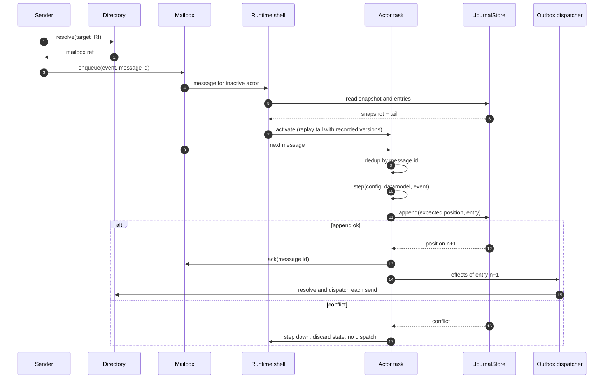
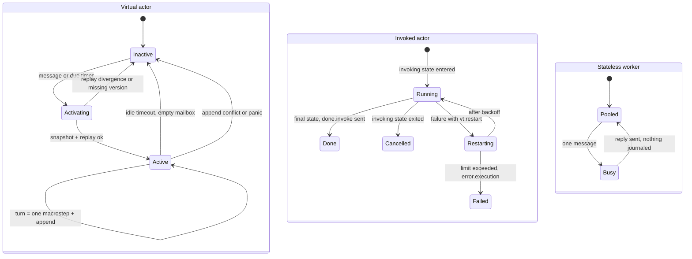
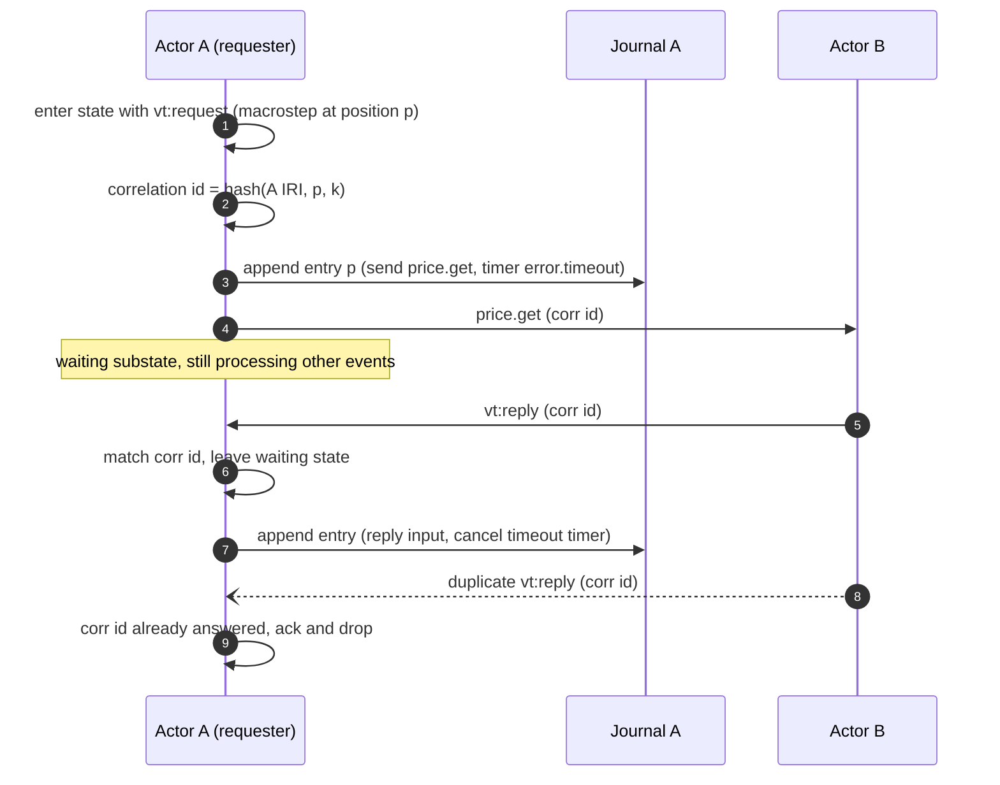
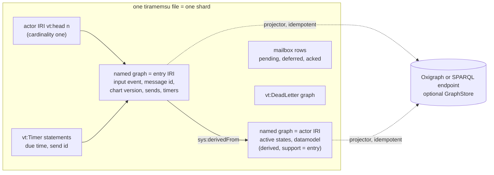
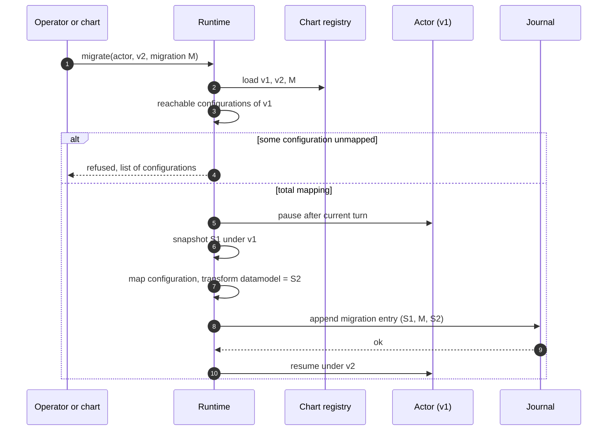

## Context

M0 delivers a pure, `no_std` `step(config, datamodel, event) -> (config', datamodel', effects)` and M1 gives charts typed context and events. Nothing yet owns a mailbox, persists state or talks to a store. See proposal.md (Why) for motivation and the specs in this change for the requirements.

The design is bound by decisions already accepted in tg.md: [[decisions#SCXML-native actors with vt extensions]], [[decisions#IRI identity and lifecycle classes]], [[decisions#Identity, mailbox and transport layers]], [[decisions#Event-sourced actors]], [[decisions#Two storage traits with tiramemsu as default]], [[decisions#Content-addressed chart versions]], [[decisions#No-std core and tokio shell]] and [[decisions#Non-blocking request and deferred events]]. The constraints that shape it are [[constraints#Relays deliver at least once]], [[constraints#SPARQL Update has no compare-and-set]], [[constraints#Tiramemsu has a single writer per file]], [[constraints#SCXML discards unmatched events]] and [[constraints#RDF is open-world]].

## Goals / Non-Goals

**Goals:**

- A single-node runtime in which every [[glossary#Virtual actor]] is durable, single-activation per node and replayable bit for bit.
- Trait boundaries (`Actor`, `Mailbox`, `Transport`, `Directory`, `JournalStore`, `GraphStore`, `Clock`, `Spawn`) drawn so that M3 (deciders), M4 (cluster) and M5 (federation) add implementations without changing these specs.
- The journal and the current-state graph consistent in one tiramemsu transaction by default.
- Journal protocol properties stated in Lean and checked against the Rust shell.

**Non-Goals:**

- Multi-node placement, membership and leases (M4); this change uses a local shard map only.
- DID addresses, encrypted relays and authenticated origins (M5).
- `vt:decide`, LLM actors and plan charts (M3); M2 only guarantees that external results are journaled as inputs.
- A networked journal store; the contract allows one, but only tiramemsu is implemented here.

## Decisions

### D1. A functional core and an imperative shell

`vertep-runtime` wraps the M0 `step` in a per-actor task. The task owns the in-memory state, dequeues one message, calls `step`, builds a journal entry from the effects, appends it, then hands the effects to the outbox dispatcher. Nothing inside `step` awaits. This keeps the Lean oracle applicable to every macrostep and makes [[glossary#Mailbox]] and transport failures impossible to observe from inside a chart.

Alternative rejected: an async `step` that awaits sends or requests (Orleans style). It reintroduces reentrancy, breaks determinism and voids the oracle.

### D2. Three lifecycle classes, one task model

An [[glossary#Invoked actor]] of chart kind persists inside its parent: its events reach the parent as journaled inputs, so the child itself is replayed from the parent's journal and needs no journal of its own in M2. A [[glossary#Stateless worker]] runs as a bounded pool of tasks on one address. Alternative rejected: giving invoked charts their own journals now; that is only needed when a child outlives its node, which M4 handles.

### D3. Mailboxes and transports

`Mailbox` has `enqueue`, `receive` (ordered, with deferral) and `ack`. M2 ships an in-memory mailbox for invoked actors and workers and a store-backed mailbox for virtual actors, kept in the same tiramemsu file as the shard's journal so that enqueue-after-append and ack-with-append share transactions. `Transport` implementations register as SCXML Event I/O Processors; M2 ships only the local transport. `Directory` holds pluggable resolvers keyed by IRI scheme; M2 resolves local addresses through the shard map.

Deferral is implemented in the mailbox, not in `step`: `receive` takes the set of descriptors deferred by the active configuration and skips matching messages without removing them. This keeps the SCXML core unchanged and order-preserving.

### D4. Request and reply as IR expansion

`vt:request` is expanded by the IR lowering into a `<send>`, a generated waiting substate, a transition on `vt:reply` guarded by correlation id, and a durable timer that raises `error.timeout`. `k` is the index of the request within the macrostep. Because the expansion is plain SCXML plus timers, the M0 conformance semantics and the Lean model cover it.

### D5. Journal entries are RDF datasets; tiramemsu is the default store

Entries are encoded as RDF datasets with the runtime module's terms, so any journal backend stores RDF and projection is a copy, not a translation. On tiramemsu one append is one `Db::transact` call that:

1. reads the actor's head (a cardinality-one `vt:head` statement) and checks the expected position,
2. asserts the entry's statements inside a named graph named by the entry IRI,
3. writes current-state statements with `Tx::derive`, citing the entry's statements as support, and retracts the statements of exited states,
4. writes the new head and acknowledges the message in the shard's mailbox.

Because tiramemsu never deletes, `db.now()` is the current-state graph and `db.as_of(t)` is time travel without replay; `View::dependents` on an entry shows the state it caused.

Alternatives rejected: Oxigraph for both traits (no compare-and-set guarantee usable across processes, no never-delete history), and one `RdfStore` trait requiring transactions (excludes most SPARQL stores).

Single-node sharding uses a fixed shard count and a hash of the address IRI, so each shard has its own writer ([[constraints#Tiramemsu has a single writer per file]]). M4 replaces the local shard map with leased placement without changing the file layout.

Appends carry optional metadata with a fencing token (scope IRI, epoch). M2 never sets it; the tiramemsu backend already enforces it by keeping the highest accepted epoch per scope as a cardinality-one statement checked in the same append transaction. This is the hook M4 uses to fence a node whose shard lease has moved, without making clustering an M2 requirement.

### D6. Time, randomness and timers

The shell's `Clock` stamps each input when it is dequeued, and the timestamp is stored in the entry; `step` reads time only from the event. Random values requested by executable content come from a seeded generator whose seed is the entry IRI, so replay reproduces them without storing every value. Timers are `vt:Timer` statements in the entry; a timer service per shard scans for due timers, enqueues their events with message ids derived from send ids and relies on deduplication for exactly-once processing. Missed recurring reminders collapse to one firing.

### D7. Versions and migrations

The version IRI comes from `vertep-rdf` (RDFC-1.0 hash). Reachable configurations are enumerated over the chart structure, ignoring guards, which over-approximates and is therefore safe. Self-migration requests are queued as a runtime-internal input, never applied inside the requesting macrostep.

### D8. Ontology module and projections

The runtime module lives next to the chart module in `vertep-rdf`, with its own SHACL shapes. PROV-O alignment is a handful of `rdfs:subClassOf` and `rdfs:subPropertyOf` triples in the module file; the runtime's own queries use only `vt:` terms. Annotations use RDF 1.2 reifiers when the store declares support, otherwise `rdf:Statement` reification.

### D9. Verification

`vertep-lean` gains a model of the journal protocol: entries, compare-and-set append, deduplication, the outbox and replay. Target theorems: replay of a journal is deterministic and equals the recorded states; deduplication is idempotent; every recorded send is dispatched at least once and no unrecorded send is dispatched; with compare-and-set at most one of two concurrent activations appends. The Rust shell is checked against it by property tests that generate interleavings of crashes, redeliveries and concurrent activations.

## Risks / Trade-offs

- [Single writer per shard limits write throughput] → several shard files per node, chosen by hash; benchmark appends per second per shard before choosing the default shard count.
- [Replay cost grows with journal length] → snapshots every N entries, validated against the digest; full replay remains the fallback.
- [Replay divergence after a library upgrade changes executable content behaviour] → digests in every entry detect it at activation; the fix is a new chart version and a migration, never silent acceptance.
- [Reachable-configuration enumeration explodes on large parallel charts] → enumerate per region and combine lazily; allow an explicit operator override that records the unchecked configurations in the migration entry.
- [Store-backed mailbox in the journal file adds writes per message] → enqueue for local senders shares the sender's append transaction when both actors are in the same shard; otherwise one small transaction.
- [Dead-letter default changes SCXML behaviour for virtual actors] → only for virtual actors; plain sessions keep `discard`, so the conformance suite is unaffected.
- [Projection lag to an external graph store] → the projector's position per actor is queryable; queries that need consistency read tiramemsu directly.

## Migration Plan

Greenfield: no existing deployments. The throwaway spike from M0 is deleted when this change starts. Rollback of an M2 release is a downgrade of the crates; journals written by M2 are append-only and remain readable by later versions.

## Open Questions

- The default snapshot interval and the default shard count per node; to be set from the benchmarks in the task list, without affecting the specs.
- Whether the store-backed mailbox should also be offered for invoked actors whose parents are virtual; deferred until M4 shows whether invoked charts need to survive node loss.

## Measurements

Tiramemsu backend, release build, default durability, one entry of 14 statements plus a state delta per append (task 4.6, measured 2026-11-11 with `cargo test --release -p vertep-tiramemsu --test throughput -- --ignored --nocapture`):

- one shard: about 400 appends/s
- four shards in parallel: about 970 appends/s
- replay read: about 25,000 entries/s
