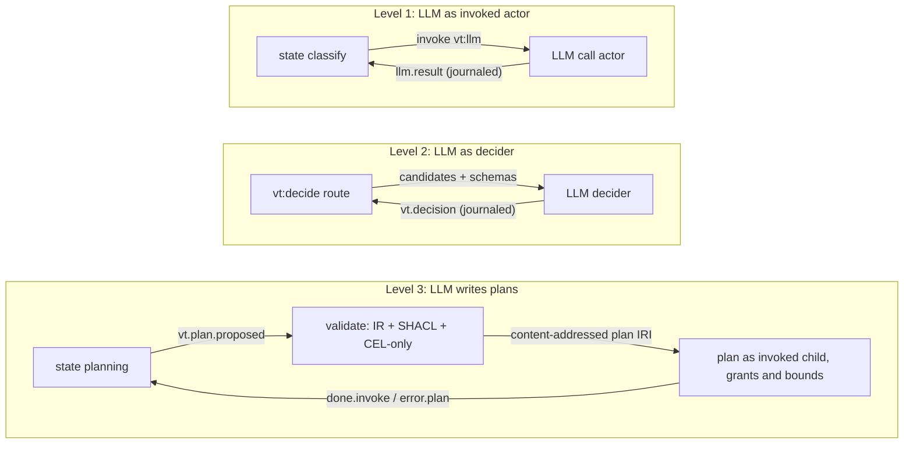
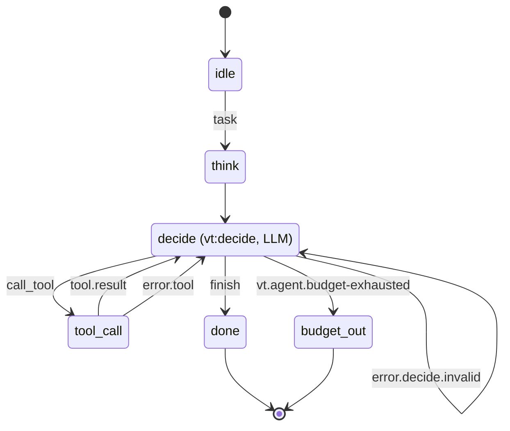
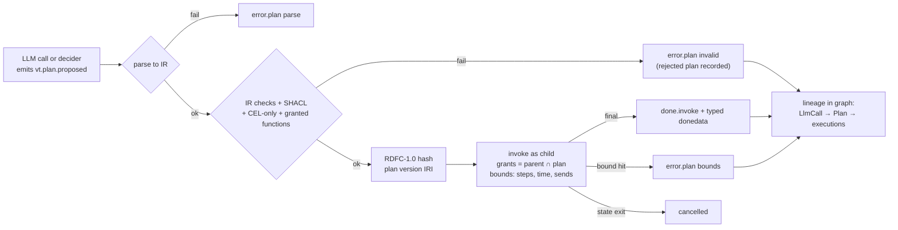

## Context

M0 to M2 provide the following:
- the SCXML core and the IR (`chart-model`, `scxml-interpretation`)
- typed charts with the CEL datamodel (`type-system`, `cel-datamodel`)
- journaled virtual actors with mailboxes, `vt:request`, durable timers and chart versioning (`actor-model`, `messaging`, `event-journal`, `durable-timers`, `chart-versioning`)

M3 adds agents on top of that, without adding any new execution semantics. Every feature in this change lowers onto SCXML constructs that already exist: states, `<invoke>`, `<send>`, internal events, durable timers and journal entries.

The binding decisions are these:
- [[decisions#Deciders at choice points]]: the LLM is one decider among several, and it may also be the main driver.
- [[decisions#Event-sourced actors]]: model results and decisions are journaled inputs.
- [[decisions#Pluggable datamodel]]: plans are CEL-only.
- [[decisions#Content-addressed chart versions]]: plans and self-modification are new versions.
- [[decisions#Non-blocking request and deferred events]]: nothing waits by blocking.
- [[decisions#Lean verification bridge]]: decider safety is a theorem.

The [[glossary#Decider]] term is defined in the glossary. The event-loss rule of [[constraints#SCXML discards unmatched events]] matters here, because a decision for a state that has already been left must be rejected explicitly, not dropped silently.

## Goals / Non-Goals

**Goals:**
- One mechanism, the `vt:decide` state, covers four kinds of control: LLM as helper, LLM as main driver, human in the loop, and delegation to another actor.
- The chart bounds the action space. Decider safety holds for *any* decider output, including adversarial output.
- Agent runs are replayable with no provider present, and they can be forked from any journal position.
- Plans written by an LLM run under explicit, intersected grants and bounds.
- Agent provenance (calls, decisions, plans, usage) can be queried with SPARQL through the `vt-agent:` module.

**Non-Goals:**
- No prompt-engineering library, memory store or RAG pipeline. Those are actors or tools that users plug in. Tiramemsu's recall APIs can be wrapped as tool actors.
- No built-in vendor SDKs in the core of `vertep-agent`. Providers sit behind a trait, and concrete providers are optional features.
- No in-place mutation of a running chart under any circumstances.
- No distributed LLM worker pools here. Pooled stateless workers arrive in M4 (`worker-pools`). In M3, LLM calls run as invoked actors on the local runtime.

## Decisions

### 1. `vt:decide` is a state annotation, not a new semantics

A decide state is a normal SCXML state carrying a `vt:decide` binding. When it's entered, the runtime shell does the following:
1. Asks the core for the **candidate set**: the events whose transitions would be enabled from the current configuration, including ancestors' transitions, filtered by the declared candidates.
2. Issues a `DecisionRequest` with a fresh correlation id, which is derived from the journal position so that replay reproduces it.

The decision comes back through the mailbox as an external `vt.decision` event. That event is matched by an auto-generated transition guard, which accepts it only if `(correlation id, event, payload)` is valid. The guard then re-raises the chosen event internally. Decision rejection and `vt.decide.*` events are raised the same way.

**Alternative rejected:** the decider being called synchronously inside `step`. That would make `step` impure, break the Lean oracle, and turn LLM latency into blocking. The candidate set is computed by a pure core function (`enabled_events(config, datamodel)`), which is also modelled in Lean.

```mermaid
sequenceDiagram
    autonumber
    participant M as Mailbox
    participant A as Actor (step, pure)
    participant J as Journal
    participant S as Shell (vertep-agent)
    participant D as Decider (LLM / human / actor / guards)
    M->>A: event enters decide state
    A->>S: effect: OfferDecision(state, candidates, corr=j42)
    A->>J: append macrostep + offer (same append)
    S->>D: DecisionRequest(candidates + JSON Schemas, context view, corr=j42)
    Note over A: still an active state; other events are processed
    D-->>S: Decision(event=approve, payload, annotations)
    S->>M: vt.decision(corr=j42, approve, payload, annotations)
    M->>A: deliver
    A->>J: append input vt.decision (dedup by corr)
    alt valid: in candidate set, schema ok, not stale
        A->>A: raise approve internally, take transition
    else invalid
        A->>A: raise error.decide.invalid(reason)
    end
```

### 2. Re-decision is driven by candidate-set fingerprints

Each outstanding offer stores a fingerprint of its candidate set: the event names plus their schema hashes. After each macrostep in which the decide state stays active, the core recomputes the fingerprint. If it has changed, the core emits a cancel-and-reoffer effect with a new correlation id. This keeps "stale" well-defined and replayable. **Alternative rejected:** re-offering on every macrostep. That spams deciders and costs tokens.

### 3. Deadlines and fallbacks are durable timers

A deadline is a `vt:Timer` journaled with the offer. When it fires, the shell either consults the fallback decider with a new correlation id, or raises `error.decide.timeout`. Because timers are durable, deadlines behave identically across deactivation and replay.

### 4. Decider kinds share one trait

```
trait Decider {
    async fn decide(&self, req: DecisionRequest) -> DecisionOutcome; // Decision | Refusal
    fn cancel(&self, corr: CorrelationId);
}
```

The four kinds are implemented like this:

| Kind | How it decides |
|---|---|
| Guard decider | A pure function, effectively synchronous. It's ordered by document order, which makes it deterministic. |
| LLM decider | Builds a structured-output request whose schema is a `oneOf` over the candidates. Each branch is `{event: const, payload: <candidate schema>}`. |
| Human decider | Publishes to an inbox actor. A human's answer arrives as a reply. |
| Actor decider | A `vt:request` to an actor IRI. |

None of them can do anything except return a value. The pure core validates whatever comes back.

### 5. LLM calls are invoked actors with journaled results

`<invoke type="vt:llm">` creates an invoked actor that owns one call. It does the following:
- renders the template, and records the prompt hash
- calls the provider
- validates any structured output
- sends `llm.result`, or `error.llm`, to its parent

The parent journals `llm.result` *before* processing it. On replay, the shell sees that the invocation's result is already in the journal, so it doesn't start a provider call. Instead, it feeds the journaled result back in. Retries are chart transitions. `vt:retry` is sugar for a counter in a substate plus a durable backoff timer, so retry behaviour is visible in the chart and in the graph.

**Alternative rejected:** caching provider responses by prompt hash. A cache is not history. It can be evicted, and it conflates identical prompts from different runs.

### 6. Tools are actors, and grants are an intersection

A tool is a registered actor kind with typed arguments and results. Its JSON Schemas come from the type system. An invoking state declares its grants as `vt:grant` children:
- targets: actor IRIs, `#_parent`, tool IRIs
- deciders
- functions that plans may call

The effective grant of a child is `grants(parent) ∩ grants(declared)`. Enforcement lives in the send path of the runtime (the Event I/O Processor dispatch), not in the LLM adapter, so it applies to plans and nested invokes as well. Grant enforcement is modelled in Lean together with decider safety.

### 7. The three levels of LLM control



### 8. LLM as main driver is a chart pattern

A ReAct agent is written as a chart. No special runtime support is needed: the iteration bound is a context counter guarded in CEL, or the `vt:maxDecisions` attribute on the decide state.



Here is an illustrative agent chart in the YAML surface. The exact YAML syntax belongs to `yaml-format` in M1.

```yaml
chart: support-agent
datamodel: cel
types:
  Ticket: { id: string, text: string }
  ToolCall: { tool: string, args: any }
  Answer: { text: string, confidence: decimal }
context:
  steps: { type: int, init: 0 }
states:
  idle:
    on:
      task: { target: decide, assign: { ticket: event.data } }
  decide:
    vt:decide:
      decider: llm/claude
      deadline: 30s
      fallback: guards/escalate
      maxDecisions: 12
    on:
      call_tool: { target: tooling, payload: ToolCall }
      finish:    { target: done, payload: Answer }
      escalate:  { target: human }
  tooling:
    invoke:
      type: vt:request
      target: "expr: event.data.tool"
      grants: { tools: [search, kb_lookup] }
    on:
      done.invoke: { target: decide, assign: { steps: "steps + 1" } }
      error.tool:  { target: decide }
  human:
    vt:decide: { decider: human/support-inbox }
    on:
      finish: { target: done, payload: Answer }
  done:
    type: final
    donedata: "event.data"
```

### 9. Plans: validate, address, sandbox, bound



Self-modification reuses this same pipeline. The output is a new version of the agent's *own* chart plus a migration, handed to the `chart-versioning` migration procedure instead of being invoked. **Alternative rejected:** letting a plan patch the parent's chart directly. That breaks pinned replay, and it makes the safety theorem unprovable.

### 10. The `vt-agent:` module and annotations

The classes are `Decider ⊑ prov:Agent`, `Decision ⊑ prov:Activity`, `LlmCall ⊑ prov:Activity`, `Tool`, `ToolCall ⊑ prov:Activity`, `Grant` and `Plan ⊑ prov:Entity`.

Annotations use RDF 1.2 triple terms on the statement `decision vt-agent:chose event`, for example:

```
<< :d42 vt-agent:chose vt:event/approve ~ :r42 >> .
:r42 vt-agent:rationale "invoice matches PO" ;
     vt-agent:confidence 0.82 ;
     vt-agent:model "claude-…" ; vt-agent:promptHash "sha256:…" .
```

This maps onto tiramemsu statement layers. The alignment axioms ship as plain triples, so PROV queries work without a reasoner, as required by [[decisions#Modular vt ontology on RDF 1.2]].

## Risks / Trade-offs

- **Prompt injection makes an LLM choose harmful actions.** Mitigation: the chart bounds the action space (decider safety), grants are intersected and enforced in the send path, and plans are CEL-only with bounds. Injection can at worst pick a *permitted* move. High-risk moves should route through a human decider.
- **Model nondeterminism undermines reproducibility.** Mitigation: every result and decision is journaled before it's processed, so replay never calls a model. Forking from a journal position is the supported way to explore alternatives.
- **Token and cost runaway in ReAct loops.** Mitigation: `vt:maxDecisions`, cumulative usage as a system variable for budget guards, and per-call accounting in the graph.
- **Structured-output support varies by provider.** Mitigation: the provider contract always validates against the schema after the call, and invalid output becomes `error.llm` with the class `schema`, which chart retries handle.
- **Large prompts or results bloat the journal.** Mitigation: content is stored once, addressed by hash, and journal entries reference the hash. Compaction is covered by `event-journal` snapshots.
- **A human decider can wait indefinitely.** Mitigation: deadlines with fallback deciders. The wait is non-blocking, so the actor stays responsive.
- **Re-offering after context changes can be expensive.** Mitigation: re-offers are fingerprint-based, so they happen only when the candidate set really changes.

## Migration Plan

This is a new crate (`vertep-agent`) and a new ontology module. No existing behaviour changes. Charts without `vt:decide`, `vt:llm`, tools or plans are unaffected, and their RDF contains no `vt-agent:` terms. Rollback means disabling the `agent` feature of the facade crate.

## Open Questions

- Should the human decider's inbox be one shared actor per deployment, or one per agent? This doesn't affect the specs, because the inbox is an actor binding.
- How should the `vt:retry` backoff parameters be expressed in SCXML attributes compared with YAML keys? That's a surface-syntax detail for `yaml-format` and `scxml-format`.
