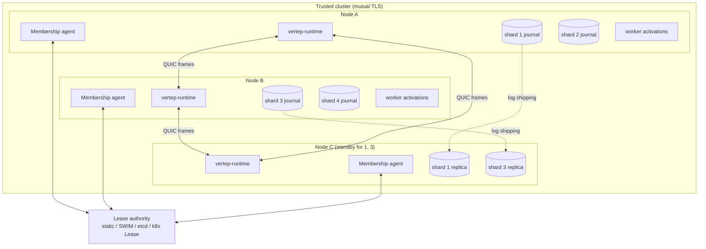
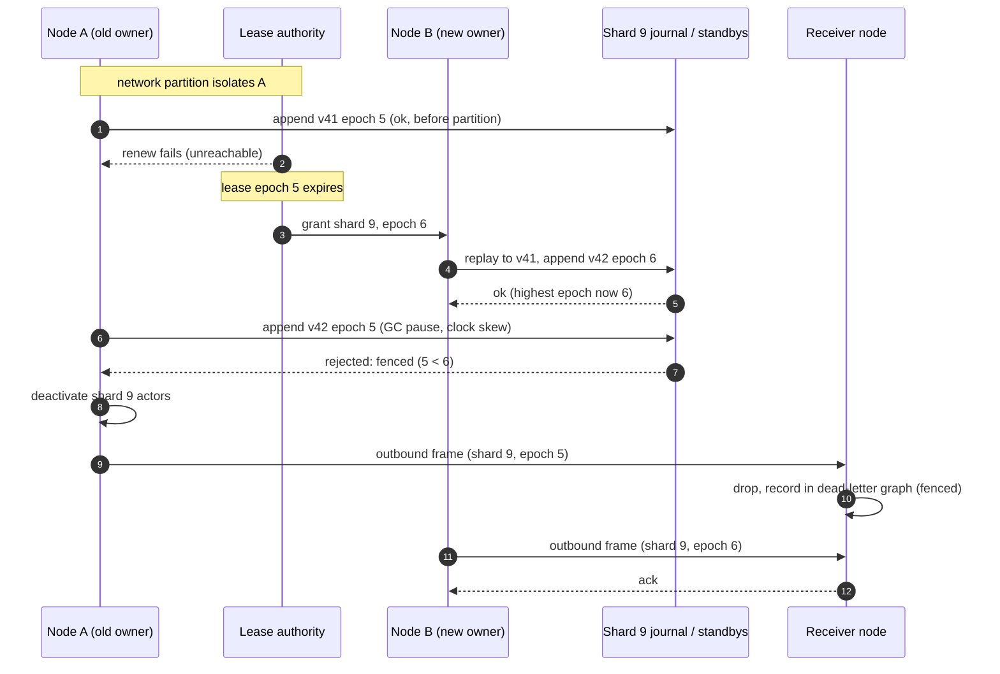
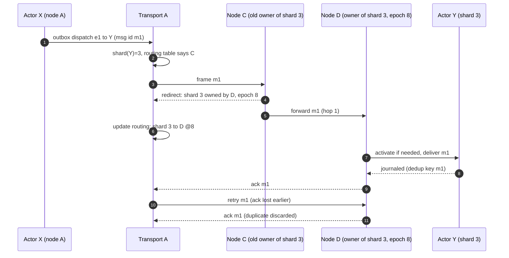
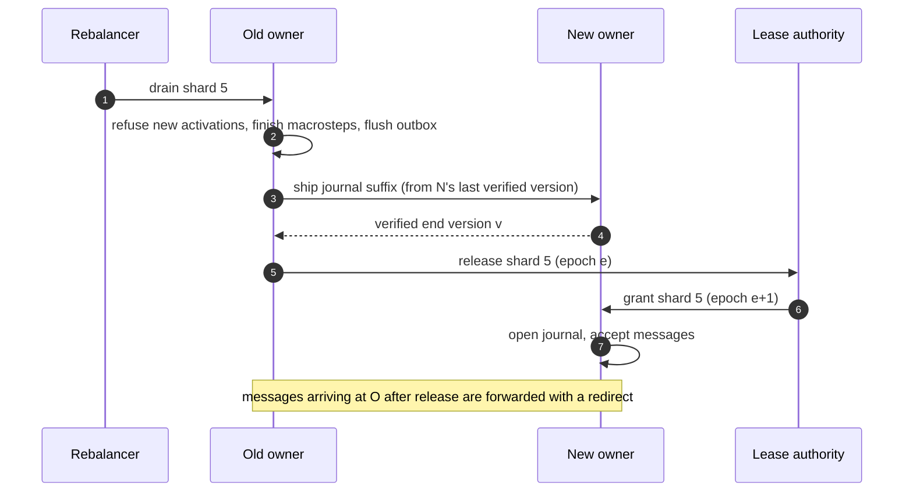

## Context

See proposal.md for why. After M2, `vertep-runtime` runs virtual, invoked and worker actors on one node. Each virtual actor is event-sourced in a `JournalStore`, with deduplication by message id and a transactional outbox ([[decisions#Event-sourced actors]]). The default store is a tiramemsu file, which has one serialized writer and no network server ([[constraints#Tiramemsu has a single writer per file]]). Addresses are IRIs, and an IRI resolves through a directory to a mailbox, then to a transport ([[decisions#Identity, mailbox and transport layers]]). M4 makes that directory placement-aware and adds a transport between trusted nodes. Cross-trust federation is M5 and is out of scope here.

The accepted architecture decision is [[decisions#Shard-based placement]]: a [[glossary#Shard]] is the unit of placement, one shard is one journal with one writer, and single activation rests on a lease with the journal append as a backstop.

## Goals / Non-Goals

**Goals:**
- At most one activation commits for any virtual actor, under any partition, pause or crash. This is checked by fault injection and stated as a Lean theorem.
- A shard can move between nodes without losing any acknowledged entry or accepted message.
- Membership and lease authority are swappable without touching runtime code.
- Workers scale out across nodes and never touch a journal.

**Non-Goals:**
- Cross-trust federation, DID identities and relay mailboxes (M5).
- Online resharding. Resharding is an offline procedure in M4.
- Per-actor placement hints or affinity. Placement is by hash only.
- Building a networked `JournalStore` backend. M4 defines the lease-transfer path and tests it against an in-memory shared store; a production networked backend is separate work.
- Byzantine fault tolerance. Nodes inside a cluster are trusted.

## Decisions

### D1. Shards by IRI hash modulo a fixed power-of-two count

`shard = H(iri) mod N`. Here H is a fixed, versioned 64-bit hash over the UTF-8 bytes of the actor IRI, and N is a power of two recorded in the cluster metadata at creation.

- Motivated by [[decisions#Shard-based placement]] and [[constraints#Tiramemsu has a single writer per file]]. One shard is one writer, so N bounds write parallelism and must be chosen generously, for example 256 or 1024.
- Rejected alternatives:
  - **An Orleans-style per-actor directory.** It needs a distributed table of millions of entries and its own consistency protocol.
  - **Consistent hashing with virtual nodes.** It gives smooth rebalancing, but it couples placement to the member set, so an actor's shard changes when members change, which breaks the one-file-per-shard mapping.
- Choosing a power of two makes resharding a split. Under `mod 2N`, an actor in shard s lands in s or s+N, so each old shard feeds exactly two new ones.

### D2. Leases with fencing epochs, granted by the membership authority

Every shard lease has an expiry and an epoch. Epochs increase strictly on every grant, renewals keep the epoch, and an owner stops work at `expiry − safety_margin` by its local clock.

- Motivated by [[decisions#Shard-based placement]]: the lease is the first guard.
- Rejected alternative: **relying on journal compare-and-set alone.** CAS detects conflicting appends on *one* store. It doesn't stop a stale owner from emitting outbox messages, and it doesn't work across local file copies (D3). Leases avoid the conflict; fencing (D4) catches what leases miss under clock skew or GC pauses.

### D3. Local journal files per shard in v1, shipped on move, optionally replicated

With tiramemsu, a shard's journal is a file on its owner's disk.
- **Moving a shard:** drain, ship the append-only file (or the suffix the target lacks), verify that the end version matches, then transfer the lease.
- **Failover (replication factor > 1):** the owner streams every append to standbys and acknowledges only after the configured number of them have stored it, so a standby can take over after the lease expires.
- **Replication factor 1:** a failed owner's shards stay unavailable until its disk comes back. That trade-off is stated explicitly in the spec.

- Motivated by [[decisions#Two storage traits with tiramemsu as default]]. Tiramemsu never mutates history, so shipping and replication are append-only copies.
- Rejected alternative: **a networked journal from day one.** It makes moves free, but it adds a mandatory external database to every cluster. The lease-transfer path (D3b) is specified now, so that backend can be added without spec changes.

### D4. Fencing on both journal appends and outbound frames

Every append and every outbound frame from a virtual actor carries `(shard, epoch)`.
- A `JournalStore`, or a standby receiving a replication stream, rejects an epoch lower than the highest it has accepted for that shard.
- Receivers keep the highest epoch they've seen per shard and drop lower-epoch frames into the dead-letter graph.

The store-side check is the M2 hook [[openspec:storage#Append Fencing Token]], with the shard IRI as the fencing scope; M4 is the first caller that sets the token. This is the backstop the decision promised. Under split brain, the stale owner can neither extend the authoritative journal nor have its side effects accepted.

### D5. Membership implementations behind one trait

- **Static:** members come from config, leases are assigned deterministically, and failure detection still runs.
- **Gossip:** SWIM (the `foca` crate). Leases are granted by a deterministic leader among the active members, chosen by view version, and recorded in gossip with epochs.
- **External:** etcd leases or Kubernetes `Lease` objects, which are authoritative for members and shard leases.

All three implement one trait: view, subscribe, acquire, renew, release and revoke a lease. A shared test kit runs against all three.

- Motivated by [[decisions#Shard-based placement]], which made membership pluggable.
- Rejected alternative: **embedding Raft in Vertep.** Correct, but heavy, and redundant where etcd or Kubernetes already exist. Gossip clusters accept weaker lease guarantees, and D4 fencing covers the gap.

### D6. QUIC with mutual TLS, one stream per sender-receiver pair

Each node keeps one QUIC connection per peer. Messages from actor X to actor Y travel on a stream keyed by (X, Y), which gives per-pair ordering without head-of-line blocking across pairs. Mailbox bounds feed QUIC flow control for backpressure. Frames carry the message id, both IRIs, `(shard, epoch)`, the event name and the data.

- Motivated by [[decisions#Identity, mailbox and transport layers]]: the cluster transport is just another transport and Event I/O Processor.
- Rejected alternatives:
  - **TCP+TLS.** One ordered byte stream per connection means head-of-line blocking across actors.
  - **gRPC.** Extra framing and a schema layer we don't need, and weaker control over per-pair streams.
- Stream fan-out is capped. Beyond the cap, pairs are multiplexed onto shared streams, ordered per pair by sequence number.

### D7. At-least-once with deduplication reused from the journal

Senders retry until the receiver acknowledges that the message is stored. Deduplication by message id is the M2 journal deduplication for virtual actors, and a bounded id cache for mailboxes that aren't journaled.

- Motivated by [[constraints#Relays deliver at least once]], which applies inside a cluster too, and [[decisions#Event-sourced actors]].
- Rejected alternative: **exactly-once transport.** It's impossible across failures, and duplicating the journal's guarantee would add nothing.

### D8. Rebalancing and resharding procedures

**Rebalancing** moves a minimal set of shards when the view changes. Each move runs the same steps: drain → ship or confirm the replica → verify the end version → transfer the lease at epoch+1 → resume.

**Resharding** is offline:
1. Stop all leases.
2. For each shard s, split its journal into s and s+N by re-hashing each actor's IRI.
3. Verify that every actor's replayed state is unchanged.
4. Write N' = 2N to the metadata and restart.

### D9. Workers are pooled, not sharded

Worker activations are placed on any member that declares the worker type, and they're balanced by policy: round robin, least outstanding, or prefer local. They never take a lease and never append to a journal. A virtual actor that calls a worker receives the result as an input event in its own journal, matched by the correlation id from `vt:request`.

- Motivated by [[decisions#IRI identity and lifecycle classes]] and the [[glossary#Stateless worker]] definition.
- Failures surface as error events or request timeouts. Automatic retry is allowed only for worker types declared idempotent, because a retried LLM or tool call can have external effects.

### D10. Verification

- **Lean:** a model of leases, epochs and fenced appends in `vertep-lean`, with the theorem that for every shard and epoch at most one writer's appends are accepted, and that accepted journal versions are totally ordered across epochs. Motivated by [[decisions#Lean verification bridge]].
- **Fault injection:** a Jepsen-style harness of partitions, process pauses, crashes and clock skew over many nodes, with a checker that every journal is linear and every accepted message was processed once.

## Risks / Trade-offs

- **[Clock skew longer than the safety margin lets a stale owner run past expiry]** → fencing on appends and frames (D4). The margin is configurable, and a monotonic clock is used for lease timing.
- **[With replication factor 1, a failed node makes its shards unavailable]** → this is documented, standby replication is offered (RF ≥ 2 is recommended for production), and messages wait in mailboxes rather than being lost.
- **[A fixed N limits write parallelism per cluster]** → choose a generous power of two at creation; offline doubling is documented.
- **[Gossip lease granting is weaker than consensus under partitions]** → fencing keeps safety, and availability may drop. Deployments that need strong lease authority use the etcd or Kubernetes implementations.
- **[A hot shard concentrates load on one writer]** → not solved in M4; shard metrics expose it. Moving hot actors would need placement hints, which are a non-goal here.
- **[Shipping large journal files slows rebalancing]** → ship only the missing suffix; snapshots bound the replay cost on arrival.
- **[Too many per-pair QUIC streams]** → a stream cap, with fallback to sequenced multiplexing.

## Migration Plan

This is a new crate and an opt-in feature. A single-node M2 deployment becomes a one-member static cluster by:
1. choosing N
2. running the offline split of the existing journal into shard files

Rolling back means stopping the cluster and merging the shard files back into one journal, with the same tool run in reverse.

## Open Questions

- The default safety margin and lease duration for each membership implementation. These are tuning values that don't change the specs.
- Whether the gossip implementation's lease leader should use the lowest node id or a rendezvous hash. Either satisfies the specs.
