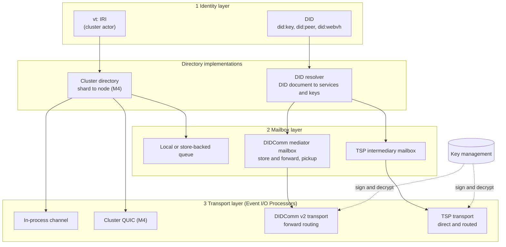
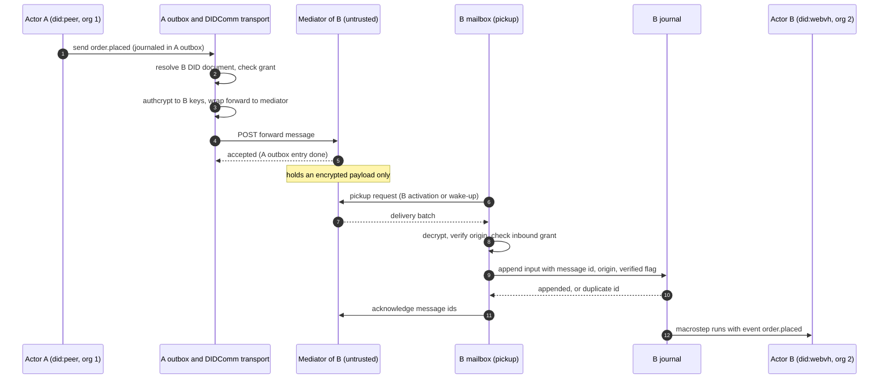
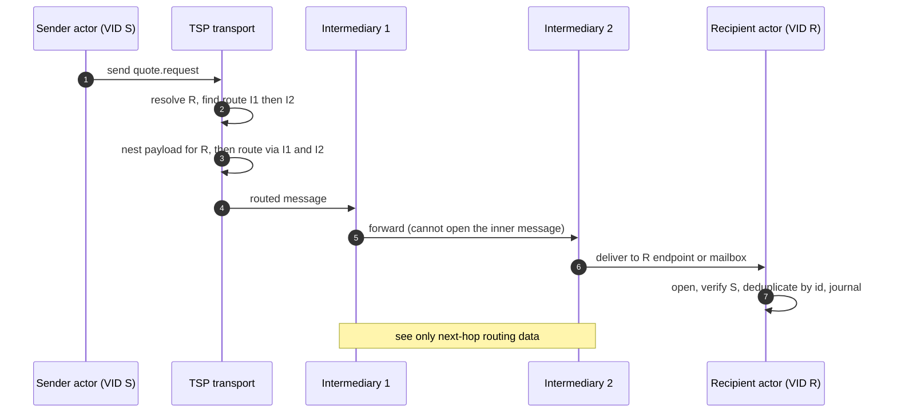
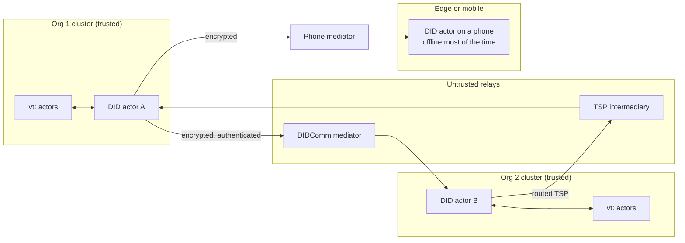

## Context

See proposal.md (Why) for the motivation. The design starts from three facts settled before M5:

- **Separate layers.** Identity, mailbox and transport are separate pluggable layers, per [[decisions#Identity, mailbox and transport layers]]:
  - an address IRI resolves through a directory to mailboxes
  - mailboxes deliver over transports, which are SCXML Event I/O Processors
  - a [[glossary#Mailbox]] outlives activations
- **At-least-once delivery.** Relays redeliver ([[constraints#Relays deliver at least once]]). Actors are event-sourced ([[decisions#Event-sourced actors]]), so the journal's message-id deduplication is what makes processing effectively once.
- **Messages only, never blocking.** Virtual actors are reached only by messages ([[decisions#IRI identity and lifecycle classes]]), and sends never block ([[decisions#Non-blocking request and deferred events]]).

M2 provides the `Directory`, `Mailbox` and `Transport` traits and the outbox, and M4 provides the cluster transport. M5 adds implementations of those traits in a new crate, `vertep-federation` ([[components#vertep-federation]]). The pure core changes in only one way: `_event` gains a verified-origin field. Identity data goes into the `vt-id:` module of the ontology ([[decisions#Modular vt ontology on RDF 1.2]]).

## Goals / Non-Goals

**Goals:**
- Cross-trust messaging with no change to how charts call `<send>`, `<invoke>` or `vt:request`.
- No cost for actors without DIDs: no resolution, keys or crypto on cluster-internal paths.
- Mediators and intermediaries that are untrusted: they see routing data only.
- Effectively-once processing over at-least-once relays, reusing the journal's deduplication.
- Grants and verified origins that charts can test in guards and auditors can query in the graph.

**Non-Goals:**
- Writing a DIDComm mediator or a TSP intermediary. Vertep is a client of existing ones and ships only a test mediator for CI.
- Running a DID registry or a `did:webvh` hosting service.
- KERI-based identifiers. These could later be one more resolver behind the same interface; the user's local `keri/keriox` clone is a reference point, not a dependency.
- Global ordering or exactly-once delivery across relays, which are impossible per [[constraints#Relays deliver at least once]].
- Changing cluster-internal transport security. That stays with M4.

## Decisions

### D1. DID resolution is a `Directory`, chosen by address scheme
The runtime already resolves addresses through a `Directory` trait. M5 adds a `DidDirectory` that, for addresses starting with `did:`, calls the method resolver and turns DID document service entries into mailbox and transport routes. Actors on `vt:` IRIs never reach it.
*Alternative rejected:* giving every actor a DID. That's uniform, but it adds key management and a signature to every in-cluster message, against the decision to use DIDs only at trust boundaries.

### D2. Method resolvers behind one trait, three shipped methods
- **`did:key`**: derived offline.
- **`did:peer`**: for pairwise agent relationships, without a registry.
- **`did:webvh`**: for long-lived public actors whose keys rotate, with a verifiable history.

Applications can add or override resolvers.
*Alternative rejected:* using a universal resolver over HTTP. It adds a network trust dependency to every resolution and doesn't work offline.

### D3. Keys live behind a key-management trait, never in the graph
Signing, decryption and key agreement go through `KeyManager`. Journals, snapshots, datamodels and the graph hold only public keys and key ids. Hardware-backed and remote key services plug in at the same seam.
*Alternative rejected:* storing keys in tiramemsu next to the actor. Key material would land in a never-forget store, where it can't be erased except by crypto-shredding.

### D4. The verification outcome is an input, journaled with the event
Sender authentication is checked in the shell before the event enters `step`. The verified origin DID and a verified flag are journaled with the input. Replay uses the journaled outcome, so it stays deterministic after key rotation, as the event-sourcing decision requires. The pure core sees `_event.origin` plus one boolean.
*Alternative rejected:* verifying inside the datamodel or the guard. That would make `step` depend on resolution and cryptography, which breaks purity and the Lean oracle.

### D5. Grants are enforced at both ends, before the core
- **Outbound:** the shell refuses ungranted cross-trust sends and raises `error.communication`.
- **Inbound:** the shell refuses messages whose verified sender has no grant for the event descriptor.

A grant is a statement in the graph: grantee DID, target actor, event descriptors, and an optional expiry. It can also arrive as a verifiable credential from a trusted issuer.
*Alternative rejected:* leaving authorization to chart guards alone. Guards stay available for fine-grained decisions, but an ungranted message must never cost the receiver a journal append.

### D6. DIDComm v2: mediator mailbox, forward routing, pickup
- **Sending:** the sender encrypts to the recipient (authcrypt when the sender has a DID, anoncrypt otherwise) and wraps one forward message per routing key from the recipient's DIDComm service.
- **Receiving:** a mailbox per actor or per shard uses the message pickup protocol: poll in batches, or keep a live session open.
- **Acknowledgement:** messages are acknowledged only after the journal append, so a crash causes redelivery, never loss.

### D7. TSP: direct when reachable, routed through intermediaries otherwise
The TSP transport maps an actor's DID to its VID. It sends direct TSP messages when the recipient's endpoint is reachable. Otherwise it uses routed mode through the intermediaries in the route, with the payload nested so only the recipient opens it. Relationship setup happens before the first event, inside the transport, and is invisible to charts.

### D8. The event envelope is protocol-neutral, and the payload is typed
Each relay message body carries one canonical event envelope, the same JSON-LD shape for DIDComm and TSP:
- the event `name`, `sendid` and typed `data`
- the chart version IRI of the sender
- the message id used for deduplication

`origin` and `origintype` are **not** taken from the body. The receiver derives them from the verified envelope and the I/O processor, so a sender can't spoof them. The receiver type-checks `data` against its own declared event type before journaling.
*Alternative rejected:* letting each protocol use its own native message types per event. That gives two mappings to maintain, and the semantic fields would leak to protocol-specific code.

### D9. Transport selection follows the DID document, with fallback
Service entries are tried in a configured preference order: TSP first by default, then DIDComm. If a service fails, the next compatible one is tried. Retries and fallbacks run in the shell behind the outbox. The chart sees only success, or `error.communication` once the policy is exhausted.

### Trust topology

## Risks / Trade-offs

- [**Library maturity.** The Rust DIDComm and TSP libraries may lag their specs.] → Keep both behind cargo features and our own `Transport` and `Mailbox` contracts. Interop tests against a third-party mediator and the TSP reference implementation run in CI.
- [**Resolution latency and availability.** `did:webvh` needs HTTP.] → Bounded caches, resolution timeouts that raise `error.communication`, and re-resolution only on expiry or endpoint failure.
- [**Key rotation races.** Messages may be in flight to old keys.] → A grace period for retired keys. Undecryptable messages are recorded, not silently dropped.
- [**Grant sprawl.** Many fine-grained grants become hard to reason about.] → Grants are graph statements, so "who may talk to this agent" is one SPARQL query, and the identity SHACL shapes reject malformed grants.
- [**The journal becomes a metadata trove.** Every verified origin is kept forever.] → Origins are DIDs, which are often pairwise `did:peer`. Payload erasure follows the store's crypto-shredding plan, not deletion.
- [**Ordering assumptions.** Charts may expect FIFO across relays.] → The spec promises ordering only within one mailbox. `vt:request` correlation ids and sequence data are the documented way to handle order.
- [**Replay-time verification drift**: if verification ran at replay, it would give different answers after rotation.] → The outcome is journaled at receipt (D4).

## Migration Plan

This is additive. Actors without DIDs behave exactly as in M4. Enabling federation is opt-in in three steps:
1. Enable the `federation` cargo feature.
2. Give selected actor types DID identities.
3. Configure resolvers, key management and mediator or intermediary endpoints.

Rollback means removing DID identities from new activations. Existing DID actors keep their DID addresses, because addresses never change.

## Open Questions

- Which DIDComm and TSP Rust libraries to pin. This is decided at the start of implementation by the interop tests, and doesn't change the specs.
- The default retry policy values for cross-trust sends (attempts, backoff, total timeout). They're configurable, and the defaults can be tuned later.
