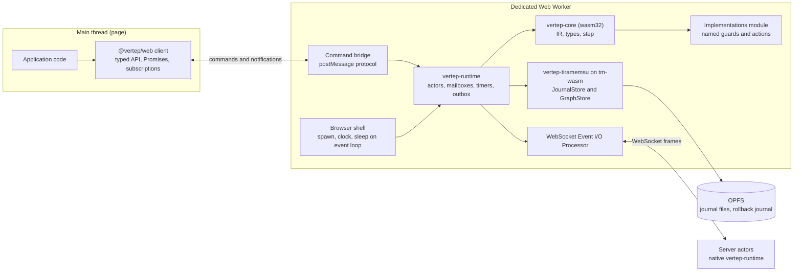
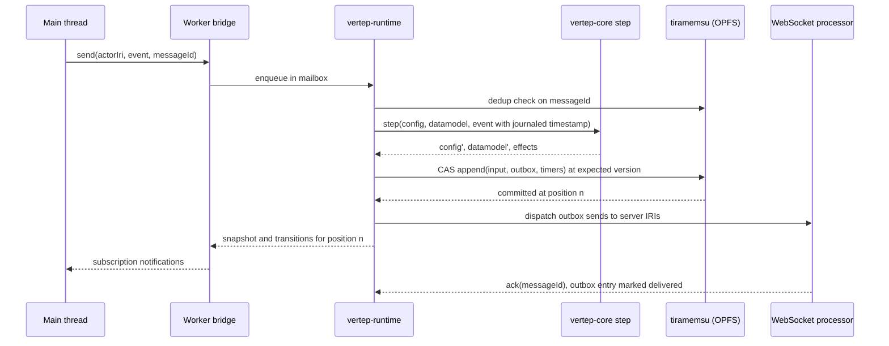

## Context

The motivation is in proposal.md (Why). This design rests on the following state of the system:

- **The core.** `vertep-core` is `no_std + alloc`. It contains the IR, the type language, the `Datamodel` trait and a pure `step(config, datamodel, event) -> (config', datamodel', effects)` with no I/O. See [[decisions#No-std core and tokio shell]].
- **The runtime.** `vertep-runtime` reaches the platform only through a small runtime trait: spawn, clock and sleep. The tokio shell is its first implementation.
- **The journal.** Actors are event-sourced. The journal records accepted inputs with message ids, timers are journal entries, and replay is deterministic. See [[decisions#Event-sourced actors]].
- **Storage.** Storage is `JournalStore` plus `GraphStore`, and tiramemsu implements both. See [[decisions#Two storage traits with tiramemsu as default]].
- **Tiramemsu in the browser.** Tiramemsu already runs in WebAssembly on its `tm-wasm` host:
  - SQLite runs on `sqlite-wasm-rs`, with either a memory VFS or the OPFS sync-access-handle pool VFS.
  - Every call is synchronous, so it must live in a dedicated worker.
  - It supports only a rollback journal (no WAL, no reader pool).
  - `wasm32-unknown-unknown` has no `std::time::Instant`, so budgets and cancellation are refused.
  - The file format equals the native one, so files move between browser and native unchanged.
- **One writer per file.** A tiramemsu file has one writer, see [[constraints#Tiramemsu has a single writer per file]]. OPFS sync access handles are exclusive, too.

## Goals / Non-Goals

**Goals:**
- The browser and Node.js run the identical core and the identical journal semantics. Native and WebAssembly traces are byte-for-byte comparable.
- No API call blocks the main thread.
- Journals are portable between the browser and native runtimes.
- TypeScript users get the same type safety that `statechart!` gives Rust users.
- The bundle size stays small enough for ordinary web applications.

**Non-Goals:**
- **Running XState machine configurations, or matching XState behaviour where it departs from SCXML.** An XState importer is a separate dialect importer and not part of this change.
- **A cluster or federation runtime in the browser.** A browser is a client of server actors over WebSocket. It doesn't host shards, membership or DID mediators.
- **Durable native file storage in Node.js.** Node.js uses `memory` storage with file import and export. Durable server-side actors use the native Rust runtime.
- **Multi-tab sharing of one durable store.** One worker owns a store. Coordination between tabs goes through messages, not a shared journal.
- **Budgets and cancellation of storage calls inside the worker.** The target has no monotonic `Instant`.

## Decisions

### D1. One worker hosts the core, the shell and the journal

The entire actor system runs in a single dedicated Web Worker: core, shell, storage and implementations. The main thread holds a thin TypeScript client that sends commands and receives notifications through `postMessage`.

- **Why:** tiramemsu's WASM host is synchronous and its OPFS VFS needs a dedicated worker. A step must call guards and actions synchronously, so the implementations must be in the same thread as the core.
- **Alternatives rejected:**
  - Core on the main thread with storage in a worker. Every journal append would become an async round trip inside a macrostep, which breaks run-to-completion.
  - A SharedWorker. OPFS sync access handles are unavailable there.



### D2. The browser shell implements the existing runtime trait

The browser shell makes the following mappings:

| Runtime operation | Browser implementation |
|---|---|
| `spawn` | `wasm-bindgen-futures::spawn_local` |
| `sleep` | a `setTimeout` future |
| `clock` | `Date.now()`, read only by the shell when it stamps a journal entry |

On Node.js, the same calls map to worker-thread equivalents.

- **Why:** the decision to keep the shell behind a trait exists exactly for this. No `cfg(target_arch)` appears in `vertep-core`, and only the shell crate differs.
- **Alternative rejected:** tokio on wasm. Its single-threaded runtime does not integrate with the browser event loop or timers.

### D3. Implementations are a module imported by the worker

Applications give the actor system a module URL. The module exports named guards and actions, much like XState's `setup({ guards, actions })`. The worker imports it at start, and the `rust`-style named-function registry resolves guard and action IRIs to those JavaScript functions.

- Guards must be pure. This is a documented contract, and a development mode replays every macrostep twice and reports any divergence.
- **Why:** functions can't cross `postMessage`, and steps must call them synchronously.
- **Alternative rejected:** serializing guards as CEL only. CEL charts work and need no module, but forcing them would make the JavaScript API much weaker than the Rust one.

### D4. Storage is explicit, exclusive and native-format

The storage choice is `{ storage: "opfs" | "memory" }`, with no default fallback.

- An `opfs` store first takes a Web Lock named after the store path, and only then opens the VFS. A second holder gets `StoreLocked` instead of hanging or corrupting the file.
- Journals use tiramemsu's rollback journal mode.
- Export and import use tiramemsu's `exportFile` and `importFile`, so a browser journal opens natively unchanged.
- **Why:** tiramemsu already refuses a silent journal-mode fallback. Vertep applies the same rule to storage kinds, and the single-writer constraint makes exclusivity mandatory.



### D5. TypeScript is one more projection of the type language

`vt gen ts <chart>` emits a `.ts` module with:
- the event union, with typed payloads
- the context interface
- the state-identifier union
- a typed `createActor` overload

The generator projects from the same IR types as the Rust, JSON Schema, SHACL and CEL projections. A property test checks that the TypeScript and JSON Schema projections accept the same values. See [[decisions#One IR type language]].
- **Alternative rejected:** deriving TypeScript from JSON Schema with a third-party generator. It loses tagged unions and named types.

### D6. Ergonomics follow XState and semantics follow SCXML

The API borrows familiar names: `createActorSystem`, `spawn`, `send`, `request`, `subscribe`, `getSnapshot`, `matches` and `can`. Execution is exactly the core `step`, see [[decisions#SCXML semantics are normative]].

- `can(event)` is evaluated by a side-effect-free selection of enabled transitions in the core. It is not journaled.
- `request` is the external blocking-style ask from [[decisions#Non-blocking request and deferred events]], exposed as a Promise on the main thread. Charts themselves keep using `vt:request`.

```ts
import { createActorSystem } from "@vertep/web";
import { orderChart, type OrderEvent } from "./order.chart"; // generated by `vt gen ts order.scxml`

const system = await createActorSystem({
  storage: "opfs",
  path: "/vertep/app.db",
  implementations: new URL("./order.impl.js", import.meta.url),
  transports: { websocket: { url: "wss://api.example.com/vertep", credentials: () => getToken() } },
});

const order = system.virtual(orderChart, "order-8f3a");      // activated on first message
order.subscribe((s) => render(s.matches("checkout.payment"), s.context.total));

await order.send({ type: "item.add", sku: "A-17", qty: 2 });  // typed: OrderEvent
const receipt = await order.request({ type: "pay", method: "card" }, { timeoutMs: 10_000 });

const before = await order.asOf({ position: 3 });             // read-only time travel
const history = await order.journal({ from: 0 });
```

### D7. WebSocket is a transport and an Event I/O Processor

The WebSocket processor carries Vertep message envelopes: target IRI, origin IRI, message id, event name and payload. It also carries acknowledgements.

- Unacknowledged outbox entries are redelivered after a reconnect, and receivers deduplicate by message id. That gives effectively-once processing on both sides, as in [[decisions#Event-sourced actors]].
- Credentials come from an application-supplied provider. DID-authenticated envelopes from the federation capability can wrap the same frames later, without changing the processor.
- **Alternative rejected:** HTTP long polling as the primary transport. It adds latency and has no server push.

### D8. Separate packages keep the budget

| Package | Contents |
|---|---|
| `@vertep/web` | core, shell, `null`, `rust`-style named-function registry, CEL datamodel and client |
| tiramemsu SQLite module | lazy-loaded the first time an `opfs` or journaled `memory` store opens |
| `@vertep/dm-ecma` | the boa ECMAScript datamodel |

CI enforces the budget with gzip measurements of the built artifacts. The budget numbers are in the spec.
- **Alternative rejected:** one package with everything. boa alone would exceed the storage-free budget.

## Risks / Trade-offs

- **[OPFS sync access handles vary across browsers and versions]** → Probe capabilities at open, fail with `StorageUnavailable`, and run the conformance and storage tests in headless Chrome in CI. Firefox and Safari smoke tests come before the 1.0 release.
- **[JavaScript guards may be impure and break replay]** → Document the contract. A development mode double-steps and reports divergence. CEL guards are recommended for charts that LLMs write.
- **[Size budget pressure from SQLite]** → Lazy-load the storage module, and let storage-free `memory` actors skip it entirely.
- **[Rollback journal on OPFS is slower than native WAL]** → Batch outbox and timer entries into the same append as their input. One append per macrostep is the expected upper bound.
- **[Clock skew between browser and server]** → Timestamps are journaled facts from each side, not ordering keys. Cross-actor ordering never relies on them.
- **[A crashed worker leaves a held Web Lock]** → Web Locks are released when the holding worker terminates. The open path retries once after a lock is released.

## Migration Plan

This change is additive: no existing API or journal format changes. Release order:
1. `vertep-wasm` builds in CI.
2. Conformance passes in Chrome and Node.js.
3. npm packages are published with `next` tags.
4. `latest` follows once the size budget and the storage round-trip tests hold.

Rollback means unpublishing the `next` tag. Journals stay readable natively because the format is shared.

## Open Questions

- The exact Node.js minimum version beyond "current active LTS" is decided when the first release is cut.
- The npm scope name (`@vertep`) is assumed and has to be checked for availability before publishing.
