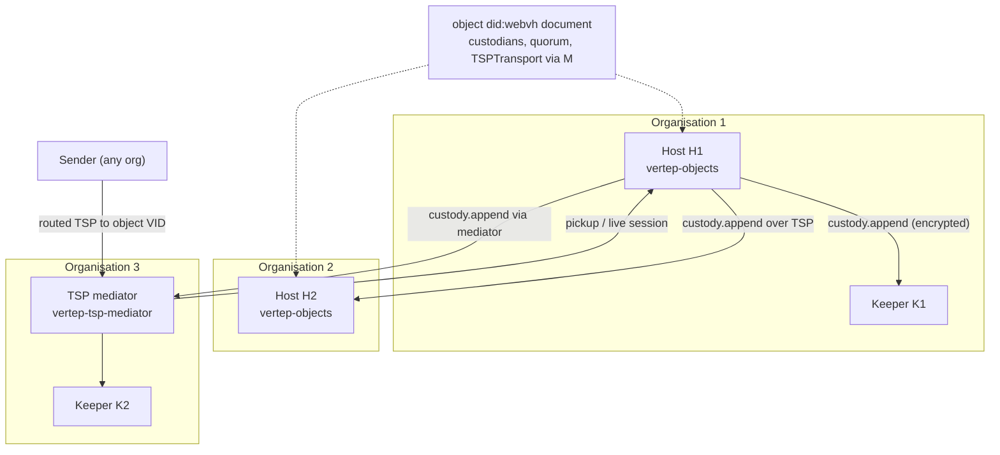
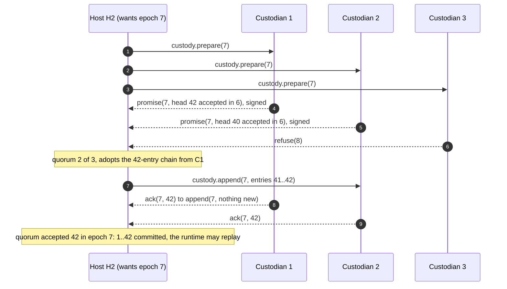

## Context

See proposal.md for the motivation. These facts about the current code shape the design:

- **Journal.** `vertep-store`'s `JournalStore` already gives compare-and-set appends, fencing epochs and message deduplication. State changes travel in the append. Durable timers live in the current-state graph.
- **Agents.** The agent host journals every external answer as an `AgentInput`. Its `AgentJournal` trait has only `MemoryJournal`.
- **Replication.** `vertep-cluster/src/replication.rs` (`ReplicatedJournal`, `StandbyReplica`) already implements:
  - suffix shipping;
  - "a standby's fence rises only with entries it stores";
  - "unreplicated entries stay unreadable until the quorum catches up".

  It assumes a trusted cluster, and its epochs come from a membership authority (gossip, etcd, Kubernetes).
- **TSP.** `vertep-federation/src/tsp.rs` implements TSP direct, nested and routed modes on `tsp_sdk` 0.16, plus `forward_routed` for an intermediary hop. `net.rs` has `DropBox` and `PickupSource`. `testkit.rs` has a test-only TSP intermediary. There is no TSP pickup client and no production intermediary.
- **TSP 1.0** (ToIP TSWG, Release 1.0) has these properties:
  - It defines direct, nested and routed modes and the relationship-forming control messages (`TSP_RFI`, `TSP_RFA`, `TSP_RFD`).
  - It requires neighbour relationships along a route (§5.3). The last intermediary must have one with the receiver.
  - It says intermediaries MUST NOT persist nested inner VIDs, and that "TSP provides no delivery guarantee".
  - It defines no mailbox, pickup or acknowledgement.

## Goals / Non-Goals

**Goals:**

- Safety holds under crash faults, partitions, arbitrary message delay and clock skew. Safety means one writer per epoch, and no committed entry is lost.
- Liveness holds whenever a quorum of custodians and one host are reachable.
- A malicious or faulty custodian is detected, never trusted: replicas are verifiable, keepers cannot read, and equivocation leaves evidence.
- A TSP mediator that conforms to TSP 1.0 routed mode, adds store-and-forward, and can be deployed by anyone.
- Reuse the journal, replication and federation code. `vertep-core` is unchanged.

**Non-Goals:**

- Byzantine fault *tolerance* among hosts. A host holding a valid epoch can equivocate. We detect it and let the controller remove that host, but we do not run BFT consensus. Keepers can withhold data but cannot forge it.
- A global ledger, blockchain anchoring or token economics.
- An API compatible with Cloudflare Durable Objects. "Durable object" names the concept: one addressable, single-writer, persistent entity.
- A DIDComm mediator. DIDComm stays client-only, against third-party mediators.
- Standardising the pickup protocol at ToIP. It is versioned so it can be proposed later.

## Decisions

### D1. A durable object is a DID virtual actor with a verifiable journal
A durable object is a virtual actor with a `did:webvh` identity, whose journal entries are hash-chained and signed. A storage API outside the chart was rejected: state stays the chart's datamodel, written only by journaled turns, so replay, Lean certificates and time travel keep working unchanged.

- motivated_by: [[decisions#Event-sourced actors]], [[decisions#State changes travel in the append]], [[decisions#Identity, mailbox and transport layers]].
- `did:webvh` is used because the custodian set and endpoints must change without changing the address. `did:key` and `did:peer` cannot do that.

### D2. Entries are hash-chained and host-signed; the chain covers the canonical entry
Each entry carries `prev` (the previous entry's hash), the object DID, position, epoch, the writer's host DID, its own content hash and a signature over that hash. All of these are `vt:` statements inside the entry graph (`vt:actor`, `vt:position`, `vt:custodyEpoch`, `vt:writer`, `vt:previousEntryHash`, `vt:entryHash`, `vt:entrySignature`), so every journal store round-trips them with no store change.

The content hash is SHA-256 over the canonical form of the graph without the hash, signature and `rdf:type vt:JournalEntry` statements. The canonical form is the sorted set of N-Triples lines. Runtime entries have no blank nodes, so this is a sort; an entry with blank nodes is first relabelled with RDFC-1.0, so a store that renames blank nodes keeps the hash.

*Refined during implementation:* the plan carried the metadata in `AppendMeta` and hashed JCS JSON. Statements in the graph avoid a store change, and journal entries are RDF, not JSON.

Alternatives considered:

- A Merkle-tree transparency log: rejected for now, because a chain is enough to verify a replica end to end. Signed checkpoints can add Merkle proofs later.
- RDFC-1.0 on every entry: rejected as too slow per turn. It is used only when blank nodes are present.

Signing goes through the key manager (motivated_by: [[decisions#Keys stay behind a key manager]]).

### D3. Custody epochs are won by quorum promises, not leases
A host becomes writer of epoch `e` by sending `custody.prepare(e)` to every custodian. Each custodian answers with a signed `custody.promise(e, head, accepted_epoch, config)`, or `custody.refuse(e_max)`. `accepted_epoch` is the epoch of the last append the custodian accepted.

- With a quorum of promises, the host adopts the chain accepted in the highest epoch (then the longest), and the custody configuration that came with it.
- It then ships the adopted chain to the custodians under epoch `e`.
- An entry is committed when a quorum has accepted, in one epoch, a journal containing it. Inherited entries are therefore committed once a quorum re-accepts them in `e`.
- Batches always run to the writer's head, so every custodian that accepted in `e` holds the writer's adopted chain.

This is single-decree Paxos over the whole log (ballot = epoch, accepted value = the custodian's chain). It closes Raft's "commit from an older term" hole without an extra entry. Entries keep the epoch they were *written* in for signature checks; the accepted epoch is custodian state.

*Refined during implementation:* the plan used a Raft-style epoch-start entry carrying the promises. Runtime replay decodes every entry as a turn, so custody bookkeeping cannot live in the object's chain. Promises are recorded in the lineage graph instead (D-lineage in `durable-objects`).

Alternatives rejected:

- Leases from an etcd or Kubernetes authority, as M4 does: they need a shared authority.
- Time-based leases: [[constraints#Clock skew beyond the safety margin breaks lease exclusivity]].
- Controller-only appointment: the controller would become a single point of liveness.
- Blockchain anchoring: latency and cost, and not needed for single-writer safety.

This decision reuses [[decisions#Fencing epochs on journal appends]] and [[decisions#A standby's fence rises only with entries it stores]]. It does **not** use [[decisions#Leases with fencing epochs from the membership authority]].

Here C3 refused because it had already promised epoch 8 to another host. That host's appends at epoch 8 will fence H2 at C1 and C2. Safety holds either way. Liveness needs back-off: a randomised, growing retry delay before raising the epoch.

### D4. Replication rides TSP between host and custodian VIDs; cluster replication is generalised
The replication logic in `vertep-cluster` is factored over a `ReplicaLink` trait with QUIC (cluster) and TSP (custody) implementations. Custody messages are application messages inside the TSP relationship between the writer's host VID and the custodian's VID. They use the protocol-neutral envelope, with types under `https://w3id.org/vertep/custody/1.0#`:

- `prepare`, `promise`, `refuse`;
- `append`, `ack`;
- `read`, `entries`.

Custodians behind NAT or offline are reached through their TSP mediator, like any TSP party.

- Alternative rejected: a separate custody protocol over HTTP or gRPC. It would duplicate authentication and encryption that TSP already gives and would bypass grants.
- motivated_by: [[decisions#TSP before DIDComm across trust boundaries]], [[decisions#TSP direct when reachable, routed otherwise]].

### D5. Keepers store ciphertext; hosts share a per-object content key
Each object has a content key. It is wrapped (HPKE) to every host's key-agreement key and recorded in a custody entry. Each entry is split into:

- a clear header: DID, position, epoch, `prev`, signature over header and ciphertext hash;
- a ciphertext body.

Hosts store bodies decrypted (or re-encrypted at rest at their own choice). Keepers store the ciphertext as it is. Removing a host rotates the content key for later entries. Earlier entries stay readable to the removed host; this is recorded as a known limit.

- Alternative rejected: trusting every custodian with clear state. That would make keepers as trusted as hosts and defeat third-party storage.

### D6. Equivocation is evidence, not a fault the protocol absorbs
Two validly signed entries with the same (object, epoch, position) and different hashes are a proof. The custodian journals both into its own graph, refuses further entries from that epoch, and sends `custody.evidence` to the controller's service endpoint. The controller removes the host by reconfiguration (D7).

A different entry at the same position from a *higher* epoch is not equivocation. It is the normal replacement of an uncommitted tail.

### D7. Custodian set changes travel as replicated custody state
A controller-signed reconfiguration request changes the custody configuration (version, custodians, quorum). Every append batch carries the configuration, and custodians accept it with the journal under the writer's epoch. The change takes effect once a quorum of the old set has accepted it and the new custodians hold the committed chain. The writer then updates the `did:webvh` log. The custody state is authoritative, and the DID document is used for discovery.

Promises carry the configuration the custodian accepted, so a candidate adopts the configuration accepted in the highest epoch, as it does for the chain. When that configuration is newer than the one it prepared with, it prepares again with the new set. Changes are single-step: one at a time, each accepted before the next. Raft-style joint consensus was rejected as unnecessary at this rate of change.

*Refined during implementation:* the plan wrote the change as a journal entry, which runtime replay cannot decode.

### D8. Durable agent journal over `JournalStore`
`StoreAgentJournal` stores each `AgentInput` as a journal entry of the agent's actor, using compare-and-set at `head + 1`, with the same JSON text `MemoryJournal` keeps. `AgentHost::builder` keeps `MemoryJournal` as the default for tests and accepts a store-backed journal. An agent declared as a durable object gets the custody journal (D3), which is a `JournalStore`.

motivated_by: [[decisions#The agent host journals agent inputs]].

### D9. Vertep ships its own TSP mediator
A new crate `vertep-tsp-mediator` (library and `vt-mediator` binary) supersedes, for TSP only, the M5 design non-goal "Vertep is a client of existing mediators and intermediaries". The reasons:

- TSP 1.0 defines no store-and-forward.
- No TSP mediator exists that we can depend on. The reference implementation's intermediary routes only.
- Durable objects need a mailbox that works while every host is offline.

DIDComm stays client-only against third-party mediators (motivated_by: [[decisions#Remote mediators through Pickup 3.0]]).

### D10. Pickup is a versioned Vertep protocol inside TSP
After a TSP relationship (`TSP_RFI` and `TSP_RFA`) between a VID and the mediator, these application messages carry the protocol, with types under `https://w3id.org/vertep/tsp/mailbox/1.0#`:

- `register`, `registered`, `unregister`;
- `status`;
- `deliver`, plus the `batch` reply;
- `received`;
- `live` (session open).

Registration creates the neighbour relationship that TSP §5.3 requires between the last intermediary and the receiver. Senders then route with the mediator as the last hop, as published in the recipient's `TSPTransport` service.

The semantics deliberately mirror DIDComm Message Pickup 3.0, so `RelayMailbox` and `PickupBinding` stay protocol-neutral. The TSP pickup client is one more `PickupSource`.

Alternatives rejected:

- HTTP polling outside TSP: unauthenticated by TSP, and it leaks who picks up.
- Holding messages inside the TSP layer by abusing relationship control messages: not allowed by the spec.

### D11. The mediator stores opaque sealed bytes in its own journal
The bytes are the message the mediator would have delivered as the last hop (`forward_routed`'s re-sealed output). They are stored per recipient VID in an event-sourced mailbox journal (`MailboxStore`) over any journal store: tiramemsu shard files by default, one writer per file. Every change (registration, stored, received, expired, revoked) is an entry, and replay rebuilds the mailboxes on start. The mediator accepts from the previous hop (HTTP 2xx) only after the append. It deletes on `received`.

Its message id is a SHA-256 digest of the message as the previous hop posted it. The re-sealed bytes differ on every retry, so this is what makes a retried post stored once. Acknowledged ciphertext stays in the journal history until `vt-mediator compact` rewrites the store with live messages only. The receiver deduplicates by the envelope's own message id, inside the ciphertext.

For a replicated deployment, mailboxes are sharded by recipient VID and replicated with M4 standby replication inside the operator's trusted cluster (motivated_by: [[decisions#Optional standby journal replication]]).

Metadata kept follows the tsp-mediator spec's metadata-minimisation requirement and TSP's rule on inner VIDs.

### D12. Live delivery is a WebSocket binding of the same protocol
A `live` request upgrades to a WebSocket session on which the mediator pushes `batch` messages. The client answers with `received`. The same binding serves the DIDComm mailbox's live mode (Pickup 3.0 `live-delivery-change`), closing M5's open "live delivery over WebSocket" item. The binding reuses `vertep-runtime`'s WebSocket transport.

### D13. One object VID, shared by its hosts; only the writer acknowledges pickups
The object's TSP private keys are held by every host's key manager, wrapped like the content key. Any host can open messages addressed to the object. Only the current writer journals and acknowledges them, and non-writers never acknowledge. Rotation on host removal uses `did:webvh` key rotation.

Alternative rejected: one VID per host with a routing indirection. Senders would then have to follow custody changes.

## Constraints

- **TSP 1.0 provides no delivery guarantee and no store-and-forward.**
  - Binds: D9, D10, [[openspec:relay-mailboxes#TSP Mediator Mailbox]] (must).
  - Source: ToIP TSP Release 1.0, §5 and the section on metadata exposure and intermediaries.
- **TSP intermediaries must not persist nested inner VIDs.**
  - Binds: D11 and the tsp-mediator spec's metadata-minimisation requirement (must).
  - Source: TSP 1.0 §5.4.
- **TSP routing needs neighbour relationships, including last intermediary to receiver.**
  - Binds: D10 registration (must).
  - Source: TSP 1.0 §5.3.
- **Relays deliver at least once** (existing): receivers deduplicate by message id (must).
- **Clock skew breaks lease exclusivity** (existing): binds D3, so no time in custody decisions (must).
- **Tiramemsu has a single writer per file** (existing): binds D11. The mediator runs one writer per shard file (must).
- **`did:webvh` updates are signed by update keys and published by the DID's web host.**
  - Binds D7: publishing the custodian set depends on a reachable web host, while custody itself does not (should).
  - Source: DIF did:webvh spec.

## Risks / Trade-offs

- [Duelling candidates delay failover] → randomised exponential back-off and a preferred-host order taken from the DID document. Only liveness is affected, never safety.
- [Equivocating host before removal] → keepers and hosts refuse the epoch as soon as they see evidence. The controller acts out of band. A BFT mode is a later change.
- [Removed host keeps read access to old entries] → documented. Rotate the content key on removal, and re-encrypt history only by explicit operator action.
- [`did:webvh` web host offline blocks discovery of a changed set] → custody keeps working from the journal. Senders use cached documents, and the mediator route still works.
- [Mediator is a metadata observer: who receives, when, how much] → minimisation by construction, padding (TSP padding messages) left to clients, and multiple mediators selectable per actor.
- [Latency: each turn waits for a cross-organisation quorum] → objects choose their custodian set, so a set of one or a same-region quorum gives local latency. Batching appends per turn is already the rule.
- [`tsp_sdk` pre-1.0 API churn] → pinned version, behind feature `tsp`, with interop tests against the reference intermediary and wallet.

## Migration Plan

- Additive. Existing virtual actors, cluster replication and M5 relays are unchanged.
- `ReplicaLink` is a refactor of `vertep-cluster`, gated by its existing fault-injection tests and Lean lease replay.
- The durable agent journal is opt-in, and `MemoryJournal` stays the default.
- Rollback: disable feature `objects` and stop `vt-mediator`. Stored mailboxes remain readable by a later version.

## Open Questions

- Canonical form for the pickup and custody payloads: JSON in the TSP generic payload (simplest, chosen for now), or CESR-native. This doesn't change the specs.
- Whether to submit the pickup protocol to the ToIP TSWG as a TSP extension once it has interop users.
- Merkle checkpoints for fast partial verification of long journals (D2 leaves room).
