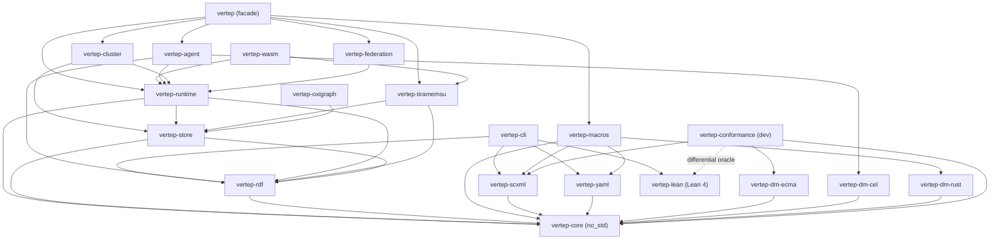

# Components

The crates of the Vertep workspace and the Lean package, what each provides, what it uses and which decisions it realizes; each crate depends only on crates below it.

## vertep-core

The `no_std` heart: the chart IR, the type language, the `Datamodel` trait and the pure `step` function; no I/O, no async, no allocator beyond `alloc`.

- provides:: [[capabilities#Chart model]] {confidence: full}
- provides:: [[capabilities#SCXML interpretation]] {confidence: full}
- provides:: [[capabilities#Datamodel]] {confidence: partial, note: "trait, null datamodel and system variables"}
- provides:: [[capabilities#Type system]] {confidence: partial, note: "type language and checker; projections live in vertep-rdf and vertep-macros"}
- realizes:: [[decisions#IR is the hub]]
- realizes:: [[decisions#SCXML semantics are normative]]
- realizes:: [[decisions#No-std core and tokio shell]] {confidence: partial, note: "the core half"}
- scheduled_in:: [[roadmap#M0 SCXML core]]

Implemented 2026-11-11: `validate`, `order`, `compile` (states numbered in document order, root 0, an in-crate bitset), the pure Appendix D `kernel`, `session::{start, step}` with effects, the `null` datamodel and registry, and the `tape`/`trace` exchange format for the Lean oracle, following [[decisions#Appendix D readings in the Rust core]].

## vertep-scxml

SCXML 1.0 XML reader and writer to and from the IR, with `vt:` extension attributes and a loss report for unsupported constructs.

- provides:: [[capabilities#SCXML format]] {confidence: full}
- uses:: [[components#vertep-core]] {kind: required}
- scheduled_in:: [[roadmap#M0 SCXML core]]

Implemented 2026-11-11 on quick-xml: reader with spans, recoverable errors, `vt:` and foreign extensions, a caller-supplied `SourceResolver` and a `DatamodelSet` of registered names; writer; strict mode over a loss report that separates content losses from formatting losses. Every IRP chart and generated charts round-trip.

IR gaps it reports as losses, to close before the IR is frozen for M1: no extension slot on `<datamodel>`, executable-content blocks, `donedata`, `param`, `content`, `elseif`/`else` and the top-level script; inline content cannot tell text from XML; `<content src>` must be inlined; the xpath `<assign type attr>` form (optional IRP tests 474–480, 483) is not representable.

## vertep-dm-ecma

The `ecmascript` datamodel on the boa engine, behind a cargo feature, used for SCXML conformance and imported real-world charts.

- provides:: [[capabilities#Datamodel]] {confidence: partial, note: "ecmascript implementation"}
- uses:: [[components#vertep-core]] {kind: required}
- realizes:: [[decisions#Pluggable datamodel]] {confidence: partial}
- scheduled_in:: [[roadmap#M0 SCXML core]]

Implemented 2026-11-11 on boa 0.22 with Intl and Temporal off and the time zone pinned to UTC. Guards run in a `with` over a proxy view whose write traps throw; debug builds also snapshot-compare every guard. `Math.random` is SplitMix64 seeded per input and `Date` reads the input time. Snapshots keep script-defined functions and classes as source; values that cannot be captured make restore fail loudly.

Known limits: in release builds a script-defined function called from a guard can still mutate through its closure; boa compiles functions before later global `let` declarations are visible to them; there is no DOM, so XML `<data>` content is a string.

## vertep-rdf

The `vt:` ontology modules, IR to RDF 1.2 and back, SHACL shapes, RDFC-1.0 canonical hashing and chart version IRIs.

- provides:: [[capabilities#Chart RDF]] {confidence: full}
- provides:: [[capabilities#Runtime ontology]] {confidence: full}
- provides:: [[capabilities#Type system]] {confidence: partial, note: "SHACL projection of types"}
- uses:: [[components#vertep-core]] {kind: required}
- realizes:: [[decisions#Modular vt ontology on RDF 1.2]]
- realizes:: [[decisions#Content-addressed chart versions]] {confidence: partial, note: "hashing; pinning lives in vertep-runtime"}
- scheduled_in:: [[roadmap#M0 SCXML core]]

## vertep-lean

The Lean 4 package on LeanRDF: the IR, types, `step`, journal protocol and decider safety as definitions with proofs, an executable oracle and the `vt certify` checker.

- provides:: [[capabilities#Formal model]] {confidence: full}
- realizes:: [[decisions#Lean verification bridge]]
- scheduled_in:: [[roadmap#M0 SCXML core]]

First phase landed 2026-11-11 on Lean v4.35.0 and LeanRDF `b407b97`: the IR, `WellFormed` with a proven decision procedure, compile and the Appendix D kernel mirroring Rust, the executable `step` over an answer tape, and proofs of step determinism, transition selection and dynamic type soundness. `scripts/check.sh` gates `sorry` and axioms. See [[decisions#Configuration well-formedness proof is pending]].

## vertep-conformance

A dev-only harness that runs the W3C SCXML IRP suite on the Rust core and on the Lean model, and the property-based differential tests between them.

- provides:: [[capabilities#SCXML conformance]] {confidence: full}
- uses:: [[components#vertep-core]] {kind: dev}
- uses:: [[components#vertep-scxml]] {kind: dev}
- uses:: [[components#vertep-dm-ecma]] {kind: dev}
- uses:: [[components#vertep-lean]] {kind: dev, note: "the oracle binary"}
- uses:: [[components#vertep-testkit]] {kind: dev}
- scheduled_in:: [[roadmap#M0 SCXML core]]

The suite under `suite/` comes from [[decisions#IRP suite from a pinned mirror]]: 236 ECMAScript charts and one `null` chart, checked by `scripts/check-suite-hash.sh`.

## vertep-testkit

Test-only proptest generators for charts, shared by the SCXML, YAML and RDF round-trip tests and the differential conformance tests.

- uses:: [[components#vertep-core]]
- scheduled_in:: [[roadmap#M0 SCXML core]]

## vertep-yaml

The YAML chart surface, mapped one to one onto the IR, with a `types:` block.

- provides:: [[capabilities#YAML format]] {confidence: full}
- uses:: [[components#vertep-core]] {kind: required}
- scheduled_in:: [[roadmap#M1 Typed authoring]]

## vertep-dm-rust

The `rust` datamodel: typed context structs and named guard and action functions registered by IRI.

- provides:: [[capabilities#Rust DSL]] {confidence: partial, note: "runtime half of the DSL"}
- uses:: [[components#vertep-core]] {kind: required}
- realizes:: [[decisions#Pluggable datamodel]] {confidence: partial}
- scheduled_in:: [[roadmap#M1 Typed authoring]]

## vertep-dm-cel

The CEL datamodel: side-effect-free, terminating expressions type-checked against the chart's type environment.

- provides:: [[capabilities#CEL datamodel]] {confidence: full}
- uses:: [[components#vertep-core]] {kind: required}
- realizes:: [[decisions#Pluggable datamodel]] {confidence: partial}
- scheduled_in:: [[roadmap#M1 Typed authoring]]

## vertep-macros

The `statechart!` and `include_chart!` procedural macros: they build the IR at compile time, run its checks and emit typed Rust state, event and context APIs.

- provides:: [[capabilities#Rust DSL]] {confidence: partial, note: "compile-time half of the DSL"}
- provides:: [[capabilities#Type system]] {confidence: partial, note: "Rust projection of types"}
- uses:: [[components#vertep-core]] {kind: required}
- uses:: [[components#vertep-scxml]] {kind: required}
- uses:: [[components#vertep-yaml]] {kind: required}
- uses:: [[components#vertep-dm-rust]] {kind: required}
- realizes:: [[decisions#One IR type language]]
- scheduled_in:: [[roadmap#M1 Typed authoring]]

## vertep-store

The storage traits `JournalStore` and `GraphStore`, their contracts and a shared conformance test kit every backend must pass.

- provides:: [[capabilities#Storage]] {confidence: partial, note: "traits and test kit"}
- uses:: [[components#vertep-core]] {kind: required}
- uses:: [[components#vertep-rdf]] {kind: required}
- realizes:: [[decisions#Two storage traits with tiramemsu as default]] {confidence: partial}
- scheduled_in:: [[roadmap#M2 Actor runtime]]

## vertep-tiramemsu

The default backend: one tiramemsu file per shard implements both `JournalStore` and `GraphStore`, with `now()` as the current-state graph and `as_of` as time travel.

- provides:: [[capabilities#Storage]] {confidence: partial, note: "default backend"}
- uses:: [[components#vertep-store]] {kind: required}
- uses:: [[components#vertep-rdf]] {kind: required}
- realizes:: [[decisions#Two storage traits with tiramemsu as default]] {confidence: partial}
- scheduled_in:: [[roadmap#M2 Actor runtime]]

## vertep-oxigraph

A `GraphStore` adapter for Oxigraph and for any SPARQL 1.1 endpoint, including the RDF 1.1 reification fallback.

- provides:: [[capabilities#Storage]] {confidence: partial, note: "second GraphStore backend"}
- uses:: [[components#vertep-store]] {kind: required}
- scheduled_in:: [[roadmap#M2 Actor runtime]]

## vertep-runtime

The tokio shell: actors and lifecycle classes, mailboxes, transports, the directory, the event journal driver, durable timers, chart version pinning and migrations.

- provides:: [[capabilities#Actor model]] {confidence: full}
- provides:: [[capabilities#Messaging]] {confidence: full}
- provides:: [[capabilities#Event journal]] {confidence: full}
- provides:: [[capabilities#Durable timers]] {confidence: full}
- provides:: [[capabilities#Chart versioning]] {confidence: full}
- uses:: [[components#vertep-core]] {kind: required}
- uses:: [[components#vertep-store]] {kind: required}
- uses:: [[components#vertep-rdf]] {kind: required}
- realizes:: [[decisions#SCXML-native actors with vt extensions]]
- realizes:: [[decisions#IRI identity and lifecycle classes]]
- realizes:: [[decisions#Identity, mailbox and transport layers]]
- realizes:: [[decisions#Event-sourced actors]]
- realizes:: [[decisions#Non-blocking request and deferred events]]
- realizes:: [[decisions#No-std core and tokio shell]] {confidence: partial, note: "the shell half"}
- scheduled_in:: [[roadmap#M2 Actor runtime]]

## vertep-agent

Agents on charts: `vt:decide` and the `Decider` trait, LLM and tool actors, capability grants and LLM-written plan charts.

- provides:: [[capabilities#Deciders]] {confidence: full}
- provides:: [[capabilities#LLM actors]] {confidence: full}
- provides:: [[capabilities#Plan charts]] {confidence: full}
- uses:: [[components#vertep-runtime]] {kind: required}
- uses:: [[components#vertep-dm-cel]] {kind: required}
- uses:: [[components#vertep-rdf]] {kind: required}
- realizes:: [[decisions#Deciders at choice points]]
- scheduled_in:: [[roadmap#M3 Agents]]

## vertep-cluster

Trusted clusters: the `Membership` trait and its implementations, shard leases and placement, the QUIC transport and worker pools.

- provides:: [[capabilities#Cluster membership]] {confidence: full}
- provides:: [[capabilities#Shard placement]] {confidence: full}
- provides:: [[capabilities#Cluster transport]] {confidence: full}
- provides:: [[capabilities#Worker pools]] {confidence: full}
- uses:: [[components#vertep-runtime]] {kind: required}
- uses:: [[components#vertep-store]] {kind: required}
- realizes:: [[decisions#Shard-based placement]]
- scheduled_in:: [[roadmap#M4 Cluster]]

## vertep-federation

Trust-boundary actors: DID identities and resolution, authenticated senders, grants, and DIDComm v2 and TSP mailboxes and transports.

- provides:: [[capabilities#DID identity]] {confidence: full}
- provides:: [[capabilities#Relay mailboxes]] {confidence: full}
- uses:: [[components#vertep-runtime]] {kind: required}
- realizes:: [[decisions#Identity, mailbox and transport layers]] {confidence: partial, note: "the cross-trust layers"}
- scheduled_in:: [[roadmap#M5 Federation]]

## vertep-wasm

The WebAssembly build of the core and a browser shell with a TypeScript API and a tiramemsu journal in OPFS.

- provides:: [[capabilities#WASM bindings]] {confidence: full}
- uses:: [[components#vertep-runtime]] {kind: required}
- uses:: [[components#vertep-tiramemsu]] {kind: required}
- scheduled_in:: [[roadmap#M6 WASM and JS]]

## vertep-cli

The `vt` command: convert between SCXML, YAML and RDF, validate and hash charts, run the conformance suite and call the Lean checker for certificates.

- uses:: [[components#vertep-scxml]] {kind: required}
- uses:: [[components#vertep-yaml]] {kind: required}
- uses:: [[components#vertep-rdf]] {kind: required}
- uses:: [[components#vertep-lean]] {kind: optional, note: "vt certify"}
- scheduled_in:: [[roadmap#M1 Typed authoring]]

## vertep

The facade crate an application depends on, re-exporting the other crates behind cargo features.

- uses:: [[components#vertep-runtime]] {kind: required}
- uses:: [[components#vertep-macros]] {kind: optional}
- uses:: [[components#vertep-tiramemsu]] {kind: optional}
- uses:: [[components#vertep-agent]] {kind: optional}
- uses:: [[components#vertep-cluster]] {kind: optional}
- uses:: [[components#vertep-federation]] {kind: optional}
- scheduled_in:: [[roadmap#M2 Actor runtime]]
