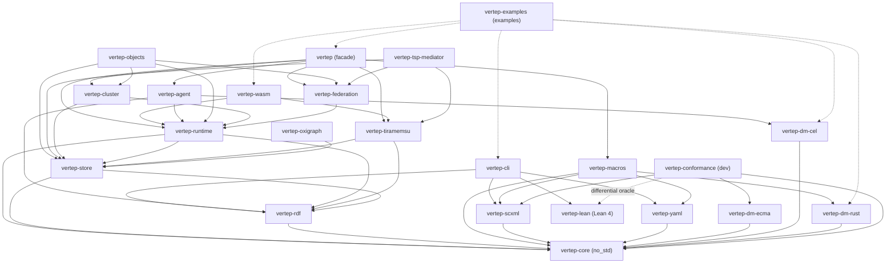

# Components

The crates of the Vertep workspace and the Lean package, what each provides, what it uses and which decisions it realizes; each crate depends only on crates below it.

## vertep-core

The `no_std` heart: the chart IR, the type language, the `Datamodel` trait and the pure `step` function; no I/O, no async, no allocator beyond `alloc`.

- provides:: [[capabilities#Chart model]] {confidence: full}
- provides:: [[capabilities#SCXML interpretation]] {confidence: full}
- provides:: [[capabilities#Datamodel]] {confidence: partial, note: "trait, null datamodel and system variables"}
- provides:: [[capabilities#Type system]] {confidence: partial, note: "type language and checker; projections live in vertep-rdf and vertep-macros"}
- realizes:: [[decisions#IR is the hub]]
- realizes:: [[decisions#SCXML semantics are normative]]
- realizes:: [[decisions#No-std core and tokio shell]] {confidence: partial, note: "the core half"}
- realizes:: [[decisions#Type checking stops on non-contractive recursion]] {confidence: full}
- realizes:: [[decisions#Verified origin flag in the event]] {note: "Event::originverified, set only by the federation shell"}
- realizes:: [[decisions#Hosts instantiate CEL charts typed]] {confidence: partial, note: "the registry's create_for and check, create_datamodel_for, Datamodel::check_event and admit"}
- scheduled_in:: [[roadmap#M0 SCXML core]]

Implemented 2026-11-11: `validate`, `order`, `compile` (states numbered in document order, root 0, an in-crate bitset), the pure Appendix D `kernel`, `session::{start, step}` with effects, the `null` datamodel and registry, and the `tape`/`trace` exchange format for the Lean oracle, following [[decisions#Appendix D readings in the Rust core]].

M1 type language added 2026-11-11 in `types`: a value checker with path-located errors, declarations validated for unknown names and unguarded cycles, event payload tables, and `check_chart`/`compile_checked` per [[decisions#Types ride on vt extension nodes]] and [[decisions#Datamodel typers plug into one core checker]]. Projections to RDF, JSON Schema, SHACL and CEL and content-addressed type IRIs are still open.

Added 2026-11-12 per [[decisions#Hosts instantiate CEL charts typed]]: `DatamodelRegistry::create_for(chart)` and `check(chart)` (defaults: create by name, refuse nothing; `WithNull` forwards both), `null::create_datamodel_for`, which hosts and `start_with_registry` use and which reports a refusal as `StartError::ChartRefused`, and `Datamodel::check_event` with `datamodel::admit`, which hosts call before stepping so an event whose payload fails its declared type becomes `error.execution`. The kernel does not call them, so the answer tape is unchanged.

## vertep-scxml

SCXML 1.0 XML reader and writer to and from the IR, with `vt:` extension attributes and a loss report for unsupported constructs.

- provides:: [[capabilities#SCXML format]] {confidence: full}
- uses:: [[components#vertep-core]] {kind: required}
- scheduled_in:: [[roadmap#M0 SCXML core]]

Implemented 2026-11-11 on quick-xml: reader with spans, recoverable errors, `vt:` and foreign extensions, a caller-supplied `SourceResolver` and a `DatamodelSet` of registered names; writer; strict mode over a loss report that separates content losses from formatting losses. Every IRP chart and generated charts round-trip.

IR gaps it reports as losses, to close before the IR is frozen for M1: no extension slot on `<datamodel>`, executable-content blocks, `donedata`, `param`, `content`, `elseif`/`else` and the top-level script; inline content cannot tell text from XML; `<content src>` must be inlined; the xpath `<assign type attr>` form (optional IRP tests 474–480, 483) is not representable.

## vertep-dm-ecma

The `ecmascript` datamodel on the boa engine, behind a cargo feature, used for SCXML conformance and imported real-world charts.

- provides:: [[capabilities#Datamodel]] {confidence: partial, note: "ecmascript implementation"}
- uses:: [[components#vertep-core]] {kind: required}
- realizes:: [[decisions#Pluggable datamodel]] {confidence: partial}
- scheduled_in:: [[roadmap#M0 SCXML core]]

Implemented 2026-11-11 on boa 0.22 with Intl and Temporal off and the time zone pinned to UTC. Guards run in a `with` over a proxy view whose write traps throw; debug builds also snapshot-compare every guard. `Math.random` is SplitMix64 seeded per input and `Date` reads the input time. Snapshots keep script-defined functions and classes as source; values that cannot be captured make restore fail loudly.

Known limits: in release builds a script-defined function called from a guard can still mutate through its closure; boa compiles functions before later global `let` declarations are visible to them; there is no DOM, so XML `<data>` content is a string.

## vertep-rdf

The `vt:` ontology modules, IR to RDF 1.2 and back, SHACL shapes, RDFC-1.0 canonical hashing and chart version IRIs.

- provides:: [[capabilities#Chart RDF]] {confidence: full}
- provides:: [[capabilities#Runtime ontology]] {confidence: full}
- provides:: [[capabilities#Type system]] {confidence: partial, note: "SHACL projection of types"}
- uses:: [[components#vertep-core]] {kind: required}
- realizes:: [[decisions#Modular vt ontology on RDF 1.2]]
- realizes:: [[decisions#Content-addressed chart versions]] {confidence: partial, note: "hashing; pinning lives in vertep-runtime"}
- realizes:: [[decisions#The agent ontology ships with vertep-rdf]] {note: "ontology/vt-agent.ttl and shapes/vt-agent-shapes.ttl"}
- scheduled_in:: [[roadmap#M0 SCXML core]]

Implemented 2026-11-11 on oxrdf 0.3 with RDF 1.2 and built-in RDFC-1.0 (86/86 W3C RDFC tests): a chart module of 29 classes and 69 properties, node IRIs `<base>#<fragment>` with no blank nodes, the version hash computed under the fixed base `urn:vertep:chart:self` and rebased to `urn:vertep:chart:sha256:<hex>`, SHACL Core shapes with an in-crate validator, and reconstruction gated by the shapes. Its verdicts agree with `vertep-core` validation on generated charts and on 46 single-rule mutations.

M1 types added 2026-11-11 in `types` and `ontology/vt-types.ttl`: [[decisions#Type IRIs hash the definition graph]], SHACL shapes per type, a value encoding for checking values against those shapes, and JSON Schema; the SHACL engine gained `sh:closed`, `sh:pattern` and datatype well-formedness.

## vertep-lean

The Lean 4 package on LeanRDF: the IR, types, `step`, journal protocol and decider safety as definitions with proofs, an executable oracle and the `vt certify` checker.

- provides:: [[capabilities#Formal model]] {confidence: full}
- realizes:: [[decisions#Lean verification bridge]]
- scheduled_in:: [[roadmap#M0 SCXML core]]

First phase landed 2026-11-11 on Lean v4.35.0 and LeanRDF `b407b97`: the IR, `WellFormed` with a proven decision procedure, compile and the Appendix D kernel mirroring Rust, the executable `step` over an answer tape, and proofs of step determinism, transition selection and dynamic type soundness. `scripts/check.sh` gates `sorry` and axioms. Configuration well-formedness is proven since 2026-11-12, see [[decisions#Configuration well-formedness is proven]].

Second phase landed 2026-11-11: Lean projection, canonical N-Quads, SHA-256 and reconstruction; the `vertep-oracle` executable, which replays recorded tapes and reproduces the Rust traces on all 201 IRP root documents; `vt-certify`, which recomputes the chart version and emits a `vt:certifiedBy` certificate; and `vertep-shapes`, which runs the chart shapes on LeanRDF's proven SHACL validator. Proven: reconstruction soundness, canonical form and version determined by the chart, certified charts are `WellFormed`. The RDF round trip and shapes equivalence are checked differentially, not yet proven. Its certificate terms are declared in the `vt:` verification module, `crates/vertep-rdf/ontology/vt-verification.ttl`.

Third phase landed 2026-11-11. The oracle charges idle internal events against the microstep budget like `vertep-core` and writes the partial trace with the budget error, so regression `5cbfa3338d26b03f` terminates and the harness lost its budget special case. Three protocol models with proofs over every interleaving, no `sorry`, axioms pinned: the journal protocol (`Journal`, `JournalTheorems`: replay determinism, deduplication, outbox safety and completeness, compare-and-set single activation), decide states and grants over an abstract SCXML core (`Agent`, `AgentTheorems`: decider safety, replay without deciders, grant intersection and enforcement), and leases and fencing (`Lease`, `LeaseTheorems`: one writer per shard and epoch, epochs ordered along every journal, stale appends and frames fenced). Each has an oracle executable: `vertep-journal`, `vertep-decide`, `vertep-lease`.

Typed charts certify since 2026-11-12: `vt-certify` reads a chart's `vt:types` block and derives its type triples as `vertep-rdf` does, see [[decisions#The Lean checker recomputes a chart's type triples]]. The SHACL projection of types is proven to agree with `HasType` under LeanRDF's SHACL semantics (`Types/Shacl.lean`, `shacl_agrees`).

The custody model landed 2026-11-12 (M7), with every proof complete:

- **Model** (`Custody`, `CustodyTheorems`): Paxos over the whole log for durable objects, under a majority quorum and over every interleaving of prepares, elections, writes, appends, refusals, lost messages and restarts.
- **Theorems:**
  - `one_writer_per_epoch` and `one_adoption_per_epoch`;
  - `committed_survives_election` and `committed_survives_accept`: a log committed in one epoch is a prefix of every later adoption and every later accepted log;
  - `committed_in_custodian` and `committed_in_writer_log`.
- **Axioms:** pinned to `propext`, `Classical.choice` and `Quot.sound`.
- **Oracle:** `vertep-custody --history` replays the fault histories of `vertep-objects` in strict mode. `adoptsB_sound` proves that its adoption check implies the model's max rule.
- **Not modelled:** custodian-set changes, keeper encryption and equivocation evidence; Rust records their refusals as `failed`, a no-op.

- realizes:: [[decisions#Custody epochs are won by quorum promises]] {confidence: partial, note: "proven for a fixed custodian set; reconfiguration is not modelled"}
- scheduled_in:: [[roadmap#M7 Durable objects]] {note: "the custody model"}

## vertep-conformance

A dev-only harness that runs the W3C SCXML IRP suite on the Rust core and on the Lean model, and the property-based differential tests between them.

- provides:: [[capabilities#SCXML conformance]] {confidence: full}
- uses:: [[components#vertep-core]] {kind: dev}
- uses:: [[components#vertep-scxml]] {kind: dev}
- uses:: [[components#vertep-dm-ecma]] {kind: dev}
- uses:: [[components#vertep-lean]] {kind: dev, note: "the oracle binary"}
- uses:: [[components#vertep-testkit]] {kind: dev}
- uses:: [[components#vertep-rdf]] {kind: required, note: "corpus round-trip and shape checks"}
- uses:: [[components#vertep-runtime]] {kind: dev, note: "journal protocol property tests"}
- uses:: [[components#vertep-store]] {kind: dev, note: "journal protocol property tests"}
- uses:: [[components#vertep-agent]] {kind: dev, note: "decide-state differential tests"}
- scheduled_in:: [[roadmap#M0 SCXML core]]

The suite under `suite/` comes from [[decisions#IRP suite from a pinned mirror]]: 236 ECMAScript charts and one `null` chart, checked by `scripts/check-suite-hash.sh`.

Results 2026-11-11 on the Rust core: mandatory 158/158 ECMAScript and 1/1 `null` pass with no allow-list entries; optional 18 pass and 45 are allow-listed with reasons (Basic HTTP processor, xpath datamodel, XML DOM in ECMAScript, and test 444 whose guard mutates data, refused by [[decisions#Pluggable datamodel]]). Nine manual tests are listed, not run. The in-memory host runs many sessions on a virtual clock in about 0.4 s. `corpus::check_corpus` checks every IRP chart's SCXML and RDF round trips and its conformance to the chart shapes. The Lean oracle replays every IRP case with identical traces (159/159 mandatory), generated charts and inputs run through Rust and Lean with shrinking into `regressions/`, and Rust validation agrees with `vt-certify` on well-formed and mutated charts. The full runs are `differential_*` tests behind the `differential` feature.

## vertep-testkit

Test-only proptest generators for charts, shared by the SCXML, YAML and RDF round-trip tests and the differential conformance tests.

- uses:: [[components#vertep-core]]
- scheduled_in:: [[roadmap#M0 SCXML core]]

## vertep-yaml

The YAML chart surface, mapped one to one onto the IR, with a `types:` block.

- provides:: [[capabilities#YAML format]] {confidence: full}
- uses:: [[components#vertep-core]] {kind: required}
- scheduled_in:: [[roadmap#M1 Typed authoring]]

Implemented 2026-11-11 per [[decisions#YAML on saphyr-parser with a self-verifying writer]]: reader with spans and located diagnostics, canonical byte-stable writer, version check and `cel` as the default datamodel; every SCXML corpus chart converts to YAML and back unchanged. The `vt convert` command and a real CEL expression parser are still open.

## vertep-dm-rust

The `rust` datamodel: typed context structs and named guard and action functions registered by IRI.

- provides:: [[capabilities#Rust DSL]] {confidence: partial, note: "runtime half of the DSL"}
- uses:: [[components#vertep-core]] {kind: required}
- realizes:: [[decisions#Pluggable datamodel]] {confidence: partial}
- scheduled_in:: [[roadmap#M1 Typed authoring]]

Implemented 2026-11-11 per [[decisions#Rust actions lower to a foreach over the action IRI]] and [[decisions#Default function IRIs are vt:guard and vt:action paths]]: `RustDatamodel`, a function `Registry`, `Emit` for raises and sends, typed `Machine` sessions, and exact `Decimal` to 38 digits. It re-exports both macros so users depend on this crate alone.

## vertep-dm-cel

The CEL datamodel: side-effect-free, terminating expressions type-checked against the chart's type environment.

- provides:: [[capabilities#CEL datamodel]] {confidence: full}
- uses:: [[components#vertep-core]] {kind: required}
- realizes:: [[decisions#Pluggable datamodel]] {confidence: partial}
- realizes:: [[decisions#Hosts instantiate CEL charts typed]]
- uses:: [[components#vertep-yaml]] {kind: dev, note: "typed instantiation tests read YAML charts"}
- scheduled_in:: [[roadmap#M1 Typed authoring]]

Implemented 2026-11-11 per [[decisions#Own CEL interpreter in vertep-dm-cel]]: data items are fields of `ctx`, `<script>` is refused, `foreach` walks lists by index and maps by key, and every expression has step, size, depth and length limits. A 130-expression golden corpus gives identical results natively and on wasm32. The IRP suite under CEL is still open.

Added 2026-11-12: the CEL type environment projection (`cel_type`, `type_env`, moved from `vertep-cli`) and `instantiate`, the typed load every host goes through. `CelRegistry::create_for` instantiates a chart that declares types typed (initial values, assignments and payloads converted to their declared types) and refuses one with type errors; an untyped chart gets the untyped datamodel as before. `CelDatamodel::check_event` refuses a non-platform payload that does not convert to its declared event type.

## vertep-macros

The `statechart!` and `include_chart!` procedural macros: they build the IR at compile time, run its checks and emit typed Rust state, event and context APIs.

- provides:: [[capabilities#Rust DSL]] {confidence: partial, note: "compile-time half of the DSL"}
- provides:: [[capabilities#Type system]] {confidence: partial, note: "Rust projection of types"}
- uses:: [[components#vertep-core]] {kind: required}
- uses:: [[components#vertep-scxml]] {kind: required}
- uses:: [[components#vertep-yaml]] {kind: required}
- uses:: [[components#vertep-dm-rust]] {kind: required}
- realizes:: [[decisions#One IR type language]]
- scheduled_in:: [[roadmap#M1 Typed authoring]]

Implemented 2026-11-11: `statechart!` and `include_chart!`, lowering to the IR with spans, compile-time validation and typing per [[decisions#Macro findings are compile errors or deprecation lints]], and generated `Ctx`, `Event`, `State` and `Machine` types. It uses `vertep-core`, `vertep-scxml` and `vertep-yaml` only. `<donedata>`, `<assign>`, `<if>`, `<foreach>` and `<script>` have no macro syntax; that logic lives in Rust actions.

## vertep-store

The storage traits `JournalStore` and `GraphStore`, their contracts and a shared conformance test kit every backend must pass.

- provides:: [[capabilities#Storage]] {confidence: partial, note: "traits and test kit"}
- uses:: [[components#vertep-core]] {kind: required}
- uses:: [[components#vertep-rdf]] {kind: required}
- realizes:: [[decisions#Two storage traits with tiramemsu as default]] {confidence: partial}
- scheduled_in:: [[roadmap#M2 Actor runtime]]

Implemented 2026-11-11: `JournalStore` (compare-and-set append with fencing tokens and state deltas), `GraphStore` (quads and SPARQL), an in-memory reference store, the RDF 1.1 reification fallback, a projector to an external graph store and a test kit that every backend runs. Message-id deduplication is the runtime's job.

## vertep-tiramemsu

The default backend: one tiramemsu file per shard implements both `JournalStore` and `GraphStore`, with `now()` as the current-state graph and `as_of` as time travel.

- provides:: [[capabilities#Storage]] {confidence: partial, note: "default backend"}
- uses:: [[components#vertep-store]] {kind: required}
- uses:: [[components#vertep-rdf]] {kind: required}
- realizes:: [[decisions#Two storage traits with tiramemsu as default]] {confidence: partial}
- scheduled_in:: [[roadmap#M2 Actor runtime]]

Implemented 2026-11-11 on tiramemsu 0.12: one append is one `Db::transact`; entries are named graphs, current state is `GRAPH <actor>` derived from entries, `view_as_of` gives time travel. Measured about 400 appends/s per shard and 25,000 replayed entries/s.

## vertep-oxigraph

A `GraphStore` adapter for Oxigraph and for any SPARQL 1.1 endpoint, including the RDF 1.1 reification fallback.

- provides:: [[capabilities#Storage]] {confidence: partial, note: "second GraphStore backend"}
- uses:: [[components#vertep-store]] {kind: required}
- scheduled_in:: [[roadmap#M2 Actor runtime]]

Implemented 2026-11-11: an embedded in-memory Oxigraph `GraphStore` and a SPARQL 1.1 Protocol endpoint client over a pluggable HTTP client; neither is a journal store.

## vertep-runtime

The tokio shell: actors and lifecycle classes, mailboxes, transports, the directory, the event journal driver, durable timers, chart version pinning and migrations.

- provides:: [[capabilities#Actor model]] {confidence: full}
- provides:: [[capabilities#Messaging]] {confidence: full}
- provides:: [[capabilities#Event journal]] {confidence: full}
- provides:: [[capabilities#Durable timers]] {confidence: full}
- provides:: [[capabilities#Chart versioning]] {confidence: full}
- uses:: [[components#vertep-core]] {kind: required}
- uses:: [[components#vertep-store]] {kind: required}
- uses:: [[components#vertep-rdf]] {kind: required}
- realizes:: [[decisions#SCXML-native actors with vt extensions]]
- realizes:: [[decisions#IRI identity and lifecycle classes]]
- realizes:: [[decisions#Identity, mailbox and transport layers]]
- realizes:: [[decisions#Event-sourced actors]]
- realizes:: [[decisions#Non-blocking request and deferred events]]
- realizes:: [[decisions#No-std core and tokio shell]] {confidence: partial, note: "the shell half"}
- realizes:: [[decisions#WebSocket is a transport and an Event I/O Processor]] {confidence: partial, note: "the frames, the link and the server end"}
- realizes:: [[decisions#WebSocket sends stay owed until the peer acknowledges them]]
- realizes:: [[decisions#Hosts instantiate CEL charts typed]]
- uses:: [[components#vertep-dm-cel]] {kind: dev, note: "typed CEL actor tests"}
- provides:: [[capabilities#WASM bindings]] {confidence: partial, note: "the server end of the WebSocket Event I/O Processor"}
- scheduled_in:: [[roadmap#M2 Actor runtime]]

Implemented 2026-11-11: a `Node` per [[decisions#A node runs its actors on one thread]] with virtual, invoked and stateless actors, an RDF journal with message dedup, a transactional outbox, snapshots and deterministic replay that detects divergence; pluggable mailboxes (memory, store) and transports (local SCXML processor); `vt:request`, `vt:defer` and unhandled-event policies; durable timers and reminders; checked migrations and forks; the runtime ontology module with SHACL shapes. 128 tests run on a virtual clock. Known limits: dedup scans the whole journal, nested invokes inside invoked children are not supported, and the store mailbox acknowledges in a separate write.

Fixed 2026-11-11 after the Lean journal model's findings: store-mailbox row IRIs are `<address>/mailbox/<seq>-<digest of the envelope>`, so mailboxes of two nodes sharing a store no longer overwrite each other's rows; and the outbox mark (`vt:dispatchedThrough`) moves only over entries whose sends were all delivered, never backwards, so a send a transport refused is owed until a retry delivers it and is dispatched again after a crash. A retry keeps the send's original transport.

Added 2026-11-11 for M6: `websocket` holds the WebSocket Event I/O Processor's frames, the per-peer `Link`, the `LinkMailbox` and `ClientResolver`, and the `WebSocketTransport`. The browser shell uses them. The server end, `websocket::server::WebSocketServer` on tokio-tungstenite, is behind the `websocket` feature, so the default build does not grow. It checks the credential in `hello` and routes server sends to client actors by learned origin or announced prefix. It also has fault injection for tests: held acknowledgements, duplicated frames and forced disconnects.

Typed CEL since 2026-11-12 per [[decisions#Hosts instantiate CEL charts typed]]: machines and invoked chart actors create their datamodel with `create_datamodel_for`, `register_type` and `register_chart` refuse a chart the registry's `check` refuses (`RegisterError::Refused`, every problem listed), and `Machine::apply`, `can` and chart actors pass each event through `admit`, so a payload that fails its declared type reaches the chart as `error.execution`.

## vertep-agent

Agents on charts: `vt:decide` and the `Decider` trait, LLM and tool actors, capability grants and LLM-written plan charts.

- provides:: [[capabilities#Deciders]] {confidence: full}
- provides:: [[capabilities#LLM actors]] {confidence: full}
- provides:: [[capabilities#Plan charts]] {confidence: full}
- uses:: [[components#vertep-runtime]] {kind: required}
- uses:: [[components#vertep-dm-cel]] {kind: required}
- uses:: [[components#vertep-rdf]] {kind: required}
- uses:: [[components#vertep-core]] {kind: required}
- uses:: [[components#vertep-yaml]] {kind: required, note: "plans are submitted as YAML"}
- realizes:: [[decisions#Deciders at choice points]]
- realizes:: [[decisions#Offer-time decider safety]] {confidence: partial, note: "checked at runtime; the theorem lives in vertep-lean"}
- realizes:: [[decisions#LLM calls as invoked actors first]]
- realizes:: [[decisions#Plan charts may use the null datamodel]]
- realizes:: [[decisions#Decide bindings ride on vt extension attributes]]
- realizes:: [[decisions#The agent host journals agent inputs]]
- realizes:: [[decisions#Correlation ids derive from the journal position]]
- realizes:: [[decisions#vt:retry lowers to journaled retry timers]]
- realizes:: [[decisions#LLM decisions count as LLM calls]]
- realizes:: [[decisions#Agent error events extend the error payload]]
- realizes:: [[decisions#Hosts instantiate CEL charts typed]]
- realizes:: [[decisions#The agent journal is stored in a journal store]]
- uses:: [[components#vertep-store]] {kind: required, note: "StoreAgentJournal"}
- scheduled_in:: [[roadmap#M3 Agents]]
- scheduled_in:: [[roadmap#M7 Durable objects]] {note: "the durable agent journal"}

`AgentMachine` is the pure step over journaled agent inputs and `AgentHost` its shell; since 2026-11-12 it creates actor, probe and plan datamodels with `create_datamodel_for`, so a typed CEL chart runs typed and one with CEL type errors fails `spawn` with `InstantiateError::Start`, and it passes each input event through `admit`. `plan::cel_env` delegates to `vertep_dm_cel::type_env`; the reference provider (the Anthropic Messages API over an application-supplied HTTP client) is the `anthropic` feature, and `ScriptedProvider` is the deterministic mock. The `agent` feature of the facade re-exports the crate.

Known cost: `enabled_events` restores a probe datamodel from the actor's snapshot for every candidate event after every macrostep, so ECMAScript charts with large contexts spend most of a turn encoding snapshots; the decide differential smoke sample takes about 5 s in release and 4 minutes in debug.

## vertep-cluster

Trusted clusters: the `Membership` trait and its implementations, shard leases and placement, the QUIC transport and worker pools.

- provides:: [[capabilities#Cluster membership]] {confidence: full, note: "static, gossip, etcd (feature etcd) and Kubernetes Lease (feature kubernetes) memberships"}
- provides:: [[capabilities#Shard placement]] {confidence: full}
- provides:: [[capabilities#Cluster transport]] {confidence: full}
- provides:: [[capabilities#Worker pools]] {confidence: full}
- uses:: [[components#vertep-runtime]] {kind: required, note: "feature runtime: placement hook, storage, transports"}
- uses:: [[components#vertep-store]] {kind: required}
- uses:: [[components#vertep-tiramemsu]] {kind: optional, note: "feature tiramemsu: offline resharding of shard files"}
- uses:: [[components#vertep-conformance]] {kind: dev, note: "LeanTools locates vertep-lease for the fault-injection history replay"}
- realizes:: [[decisions#Shard-based placement]]
- realizes:: [[decisions#Fencing on appends and outbound frames]]
- realizes:: [[decisions#Membership behind one trait]]
- realizes:: [[decisions#QUIC with mutual TLS and a stream per actor pair]]
- realizes:: [[decisions#At-least-once inside the cluster with journal deduplication]]
- realizes:: [[decisions#Rebalancing moves the fewest shards and resharding is offline]]
- realizes:: [[decisions#Workers are pooled, not sharded]]
- realizes:: [[decisions#Local shard journals shipped on move]]
- realizes:: [[decisions#External authorities over etcd and the Kubernetes Lease API]]
- realizes:: [[decisions#A new owner replicates to the shard's current standbys]]
- realizes:: [[decisions#Frames to other nodes are kept until settled]]
- realizes:: [[decisions#Container fault injection runs every node as a process]]
- scheduled_in:: [[roadmap#M4 Cluster]]

Status: in progress. Membership (static, gossip, and etcd and Kubernetes Lease authorities over their real APIs), leases with fencing epochs, placement, fenced shard storage, standby replication, rebalancing, offline resharding, the QUIC transport, the runtime integration (`ClusterNode` as placement, `ClusterStorage`, the cluster Event I/O Processor) and worker pools are implemented and tested. The external memberships pass the shared membership kit and the external scenarios against etcd and k3s in containers (`VERTEP_CONTAINER_TESTS=1`). Fault injection runs in process over static, the external stand-in, gossip, etcd and Kubernetes memberships, each with a shared journal and with replication factors 1 and 3, and in containers with every node a process; every history replays through the Lean lease model in strict mode. That matrix found and fixed a gossip leader reusing an epoch after a restart, standbys raising fences without storing entries, and owners writing their own copy before checking the quorum. Since 2026-11-11 a leaving node ships each shard before the handover, a new owner replicates to the shard's current standbys, and kept outbound frames survive a sender's restart. Open: journal shipping over the wire between nodes (the shipping hook takes any copy; tests ship between stores).

## vertep-federation

Trust-boundary actors: DID identities and resolution, authenticated senders, grants, and DIDComm v2 and TSP mailboxes and transports.

- provides:: [[capabilities#DID identity]] {confidence: full}
- provides:: [[capabilities#Relay mailboxes]] {confidence: full}
- uses:: [[components#vertep-runtime]] {kind: required}
- uses:: [[components#vertep-core]] {kind: required}
- uses:: [[components#vertep-rdf]] {kind: required}
- uses:: [[components#vertep-tiramemsu]] {kind: dev, note: "identity history test"}
- realizes:: [[decisions#Identity, mailbox and transport layers]] {confidence: full, note: "the cross-trust layers on the runtime's Resolver, Mailbox and Transport traits"}
- realizes:: [[decisions#Grants enforced before the journal]]
- realizes:: [[decisions#TSP before DIDComm across trust boundaries]]
- realizes:: [[decisions#DID resolution is a directory chosen by address scheme]]
- realizes:: [[decisions#Method resolvers behind one trait]]
- realizes:: [[decisions#Keys stay behind a key manager]]
- realizes:: [[decisions#Verification outcome is journaled with the input]] {confidence: full}
- realizes:: [[decisions#Verified origin flag in the event]] {note: "VerifiedOrigin::apply sets _event.originverified"}
- realizes:: [[decisions#DIDComm mailboxes acknowledge after the append]]
- realizes:: [[decisions#Remote mediators through Pickup 3.0]] {note: "pickup::MediatorClient, checked against the Identus mediator"}
- realizes:: [[decisions#TSP direct when reachable, routed otherwise]]
- realizes:: [[decisions#Protocol-neutral event envelope]]
- realizes:: [[decisions#Transport selection follows the DID document]]
- realizes:: [[decisions#Relay outbox owns cross-trust retries]]
- realizes:: [[decisions#Pinned relay protocol libraries]]
- realizes:: [[decisions#TSP pickup is a versioned protocol inside TSP]] {note: "the protocol and its client, tsp_mailbox::TspMailboxClient"}
- realizes:: [[decisions#Live delivery is a WebSocket binding of pickup]] {note: "the live seam, and Pickup 3.0 live mode in MediatorClient"}
- scheduled_in:: [[roadmap#M5 Federation]]
- scheduled_in:: [[roadmap#M7 Durable objects]] {note: "the TSP mailbox client and live delivery"}

Cargo features `didcomm`, `tsp` and `webvh` select the protocol libraries; `testkit` adds an in-process DIDComm mediator and TSP intermediary for tests. Since M7:

- `tsp_mailbox` (feature `tsp`) holds the mailbox protocol of `vt-mediator` and its client.
- `live` is the seam of live sessions, with an in-process network.
- `MediatorClient::with_live` and the test mediator speak Pickup 3.0 `live-delivery-change`. The runtime gained two additive hooks for it: address binding (a DID as a virtual actor's address) and `NodeHandle::notify` (a relay pickup wakes the actor).

## vertep-objects

Durable objects: DID-addressed virtual actors with hash-chained, signed journals, and the custody protocol that replicates them over TSP across organisations.

- provides:: [[capabilities#Durable objects]] {confidence: full}
- provides:: [[capabilities#Object custody]] {confidence: full}
- uses:: [[components#vertep-runtime]] {kind: required}
- uses:: [[components#vertep-store]] {kind: required}
- uses:: [[components#vertep-federation]] {kind: required, note: "DID documents, key manager, TSP sessions"}
- uses:: [[components#vertep-cluster]] {kind: required, note: "replication behind the replica link"}
- uses:: [[components#vertep-agent]] {kind: dev, note: "the three_orgs example: an agent as a durable object"}
- realizes:: [[decisions#Durable objects are DID virtual actors with verifiable journals]]
- realizes:: [[decisions#Journal entries are hash-chained and host-signed]]
- realizes:: [[decisions#Custody epochs are won by quorum promises]]
- realizes:: [[decisions#Replication rides TSP through a replica link]]
- realizes:: [[decisions#Keepers store ciphertext under a per-object content key]]
- realizes:: [[decisions#Equivocation is kept as evidence]]
- realizes:: [[decisions#Custodian set changes are replicated, then published]]
- realizes:: [[decisions#Hosts share the object VID and only the writer acknowledges]]
- scheduled_in:: [[roadmap#M7 Durable objects]]

Modules: `chain` (sealing and verifying entries), `identity` (`DurableObjectId`, `did:webvh` or `did:web` only), `custody` (`config`, `wire`, `replica`, `host`, `link`, `keys`, `history`, and `tsp_link` with feature `tsp`), `runtime` (`ObjectStorage`, `serve_object`), and `testkit` (feature `testkit`). The ontology module is `ontology/custody.ttl`.

What runs: 45 tests in the crate (and 3 in vertep-agent) cover every scenario of `durable-objects` and `object-custody`, custody over real TSP through a store-and-forward intermediary, durable objects in the runtime, and a randomised fault run. The fault run covers partitions, colliding elections, crash recovery and late duplicate batches, and exports histories for the Lean custody model. The `three_orgs` example runs an agent across three organisations.

Found while building it:

- A deposed writer counted its own replica toward a quorum it had lost. It is now fenced when its replica has promised a higher epoch; a regression test covers this.
- Keeper headers carry the writer's signature over the content hash, so a new writer can re-ship inherited entries to keepers.

Known limits:

- Outbox progress is per node, so a new host re-dispatches recent sends with their original message ids, and receivers deduplicate them.
- A removed host can still read entries written before its removal.
- Custody tolerates crashed hosts, not Byzantine ones: equivocation is detected and kept as evidence, not prevented.

## vertep-tsp-mediator

A TSP mailbox mediator: routed-mode intermediary, durable store-and-forward mailboxes, the pickup protocol and live WebSocket sessions, as a library and the `vt-mediator` binary.

- provides:: [[capabilities#TSP mediator]] {confidence: full}
- provides:: [[capabilities#Relay mailboxes]] {confidence: partial, note: "the mediator side of TSP Mediator Mailbox and live delivery"}
- uses:: [[components#vertep-federation]] {kind: required, note: "TSP sealing, forward_routed, the mailbox protocol and the live seam"}
- uses:: [[components#vertep-store]] {kind: required}
- uses:: [[components#vertep-tiramemsu]] {kind: required, note: "the mailbox store"}
- uses:: [[components#vertep-cluster]] {kind: dev, note: "the replicated deployment test on ReplicatedJournal"}
- uses:: [[components#vertep-runtime]] {kind: dev, note: "runtime nodes picking up from the mediator"}
- realizes:: [[decisions#Vertep ships its own TSP mediator]]
- realizes:: [[decisions#TSP pickup is a versioned protocol inside TSP]]
- realizes:: [[decisions#The mediator stores opaque sealed bytes in its own journal]]
- realizes:: [[decisions#Live delivery is a WebSocket binding of pickup]]
- scheduled_in:: [[roadmap#M7 Durable objects]]

The library has four parts:

- `Mediator`, the core: routing, mailbox requests and live sessions over the federation `RelayEndpoint` and `LiveEndpoint` seams.
- `MailboxStore`: event-sourced mailbox journals over any `JournalStore`.
- `server` and `http` (feature `server`, default): the axum routes, a blocking HTTP `RelayNetwork` and `did:web` fetcher, and a WebSocket `LiveNetwork`.
- `config`: TOML plus `VT_MEDIATOR_*` variables, and an identity created on first start.

The `vt-mediator` binary has `serve`, `did`, `compact` and `revoke`. `docker/` holds the image and a two-mediator compose file.

Known limits:

- The WebSocket client speaks `ws://` only, so TLS needs a terminating proxy.
- A replicated deployment is assembled in code (a `ReplicatedJournal` under the store); the binary runs one node.
- Acknowledged ciphertext stays in the journal history until `compact`.

## vertep-wasm

The WebAssembly build of the core and a browser shell with a TypeScript API and a tiramemsu journal in OPFS.

- provides:: [[capabilities#WASM bindings]] {confidence: full}
- uses:: [[components#vertep-runtime]] {kind: required}
- uses:: [[components#vertep-tiramemsu]] {kind: required}
- uses:: [[components#vertep-scxml]] {kind: required}
- uses:: [[components#vertep-yaml]] {kind: required}
- uses:: [[components#vertep-rdf]] {kind: required}
- uses:: [[components#vertep-dm-cel]] {kind: required}
- uses:: [[components#vertep-dm-rust]] {kind: required, note: "the named-function registry binds JavaScript guards and actions"}
- realizes:: [[decisions#No-std core and tokio shell]] {confidence: partial, note: "the browser shell half"}
- realizes:: [[decisions#Two storage traits with tiramemsu as default]] {confidence: partial, note: "tiramemsu on its WebAssembly host"}
- realizes:: [[decisions#SCXML semantics are normative]]
- realizes:: [[decisions#One worker hosts the core, the shell and the journal]]
- realizes:: [[decisions#The browser shell implements the runtime shell trait]]
- realizes:: [[decisions#Implementations are a module imported by the worker]]
- realizes:: [[decisions#Browser storage is explicit, exclusive and native-format]]
- realizes:: [[decisions#TypeScript is one more projection of the type language]] {note: "the projection lives in vertep-rdf, the command in vertep-cli"}
- realizes:: [[decisions#JavaScript ergonomics follow XState and semantics follow SCXML]]
- realizes:: [[decisions#Separate packages keep the bundle budget]] {note: "core 1,170.3 KB gzip within the 1.2 MB budget"}
- realizes:: [[decisions#WebSocket is a transport and an Event I/O Processor]] {confidence: partial, note: "the browser and Node.js end"}
- realizes:: [[decisions#WebSocket sends stay owed until the peer acknowledges them]]
- realizes:: [[decisions#Test-only WebAssembly exports live in a test build]]
- uses:: [[components#vertep-conformance]] {kind: optional, note: "feature conformance: the IRP suite runner of the test build"}
- realizes:: [[decisions#Hosts instantiate CEL charts typed]]
- scheduled_in:: [[roadmap#M6 WASM and JS]]

Implemented 2026-11-11: the crate (`System` and its JSON command bridge, the browser shell, explicit storage on `tm-wasm`, JavaScript implementations bound by IRI, step and differential traces, the native helper `vertep-wasm-native`) and the npm workspace `bindings/js` with `@vertep/web` (client, worker entry, core and journal builds) and `@vertep/dm-ecma`. Built by `bindings/js/scripts/build.sh` with the `wasm-bindgen` CLI pinned to the crate; tested natively, in Node.js worker threads and in headless Chrome (OPFS). Added the same day: the WebSocket Event I/O Processor and the W3C IRP suite in WebAssembly.

- The WebSocket end is `ws` on the platform `WebSocket`, with the `transports.websocket` option and a credential provider on the main thread. It is tested end to end against the native server in `vertep-wasm-native ws-server`, in Node.js and in headless Chrome, across forced disconnects.
- The IRP suite runs from in-memory documents in the test build. Its verdicts equal the native harness's on all 386 non-manual variants, in Node.js and headless Chrome.

Typed CEL since 2026-11-12: the worker's `Datamodels` registry forwards `create_for` and `check` for `cel` to `CelRegistry`, so typed charts run typed and a chart with CEL type errors is rejected at `register`/`spawn` with `ChartInvalid`, one violation per type error.

Open: publishing. A smaller storage-free build (the original 600 KB target) needs a non-SPARQL `GraphStore` read path and is follow-up work.

## vertep-cli

The `vt` command: convert between SCXML, YAML and RDF, validate and hash charts, run the conformance suite and call the Lean checker for certificates.

- uses:: [[components#vertep-scxml]] {kind: required}
- uses:: [[components#vertep-yaml]] {kind: required}
- uses:: [[components#vertep-rdf]] {kind: required}
- uses:: [[components#vertep-dm-cel]] {kind: required, note: "CEL checking in vt typecheck; vertep_cli::cel re-exports the CEL type environment projection"}
- uses:: [[components#vertep-lean]] {kind: optional, note: "vt certify"}
- scheduled_in:: [[roadmap#M1 Typed authoring]]

Implemented 2026-11-11: the `vt` binary with `typecheck`, `schema` (JSON Schema, SHACL, CEL; Rust waits for the macro crate), `validate`, `hash`, `convert` between SCXML, YAML and RDF formats, and `certify` per [[decisions#vt certify runs the Lean checker as a process]]. Exit codes: 0 success, 1 the chart fails, 2 usage or I/O.

## vertep

The facade crate an application depends on, re-exporting the other crates behind cargo features.

- uses:: [[components#vertep-runtime]] {kind: required}
- uses:: [[components#vertep-macros]] {kind: optional}
- uses:: [[components#vertep-tiramemsu]] {kind: optional}
- uses:: [[components#vertep-agent]] {kind: optional}
- uses:: [[components#vertep-cluster]] {kind: optional}
- uses:: [[components#vertep-federation]] {kind: optional}
- scheduled_in:: [[roadmap#M2 Actor runtime]]

Implemented 2026-11-11: re-exports core, store and RDF, plus runtime, tiramemsu and SCXML behind default features and ECMAScript on request; `examples/quickstart.rs` runs one virtual actor with a delayed send and a time-travel query.

## vertep-examples

Runnable examples for newcomers and the documentation site, one binary per example with its charts, and tests that hold every example to its recorded output.

- uses:: [[components#vertep]] {kind: required, note: "the facade with the agent feature: core, SCXML, runtime, tiramemsu, agents"}
- uses:: [[components#vertep-dm-cel]] {kind: required, note: "the facade does not re-export the CEL datamodel"}
- uses:: [[components#vertep-dm-rust]] {kind: required, note: "statechart! and the rust datamodel"}
- uses:: [[components#vertep-cli]] {kind: dev, note: "the vt commands as a library, to check their recorded outputs"}
- uses:: [[components#vertep-yaml]] {kind: dev, note: "runs the typed-order chart"}
- uses:: [[components#vertep-wasm]] {kind: optional, note: "browser-js runs the built @vertep/web package in Node.js"}
- scheduled_in:: [[roadmap#M6 WASM and JS]] {note: "written after M6; the examples cover M0 to M6"}

Added 2026-11-12 under `examples/` (package `vertep-examples`, not published), indexed by `examples/README.md`:

- `traffic-light`: an SCXML chart with a parallel state, eventless `In()` transitions and delayed sends with cancel, driven by a minimal host over the pure `session::start`/`step`; plus `vt validate`, `vt hash` and `vt convert` to YAML and Turtle, which keep the chart version.
- `typed-order`: a typed YAML chart on CEL with `vt typecheck`, `vt schema`, `vt gen ts` and an ill-typed variant.
- `rust-macro`: `statechart!` on the `rust` datamodel with guard and action functions and the generated `Machine`.
- `durable-actor`: a virtual actor on a tiramemsu store that outlives its node; replay on reopen and a durable timer that fires in the second process.
- `decider-agent`: two `vt:decide` states answered by a scripted `Decider`, journaled, then replayed by a host with no decider bound.
- `browser-js`: `@vertep/web` from Node.js: spawn from SCXML text, send, subscribe, read the journal, time travel.

`tests/run_examples.rs` runs every binary and compares its standard output with `expected-output.txt`; `tests/vt_commands.rs` does the same for the `vt` outputs under each example's `vt/` directory (`VERTEP_BLESS=1` re-records). The Node.js example is checked when its `node_modules` link to the built package exists.
