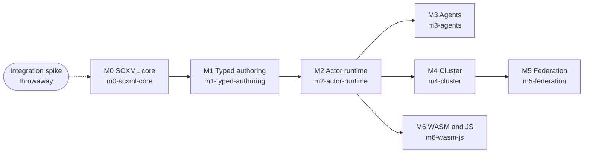

# Roadmap

Vertep is delivered bottom-up in seven milestones, each an OpenSpec change named after it; full SCXML comes first, distribution and bindings last.

## M0 SCXML core

The complete SCXML core: chart IR, interpretation algorithm, SCXML format, datamodel trait with null and ECMAScript, RDF projection, Lean model and the W3C conformance suite.

- precedes:: [[roadmap#M1 Typed authoring]]

Delivered by the OpenSpec change `m0-scxml-core`. A throwaway spike of a journaled actor with an LLM decider runs alongside it, see [[decisions#Full SCXML first]]; its code is deleted when M2 starts.

Archived 2026-11-11 as `openspec/changes/archive/2026-11-11-m0-scxml-core` with 78 requirements in `openspec/specs/`. The three unproven Lean theorems and the Lean oracle hang moved to the `verification-backlog` change.

## M1 Typed authoring

One IR type language with its projections, the `statechart!` and `include_chart!` macros with the Rust datamodel, the YAML format and the CEL datamodel.

- precedes:: [[roadmap#M2 Actor runtime]]

Delivered by the OpenSpec change `m1-typed-authoring`.

Archived 2026-11-11 with 44 requirements. The CEL variant of the IRP suite and the Lean type language moved to `verification-backlog`.

## M2 Actor runtime

Single-node actor runtime: the three lifecycle classes, mailboxes and transports, the event journal, storage traits with tiramemsu, durable timers, chart versioning and the runtime ontology.

- precedes:: [[roadmap#M3 Agents]]
- precedes:: [[roadmap#M4 Cluster]]
- precedes:: [[roadmap#M6 WASM and JS]]

Delivered by the OpenSpec change `m2-actor-runtime`.

Archived 2026-11-11 with 68 requirements. The Lean journal-protocol proofs moved to `verification-backlog`.

## M3 Agents

Deciders at choice points, LLM actors with journaled results and tool actors, and LLM-written plan charts run as sandboxed children.

Delivered by the OpenSpec change `m3-agents`.

Archived 2026-11-11 with 33 requirements; decider safety, grant enforcement and replay without deciders are proven in `vertep-lean`, and agent runs replay through the Lean oracle.

## M4 Cluster

Trusted multi-node clusters: pluggable membership with leases, shard placement, the QUIC cluster transport and pooled stateless workers.

- precedes:: [[roadmap#M5 Federation]]

Delivered by the OpenSpec change `m4-cluster`.

Archived 2026-11-11 with 36 requirements. etcd and Kubernetes Lease membership and the container fault harness run against Docker with `VERTEP_CONTAINER_TESTS=1`; every fault history replays through the Lean lease model in strict mode. Journal shipping between nodes has no wire protocol yet.

## M5 Federation

Actors across trust boundaries: DID identities, authenticated senders, capability grants, and DIDComm and TSP relay mailboxes and transports.

Delivered by the OpenSpec change `m5-federation`.

Archived 2026-11-11 with 27 requirements. Interop with a third-party mediator (Hyperledger Identus) runs against Docker when `VERTEP_MEDIATOR_INTEROP=1`; live delivery over WebSocket is not bound yet.

## M6 WASM and JS

The core and a browser shell compiled to WebAssembly, with a TypeScript API and a tiramemsu journal in OPFS.

Delivered by the OpenSpec change `m6-wasm-js`.
