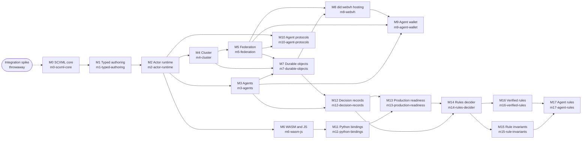

# Roadmap

Vertep is delivered bottom-up in eighteen milestones, each an OpenSpec change named after it; full SCXML comes first, distribution and bindings last.

## M0 SCXML core

The complete SCXML core: chart IR, interpretation algorithm, SCXML format, datamodel trait with null and ECMAScript, RDF projection, Lean model and the W3C conformance suite.

- precedes:: [[roadmap#M1 Typed authoring]]

Delivered by the OpenSpec change `m0-scxml-core`. A throwaway spike of a journaled actor with an LLM decider runs alongside it, see [[decisions#Full SCXML first]]; its code is deleted when M2 starts.

Archived 2026-11-11 as `openspec/changes/archive/2026-11-11-m0-scxml-core` with 78 requirements in `openspec/specs/`. The three unproven Lean theorems and the Lean oracle hang moved to the `verification-backlog` change. That change was archived 2026-11-12 as `openspec/changes/archive/2026-11-12-verification-backlog` with every formal-model requirement implemented and verified in Lean: shapes equivalence, configuration well-formedness, the RDF round trip, the type checker with its JSON Schema and SHACL projections, type soundness of `start` and `step`, and certificates for typed charts. The proofs found thirteen runtime and checker bugs and one defect in the published list shapes, all fixed with regression tests in both cores.

## M1 Typed authoring

One IR type language with its projections, the `statechart!` and `include_chart!` macros with the Rust datamodel, the YAML format and the CEL datamodel.

- precedes:: [[roadmap#M2 Actor runtime]]

Delivered by the OpenSpec change `m1-typed-authoring`.

Archived 2026-11-11 with 44 requirements. The CEL variant of the IRP suite and the Lean type language moved to `verification-backlog`.

## M2 Actor runtime

Single-node actor runtime: the three lifecycle classes, mailboxes and transports, the event journal, storage traits with tiramemsu, durable timers, chart versioning and the runtime ontology.

- precedes:: [[roadmap#M3 Agents]]
- precedes:: [[roadmap#M4 Cluster]]
- precedes:: [[roadmap#M6 WASM and JS]]

Delivered by the OpenSpec change `m2-actor-runtime`.

Archived 2026-11-11 with 68 requirements. The Lean journal-protocol proofs moved to `verification-backlog`.

## M3 Agents

Deciders at choice points, LLM actors with journaled results and tool actors, and LLM-written plan charts run as sandboxed children.

- precedes:: [[roadmap#M7 Durable objects]] {note: "the durable agent journal"}
- precedes:: [[roadmap#M9 Agent wallet]] {note: "consent is a decide state"}
- precedes:: [[roadmap#M12 Decision records]] {note: "decision entries gain a disposition and an offer"}

Delivered by the OpenSpec change `m3-agents`.

Archived 2026-11-11 with 33 requirements; decider safety, grant enforcement and replay without deciders are proven in `vertep-lean`, and agent runs replay through the Lean oracle.

## M4 Cluster

Trusted multi-node clusters: pluggable membership with leases, shard placement, the QUIC cluster transport and pooled stateless workers.

- precedes:: [[roadmap#M5 Federation]]
- precedes:: [[roadmap#M7 Durable objects]] {note: "replication behind a replica link"}

Delivered by the OpenSpec change `m4-cluster`.

Archived 2026-11-11 with 36 requirements. etcd and Kubernetes Lease membership and the container fault harness run against Docker with `VERTEP_CONTAINER_TESTS=1`; every fault history replays through the Lean lease model in strict mode. Journal shipping between nodes has no wire protocol yet.

## M5 Federation

Actors across trust boundaries: DID identities, authenticated senders, capability grants, and DIDComm and TSP relay mailboxes and transports.

- precedes:: [[roadmap#M7 Durable objects]] {note: "TSP, DID identities and relay mailboxes"}
- precedes:: [[roadmap#M8 did:webvh hosting]] {note: "the did:webvh resolver"}
- precedes:: [[roadmap#M9 Agent wallet]] {note: "keys, DIDs, TSP and grant credentials"}
- precedes:: [[roadmap#M10 Agent protocols]] {note: "DIDs, sealed mailboxes, relays and grants"}

Delivered by the OpenSpec change `m5-federation`.

Archived 2026-11-11 with 27 requirements. Interop with a third-party mediator (Hyperledger Identus) runs against Docker when `VERTEP_MEDIATOR_INTEROP=1`; live delivery over WebSocket is not bound yet.

## M6 WASM and JS

The core and a browser shell compiled to WebAssembly, with a TypeScript API and a tiramemsu journal in OPFS.

- precedes:: [[roadmap#M11 Python bindings]] {note: "the Python binding wraps the command bridge M6 defined"}

Delivered by the OpenSpec change `m6-wasm-js`.

Archived 2026-11-14 as `openspec/changes/archive/2026-11-14-m6-wasm-js` with 15 requirements in `openspec/specs/wasm-bindings`. The npm packages are published (`next` 0.1.3, `latest` 0.1.2).

## M7 Durable objects

DID-addressed durable objects with verifiable journals, decentralised custody over TSP with quorum-promised epochs, the durable agent journal, and a TSP mailbox mediator.

- precedes:: [[roadmap#M8 did:webvh hosting]] {note: "custodian-set changes publish witnessed DID log entries"}
- precedes:: [[roadmap#M12 Decision records]] {note: "the hash-chained journal envelope is reused for agent journals"}

Delivered by the OpenSpec change `m7-durable-objects` (capabilities `durable-objects`, `object-custody`, `tsp-mediator`, and additions to `relay-mailboxes`). Merged 2026-11-12 (pull request 1) and released in 0.1.2 on 2026-11-13. Open: task 10.4, the Lean proof of custody safety under custodian-set changes. Creating and hosting `did:webvh` logs followed in [[roadmap#M8 did:webvh hosting]].

## M8 did:webvh hosting

Creating, updating, witnessing, publishing and serving `did:webvh` DIDs with Vertep keys; custodians witness their object's DID log; `vt webvh`; `vt-mediator` under a `did:webvh`.

- precedes:: [[roadmap#M9 Agent wallet]] {note: "status lists publish through the webvh publishers"}

Delivered by the OpenSpec change `m8-webvh` (capabilities `webvh-identity` and `webvh-hosting`), in [[components#vertep-webvh]].

Implemented 2026-11-13: the crate, custodian witnessing in `vertep-objects`, `vt webvh`, and `vt-mediator` under `did:webvh`. Merged 2026-11-13 (pull request 2) and released in 0.1.3 the same day.

## M9 Agent wallet

A wallet for every Vertep identity: credentials received, sealed, presented with consent, issued and verified, over pluggable exchange protocols and formats, with the exchange protocol modelled and proven in Lean.

Delivered by the OpenSpec change `m9-agent-wallet` (capabilities `agent-wallet`, `credential-exchange` and `oid4vc`, and one addition to `did-identity`), in [[components#vertep-wallet]]. The design is in [[views/wallet#Wallet]].

Implemented 2026-11-14: the crate with its formats, sealed store, consent, status lists, role charts and exchange engine; the Vertep Credential Exchange over TSP; OpenID4VCI and OpenID4VP with their HTTP bindings; grant credentials from a wallet; `vt wallet`. The Lean exchange model proves its six theorems, and the conformance kit's histories of every built-in protocol are accepted by its checker. Archived 2026-11-14 as `openspec/changes/archive/2026-11-14-m9-agent-wallet` and released in 0.1.5 the same day.

## M10 Agent protocols

Agents publish verifiable role-based protocols, hash-identified JSON-LD choreographies that any peer can project, check and run over any transport, and cooperate in shared spaces of sealed, hash-linked messages.

Delivered by the OpenSpec change `m10-agent-protocols` (capabilities `agent-protocols`, `protocol-conformance` and `protocol-spaces`), in [[components#vertep-kolyada]]. The design is in [[views/kolyada#Kolyada]]. Test vectors come first and the Lean model second.

The layer is called Kolyada. The core crate was implemented 2026-11-14: documents, identity, projection, signed envelopes, the conformance check, causal delivery, instances and offers, with test vectors. Open: the join policy, sealed fan-out and the mailbox binding in `vertep-federation`, the `vt:plays` declaration, `vt kolyada` and the Lean model.

## M11 Python bindings

The actor system from Python as a PyO3 extension and a pure-Python API, installed with `pip install vertep`, on the JavaScript bindings' command bridge.

- precedes:: [[roadmap#M13 Production readiness]] {note: "the wheel build joins the reproducible toolchain"}

Delivered by the OpenSpec change `m11-python-bindings` (capability `python-bindings`), in [[components#vertep-py]]. The design is in [[views/python#Python]].

Implemented 2026-11-14: the crate and the package `vertep` in `bindings/python` with 27 tests that prove each scenario and run every example, examples in `examples/python`, the docs page, a CI job and the release workflow. PyPI and TestPyPI pending publishers and the `pypi` and `testpypi` environments were set up by the maintainer on 2026-11-14. Open: the TestPyPI dry run of every platform's wheel and the first upload, in release 0.1.6 (`bindings/python/RELEASING.md`).

## M12 Decision records

Drafted, not started: a journal that alone explains each decision, exports as a bundle verified offline, can be chained and signed, replays counterfactually, and lets personal data be erased by key destruction.

- precedes:: [[roadmap#M13 Production readiness]] {note: "benchmarks track the cost of offers and sealing"}
- precedes:: [[roadmap#M14 Rules decider]] {note: "a derivation is a rationale kind beside a claim; the offer is recorded as statements"}

Specified by the OpenSpec change `m12-decision-records` (capabilities `decision-records` and `journal-redaction`), motivated by the credit-decision example, in which a refused answer reads as an accepted one. The positioning it serves is [[decisions#Explanation is the process record, not a story about it]].

## M13 Production readiness

Drafted, not started: stability tiers, a reproducible toolchain, a benchmark suite with a regression gate, a supply-chain gate, a docs-versus-behaviour audit, a tested ten-minute path, journal shipping between nodes and WebSocket live delivery.

- precedes:: [[roadmap#M14 Rules decider]] {note: "rules start only after production readiness"}

Specified by the OpenSpec change `m13-production-readiness` (capabilities `production-readiness` and `journal-shipping`, and an addition to `relay-mailboxes`). It also tracks the open Lean custody proof (M7 task 10.4) and the open M10 items. New milestones wait for it, see [[decisions#New milestones wait for production readiness]].

## M14 Rules decider

Drafted, not started: rule programs stored beside the journal and run by lean-elpi through tiramemsu, a rules decider whose rationale is a derivation over the recorded offer and state, pinned versions and rule-version counterfactuals.

- precedes:: [[roadmap#M15 Rule invariants]]
- precedes:: [[roadmap#M16 Verified rules]]

Specified by the OpenSpec change `m14-rules-decider` (capabilities `rule-programs` and `rule-decider`), in [[components#vertep-rules]]. Its first task group is a throwaway spike on `examples/credit-decision` with a go or no-go. The design is in [[views/rules#Rules]]. Native only: see [[constraints#The native rules engine exists for four platforms]].

## M15 Rule invariants

Drafted, not started: enforced rule programs that refuse a violating journal append at commit, and derived facts with stated support that retract with their cause and with erasure.

- precedes:: [[roadmap#M17 Agent rules]]

Specified by the OpenSpec change `m15-rule-invariants` (capabilities `rule-invariants` and `derived-facts`). It needs the erasure design of [[roadmap#M12 Decision records]].

## M16 Verified rules

Drafted, not started: a rules profile, totality and support-necessity checks, a differential oracle against Datalog and derivation certificates checked in Lean.

- precedes:: [[roadmap#M17 Agent rules]]

Specified by the OpenSpec change `m16-verified-rules` (capability `rule-verification`). It begins with a go or no-go on lean-elpi's LF layer for a real derivation.

## M17 Agent rules

Drafted, not started: agents propose rules that pass an ordered gate, run in shadow and are promoted by journaled acts, and no actor can change the rules that govern it.

Specified by the OpenSpec change `m17-agent-rules` (capability `rule-authoring`), building on the grants of [[roadmap#M5 Federation]].
