# Agents

How Vertep builds AI agents out of statecharts: deciders at choice points, LLM and tool actors, capability grants and LLM-written plan charts, all journaled and replayable.

This view explains milestone M3 and the crate `vertep-agent`. Requirement names in backticks are from the OpenSpec change `m3-agents` (capabilities `deciders`, `llm-actors`, `plan-charts`).

## The invariant

An LLM, a human or any other decider only proposes events; the chart validates and decides. Nothing outside `step` mutates the chart, its context or the store.

- describes:: [[decisions#Deciders at choice points]] {note: "the LLM is one decider among several"}
- describes:: [[decisions#Event-sourced actors]] {note: "every proposal is a journaled input"}
- describes:: [[roadmap#M3 Agents]]

Every agent feature in M3 lowers onto SCXML constructs that already exist in M0 to M2: states, `<invoke>`, `<send>`, internal events, durable timers and journal entries. M3 adds no execution semantics. The boundary is drawn so that everything untrusted sits outside the pure core and talks to it only through the mailbox.

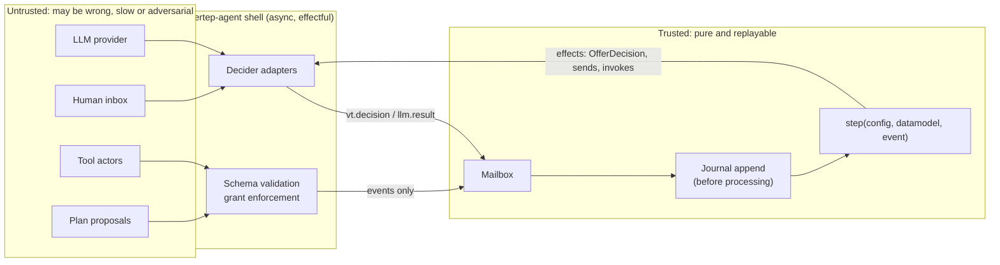

Three consequences follow, and the rest of this view is their detail:

| Property | Mechanism | Requirement |
|---|---|---|
| Bounded action space | the decider sees only the candidate set and only candidates are accepted | `Enabled Event Offer`, `Decision Validation Against Candidates`, `Decider Safety` |
| Replay without models | results and decisions are journaled before they are processed | `Decisions Are Journaled Inputs`, `Journaled Model Results` |
| Bounded side effects | sends are checked against intersected grants in the send path | `Capability Grants`, `Sandboxed Plan Execution` |

## Component map

The agent layer is one crate, `vertep-agent`, on top of the runtime, the CEL datamodel and the RDF layer; providers and tools are plug-ins behind traits.

- describes:: [[components#vertep-agent]]
- describes:: [[components#vertep-runtime]] {note: "mailboxes, journal, timers and vt:request used by deciders"}
- describes:: [[components#vertep-dm-cel]] {note: "the only datamodel plans may use"}
- describes:: [[capabilities#Deciders]]
- describes:: [[capabilities#LLM actors]]
- describes:: [[capabilities#Plan charts]]

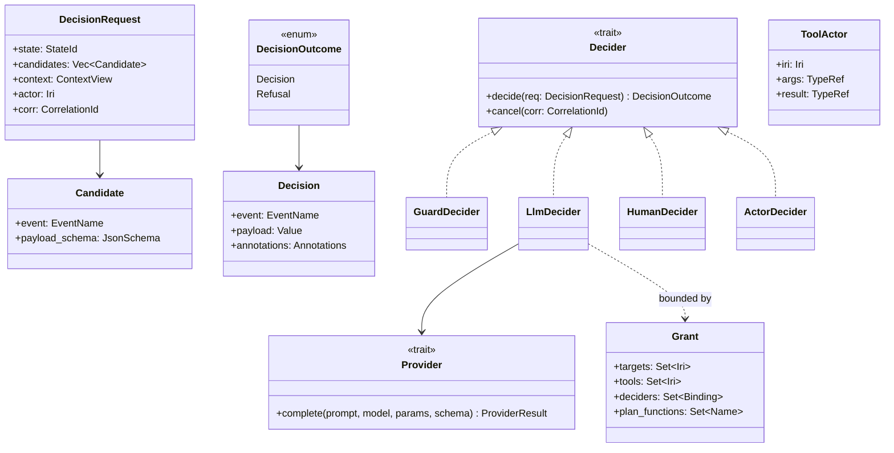

## Decide states

A `vt:decide` state names one decider binding, an optional deadline, a fallback decider and candidate descriptors; on entry the runtime offers the enabled events to the decider.

- describes:: [[capabilities#Deciders]]
- describes:: [[glossary#Decider]]
- describes:: [[decisions#Non-blocking request and deferred events]] {note: "the wait never blocks the actor"}

The flow is covered by `Decide State Declaration`, `Enabled Event Offer`, `Decider Contract`, `Decisions Are Journaled Inputs`, `Decision Validation Against Candidates` and `Non-blocking Decision Wait`.

1. **Offer.** Entering the decide state makes the pure core compute the candidate set with `enabled_events(config, datamodel)`: every event whose transition would be enabled, ancestors included, restricted to declared candidates. The core emits an `OfferDecision` effect with a correlation id derived from the journal position, so replay reproduces it.
2. **Decide.** The shell calls the bound decider asynchronously. The actor stays in an ordinary active state and keeps processing other events.
3. **Return.** The decision comes back through the mailbox as the external event `vt.decision`, is appended to the journal (deduplicated by correlation id) and only then processed.
4. **Validate.** A generated guard accepts it only if the event is in the offered candidate set for that correlation id and the payload conforms to the candidate's schema. Then the chosen event is raised internally and normal SCXML selection takes the transition. Otherwise `error.decide.invalid` is raised with a reason (`not-a-candidate`, `payload-schema`, `stale`).

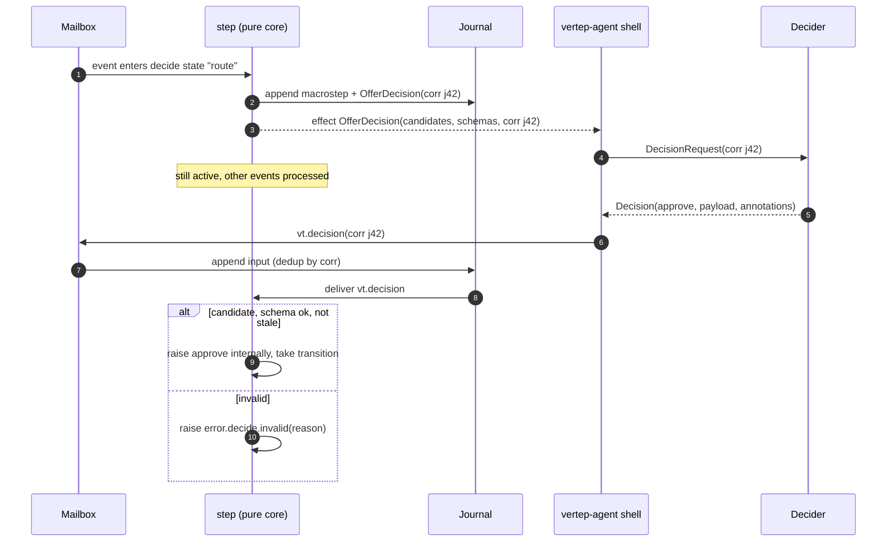

An outstanding request has a small lifecycle of its own. Re-decision (`Re-decision After Context Change`) is driven by a fingerprint of the candidate set: event names plus schema hashes. If a later macrostep changes the fingerprint, the request is cancelled and re-offered with a new correlation id; late answers to the old id are rejected as stale. Deadlines (`Decision Deadline and Fallback`) are durable timers journaled with the offer, so they fire across deactivation and replay.

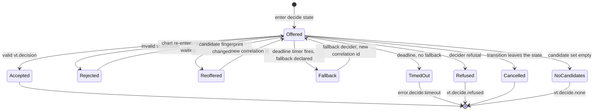

## Decider kinds

Four decider kinds share one contract: guard, LLM, human and actor deciders; none can do anything except return a value that the core validates.

- describes:: [[glossary#Decider]]
- describes:: [[capabilities#Deciders]]

This is `Decider Kinds`. A guard decider is the deterministic fallback of choice; a human decider is how high-risk moves get human approval without a special mechanism.

| Kind | How it decides | Typical use |
|---|---|---|
| Guard decider | first candidate in document order whose declared decision guard holds; pure, deterministic | fallback, policy, tests |
| LLM decider | structured output whose schema is a `oneOf` over candidates | agent reasoning |
| Human decider | publishes the request to an inbox actor; the answer is a reply | approvals, escalation |
| Actor decider | non-blocking `vt:request` to another actor IRI | delegation, ensembles, a supervisor agent |

```rust
#[async_trait]
pub trait Decider: Send + Sync {
    /// Must not mutate anything; receives an immutable context view.
    async fn decide(&self, req: DecisionRequest) -> DecisionOutcome;
    /// Called when the request is cancelled or superseded by a re-offer.
    fn cancel(&self, corr: CorrelationId);
}

pub enum DecisionOutcome {
    Decision { event: EventName, payload: Value, annotations: Annotations },
    Refusal { reason: String },
}
```

With typed charts (`Typed Decision Schemas`), every candidate carries the JSON Schema projected from the event's payload type in the IR type language, the same type the Rust and SHACL projections come from. The LLM decider sends one schema covering all candidates:

```json
{
  "oneOf": [
    { "type": "object", "required": ["event", "payload"],
      "properties": { "event": { "const": "approve" },
        "payload": { "type": "object", "required": ["amount", "reason"],
          "properties": { "amount": { "type": "number" }, "reason": { "type": "string" } } } } },
    { "type": "object", "required": ["event"],
      "properties": { "event": { "const": "reject" }, "payload": { "type": "object" } } }
  ]
}
```

Untyped charts offer the dynamic value schema, and decisions are validated for the event name only. Decision annotations (`Decision Annotations`) carry rationale, confidence in [0, 1], decider kind and identity, model and prompt hash. They are recorded in the graph and never influence transition selection.

## LLM actors

`<invoke type="vt:llm">` starts one model call as an invoked actor; its result is journaled in the parent as `llm.result` before processing, so replay never calls a provider.

- describes:: [[capabilities#LLM actors]]
- describes:: [[glossary#Invoked actor]] {note: "an LLM call lives and dies with its invoking state"}
- describes:: [[decisions#Event-sourced actors]]

The call actor renders the prompt template against a read-only view of the context and the triggering event, records the prompt hash, calls the provider, validates structured output and sends `llm.result` or `error.llm` to its parent (`LLM Invocation`, `Prompt Templates`, `Provider Contract`, `Structured Output`, `Journaled Model Results`). It is cancelled when the invoking state exits, like any SCXML invoke.

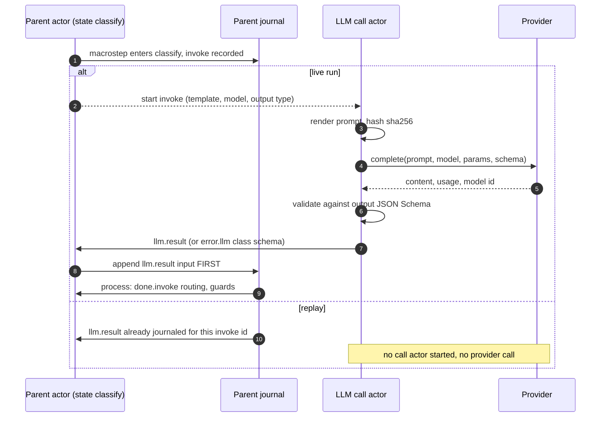

Rules worth knowing:

- **No implicit retries** (`Retries Expressed in the Chart`). Retries are transitions on `error.llm`. The `vt:retry` invoke extension is sugar for a bounded retry substate with a durable backoff timer, so retry behaviour is visible in the chart and in the graph.
- **Streaming is optional** (`Streaming Partials`). Partials arrive as `vt.llm.partial` for targetless transitions only, and only the final result is journaled.
- **Accounting** (`Usage and Cost Accounting`). Each call records prompt and completion tokens, model, provider binding, latency and optional cost as `vt-agent:` statements. Cumulative usage of the actor and its invoked descendants is a read-only system variable that budget guards read.
- **Vendor-neutral** (`Provider Contract`). No vendor SDK is needed to build or run Vertep; concrete providers are optional cargo features.

```rust
#[async_trait]
pub trait Provider: Send + Sync {
    async fn complete(
        &self,
        prompt: &RenderedPrompt,
        model: &ModelId,
        params: &GenerationParams,
        output: Option<&JsonSchema>,
    ) -> Result<ProviderResult, ProviderError>;
}

pub struct ProviderResult {
    pub content: Content,       // text or parsed JSON
    pub usage: Usage,           // prompt_tokens, completion_tokens
    pub model: ModelId,         // as reported by the provider
}
```

## Tools and capability grants

A tool is an actor kind with typed arguments and results; an invoking state grants the targets, tools and deciders its child may use, and the send path enforces the intersection.

- describes:: [[capabilities#LLM actors]]
- describes:: [[decisions#Identity, mailbox and transport layers]] {note: "grants are enforced in the Event I/O Processor dispatch"}

`Tool Actors` makes a tool an ordinary actor with an IRI, an argument type and a result type. Its JSON Schemas are derived from those types and offered to LLM actors that are granted the tool. Tool results are journaled in the caller's journal.

`Capability Grants` declares the reach of an invoked LLM, tool or plan actor. The effective grant of a child is the parent's grant intersected with the child's declared grant, recursively, so a nested invoke can never widen authority. Enforcement sits in the runtime's send path, not in the LLM adapter, so it covers plans and nested invokes uniformly. An ungranted send raises `error.communication` in the sender and is not delivered.

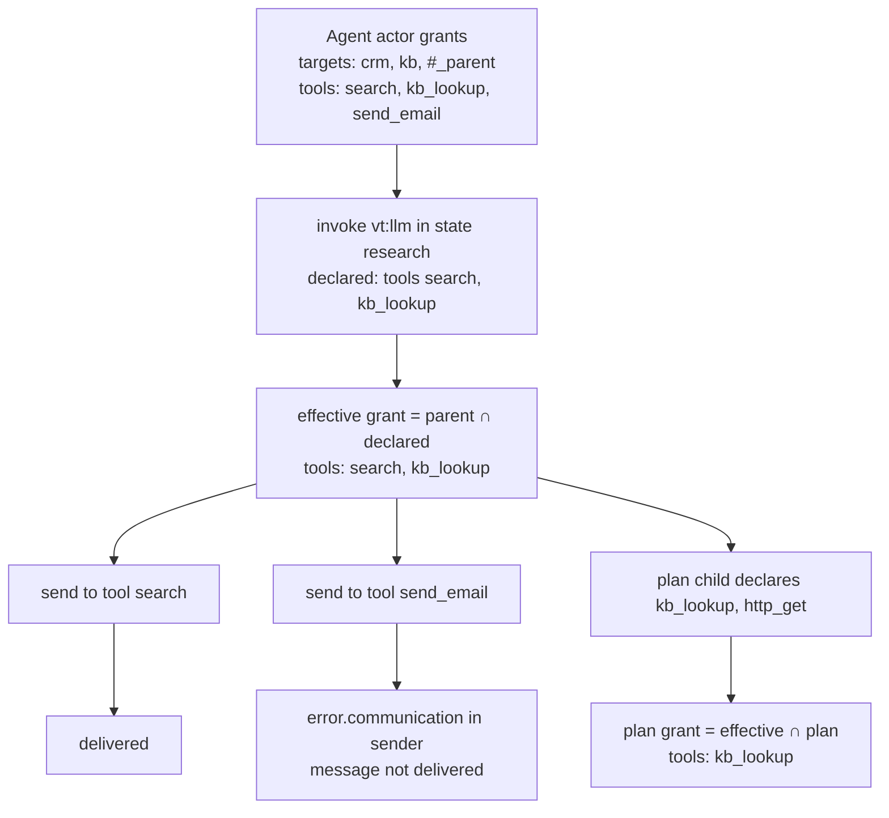

Across trust boundaries, M5 adds DID-scoped grants and inbound checks; see [[distribution#Authenticated origin and grants]].

## LLM as main driver

A ReAct agent is a chart: a decide loop whose candidates are tool calls, a finish event and an escalation, bounded by an iteration limit and a budget guard. No runtime feature is specific to it.

- describes:: [[capabilities#Deciders]]
- describes:: [[capabilities#LLM actors]]
- describes:: [[decisions#Deciders at choice points]] {note: "the LLM as the main driver"}

`LLM as Main Driver` requires that this pattern uses only deciders, grants and LLM invocations. The iteration bound is `vt:maxDecisions` on the decide state (raising `vt.agent.budget-exhausted`) or a CEL guard on a counter or on cumulative usage.

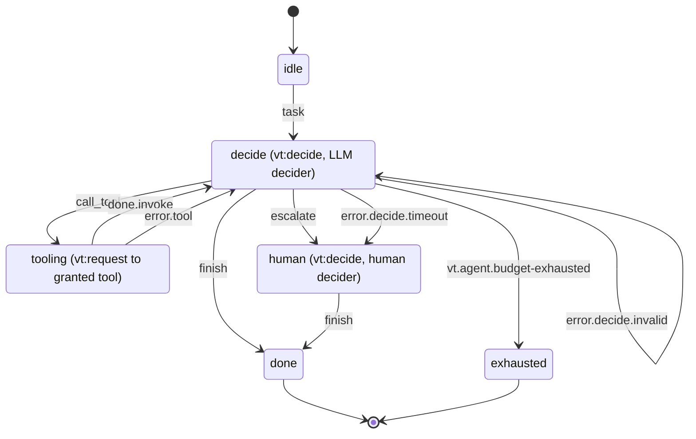

### Example agent chart

A complete support agent in the YAML surface: typed events, CEL, an LLM decider with deadline and fallback, granted tools and human escalation.

The YAML syntax is owned by `yaml-format` in M1; treat keys as illustrative.

```yaml
chart: support-agent
datamodel: cel
types:
  Ticket:   { id: string, customer: iri, text: string }
  ToolCall: { tool: iri, args: any }
  Answer:   { text: string, confidence: decimal }
context:
  ticket: { type: optional<Ticket> }
  steps:  { type: int, init: 0 }
  notes:  { type: list<string>, init: [] }
events:
  task:      Ticket
  call_tool: ToolCall
  finish:    Answer
  escalate:  { reason: string }
initial: idle
states:
  idle:
    on:
      task: { target: decide, assign: { ticket: "event.data" } }
  decide:
    vt:decide:
      decider: llm/claude-support
      candidates: [call_tool, finish, escalate]
      deadline: 30s
      fallback: guards/escalate-on-timeout
      maxDecisions: 12
    on:
      call_tool:  { target: tooling }
      finish:     { target: done, guard: "event.data.confidence >= 0.6" }
      escalate:   { target: human }
      vt.agent.budget-exhausted: { target: human }
  tooling:
    invoke:
      type: vt:request
      target: "event.data.tool"
      data: "event.data.args"
      grants: { tools: [vt:tool/kb_search, vt:tool/order_lookup] }
      timeout: 20s
    on:
      done.invoke:
        target: decide
        assign: { steps: "steps + 1", notes: "notes + [string(event.data)]" }
      error.tool:      { target: decide }
      error.timeout:   { target: decide }
      error.communication: { target: human }
  human:
    vt:decide:
      decider: human/support-inbox
      candidates: [finish]
    on:
      finish: { target: done }
  done:
    type: final
    donedata: "event.data"
```

The same agent wired from Rust: the chart is compiled with `include_chart!`, deciders, providers and tools are registered by binding name, and the virtual actor is addressed by IRI.

```rust
use vertep::prelude::*;

include_chart!(SupportAgent, "charts/support-agent.yaml");

#[tokio::main]
async fn main() -> anyhow::Result<()> {
    let runtime = Runtime::builder()
        .store(TiramemsuStore::open("data/shard-0.tm")?)
        .provider("claude", AnthropicProvider::from_env()?)
        .decider("llm/claude-support", LlmDecider::new("claude", "claude-sonnet-5-5"))
        .decider("guards/escalate-on-timeout", GuardDecider::first_enabled(["escalate"]))
        .decider("human/support-inbox", HumanDecider::inbox("vt:actor/SupportInbox/main"))
        .tool("vt:tool/kb_search", KbSearch::new(index))
        .tool("vt:tool/order_lookup", OrderLookup::new(db))
        .build()
        .await?;

    let agent = runtime.virtual_actor::<SupportAgent>("vt:actor/SupportAgent/ticket-8812");
    agent.send(SupportAgentEvent::Task(Ticket {
        id: "8812".into(),
        customer: iri!("vt:actor/Customer/42"),
        text: "My order never arrived".into(),
    })).await?;
    Ok(())
}
```

## Plan charts

An LLM may write a chart fragment as a plan; it is parsed, validated, restricted to CEL, content-addressed and run only as a bounded, sandboxed invoked child of the requesting state.

- describes:: [[capabilities#Plan charts]]
- describes:: [[decisions#Pluggable datamodel]] {note: "plans are CEL-only"}
- describes:: [[decisions#Content-addressed chart versions]] {note: "a plan gets a version IRI like any chart"}
- describes:: [[components#vertep-dm-cel]]

The pipeline is the spine of `Plan Submission`, `Plan Validation`, `CEL-only Plans`, `Content-addressed Plans`, `Sandboxed Plan Execution`, `Plan Execution Bounds`, `Plan Results Returned to Parent` and `Plan Lineage`.

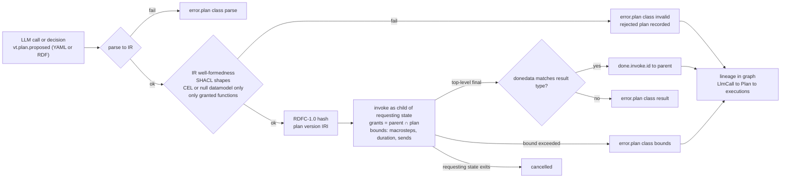

Why each restriction exists:

- **CEL only.** CEL has no side effects and terminates. No ECMAScript, no Rust-bound guards or actions, no `<script>`, no functions outside the CEL standard library and those explicitly granted.
- **Content-addressed.** Identical plans get identical IRIs, so lineage, caching of validation results and certificates attach to one node in the graph.
- **Invoked child only.** A plan is never a virtual actor, never outlives its requesting state, and can affect its parent only by sending events.
- **Bounded.** Macrostep count, wall-clock duration (a durable timer) and outgoing send count are declared by the invoking state.

## Self-modification

An agent can change its own chart only by proposing a new chart version plus a migration, which goes through the plan pipeline and then the chart-versioning migration procedure.

- describes:: [[decisions#Content-addressed chart versions]]
- describes:: [[capabilities#Chart versioning]]
- describes:: [[capabilities#Plan charts]]

This is `Self-modification Through Versioning`. The running chart is never patched in place; that would break pinned replay and make decider safety unprovable. The migration is a journal entry, so it can be queried, and undone by forking from a journal position before it.

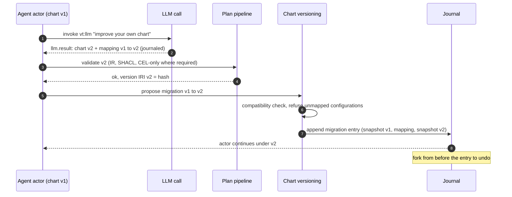

## Journaling and replay

An agent run is a journal: offers, decisions, model results, tool results, plans and migrations are inputs or entries, so a run replays without any provider and can be forked at any position.

- describes:: [[decisions#Event-sourced actors]]
- describes:: [[capabilities#Event journal]]
- describes:: [[decisions#Two storage traits with tiramemsu as default]] {note: "tiramemsu as_of gives agent time travel"}

| Journaled item | Kind | Written when |
|---|---|---|
| `OfferDecision` with correlation id and candidate fingerprint | effect in the macrostep append | decide state entered or re-offered |
| `vt.decision` with annotations | input | decider answered |
| `llm.result` with prompt hash, content, usage, model | input | provider returned |
| tool result (`done.invoke`, reply) | input | tool replied |
| deadline timer | entry with the offer | offer made |
| plan accepted or rejected, plan version IRI | input or entry | plan validated |
| migration snapshot, mapping, snapshot | entry | self-modification accepted |

Replay feeds these back instead of calling deciders, providers or tools. To explore an alternative ("what if the model had chosen `escalate`?") the supported way is to fork the actor's journal at the position of the offer and supply a different decision, which becomes a new branch rather than an edit of history. Large prompts and results are stored once by content hash and referenced from journal entries.

## Agent ontology

The `vt-agent:` module names deciders, decisions, LLM calls, tools, tool calls, grants and plans, aligned to PROV-O by subclassing; decision annotations are RDF 1.2 triple terms.

- describes:: [[decisions#Modular vt ontology on RDF 1.2]]
- describes:: [[capabilities#Runtime ontology]] {note: "vt-agent builds on the runtime module"}
- describes:: [[capabilities#LLM actors]]

`Agent Ontology Module` ships SHACL shapes and the alignment axioms as plain triples, so PROV queries work with no reasoner.

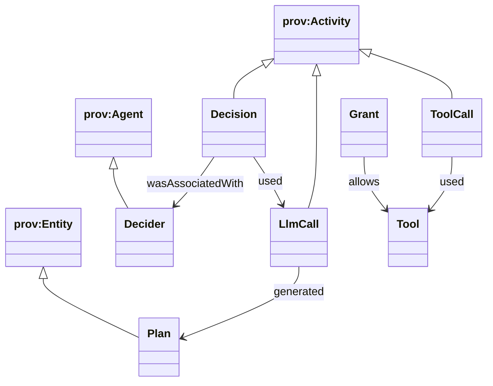

```turtle
@prefix vt-agent: <https://vertep.dev/ns/agent#> .
@prefix prov: <http://www.w3.org/ns/prov#> .

:d42 a vt-agent:Decision ;
    prov:wasAssociatedWith :llm-decider-claude ;
    prov:used :call-17 .

<< :d42 vt-agent:chose vt:event/approve ~ :r42 >> .
:r42 vt-agent:rationale "invoice matches PO" ;
     vt-agent:confidence 0.82 ;
     vt-agent:model "claude-sonnet-5-5" ;
     vt-agent:promptHash "sha256:9c1f…" .

:call-17 a vt-agent:LlmCall ;
    vt-agent:promptTokens 1834 ; vt-agent:completionTokens 212 ;
    vt-agent:latencyMs 2410 .
```

Questions the graph answers directly:

```sparql
# Every decision an LLM took with confidence below 0.5, with its rationale
SELECT ?decision ?event ?why WHERE {
  ?decision a vt-agent:Decision .
  << ?decision vt-agent:chose ?event ~ ?r >> .
  ?r vt-agent:confidence ?c ; vt-agent:rationale ?why .
  FILTER(?c < 0.5)
}
```

## Verification

Decider safety and grant enforcement are theorems in the Lean model: whatever any decider returns, the transition taken was enabled when offered, and no actor sends outside its effective grant.

- describes:: [[decisions#Lean verification bridge]]
- describes:: [[capabilities#Formal model]]

`Decider Safety` states the property over every decider kind and every output, including adversarial output. The Lean model includes the pure `enabled_events` function, the offer and validation guard, and the grant intersection. The executable Lean `step` is the differential oracle for the Rust implementation of these paths, the same bridge as for the rest of the core.

## Risks and containment

The main agent risks are prompt injection, nondeterminism, cost runaway and stuck waits; each is contained by a mechanism that does not depend on the model behaving well.

- describes:: [[constraints#SCXML discards unmatched events]] {note: "a decision for a state already left is rejected explicitly, never dropped"}
- describes:: [[capabilities#Deciders]]

| Risk | Containment | Requirement |
|---|---|---|
| Prompt injection makes the model pick a harmful action | only offered candidates are accepted; grants intersected and enforced in the send path; route high-risk moves to a human decider | `Decider Safety`, `Capability Grants` |
| Injection through a plan | CEL-only, granted functions only, bounds, sandboxed child | `CEL-only Plans`, `Plan Execution Bounds` |
| Model nondeterminism | results and decisions journaled before processing; forks for alternatives | `Journaled Model Results` |
| Token and cost runaway | `vt:maxDecisions`, cumulative usage system variable, per-call accounting | `Usage and Cost Accounting`, `LLM as Main Driver` |
| Malformed structured output | validation after every call, `error.llm` class `schema`, chart retries | `Structured Output` |
| Human never answers | deadline with fallback decider; the wait is non-blocking | `Decision Deadline and Fallback` |
| Re-offer cost | fingerprint-based re-offers only when the candidate set changes | `Re-decision After Context Change` |
| Journal bloat from prompts | content stored once by hash; snapshots | `Journaled Model Results` |

## Spec and decision differences

Where the M3 specs refine or depart from the accepted decisions, the specs govern; these are the points worth knowing.

- describes:: [[decisions#Deciders at choice points]]
- describes:: [[decisions#IRI identity and lifecycle classes]]

- **Safety is stated at offer time.** The decision says a decider "can only choose an enabled transition". `Decider Safety` makes it precise: enabled *at the time the candidate set was offered*. Staleness is kept sound by fingerprint re-offers and by rejecting old correlation ids.
- **Candidates can be restricted.** The decision speaks of "the enabled events"; the spec intersects them with declared candidate descriptors and adds `vt.decide.none` for an empty set.
- **LLM calls are invoked actors in M3, not stateless workers.** The decision on lifecycle classes names stateless workers as the home for LLM calls. M3 runs each call as an invoked actor on the local runtime; pooled LLM workers arrive with `worker-pools` in M4.
- **Plans may also use the null datamodel**, not only CEL (`CEL-only Plans`).

## Implementation in vertep-agent

How M3 lowers the design onto code: a pure agent machine over journaled inputs, an imperative host that performs its effects, and grant filters on runtime actors.

- describes:: [[components#vertep-agent]]
- describes:: [[decisions#The agent host journals agent inputs]]
- describes:: [[decisions#Decide bindings ride on vt extension attributes]]
- describes:: [[decisions#Correlation ids derive from the journal position]]
- describes:: [[decisions#vt:retry lowers to journaled retry timers]]
- describes:: [[decisions#The agent ontology ships with vertep-rdf]]

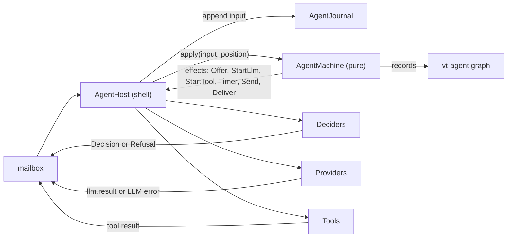

Every answer from outside — a decision, a model result, a tool result, a fired timer — is an input that the host journals before the machine applies it, so replaying a journal (or a prefix of it, for a fork) rebuilds the actor without consulting anything. The machine wraps the core's `step`: after each macrostep it recomputes the candidate sets of active decide states, re-offers when a fingerprint changes and closes offers of exited states. Plans run inside the parent's machine as bounded child sessions, so their state is rebuilt by the parent's replay and their duration bound is a durable timer of the parent.

Runtime actors invoked from ordinary charts are restricted by `GrantedActor`, a wrapper around their factory: an ungranted send becomes `error.communication` (reason `not-granted`) to the sender and `vt.grant.denied` to the parent, which journals it.
