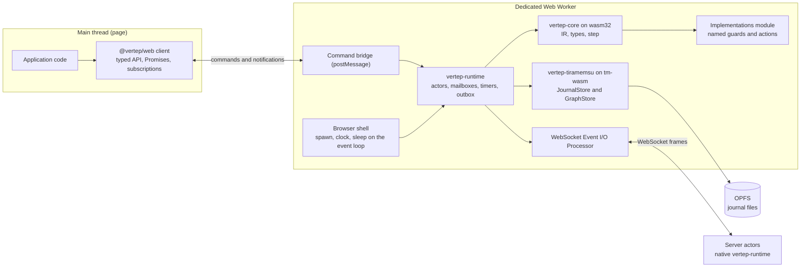
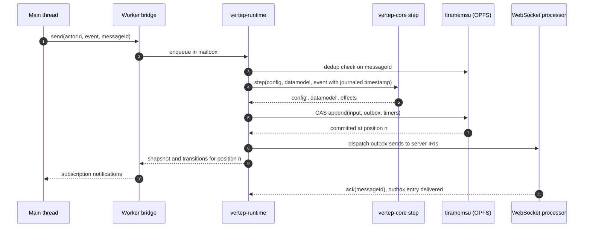
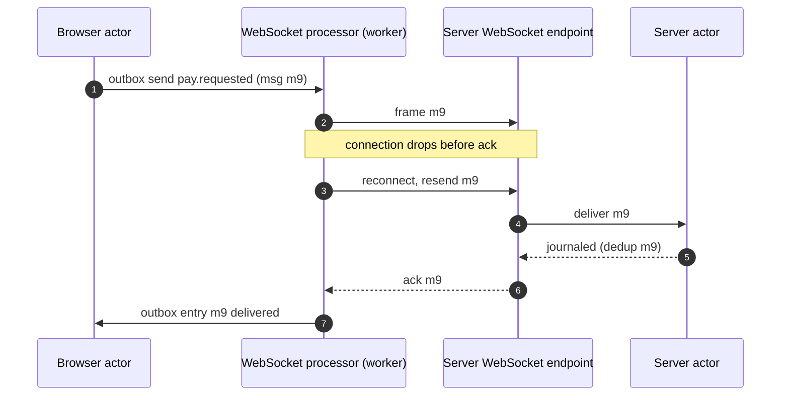

# Browser

How Vertep runs in browsers and Node.js: the unchanged core compiled to WebAssembly, a browser shell in a Web Worker, a tiramemsu journal in OPFS and a typed TypeScript API.

This view explains milestone M6 and the crate `vertep-wasm`. Requirement names in backticks are from the OpenSpec change `m6-wasm-js` (capability `wasm-bindings`).

## Shape

The whole actor system runs in one dedicated Web Worker; the page holds only a thin typed client that sends commands and receives notifications through messages.

- describes:: [[components#vertep-wasm]]
- describes:: [[capabilities#WASM bindings]]
- describes:: [[roadmap#M6 WASM and JS]]
- describes:: [[decisions#No-std core and tokio shell]] {note: "the shell trait exists so a browser shell can replace tokio"}

`Worker-Hosted Actor System` puts core, shell, storage and the user's guard and action implementations in one worker. A step calls guards and actions synchronously, and tiramemsu's WASM host is synchronous with an OPFS VFS that needs a dedicated worker, so all of them must share the thread. The main thread never blocks.



## Core and shell

The `no_std` core compiles to `wasm32-unknown-unknown` from the same source with no target-specific paths; only the shell differs, mapping spawn, clock and sleep onto the JavaScript event loop.

- describes:: [[components#vertep-core]]
- describes:: [[decisions#No-std core and tokio shell]]
- describes:: [[capabilities#SCXML interpretation]] {note: "same step, same results as native"}

`Core Builds For WebAssembly Unchanged` requires that, for the same chart and the same journaled inputs, the WebAssembly build produces the same configurations, datamodel values and effects as the native one. `Browser Runtime Shell` keeps wall-clock time out of actors except as journaled timestamps.

| Runtime operation | Native shell | Browser shell | Node.js |
|---|---|---|---|
| `spawn` | tokio task | `wasm_bindgen_futures::spawn_local` | worker-thread task |
| `sleep` | tokio timer | `setTimeout` future | timers in the worker thread |
| `clock` | system clock, read by the shell only | `Date.now()`, read only when stamping a journal entry | `Date.now()` |

Guards and actions come from an implementations module that the worker imports at start, exporting named functions like XState's `setup({ guards, actions })`. The named-function registry resolves guard and action IRIs to those JavaScript functions. Guards must be pure; a development mode steps every macrostep twice and reports divergence. CEL charts need no module at all.

## Journal in OPFS

Storage is chosen explicitly as durable `opfs` or volatile `memory`, never by silent fallback; an OPFS store takes a Web Lock first, and its files open natively unchanged.

- describes:: [[components#vertep-tiramemsu]]
- describes:: [[decisions#Two storage traits with tiramemsu as default]]
- describes:: [[constraints#Tiramemsu has a single writer per file]] {note: "the Web Lock makes exclusivity explicit"}

`Browser Journal Storage` uses tiramemsu on its WebAssembly host with the rollback journal mode. A second holder of the same store gets `StoreLocked` instead of hanging or corrupting the file. Export and import use tiramemsu's file functions, so a browser journal opens in the native runtime as is. One append per macrostep is the expected upper bound: outbox and timer entries share the input's append.



## TypeScript API

The API borrows XState's vocabulary (actor systems, send, subscribe, snapshots, `matches`, `can`) while executing SCXML semantics exactly, with types generated from the chart's IR types.

- describes:: [[decisions#One IR type language]] {note: "TypeScript is one more projection"}
- describes:: [[decisions#SCXML semantics are normative]]
- describes:: [[capabilities#Type system]]

The surface is `Actor Creation From Chart Sources`, `Event Sending From JavaScript`, `Snapshot And Transition Subscriptions`, `Journal Inspection And Time Travel` and `SCXML Semantics In JavaScript`. Chart sources (SCXML, YAML, RDF) are validated and content-addressed exactly as natively. Every external message carries a message id, so duplicates are processed once. Notifications arrive in journal order, at most once per macrostep, never exposing microsteps. Time travel is read-only. There is no mode that changes execution semantics.

```ts
import { createActorSystem } from "@vertep/web";
import { orderChart, type OrderEvent } from "./order.chart"; // vt gen ts order.scxml

const system = await createActorSystem({
  storage: "opfs",
  path: "/vertep/app.db",
  implementations: new URL("./order.impl.js", import.meta.url),
  transports: { websocket: { url: "wss://api.example.com/vertep", credentials: () => getToken() } },
});

const order = system.virtual(orderChart, "order-8f3a");        // activated on first message
order.subscribe((s) => render(s.matches("checkout.payment"), s.context.total));
await order.send({ type: "item.add", sku: "A-17", qty: 2 });    // typed as OrderEvent
const receipt = await order.request({ type: "pay", method: "card" }, { timeoutMs: 10_000 });
const before = await order.asOf({ position: 3 });               // read-only time travel
const history = await order.journal({ from: 0 });
```

`Generated TypeScript Types` emits, from the same IR types as the Rust, JSON Schema, SHACL and CEL projections, an event union with typed payloads, the context interface, the state-id union and a typed `createActor` overload. A property test checks that the TypeScript and JSON Schema projections accept the same values.

```ts
// generated by `vt gen ts order.scxml`
export type OrderEvent =
  | { type: "item.add"; sku: string; qty: number }
  | { type: "pay"; method: "card" | "invoice" }
  | { type: "cancel" };
export interface OrderContext { items: { sku: string; qty: number }[]; total: number }
export type OrderStateId = "cart" | "checkout" | "checkout.payment" | "done";
```

`request` here is the external promise-based ask for callers outside the actor system; charts themselves keep using the non-blocking `vt:request`.

## Server interop

Browser and Node.js actors reach server actors by IRI through a WebSocket transport registered as an Event I/O Processor, with at-least-once delivery and deduplication by message id.

- describes:: [[decisions#Identity, mailbox and transport layers]]
- describes:: [[constraints#Relays deliver at least once]]
- describes:: [[decisions#Event-sourced actors]] {note: "outbox redelivery after reconnect"}

`Server Interop Over WebSocket` carries Vertep envelopes (target IRI, origin IRI, message id, event name, payload) and acknowledgements. Unacknowledged outbox entries are redelivered after reconnect and deduplicated at the receiver, giving effectively-once processing on both sides. Credentials come from an application-supplied provider; DID-authenticated envelopes from the federation layer can wrap the same frames later.



## Packaging and conformance

Packages ship as ES modules with bundled WebAssembly under a CI-enforced size budget, and the full SCXML conformance suite runs in WebAssembly with results identical to native.

- describes:: [[capabilities#SCXML conformance]]
- describes:: [[capabilities#WASM bindings]]

- `npm Package Distribution`: ES modules, bundled WebAssembly, TypeScript declarations and the worker entry point; npm versions equal the Rust crate versions.
- `Bundle Size Budget`: at most 600 KB gzip without journal storage and at most 2.5 MB gzip with the tiramemsu journal; a release fails beyond either. The SQLite module is lazy-loaded on first `opfs` or journaled `memory` open, and the boa ECMAScript datamodel ships separately as `@vertep/dm-ecma`.
- `Node.js Support`: same packages on the active LTS, actor system in a worker thread, `memory` storage with journal file import and export.
- `Conformance Suite In WebAssembly`: the W3C suite and the differential traces against the Lean model run in headless Chrome and Node.js, matching the native run exactly, including the allow-list of expected deviations.

## Spec and decision differences

Where the M6 spec refines the accepted decisions; the spec governs.

- describes:: [[decisions#Pluggable datamodel]]
- describes:: [[decisions#No-std core and tokio shell]]

- **JavaScript functions as named guards and actions.** The datamodel decision names `rust`, `ecmascript`, `null` and CEL. The browser reuses the `rust`-style named-function registry but binds IRIs to JavaScript functions from an implementations module. Purity is a documented contract checked only in development mode, unlike Rust where the type system helps; CEL is recommended for LLM-written charts.
- **No tokio in the browser.** The decision chose tokio behind a small trait; M6 confirms the trait is the seam and uses `wasm-bindgen-futures` rather than tokio's wasm support.
- **Storage never falls back.** The decision names tiramemsu as default; the spec forbids any silent fallback between `opfs` and `memory`, following tiramemsu's own rule about journal modes.
