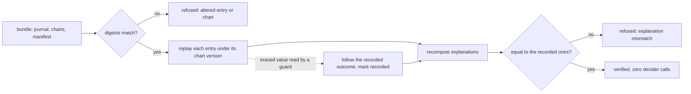

# Decision records

How the journal alone explains a decision: what each decision entry records, how a bundle is verified offline, how personal data is erased without breaking the chain, and what replay can say afterwards.

This view explains milestone M12 in `vertep-agent`, `vertep-objects`, `vertep-rules` and `vertep-cli`. Requirement names in backticks are from the OpenSpec change `m12-decision-records`.

## What a decision entry records

A decision or refusal entry carries the input, what was offered, what the shell made of the answer and, since 0.1.12, the outcome of applying it.

- describes:: [[capabilities#Decision records]]
- describes:: [[components#vertep-agent]]
- describes:: [[decisions#Explanation is the process record, not a story about it]]

The `disposition` (`accepted`, `refused-not-offered`, `stale`, ...) is set from the validation the shell ran when it accepted the input, never derived later. The `offered` list is the offer in force. The `outcome` holds the answers of the conditions evaluated, the transitions taken and the configuration after, and no datamodel value, so it leaks nothing a seal hides. A decider's rationale stays a labelled claim; a rule decider's derivation sits beside it and can be re-run.

## Verifying a bundle offline

A bundle is the journal, the chart versions it ran under and a manifest of digests; verification recomputes every explanation with no decider and no network.

- describes:: [[capabilities#Decision records]]
- describes:: [[components#vertep-cli]]

`AgentHost::export_bundle` writes it, `Bundle::verify` and `vt verify-bundle` check it, and `vt explain` prints what it verified. Agent journals in a store can be hash-chained and signed with `ChainedAgentSealer` from `vertep-objects`, which binds the journal to its writer; the bundle manifest itself is not signed.

## Erasure without rewriting

Sensitive fields are sealed under a per-subject key; erasure destroys the key and appends an entry, so every hash and signature still checks.

- describes:: [[capabilities#Journal redaction]]
- describes:: [[components#vertep-rules]]
- describes:: [[decisions#Sensitive fields are marks on record fields]]
- describes:: [[decisions#Erasure retracts what depends on the erased]]
- describes:: [[decisions#Snapshots never hold opened sealed values]]
- describes:: [[constraints#Erasure rules]]

A chart marks fields `@sensitive`, names the data subject with `@subject` and may set `@retain(P30D)`; `SealPolicy::from_chart` turns the marks into the policy `SealingJournal` applies on append. `erase` destroys the key through the `KeyStore`, lets an `ErasureHook` (in `vertep-rules`, `RetractOnErasure`) retract the subject's statements and the derived facts resting on them, and appends an `erasure` entry listing those facts. `expire` does the same at the retention horizon with the reason `retention`.

## Replay after erasure

Replay follows the recorded outcome from the first erased value on and says so: the result is `recorded`, never `verified`, when a condition could have read the erased value.

- describes:: [[capabilities#Journal redaction]]
- describes:: [[components#vertep-agent]]

Entries before the first erased value replay as always. After it, each condition answer comes from the entry's outcome, and the recorded configuration is forced as a last resort, so a fresh host reactivates the actor in the state it really reached. Not restored: the erased plaintext, values computed from erased data outside guards, and conditions inside invoked plan charts. An entry written before outcomes existed is re-evaluated and marked `recorded`. `AgentHost::replay_report` gives the counts behind the marker.
