# Distribution

How Vertep actors run on many machines: trusted clusters with shards, leases and fencing over QUIC, and federation across trust boundaries with DIDs and relay mailboxes.

This view explains milestones M4 and M5, the crates `vertep-cluster` and `vertep-federation`. Requirement names in backticks are from the OpenSpec changes `m4-cluster` and `m5-federation`.

## Cluster and federation

Distribution has two separate problems: a cluster is trusted nodes sharing placement of one actor population; federation is actors of different owners reaching each other through untrusted relays.

- describes:: [[decisions#Shard-based placement]]
- describes:: [[decisions#Identity, mailbox and transport layers]]
- describes:: [[roadmap#M4 Cluster]]
- describes:: [[roadmap#M5 Federation]]

Both reuse the three-layer split from M2: an IRI resolves through a directory to mailboxes, and mailboxes deliver over pluggable transports that are SCXML Event I/O Processors. A chart never knows which case it is in; `<send target="...">` looks the same for a local actor, a cluster actor and a federated DID actor.

| | Cluster (M4) | Federation (M5) |
|---|---|---|
| Trust | all nodes trusted, mutual TLS | each party trusts only itself |
| Addresses | `vt:` IRIs | DIDs, opt-in per actor |
| Directory | shard table: `hash(IRI) mod N` to lease owner | DID resolver: DID document services |
| Mailbox | local mailbox on the shard owner | DIDComm mediator or TSP endpoint, may be offline |
| Transport | QUIC with per-pair streams | DIDComm v2 forward, TSP direct or routed |
| Sender identity | cluster certificate | verified DID, journaled |
| Authorization | none beyond membership | DID-scoped grants in and out |

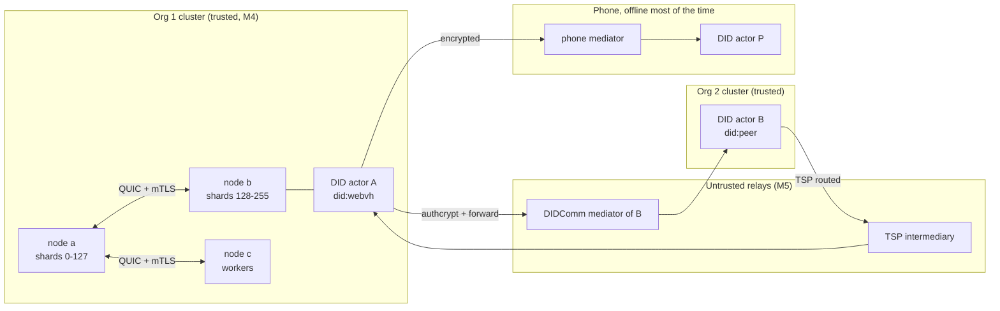

## Membership

One `Membership` trait reports the view, notifies subscribers and grants, renews, releases and revokes shard leases; static, gossip and external implementations sit behind it.

- describes:: [[capabilities#Cluster membership]]
- describes:: [[components#vertep-cluster]]
- describes:: [[decisions#External authorities over etcd and the Kubernetes Lease API]]
- describes:: [[decisions#etcd expires shard grants and a permanent key holds each shard's epoch]]
- describes:: [[decisions#Kubernetes grants expire by observation]]
- describes:: [[decisions#A leaving node ships each shard before handing it over]]

The runtime never depends on which implementation is configured (`Membership Trait`). Views carry strictly increasing version numbers, and a node rejects any view not newer than the one it holds (`Membership View Versions`). Joining checks cluster id and shard count (`Graceful Join`); leaving drains first (`Graceful Leave With Drain`); failure detection marks members suspect, then failed, within configured bounds, and a failed member's leases become available only after they expire (`Failure Detection`).

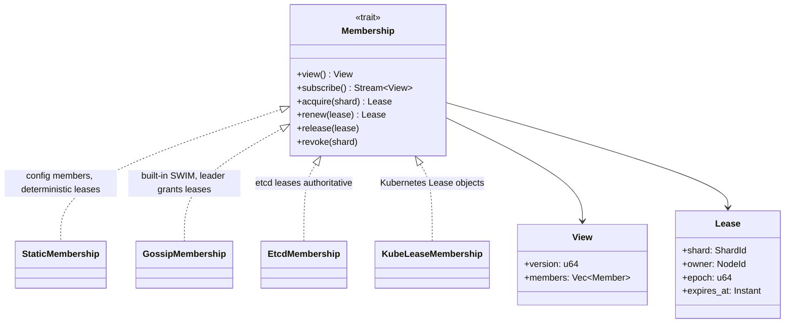

| Implementation | Members from | Lease authority | When to use | Requirement |
|---|---|---|---|---|
| Static | configuration | deterministic assignment from the member list | fixed fleets, tests, v1 | `Static Membership` |
| Gossip | SWIM with indirect probes, piggybacked gossip | a deterministic leader among active members | self-forming clusters without infrastructure | `Gossip Membership` |
| External | etcd or Kubernetes | the external service | operated clusters needing strong leases | `External Membership` |

Gossip lease granting is weaker than consensus under partitions; fencing keeps it safe, at the cost of availability. A shared test kit runs against all three implementations.

## Shards

An actor's shard is a fixed, versioned hash of its IRI modulo a power-of-two shard count chosen at cluster creation; one shard is one journal store with one writer.

- describes:: [[glossary#Shard]]
- describes:: [[capabilities#Shard placement]]
- describes:: [[constraints#Tiramemsu has a single writer per file]]

The rules are `Fixed Shard Count`, `Shard Assignment By Actor IRI Hash` and `One Journal File Per Shard`. The shard count N bounds write parallelism, so it is chosen generously (256 or 1024). Being a power of two makes resharding a split: under `mod 2N`, an actor in shard `s` lands in `s` or `s + N`.

```rust
/// Stable across platforms and releases; the hash version is cluster metadata.
pub fn shard_of(iri: &Iri, meta: &ClusterMeta) -> ShardId {
    debug_assert!(meta.shard_count.is_power_of_two());
    let h = meta.hash_version.hash64(iri.as_str().as_bytes());
    ShardId((h & (meta.shard_count as u64 - 1)) as u32)
}
```

Placement is per shard, not per actor: the directory is N entries of shard to owner, not millions of actor entries. A hot shard concentrates load on one writer; M4 exposes shard metrics but does not move individual actors.

## Leases and fencing

A shard is owned through a time-bounded lease whose every grant carries a strictly greater fencing epoch; owners stop before expiry, and stale epochs are rejected on journal appends and outbound frames.

- describes:: [[capabilities#Cluster membership]]
- describes:: [[capabilities#Shard placement]]
- describes:: [[decisions#Event-sourced actors]] {note: "the journal compare-and-set is the second guard"}

`Shard Leases With Fencing Epochs` and `Lease Expiry And Handover` define the lease. Renewals keep the epoch; new grants increase it. An owner stops work at `expiry - safety_margin` by its monotonic clock. `Journal Fencing Backstop` makes the journal store reject any append whose epoch is lower than the highest it has accepted for that shard, independently of the version check; receivers likewise drop lower-epoch frames into the dead-letter graph.

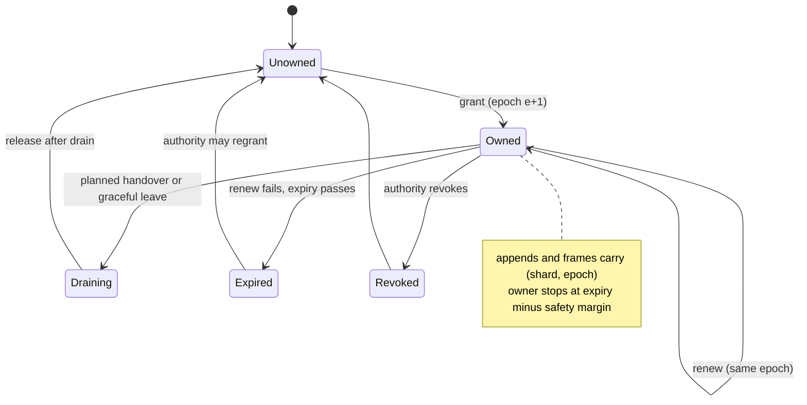

The split-brain case shows why both guards exist:

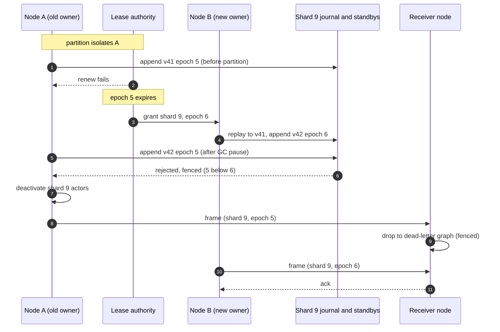

## Single activation

At most one activation of a virtual actor can commit macrosteps under any epoch: the lease prevents conflicts, and the fenced compare-and-set append catches what leases miss.

- describes:: [[glossary#Virtual actor]]
- describes:: [[decisions#Shard-based placement]]
- describes:: [[capabilities#Shard placement]]

`Activation On Shard Owner Only` and `Single Activation Guarantee` combine three checks, in order of cost:

1. **Routing.** A node activates an actor only if it holds an unexpired lease on its shard; other nodes forward (`Message Forwarding To Shard Owner`, with a hop limit).
2. **Lease timing.** The owner stops before expiry, so in the normal case two owners never overlap.
3. **Fenced append.** Under clock skew or a long pause, the stale owner's append fails on the epoch check, and its outbound frames are dropped by epoch. The append is also a compare-and-set on the actor's journal version, inherited from M2.

The invariant proved in Lean: for every shard and epoch, at most one writer's appends are accepted, and accepted journal versions are totally ordered across epochs. A Jepsen-style harness with partitions, pauses, crashes and clock skew checks that every journal is linear and every accepted message was processed once.

## Routing over QUIC

The cluster transport carries frames over QUIC with mutual TLS, one stream per sender and receiver pair, per-mailbox backpressure, and retries until the receiver confirms the message is stored.

- describes:: [[capabilities#Cluster transport]]
- describes:: [[constraints#Relays deliver at least once]] {note: "applies inside a cluster too"}

`QUIC Cluster Transport` registers it as a transport and Event I/O Processor. `Mutual TLS Within The Cluster` refuses peers whose certificate is not a current member. `Message Framing` defines one self-delimiting frame: message id, sender and target IRIs, `(shard, epoch)` for virtual senders, event name and data, with a maximum size. `Ordering Per Sender And Receiver` keys streams by `(X, Y)`; beyond a stream cap, pairs share streams ordered by sequence number. `Flow Control And Backpressure` ties mailbox bounds to QUIC flow control and never drops accepted messages.

`At-Least-Once Delivery With Deduplication` reuses the journal's message-id deduplication for virtual actors and a bounded id cache otherwise. `Routing Via The Shard Table` and `Redirect On Stale Routing` keep routing tables fresh:

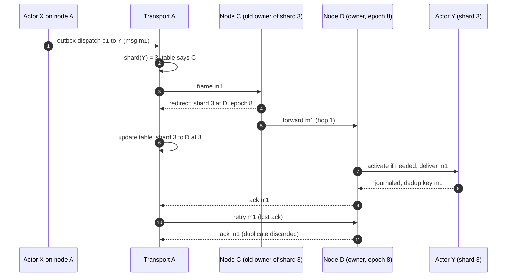

```rust
pub struct Frame {
    pub message_id: MessageId,
    pub from: Iri,
    pub to: Iri,
    pub fencing: Option<(ShardId, Epoch)>, // set when the sender is a virtual actor
    pub event: EventName,
    pub data: Bytes,                        // typed payload, encoded once
}
```

## Rebalancing and resharding

Shards move by draining, shipping or confirming the append-only journal, verifying the end version and transferring the lease at a higher epoch; resharding doubles N offline by splitting shards.

- describes:: [[capabilities#Shard placement]]
- describes:: [[decisions#Two storage traits with tiramemsu as default]] {note: "append-only files make shipping a copy"}

With tiramemsu, a shard's journal is a local file, so `Rebalancing By Journal File Shipping` copies it (or the suffix the target lacks) before the lease moves. `Journal Replication To Standbys` adds an optional replication factor: appends are acknowledged only after the configured standbys have stored them, so a standby can take over a failed owner. With replication factor 1, a failed owner's shards stay unavailable until its disk returns; messages wait in mailboxes rather than being lost. `Rebalancing By Lease Transfer` is the future path with a networked journal store: drain and move the lease, no copying.

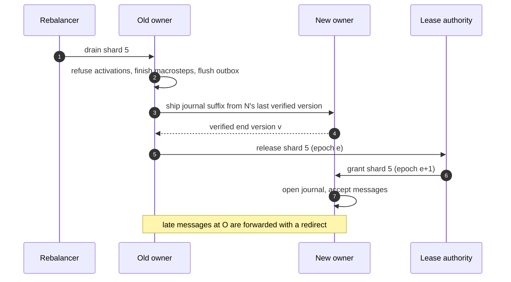

`Resharding Procedure` is offline and documented:

1. Stop all leases.
2. Split each shard `s` into `s` and `s + N` by re-hashing every actor IRI and moving its journal.
3. Verify every actor's replayed state is unchanged.
4. Record `N' = 2N` in cluster metadata and restart.

## Worker pools

Stateless workers are pooled across any node that declares the worker type, balanced by policy, keep no journal, and report results and failures into the caller's journal.

- describes:: [[capabilities#Worker pools]]
- describes:: [[glossary#Stateless worker]]
- describes:: [[decisions#IRI identity and lifecycle classes]]

Workers are the home for heavy or external work: LLM calls at scale, embeddings, tool execution. They are never sharded and never take a lease (`Stateless Worker Activations`, `Pool Placement Across Nodes`). Policies are round robin, least outstanding requests and prefer local (`Load Balancing Policies`), with per-node activation and per-activation concurrency limits backed by a bounded pool queue (`Worker Concurrency Limits`). Activations can be discarded at any time (`No Journal For Workers`).

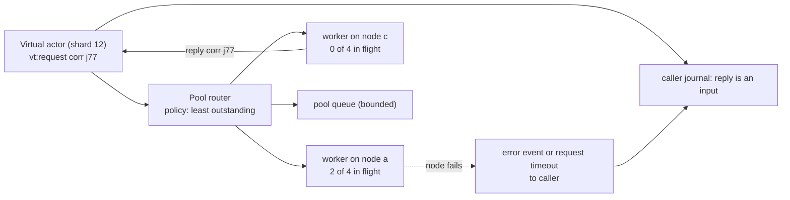

`Results Journaled By The Caller` keeps replay from repeating the work. `Worker Failure Reporting` forbids silent retries on another activation unless the worker type is declared idempotent, because a retried LLM or tool call can have external effects.

## Cluster inside the runtime

A `ClusterNode` joins one `vertep-runtime` node to the cluster as its placement, its sharded fenced storage, its cluster Event I/O Processor and its end of the wire.

- describes:: [[components#vertep-cluster]]
- describes:: [[components#vertep-runtime]]
- describes:: [[decisions#Placement is a runtime hook with three answers]]
- describes:: [[decisions#A free shard goes only to a node holding its journal]]
- describes:: [[decisions#Unreplicated entries stay unreadable until the quorum catches up]]
- describes:: [[decisions#Worker pools dispatch from the sending node]]
- describes:: [[decisions#A new owner replicates to the shard's current standbys]]
- describes:: [[decisions#Frames to other nodes are kept until settled]]

Before the runtime delivers a message to a virtual actor or a worker, or activates a virtual actor, it asks the placement. The answer is local (this node holds an unexpired lease on the shard), remote (a mailbox that frames the envelope and sends it with retries until acknowledged or the delivery deadline, after which the sender gets `error.communication`), or hold (no live owner: the message waits in the local mailbox and the actor is not activated). Messages already waiting locally move to the owner on the actor's next turn. Every append goes through `ClusterStorage`, which routes it to the shard's store, stamps the node's lease epoch as the fencing token and, with standbys, acknowledges only after the quorum stored it. `Node::drain` finishes macrosteps and the outbox and deactivates a shard's actors for a leave or a handover.

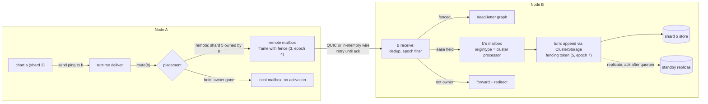

A worker request is routed by the sending node's dispatcher for the worker type: it picks an activation by policy, creating one on a declaring member when none has capacity, queues within the bound, or refuses at once with an error event. The reply completes the request and frees capacity; a failed worker node fails its requests to their callers, or retries them once on another activation for idempotent types.

## Fault injection

Harnesses partition nodes, pause them mid-append, crash and restart them, run a clock slow, delay and drop frames and lose acknowledgements, while a checker and the Lean lease model verify the recorded history.

- describes:: [[capabilities#Shard placement]]
- describes:: [[decisions#Fault-injection histories export as JSON lines]]
- describes:: [[decisions#Lean verification bridge]]
- describes:: [[decisions#Container fault injection runs every node as a process]]
- describes:: [[decisions#Gossip leader epochs carry a per-start tag]]
- describes:: [[decisions#A standby's fence rises only with entries it stores]]
- describes:: [[decisions#An owner checks its standbys before writing its own copy]]
- describes:: [[constraints#The Docker Desktop kernel has no netem]]

The checker requires every actor journal to be linear, at most one writer per shard and epoch, every acknowledged message processed exactly once, and no admitted frame from an append that was not accepted or from an epoch below one the receiver already admitted. Histories are written as JSON lines when `VERTEP_HISTORY_DIR` is set, and every run replays them through the Lean lease and fencing model in strict mode, which must reach the same accept and reject decisions.

The in-process harness (`tests/faults.rs`) is generic over the membership and the journals: static, the external stand-in and gossip on simulated time, etcd and Kubernetes in containers on real time; one shared fenced store, or local journals with replication factor 1 (only a shard's home node takes it) or 3 (two standbys, both required). The container harness (`tests/containers.rs`) runs every node as a process:

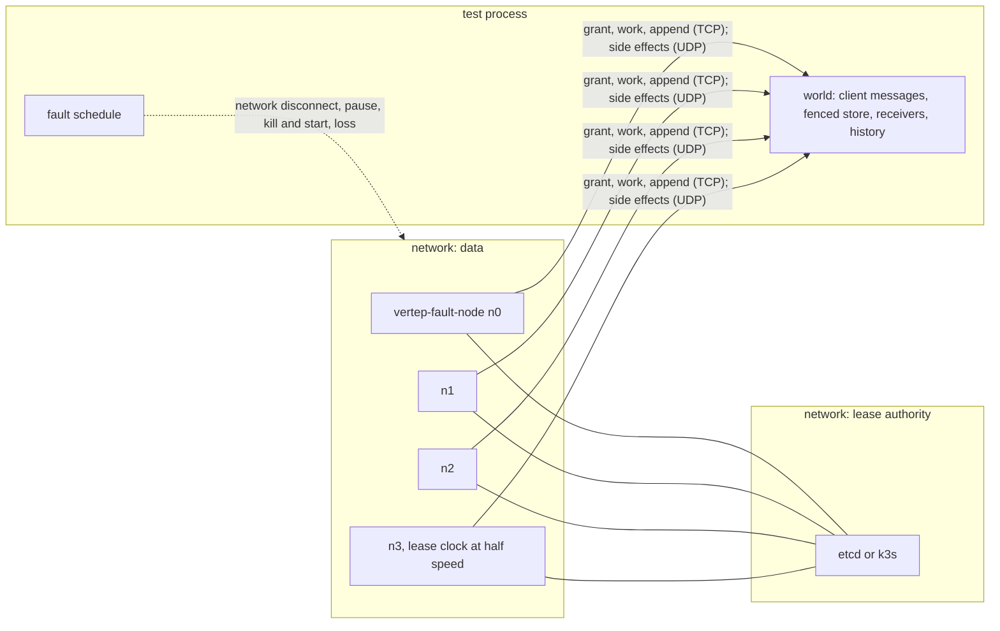

The nightly `cluster-faults` job runs both with `VERTEP_CONTAINER_TESTS=require`.

## DID identity

A DID is optional and per actor: an actor that crosses a trust boundary uses its DID as its address IRI, and a DID resolver acts as the directory that yields its mailboxes, transports and keys.

- describes:: [[capabilities#DID identity]]
- describes:: [[components#vertep-federation]]
- describes:: [[decisions#IRI identity and lifecycle classes]] {note: "a DID is an IRI, so it is the RDF subject of state and history"}

`Opt-In DID Identity Per Actor` keeps keys and cryptography away from in-cluster `vt:` actors. `Supported DID Methods` ships `did:key` (offline), `did:peer` (pairwise relationships) and `did:web` (HTTPS through an injectable `HttpFetcher`) built in, and `did:webvh` (long-lived public actors with verifiable key history) behind the `webvh` cargo feature of `vertep-federation`, all behind `Pluggable DID Resolver` (`crates/vertep-federation/src/resolver/`). `DID Resolution As Address Resolution` turns DID document services into routes and keys, with bounded caching and re-resolution on expiry or endpoint failure (`Resolution Caching`).

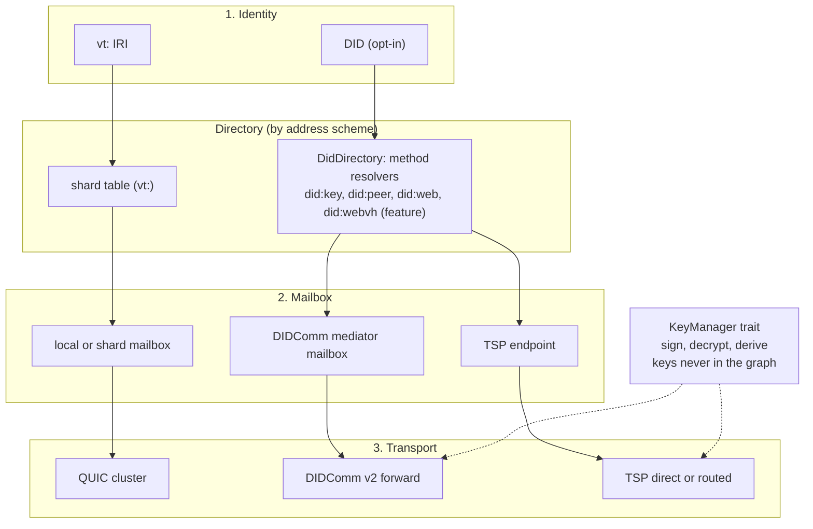

Private keys stay behind `Key Management Interface` and never enter journals, snapshots, the graph or datamodels, since a never-forget store could only crypto-shred them. `Key Rotation Without Address Change` keeps the DID stable with a grace period for retired keys. `DID Documents In The Runtime Graph` links each DID actor to its verification methods, services and grants through the identity module aligned with DID Core.

## Authenticated origin and grants

Inbound cross-trust messages are decrypted, verified against the sender's DID, checked against grants and type-checked before any journal append; the verification outcome is journaled so replay never re-verifies.

- describes:: [[capabilities#DID identity]]
- describes:: [[decisions#Event-sourced actors]] {note: "verification outcome is an input"}
- describes:: [[constraints#SCXML discards unmatched events]] {note: "refused messages are recorded, not silently dropped"}

`Authenticated Event Origin` sets `_event.origin` to the sender DID only after verification; `Unauthenticated Event Marking` lets anonymous messages in only by policy, marked unverified for guards. `Journaled Verification Outcome` keeps the pure core free of resolution and cryptography: it sees `_event.origin` and one boolean, `_event.originverified`. `DID-Scoped Capability Grants`, `Outbound Grant Enforcement` and `Credential-Based Grants` enforce authority at both ends, before the core, so an ungranted message never costs the receiver a journal append.

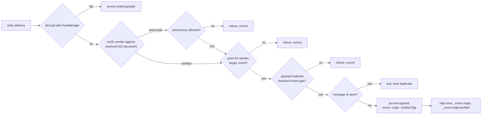

Grants are graph statements (grantee DID, target actor, event descriptors, optional expiry) or verifiable credentials from a trusted issuer, so "who may talk to this agent" is a SPARQL query:

```sparql
SELECT ?grantee ?event ?until WHERE {
  ?g a vt-id:Grant ;
     vt-id:target <did:webvh:example.org:agents:billing> ;
     vt-id:grantee ?grantee ;
     vt-id:event ?event .
  OPTIONAL { ?g vt-id:expires ?until }
}
```

Chart guards can still make finer decisions, for example "accept `approve` only from DID X", on top of grants.

## Relay mailboxes

DIDComm v2 mediators and TSP endpoints serve as mailboxes and transports: payloads are encrypted end to end, delivery is at least once, and mailboxes acknowledge only after the journal append.

- describes:: [[capabilities#Relay mailboxes]]
- describes:: [[glossary#Mailbox]]
- describes:: [[constraints#Relays deliver at least once]]

`DIDComm Mediator Mailbox`, `DIDComm Forward Routing` and `DIDComm Message Pickup` let an actor receive while deactivated or offline. The sender authcrypts (or anoncrypts) to the recipient and wraps one forward message per routing key. The receiving mailbox picks up in batches or over a live session and acknowledges each message only after the append, so a crash causes redelivery, never loss. `Shared And Per-Actor Mediator Mailboxes` lets one mailbox serve a whole node or shard, demultiplexed by recipient, and `Activation On Delivery` wakes deactivated virtual actors.

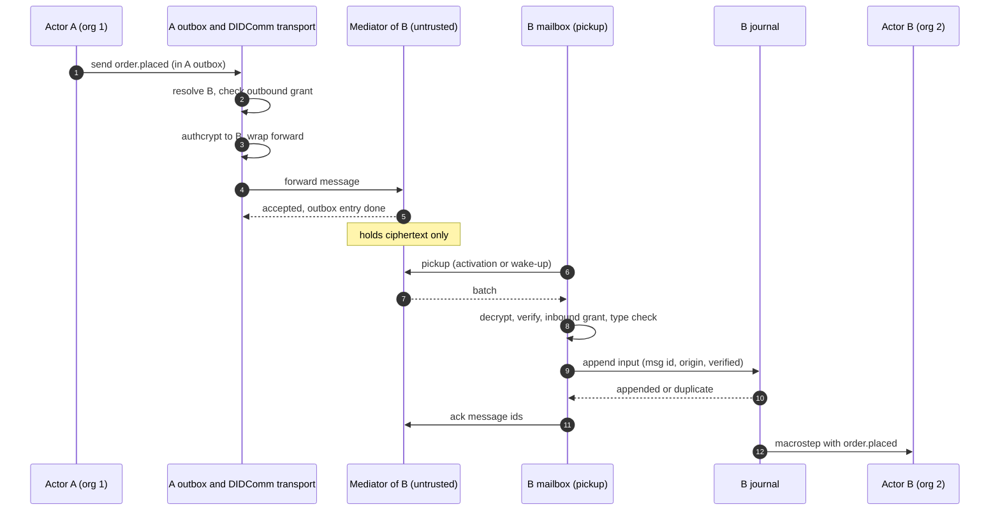

`TSP Direct Transport` and `TSP Routed Transport Through Intermediaries` map the actor's DID to a TSP VID, set up the relationship inside the transport, and nest the payload so only the final recipient opens it:

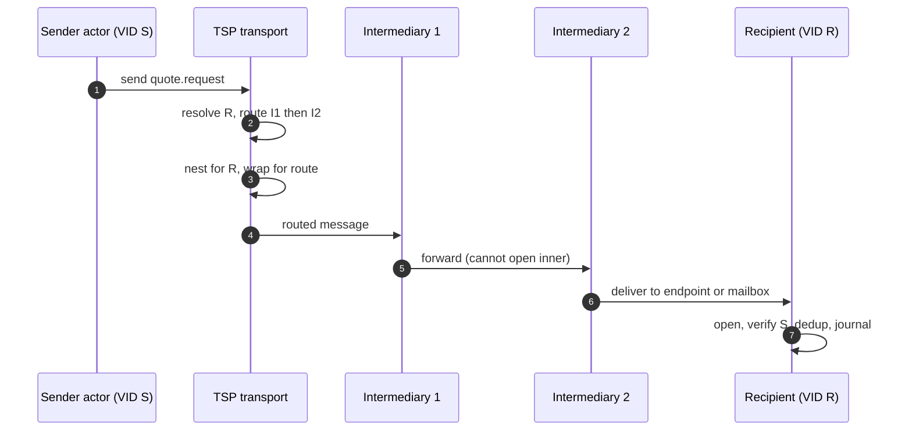

`End-To-End Encryption Through Relays` limits relays to routing data: no event name, payload, send id or origin. `SCXML Event Envelope Mapping` carries one protocol-neutral envelope for both protocols:

| Envelope field | Source at receiver |
|---|---|
| `name`, `sendid`, typed `data` | envelope body, `data` type-checked against the receiver's declared event type |
| sender chart version IRI | envelope body |
| message id | envelope body, used for deduplication |
| `origin` | the verified sender DID, never taken from the body |
| `origintype` | the I/O processor that delivered it |

`Transport Selection From The DID Document` tries services in a configured preference order (TSP first by default, then DIDComm) with fallback. `Undeliverable Message Reporting` raises `error.communication` with the send id once the retry policy is exhausted, without blocking the chart. `Mailbox Ordering` promises order only within one mailbox; across relays or senders, charts use `vt:request` correlation ids.

## Federation inside the runtime

A `Federation` joins one `vertep-runtime` node to the trust-boundary layers through the runtime's own seams: the resolver of `did:` addresses, the mailboxes of local DID actors, and two Event I/O Processors.

- describes:: [[components#vertep-federation]]
- describes:: [[components#vertep-runtime]]
- describes:: [[decisions#DID resolution is a directory chosen by address scheme]]
- describes:: [[decisions#DIDComm mailboxes acknowledge after the append]]
- describes:: [[decisions#Relay outbox owns cross-trust retries]]
- describes:: [[decisions#Verified origin flag in the event]]
- describes:: [[decisions#Remote mediators through Pickup 3.0]]
- describes:: [[decisions#TSP direct when reachable, routed otherwise]]

`Federation::provision` creates an instance's keys and DID and binds the DID to a chart type and key on the node, so the DID is the actor's address, journal subject and current-state graph. A send to a DID hosted elsewhere resolves to an outbound mailbox that only queues it in the relay outbox, a store-backed queue beside the actor journals; the runtime's outbox entry is done at that hand-off. The relay outbox checks the outbound grant, resolves the DID through the cache, tries the routes in preference order with fallback, and retries unreachable recipients with backoff; a failure becomes `error.communication` in the sending chart with the send id and the reason. `<send type="tsp">` or `type="didcomm"` restricts a send to one transport.

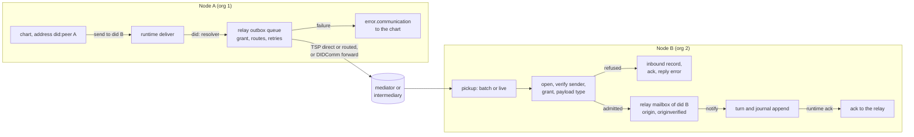

Each local DID actor's relay mailbox is a runtime `Mailbox`: picked-up messages and messages from senders on the same node, in arrival order. The runtime acknowledges a message after its turn is durable, or when it drops it as a duplicate message id, and only that acknowledgement releases the relay's copy; after a crash the copy is fetched again and dropped by the journal. A refused message is recorded in graph `<actor>/inbound`, acknowledged, and answered with `error.communication` when the sender is verified and had contacted the actor first. Relay pickups wake actors with `NodeHandle::notify`, and after a restart the mailbox factory picks up what the relays held. An admitted event carries the sender DID in `_event.origin` and `_event.originverified` true; an anonymous one has neither. A remote mediator is a `pickup::MediatorClient` binding, speaking Mediator Coordination 2.0 and Message Pickup 3.0 over the deployment's `RelayNetwork`. The `testkit` feature has an in-process DIDComm mediator and TSP intermediary on a local network for tests and the `two_orgs` example.

## Failure modes

The distributed failure cases and what the design guarantees in each; safety never depends on clocks or relays behaving well, only availability does.

- describes:: [[capabilities#Shard placement]]
- describes:: [[capabilities#Relay mailboxes]]

| Failure | Guarantee | Requirement |
|---|---|---|
| Network partition isolates a shard owner | new owner at higher epoch; stale appends and frames fenced | `Journal Fencing Backstop` |
| Clock skew beyond the safety margin | fencing on appends and frames keeps safety | `Shard Leases With Fencing Epochs` |
| Owner crash, replication factor 1 | shard unavailable until the disk returns; messages wait in mailboxes | `Journal Replication To Standbys` |
| Lost acknowledgement | retry, receiver deduplicates by message id | `At-Least-Once Delivery With Deduplication` |
| Stale routing table | redirect plus forward, hop limit | `Redirect On Stale Routing` |
| Worker node dies mid-request | error event or request timeout to the caller; no silent retry unless idempotent | `Worker Failure Reporting` |
| Mediator crashes after pickup | no ack before append, so redelivery; dedup by id | `DIDComm Message Pickup` |
| Key rotated while messages are in flight | grace period for retired keys; undecryptable messages recorded | `Key Rotation Without Address Change` |
| Recipient unreachable for good | `error.communication` after the retry policy, chart not blocked | `Undeliverable Message Reporting` |

## Spec and decision differences

Where the M4 and M5 specs refine the accepted decisions; the specs govern.

- describes:: [[decisions#Shard-based placement]]
- describes:: [[decisions#Identity, mailbox and transport layers]]
- describes:: [[decisions#Verified origin flag in the event]]

- **Fencing epochs are new.** The decision guards single activation with the lease plus the journal compare-and-set. The spec adds strictly increasing fencing epochs checked on appends, on standby replication and on outbound frames, because compare-and-set alone cannot stop a stale owner's side effects or work across shipped file copies.
- **Standby replication is new.** The decision moves shards only by shipping files (v1) or leases (later). `Journal Replication To Standbys` adds an optional replication factor for failover, and states plainly that with factor 1 a failed owner's shards are unavailable.
- **Shard count must be a power of two**, a refinement that turns resharding into a split.
- **Transport order is now chosen.** The decision left DIDComm versus TSP open; the spec defaults to TSP first, then DIDComm, configurable per deployment.
- **Grants are enforced before the journal.** The decision placed authorization at trust boundaries; the spec specifies inbound refusal before any append, so ungranted traffic costs no journal space.
- **The verified flag is a field of `_event`.** Design D4 gives the core `_event.origin` plus one boolean, and `vertep-core` now carries it as `Event::originverified` (`crates/vertep-core/src/datamodel.rs`): every datamodel exposes it, the journal stores it as `vt:originVerified`, and an unverified event has no origin.
