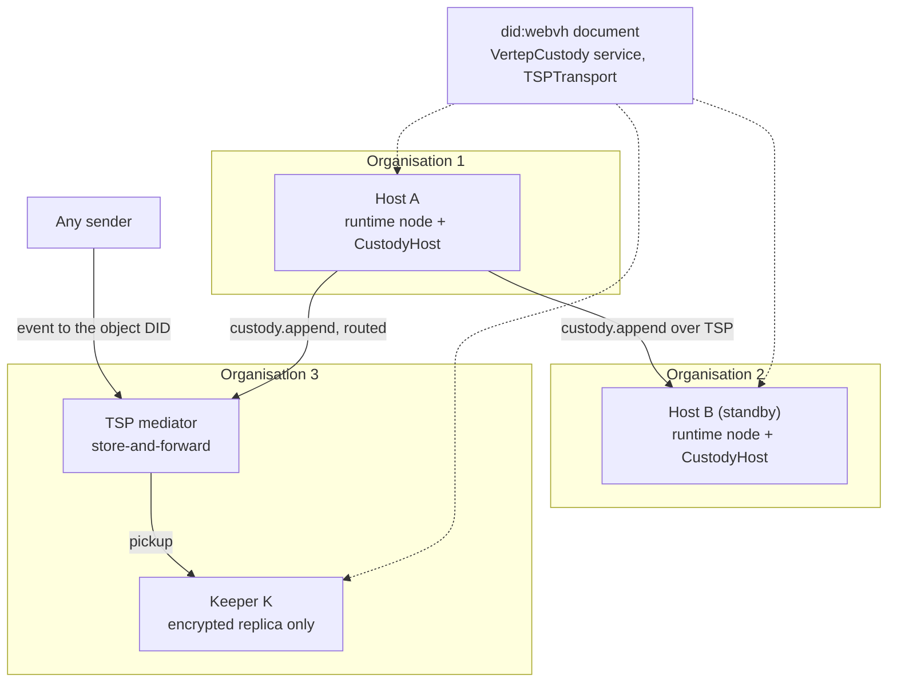
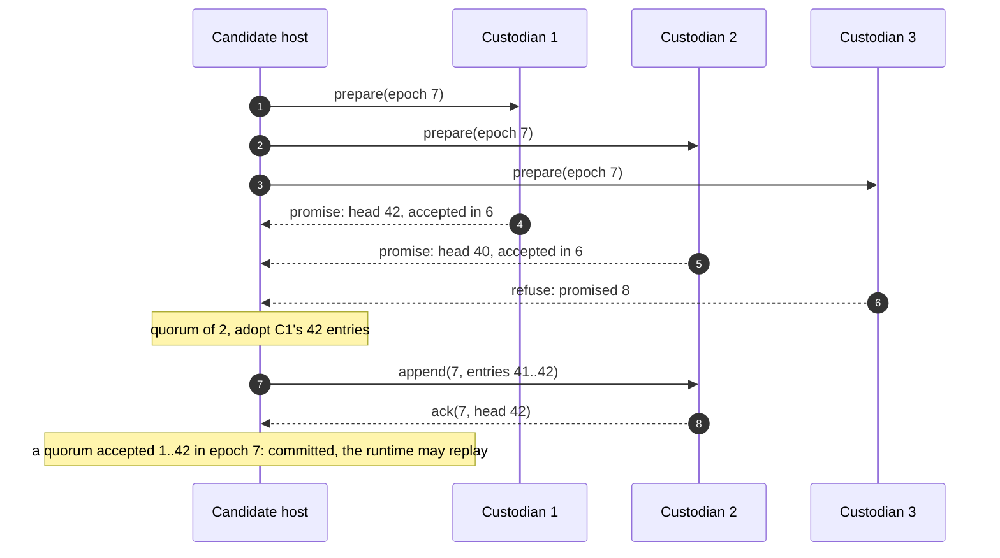
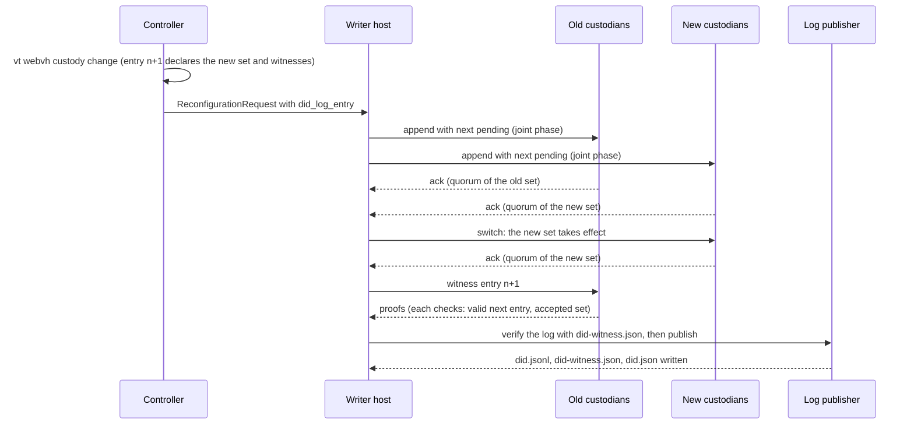
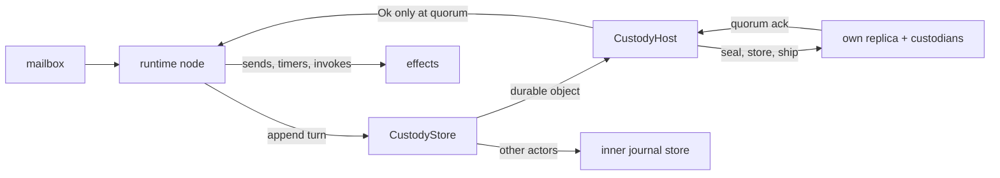

# Durable Objects

How Vertep keeps one actor alive across organisations: a DID address, a hash-chained signed journal, custodians that talk over TSP, and one writer per custody epoch won by quorum promises.

This view explains milestone M7 and the crate `vertep-objects`, and from milestone M8 how `vertep-webvh` writes, witnesses and hosts the objects' `did:webvh` logs. The TSP mediator that custodians and objects use while offline is in [[views/distribution#Distribution]]. Requirement names in backticks are from the OpenSpec change `m7-durable-objects`.

## The idea

A durable object is an ordinary virtual actor whose journal belongs to nobody in particular: several custodians keep it, any host among them can serve it, and no shared coordinator decides who writes.

- describes:: [[roadmap#M7 Durable objects]]
- describes:: [[capabilities#Durable objects]]
- describes:: [[capabilities#Object custody]]
- describes:: [[components#vertep-objects]]
- describes:: [[decisions#Durable objects are DID virtual actors with verifiable journals]]

Nothing in the execution semantics changes. The object runs the same chart, the same `step` and the same runtime as any virtual actor. What changes is where its journal lives and who may extend it:

| Concern | Ordinary virtual actor | Durable object |
|---|---|---|
| Address | `vt:` or `https:` IRI | `did:webvh` DID (`Durable Object Identity`) |
| Journal | one store, one node | custodian replicas, verifiable entry by entry |
| Single writer | shard lease from a membership authority | custody epoch won by a quorum of promises |
| Effects | after the local append | after a quorum of custodians accepted the entry |
| Survives | the node's disk | any minority of custodians, any one organisation |

## Verifiable entries

Every entry states, inside its own graph, the object, its position, the custody epoch, the writer, the previous entry's hash, its own content hash and the writer's signature over that hash.

- describes:: [[decisions#Journal entries are hash-chained and host-signed]]
- describes:: [[decisions#Keys stay behind a key manager]]

`chain::seal` adds the statements, `chain::verify_chain` checks a replica from genesis without trusting whoever served it, and failures name the position and a reason code (`hash-mismatch`, `bad-signature`, `not-a-host`, `epoch-regression`, `malformed`). The hash is SHA-256 over the sorted N-Triples lines of the graph without the seal statements; an entry with blank nodes is relabelled with RDFC-1.0 first. Because the statements are part of the graph, the memory and tiramemsu journal stores round-trip them unchanged.

## Custody epochs

A host becomes the only writer of an epoch by collecting signed promises from a majority of custodians; it adopts the chain accepted in the highest epoch, then the longest, and ships it under its own epoch.

- describes:: [[decisions#Custody epochs are won by quorum promises]]
- describes:: [[decisions#Replication rides TSP through a replica link]]
- describes:: [[constraints#Clock skew beyond the safety margin breaks lease exclusivity]]

The protocol is Paxos over the whole log. A custodian's state is the epoch it promised, the epoch it last accepted in and its chain. It promises an epoch only above every epoch it promised before, refuses batches from lower epochs, and on a batch from a newer epoch replaces an uncommitted tail. An entry is committed once a quorum has accepted, in one epoch, a chain containing it; an inherited entry therefore commits when a quorum re-accepts it in the new writer's epoch. No clock enters any decision.

`CustodyHost::elect` runs one election; `activate` retries above every epoch seen with randomised back-off; `append_turn` seals and ships a turn and succeeds only at quorum. A host whose own replica has promised a higher epoch is deposed on its next append: it never counts its own copy toward a quorum it has lost. A deposed host does not elect again until told to (`resume`), and a standby (`set_standby`) never elects on first use.

## Replicas and keepers

Hosts hold entries in clear; keepers hold a clear header and an encrypted body, enough to order, chain-check and detect equivocation but not to read state.

- describes:: [[decisions#Keepers store ciphertext under a per-object content key]]
- describes:: [[decisions#Equivocation is kept as evidence]]
- describes:: [[decisions#Hosts share the object VID and only the writer acknowledges]]

A custodian's replica is an append-only log of custody records (promises, accepted batches, evidence) in its own journal store under `<object>/custody-log`; reopening it replays the log, and replacing a tail is just another record. The keeper header carries the writer's signature over the content hash, and the envelope is signed by the host that encrypted it, so a new writer can re-ship inherited entries to keepers. Content keys are wrapped to every host; a host that joins receives the existing generations, a host that leaves starts a new one. Two validly signed entries of one epoch at one position become evidence in the replica and are reported to the controller through an `EvidenceSink`.

## Custodian set changes

The controller signs a new set; the writer replicates it as pending, which needs quorums of both sets, switches once both quorums hold the journal, and then publishes the `did:webvh` update.

- describes:: [[decisions#Custodian set changes use joint consensus]]
- describes:: [[constraints#did:webvh updates need the web host]]

Custody state is a configuration record: the effective set and, during a change, the pending next set. While a change is pending, every commit and every election needs a quorum of each set. Promises report the record, so a candidate that meets a pending change prepares again under both sets. Custodians refuse batches that carry an older set than they hold. The first rule (switch on a quorum of the old set plus every newcomer) lost committed entries in two counterexamples the Lean custody model produced, a shrink and an interrupted change; both are regression tests now.

## did:webvh logs and witnesses

An object's DID log names its custodians as witnesses at the custody quorum, so the published document changes only with the same majority that commits custody; `vertep-webvh` writes, witnesses and hosts the log.

- describes:: [[roadmap#M8 did:webvh hosting]]
- describes:: [[capabilities#webvh identity]]
- describes:: [[capabilities#webvh hosting]]
- describes:: [[components#vertep-webvh]]
- describes:: [[decisions#did:webvh authoring builds on didwebvh-rs]]
- describes:: [[decisions#did:webvh entries are signed through the key manager]]
- describes:: [[decisions#Custodians witness their object's DID log]]
- describes:: [[decisions#Witnessing is a custody request judged by a replica policy]]
- describes:: [[decisions#Custody changes carry their DID log entry]]
- describes:: [[decisions#Log publishers verify before they write]]
- describes:: [[decisions#vt webvh serve is a static log server]]
- describes:: [[decisions#The mediator creates and serves its own did:webvh]]
- describes:: [[constraints#did:webvh witnesses are did:key]]
- describes:: [[constraints#did:webvh versionTime strictly increases]]

**Authoring.** `Author` writes entries with update keys it knows only by name. `KmSigner` makes every signature through the key manager. Objects use pre-rotation: each entry reveals the key the previous one announced by hash, and announces the next. The document comes from a Vertep identity, plus the `VertepCustody` service and the controller's key.

**Witnessing.** A custodian witnesses as the `did:key` of its Ed25519 signing key. A witness request is an ordinary custody request, so it travels in process or over TSP. The replica hands it to its `EntryWitness` policy with the effective and pending configurations it accepted. The policy checks three things before it signs over the entry's `versionId`:

- the published log verifies;
- the entry is its valid next entry, signed by a current update key;
- the entry declares one of those configurations.

**Custody changes.** `vt webvh custody change` (or `custody_change`) builds the entry declaring the new set and its new witness list, and the controller-signed request that carries it. The writer runs the joint-consensus change. After the switch, `WebvhPublisher`, the custody `DocumentPublisher`, asks the custodians for proofs. A witness-list change applies only from the next entry, so the old set witnesses the change at its own threshold. The custodians that accepted the joint phase hold the new set as pending or effective, so they agree. The publisher then verifies the whole log and publishes it.

**Hosting.** Publishers write the `did:webvh` 1.0 layout below a root: `<domain>/.well-known/` or `<domain>/<path>/`, holding `did.jsonl`, `did-witness.json` and the `did:web` form `did.json`. There are three:

- the directory publisher;
- the git publisher (commit and push, for Pages);
- the command publisher (any CLI, such as `aws s3 sync` or `wrangler pages deploy`).

Each refuses a log that does not verify, naming the failing entry or the missing proofs. `vt webvh serve` serves such a root behind a TLS proxy. `vt-mediator` with `did = "webvh:<host>"` creates its own log and serves it beside `/tsp`.

**Interop.** The DIF test-suite vectors resolve through Vertep, except `witness-update`. That vector lowers its own witness threshold, and Vertep refuses it, as `didwebvh-rs` does. Accepting it would let a stolen update key witness its own entry.

## Inside the runtime

`ObjectStorage` is a runtime `Storage` whose journal routes durable objects to their custody hosts and everything else to the wrapped storage; the runtime itself is unchanged.

- describes:: [[decisions#Event-sourced actors]] {note: "effects only after a quorum accepted the turn"}
- describes:: [[decisions#The agent journal is stored in a journal store]]

A turn's sends, timers and invokes happen only after the append returned. When no quorum accepts, the runtime releases the message and parks the actor; after the back-off the entry may have committed in a catch-up, and then replay deduplicates the redelivered message and the outbox dispatches its sends once. `serve_object` activates an object on a host that takes it over, which re-arms its journaled timers there. Outbox progress is per node, so after a failover the new host re-dispatches sends with their original message ids, which receivers deduplicate. An agent becomes a durable object by journaling into the custody store with `StoreAgentJournal`, as the `three_orgs` example shows: org 2 replays the agent without calling the model and answers the approval org 1 left open.

## Verification

Every scenario of `durable-objects` and `object-custody` has a test, and a randomised fault run checks safety on hundreds of histories.

- describes:: [[components#vertep-objects]]

`tests/custody.rs` covers the custody scenarios on in-process custodians with switchable links; `tests/custody_tsp.rs` runs custody over real TSP, directly and through a store-and-forward intermediary; `tests/runtime.rs` runs durable objects in the actor runtime; `tests/faults.rs` drives random partitions, colliding elections, crashes with recovery and late duplicate batches, checks one writer per epoch and that every committed log survives into every later election and commit, and exports the histories for the Lean custody model. `lean/vertep-lean/VertepLean/CustodyTheorems.lean` proves one writer per epoch and that a committed log is a prefix of every later adoption and accepted log, for a fixed custodian set. `CustodyJoint.lean` models custodian-set changes by joint consensus. It proves quorum intersection across consecutive configurations and safety for runs that start no change. Safety for runs that change the set is still an open conjecture, checked by a random search and by replay. `CustodyReconfigUnsafe.lean` proves the first reconfiguration rule unsafe. With the `differential` feature, every history is replayed through `vertep-custody` in strict mode, and 64 seeds with set changes up to version 9 agree.
