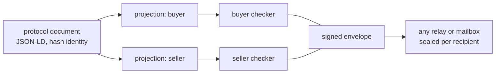
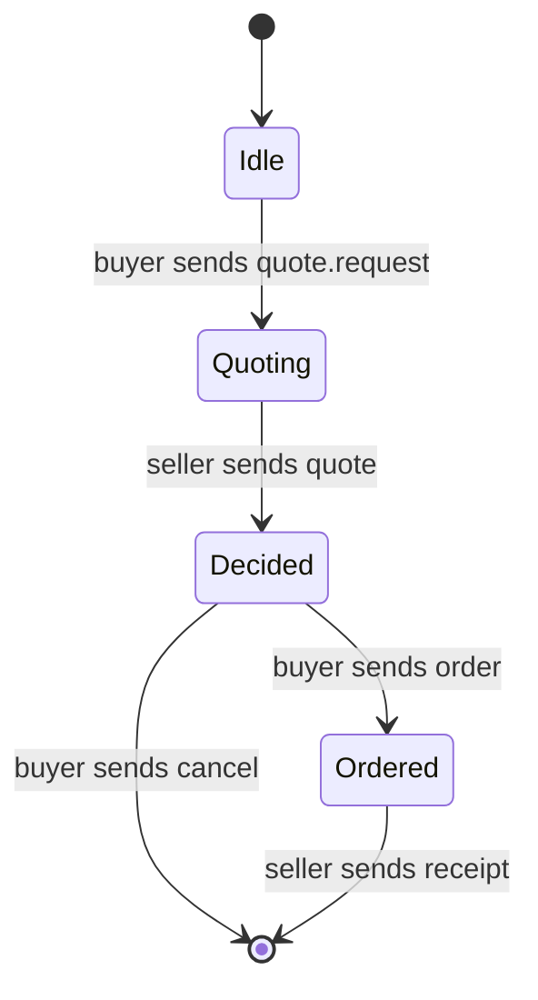
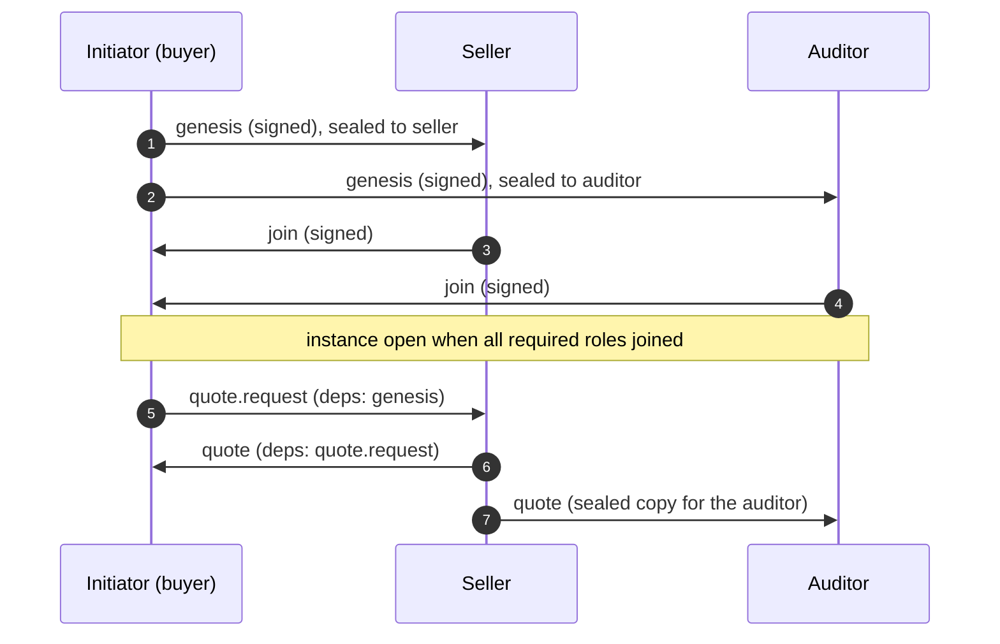
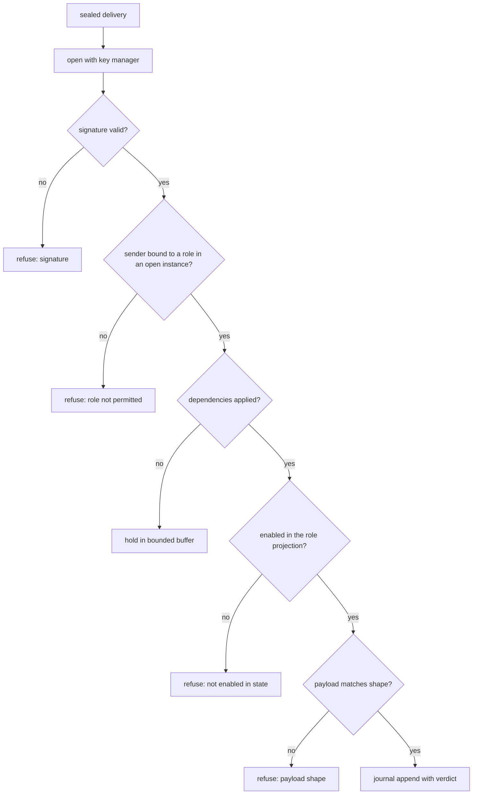

# Kolyada

How agents say, in a form a stranger can verify, how to talk to them: a hash-identified choreography projected onto roles, signed messages sealed per recipient, and spaces where several agents cooperate through ordinary mailboxes.

- describes:: [[components#vertep-kolyada]]
- describes:: [[capabilities#Agent protocols]]
- describes:: [[capabilities#Protocol conformance]]
- describes:: [[capabilities#Protocol spaces]]
- describes:: [[roadmap#M10 Agent protocols]]
- describes:: [[decisions#A protocol is a role-based choreography and the interface is its projection]]
- describes:: [[decisions#Choreographies are one global chart projected in a restricted subset]]
- describes:: [[decisions#Protocols are identified by the hash of their graph]]
- describes:: [[decisions#A protocol space is logical, sealed pairwise and hash-linked]]
- describes:: [[decisions#Role gives authority and the agent's policy decides at join]]
- describes:: [[decisions#Out-of-order messages wait, and refusals come with proof]]
- describes:: [[decisions#Protocol messages are signed, then sealed]]
- describes:: [[decisions#Sub-protocols make a space a tree of instances]]
- describes:: [[decisions#Charts declare roles and the mailbox checks before the journal]]
- describes:: [[constraints#Choreography projection needs one deciding role]]
- describes:: [[constraints#Authcrypt is not verifiable by a third party]]

This view explains milestone M10 and the crate `vertep-kolyada`, whose core is built; the join policy, mailbox binding and Lean model are not. Requirement names in backticks are from the OpenSpec change `m10-agent-protocols`. The relays that carry the messages are in [[views/distribution#Distribution#Relay mailboxes]], and the grants this replaces inside a protocol are in [[views/distribution#Distribution#Authenticated origin and grants]].

## The idea

A grant says "this DID may send this event". A protocol says who sends what, in which order, to whom, and what the handshake is, in one document that every party checks locally.

The design follows the Decentralised Web Node idea of published protocols and permissions, with three differences. Agents are statecharts, so a protocol is a chart over roles. Mailboxes only hold ciphertext, so a shared space is a logical grouping and not a shared store. And everything is checkable by a peer that trusts nobody: documents are identified by hash and messages are signed.

## The protocol document

`Protocol Document` fixes one JSON-LD profile with a frozen `vk:` context embedded in the crate. The document names roles, message types with payload shapes, and states with transitions of the form "role X sends message M".

- **Identity.** `Protocol Identity` hashes the RDFC-1.0 canonical form of the expanded graph, the same scheme as chart version IRIs, so two JSON-LD spellings of one protocol have one identity.
- **Shapes.** `Payload Shapes` uses a small SHACL subset that the checker interprets itself. Its agreement with the full SHACL validation in `vertep-rdf` is a planned test, not yet written.
- **Well-formedness.** `Well-Formed Choreography` accepts sequence, choice by one role, loops, and timeout or cancel as ordinary messages. It rejects choices decided by different roles and parallel regions across roles, naming the state.
- **Foreign contexts.** A document that references any other context is rejected without a network request.

## Projection and the interface

`Role Projection` turns the global chart into one automaton per role: its sends, its receives, and silence for everything else. The interface view lists, for each state, what the role accepts and from whom.

That is the answer to "which messages and handshake does this agent accept".

The seller's projection waits in `Idle`, accepts `quote.request` from `buyer`, then sends `quote`. The buyer decides at `Decided`, so one role decides at every branching point. An agent may implement its role with any chart or code; the projection fixes only what is visible on the wire.

## Offers and discovery

`Protocol Offers` are signed statements, separate from the document, that a DID plays a role, with an optional expiry and list of accepted initiators. `Protocol Discovery` lists them in a `VertepProtocol` service entry of the DID document.

A peer fetches the document by hash from any source and verifies it, so no registry exists. `RDF Bridge` imports documents and offers into a graph, so "who offers the seller role of this protocol" is a SPARQL query.

## A space

A space is not a store. It is an instance id, a role binding and a history.

1. The initiator signs a genesis naming the protocol identity, the instance id (the genesis hash) and a DID for each role (`Protocol Instance`).
2. Each other participant countersigns with `join` or `decline`, and no message from a role is accepted before its join (`Joining`).
3. Each agent applies its own policy to the genesis before the journal append, refusing by default (`Join Policy`).
4. Once open, a bound DID may send exactly what its projection allows. No grant is needed and none widens a role (`Role-Derived Authority`).

## Sealed fan-out and history

`Pairwise Sealed Fan-Out` sends one separately sealed copy per recipient through the existing mailboxes and relays.

A relay holds only what is sealed to its owner, so an actor can read only messages encrypted for it, and a message sealed to a subset is unreadable to the other roles.

`Hash-Linked History` makes the shared view. Each message lists the hashes it depends on, so participants compare heads to find a missing or divergent message. A late joiner receives the history it may read and verifies it against the hashes; messages hidden from it appear as hashes only, so the chain still verifies.

## Signed messages and checks

`Signed Message Envelope` signs the body with the sender's DID key before any transport seals it. The body carries the protocol identity, instance id, role, per-role sequence number, dependency hashes, recipient set, type and payload.

The hash covers the signature. Authenticity therefore does not depend on the transport, which matters because DIDComm authcrypt convinces only the recipient.

`Conformance Check` is one pure function over the role's checker state and a message. It checks the signature, the instance, the role binding, the state and the payload shape, and returns accepted or a refusal with a reason from a fixed list.

`Causal Delivery` holds a message until its dependencies are applied, in a buffer whose size and timeout the protocol declares; a timeout takes the chart's cancel path. `Violation Records` keep the signed offending message, so anyone can re-run the check, and two different signed messages with one sequence number prove equivocation.

## Sub-protocols

`Sub-Protocol Invocation` lets a transition open a child instance. Its roles are bound from the parent's, no new join is needed for participants already in the parent, and the child's completion message ends the parent's waiting state.

A purchase can open a payment instance and a delivery instance under one root genesis with one shared history, while every checker still sees a single protocol.

## Binding to charts and mailboxes

`Chart Role Binding` makes the protocol part of an actor. A chart declares `vt:plays`, and the `VertepProtocol` service entry is generated from the declarations.

The mailbox runs the check where grants run, before any journal append, and journals the verdict with the input, so replay never verifies again. The send path runs the same check on the actor's own projection, so a chart cannot emit a message its role may not send. Checker state is rebuilt on replay and never stored. The chart sees an ordinary event named by the message type, with the verified sender as origin.

## Verification

The crate publishes `Test Vectors` (identities, projections, envelope hashes, verdict sequences) as JSON so another implementation can prove it agrees without any Rust.

`Lean Protocol Model` is the second stage: it proves that accepted messages are enabled by the projection, that unbound roles are never accepted and that causally consistent orders converge, with a checker that replays recorded histories and an unsafe variant that has a counterexample.

## Open questions

Five questions are undecided; the design of `m10-agent-protocols` lists them.

- Protocol evolution beyond a new identity.
- Key rotation inside a long-lived instance.
- Instance end and history cleanup.
- Access control of the discovery query.
- Whether a sealed outer header could carry the instance id for mediator quotas.

## As built

The core crate follows the design with a few choices the design left open.

- **Participant knowledge.** A participant knows the protocol state only through the messages it sees, so its checker holds the set of states consistent with them. A transition it takes no part in is silent and adds its target, and a message hidden from it counts as one unknown step. A message is enabled when some state in the set enables it.
- **Refusal reasons.** The fixed list is `signature`, `wrong instance`, `role not permitted`, `not open`, `missing dependencies`, `not enabled in state`, `unknown message`, `payload shape`, `recipients`, `sequence`, `equivocation`, `buffer full`, `bad genesis` and `already joined`.
- **Hidden messages.** A message sealed to a subset still appears in every sender's dependency hashes, so a participant outside the subset must be told the hash alone. `observe_hidden` takes it in and releases the messages that were waiting for it.
- **Sequence numbers.** Each role's numbers must rise, not run without gaps, because a role sees only the messages sealed to it.
- **The RDF bridge** is in `vertep-kolyada`, not `vertep-rdf`, because `vertep-rdf` cannot depend on it. It adds a protocol's graph and the triples of an offer, and a SPARQL query over them lists the DIDs that offer a role.
- **Vectors.** `identity.json`, `projection.json`, `envelope.json` and `verdicts.json` are checked against the Rust implementation, and `check.mjs` checks the envelope with Node's crypto alone.
- **Docs.** `site/docs/protocols.html` documents the format and the API, and `site/articles/kolyada.html` tells the story; both quote the runnable tour `crates/vertep-kolyada/examples/quote.rs` (`cargo run -p vertep-kolyada --example quote --features testkit`).
- **Not yet built.** The join policy, sealed fan-out over mailboxes, the inbound and outbound checks in the mailbox and send path, the `vt:plays` declaration, `vt kolyada`, the Lean model, and the agreement test between the SHACL subset and full SHACL.
