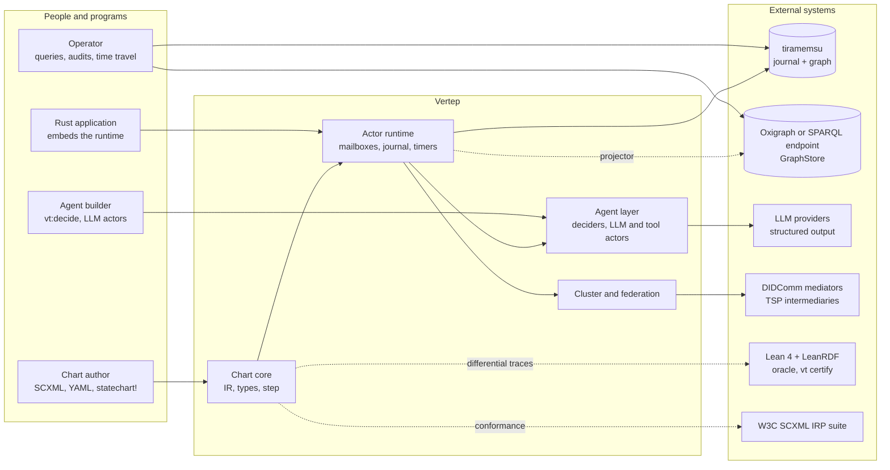
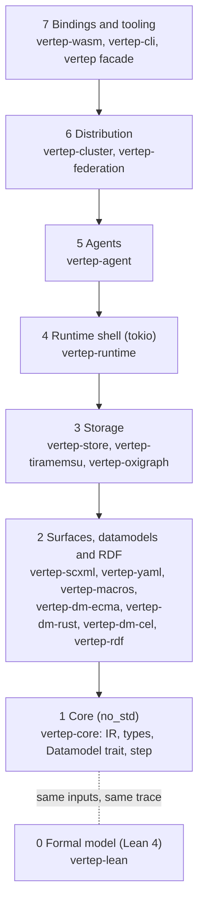
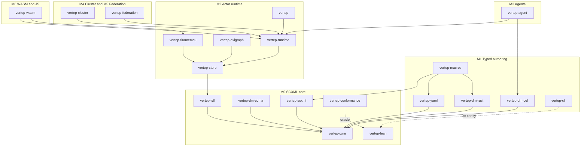
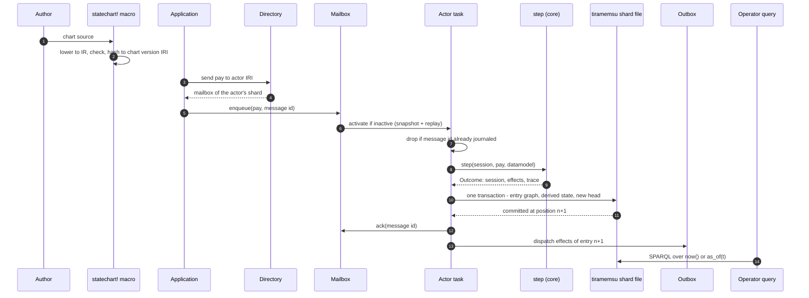
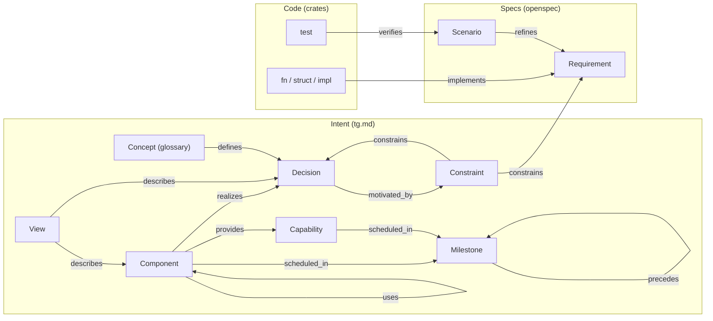

# Architecture Overview

What Vertep is, who uses it, how its layers and crates fit together, how one event travels from a chart to a journaled transition and a graph query, and how the typed graph ties docs, specs and code.

Vertep is a family of Rust crates for SCXML statecharts that run as actors, keep their state as event-sourced RDF, can be driven by LLMs, and are checked against a Lean model. This view is the entry point; the detailed views are [[views/statecharts]] for the chart layer and [[views/verification]] for the proof layer.

## System context

Vertep sits between chart authors, applications and agents on one side, and RDF stores, LLM providers, DID relays and Lean on the other.

- describes:: [[components#vertep]] {note: "the facade an application depends on"}
- describes:: [[decisions#SCXML semantics are normative]]
- describes:: [[decisions#Two storage traits with tiramemsu as default]]



The external systems never sit inside the deterministic core: model calls, relays and stores are reached only through effects that the runtime shell executes and journals.

## Layered architecture

Seven layers, each depending only on the layers below it; the bottom layer is `no_std`, pure and shared by every target from servers to the browser.

- describes:: [[decisions#IR is the hub]]
- describes:: [[decisions#No-std core and tokio shell]]
- describes:: [[decisions#Modular vt ontology on RDF 1.2]]



| Layer | Owns | Never does |
|---|---|---|
| Core | chart IR, well-formedness, type checker, `step`, `Datamodel` trait | I/O, async, clocks, randomness |
| Surfaces and RDF | SCXML, YAML and macro lowering; IR to RDF; SHACL; RDFC-1.0 hashing | execute charts |
| Storage | `JournalStore` with compare-and-set, `GraphStore` with SPARQL | interpret journal semantics |
| Runtime shell | actors, mailboxes, transports, directory, journal driver, timers | change a chart's semantics |
| Agents | `vt:decide`, deciders, LLM and tool actors, plan charts | mutate a running chart directly |
| Distribution | membership, shard leases, QUIC, DID identity, relays | bypass the journal |

The rule that keeps the layers honest: anything nondeterministic (time, randomness, model output, network) enters the core only as a journaled input event, so every layer above the core can be replayed.

## Crate map

Each crate is a typed Component in [[components]] with `provides`, `uses`, `realizes` and `scheduled_in` edges; this diagram groups them by layer and milestone.

- describes:: [[components#vertep-core]]
- describes:: [[components#vertep-runtime]]
- describes:: [[components#vertep-rdf]]
- describes:: [[components#vertep-lean]]



To list what a crate delivers without reading this file, ask the graph: `tg cypher "MATCH (c:Component {title: 'vertep-runtime'})-[r]->(x) RETURN type(r), x.title"`.

## The life of one event

One `pay` event sent to an order actor, followed from the chart source to a SPARQL answer; every hop names the requirement that governs it.

- describes:: [[capabilities#Event journal]]
- describes:: [[capabilities#Messaging]]
- describes:: [[capabilities#Storage]]
- describes:: [[glossary#Virtual actor]]
- describes:: [[glossary#Mailbox]]



1. **Author.** The macro lowers the chart to IR, runs `Well-Formedness Validation` and the type checker, and computes the `Chart Version IRI` from the `Canonical Chart Hash` of its RDF projection.
2. **Address.** The application sends to an IRI; `Address Resolution` maps it to the mailbox of the shard that owns the actor.
3. **Activate.** A message for an inactive virtual actor activates it: snapshot plus replay with the recorded chart version (`Replay With Recorded Version`).
4. **Deduplicate.** `Message Deduplication` drops a redelivered message whose id is already journaled; delivery is at least once, processing effectively once.
5. **Step.** One turn is one macrostep (`Turn Is One Macrostep`); `step` is pure (`Pure Step Function`) and returns effects instead of performing them.
6. **Append.** `Compare-And-Set Append` writes the input, the chart version and the outbox in one entry; on tiramemsu the derived state facts commit in the same transaction (`Input And State In One Transaction`) with support links to the entry (`State Facts Carry Their Cause`).
7. **Dispatch.** Only after the append commits does `Transactional Outbox` dispatch sends, timers and invokes; a crash in between re-dispatches the same sends with the same ids. The outbox mark passes an entry only once all its sends were delivered, so a send its transport refused is retried, and re-dispatched after a crash, until delivered.
8. **Query.** `db.now()` is the current-state graph and `db.as_of(t)` is time travel without replay (`Time Travel Views`).

```rust
// The seam between the pure core and the shell (crates/vertep-core/src/session.rs).
pub fn start(chart: &CompiledChart, input: StartInput, dm: &mut dyn Datamodel)
    -> Result<Outcome, StartError>;
pub fn step(
    chart: &CompiledChart,
    session: Session,
    input: Input,               // InputKind::Event or Cancel, plus env: journaled now_ms, seed from the entry IRI
    dm: &mut dyn Datamodel,
) -> Result<Outcome, StepError>;
// Outcome { session, effects, trace }; effects are
// Send, Cancel, Invoke, CancelInvoke, Forward, Log, SessionDone
```

### Failure modes along the path

What can go wrong on each hop and why the outcome stays correct; all of these follow from the journal being the only source of truth.

| Failure | Where | Outcome |
|---|---|---|
| Message redelivered by a relay | mailbox | id already in journal, acked and dropped |
| Crash after step, before append | actor task | nothing committed; message redelivered; same result |
| Crash after append, before dispatch | outbox | outbox re-read on activation; same send ids re-dispatched |
| Two activations of one actor | shard | second append fails the compare-and-set and steps down |
| Chart changed since the entry was written | activation | replay uses the version recorded in the segment |
| Event no transition handles | step | unhandled policy, dead letter by default for virtual actors |

## The typed graph of docs, specs and code

`tg` turns this folder, the OpenSpec changes and annotated code into one queryable graph; the ontology lives in `Types/` and the project types are Component, Milestone and View.

- describes:: [[decisions#Lean verification bridge]] {note: "certificates are graph facts too"}
- describes:: [[capabilities#Chart model]]



How the pieces connect while changes are open:

- **Docs to specs.** A View names the requirements it explains in its `openspec:` frontmatter with ids such as `"event-journal#Compare-And-Set Append"`; `tg check` rejects a typo. Typed doc edges to requirements are added when a change is archived into `openspec/specs/`.
- **Code to specs.** `// @tg: implements:: [[openspec:<capability>#<Requirement>]]` above a declaration and `// @tg: verifies:: [[openspec:<capability>#<Requirement>#<Scenario>]]` above a test; these resolve pending deltas immediately.
- **Code to docs.** A crate's `lib.rs` names the decisions it realizes with `//! @tg: implements:: [[decisions#<Decision>]]`.

Questions to ask instead of grepping:

```text
tg trace event-journal --gaps
tg cypher "MATCH (c:Component)-[:realizes]->(d:Decision)-[:motivated_by]->(w) RETURN c.title, d.title, w.title"
tg cypher "MATCH (v:View)-[:describes]->(x) RETURN v.title, labels(x), x.title"
tg cypher "MATCH (x)-[:scheduled_in]->(m:Milestone) RETURN m.title, labels(x), x.title ORDER BY m.title"
tg cypher "MATCH (c:Constraint)-[r:constrains]->(d) RETURN c.title, d.title, r.strength"
```

## Milestone map

Seven milestones, each one OpenSpec change; M0 builds the full SCXML core and its proofs, M2 makes charts durable actors, later milestones add agents, clusters, federation and the browser.

- describes:: [[roadmap#M0 SCXML core]]
- describes:: [[roadmap#M1 Typed authoring]]
- describes:: [[roadmap#M2 Actor runtime]]
- describes:: [[roadmap#M3 Agents]]
- describes:: [[roadmap#M4 Cluster]]
- describes:: [[roadmap#M5 Federation]]
- describes:: [[roadmap#M6 WASM and JS]]

```mermaid
gantt
    title Vertep milestones (order, not dates)
    dateFormat X
    axisFormat %s
    section Core
    M0 SCXML core          :m0, 0, 3
    Integration spike      :sp, 0, 1
    M1 Typed authoring     :m1, after m0, 2
    section Runtime
    M2 Actor runtime       :m2, after m1, 3
    section Extensions
    M3 Agents              :m3, after m2, 2
    M4 Cluster             :m4, after m2, 2
    M5 Federation          :m5, after m4, 2
    M6 WASM and JS         :m6, after m2, 2
```



| Milestone | Change | Capabilities | Proof obligations added |
|---|---|---|---|
| M0 SCXML core | `m0-scxml-core` | chart-model, scxml-interpretation, scxml-format, datamodel, chart-rdf, formal-model, scxml-conformance | determinism, well-formed configurations, optimal transition sets, shapes equivalence, RDF round trip |
| M1 Typed authoring | `m1-typed-authoring` | type-system, rust-dsl, yaml-format, cel-datamodel | checker soundness, projection agreement, typed step soundness |
| M2 Actor runtime | `m2-actor-runtime` | actor-model, messaging, event-journal, storage, durable-timers, chart-versioning, runtime-ontology | replay determinism, dedup idempotence, outbox, single activation |
| M3 Agents | `m3-agents` | deciders, llm-actors, plan-charts | decider safety, grant enforcement, replay without deciders |
| M4 Cluster | `m4-cluster` | cluster-membership, shard-placement, cluster-transport, worker-pools | one writer per shard epoch |
| M5 Federation | `m5-federation` | did-identity, relay-mailboxes | none planned in Lean; interop tests |
| M6 WASM and JS | `m6-wasm-js` | wasm-bindings | Lean traces replayed in WebAssembly |
