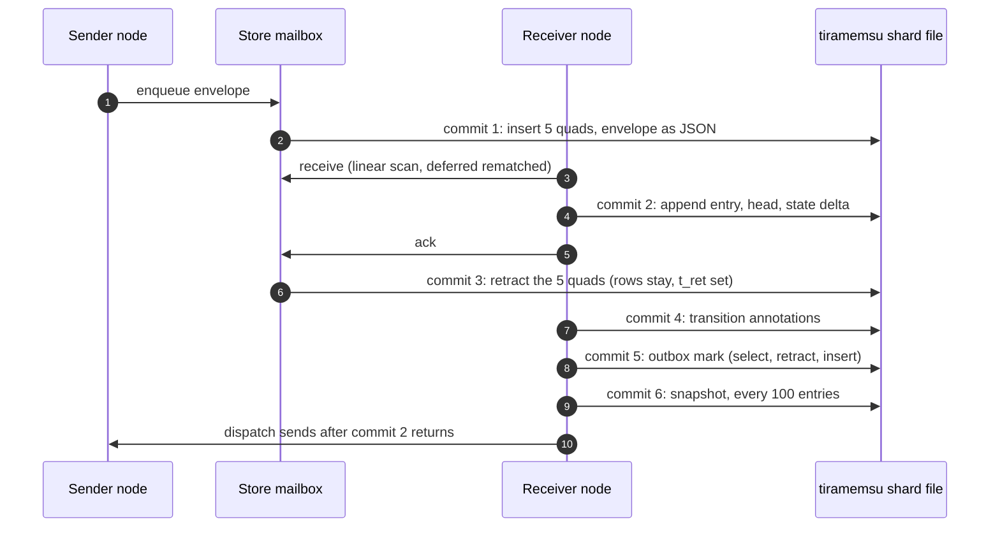
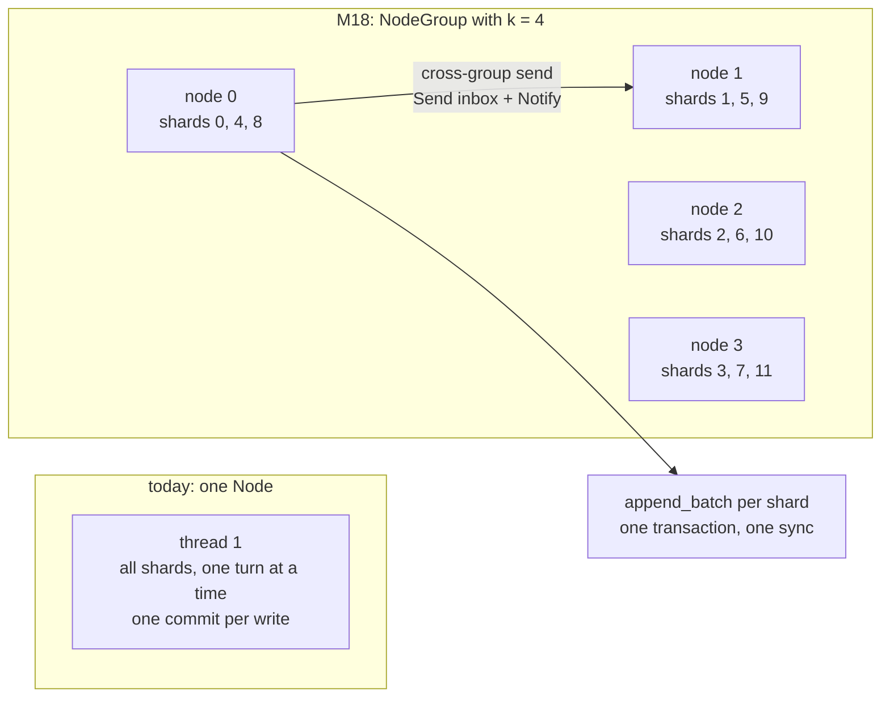
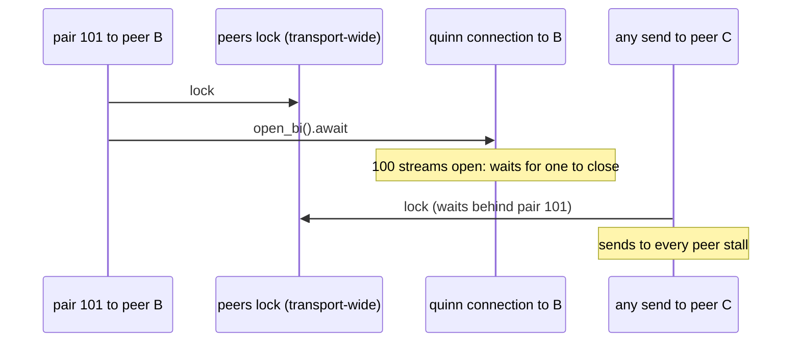
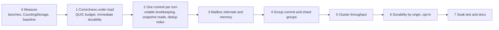

# Performance

How Vertep's runtime costs grow with load and with time: what one durable message costs today, what never shrinks, how mailboxes compare with the alternatives, where the cluster stalls, and the M18 plan.

This view records the architecture review of 2026-11-16 (branch `mailbox-backends`, code as of `main` 2c8aaf4). The semantics held up: the mailbox contract, routing per address, at-least-once delivery with message-id deduplication and the transactional outbox. The cost of those semantics did not, and nothing measured it. Requirement names in backticks are from the OpenSpec change `m18-runtime-performance`, which is drafted and not started.

## Cost of one durable message

A message to an actor with a store mailbox on tiramemsu costs five to seven commits today; the journal append is only one of them, and the mailbox acknowledgement is not in it.

- describes:: [[components#vertep-runtime]]
- describes:: [[components#vertep-tiramemsu]]
- describes:: [[decisions#Outbox progress lives in an outbox graph]]
- describes:: [[decisions#One transaction per turn]]
- describes:: [[decisions#Runtime bookkeeping is unversioned]]

Three things follow from the diagram:

- **Each commit pays SQLite's commit cost**, and with one writer per file the commits of one shard are serial. A turn's throughput is bounded by commits, not by the step function.
- **Nothing is freed.** Tiramemsu is bitemporal: retraction sets `t_ret` and keeps the row with its nine indexes. Every mailbox row, outbox mark and head ever written stays in the file.
- **Dispatch can outrun durability.** Shards open at `Durability::Normal`, so an OS crash can roll back commit 2 after its sends were delivered ([[constraints#SQLite NORMAL synchronous can lose the newest commits]]).

`One Commit Per Turn` and `Unversioned Bookkeeping` turn this into one commit per turn and one sync per batch: the annotations, the outbox mark, the acknowledgement and the snapshot travel in the append, and bookkeeping moves to tiramemsu's volatile table.

## Growth over a long run

Several per-actor structures grow with every actor ever activated or every message ever accepted, and activation reads the whole journal.

- describes:: [[decisions#Deduplication reads the whole journal on activation]]
- describes:: [[decisions#Activation reads from the snapshot and deduplication uses an index]]
- describes:: [[decisions#Deactivation releases per-actor memory]]
- describes:: [[components#vertep-cluster]]

| Structure | Where | Grows with | M18 |
|---|---|---|---|
| Activation read | `Node::load` reads from position 0 and loads every snapshot | journal length | `Activation Reads From The Snapshot` |
| Deduplication set `seen` | per activation | every message id ever accepted | `Indexed Deduplication`, window of 4096 |
| `mailboxes`, `outbox` maps | `Node` | every address ever activated | `Deactivation Releases Memory` |
| `stats.activations` | `Node` | every address ever activated | a counter |
| Idle scan | `deactivate_idle`, `next_deadline` | active actors, every round | `Idle Detection Without Scanning` |
| Snapshots, `vt:dispatched` marks | shard file | time | `Snapshot Retention`, volatile rows |
| Retracted mailbox rows and marks | shard file | messages and turns | `Unversioned Bookkeeping` |
| `virtuals`, `PeerConn.pairs`, replication `acked` | `vertep-cluster` | actors and pairs ever seen | evicted when idle or moved |

`Bounded Long-Run Growth` holds the result to a soak test: a million messages to 100k actors with deactivation churn, checked through `CountingStorage` and node introspection.

## Mailboxes under high load

The mailbox contract is the right abstraction; a durable receiver-side copy of every actor-to-actor message is the costly part, because the sender's journal already holds it.

- describes:: [[decisions#Mailbox backend is chosen per address]]
- describes:: [[decisions#Mailboxes queue, stash deferred messages and may be bounded]]
- describes:: [[decisions#Durability by origin is opt-in]]
- describes:: [[constraints#Relays deliver at least once]]
- describes:: [[capabilities#Messaging]]

The review compared four designs against the store mailbox:

| Design | Commits per message | Keeps | Costs |
|---|---|---|---|
| Store mailbox (today) | enqueue + ack, beside the turn | any sender, including outside ones | two extra commits and permanent rows per message |
| A. Sender's outbox is the queue; receiver mailbox in memory (Akka reliable delivery) | none beyond the sender's turn | exact once-per-turn via deduplication | a consumption confirmation per message; deferral holds the sender's mark |
| B. Append-only log per shard with offsets committed in the journal transaction (Kafka, Restate) | one log append; offset in the turn | replay by offset, high throughput | a new storage format beside tiramemsu |
| C. Mailbox rows in tiramemsu's volatile table, acknowledged in the append | one, inside the turn | today's semantics | the volatile API inside `Db::transact` must hold (M18 task 2.1) |
| D. External broker (NATS JetStream, Redis Streams) | broker-side | operations teams know it | a second source of truth, and no shared transaction with the journal |

M18 takes C as the default for all mailboxes (`Unversioned Bookkeeping`, `One Commit Per Turn`) and A as an opt-in per route (`Durability By Origin`). Messages from outside the system still need a durable mailbox, because no journal holds them. B stays a follow-up if C does not reach the throughput the benchmarks set. D is rejected as the default and remains possible behind a `Custom` mailbox backend.

Inside the mailbox, `receive`, `remove`, `release` and `deliverable` walk every row and rematch deferred messages on each receive, and nothing bounds a mailbox. `Receive Cost Under Deferral` and `Bounded Mailboxes` replace that with a ready queue, a stash for deferred messages and a capacity with a declared overflow policy.

## Throughput within one process

A node runs every turn of every actor on one thread with synchronous storage calls, so one process uses one core and one shard writer at a time, however many shards it owns.

- describes:: [[decisions#A node runs its actors on one thread]]
- describes:: [[decisions#Shard groups run several single-threaded nodes]]
- describes:: [[decisions#Group commit per shard]]
- describes:: [[decisions#Effects follow a durable commit]]

Shard groups keep each activation on one thread, so datamodels that are not `Send` still work and k = 1 is today's node. Group commit is what makes `Durability::Immediate` affordable: the sync is paid once per batch of ready turns on a shard.

## Cluster transport limits

The QUIC transport opens one stream per sender and receiver pair, allows up to 1024 of them, and holds its transport-wide lock while opening one; quinn allows 100 by default, so the 101st pair to a peer stalls every peer.

- describes:: [[components#vertep-cluster]]
- describes:: [[constraints#QUIC limits streams per connection]]
- describes:: [[decisions#QUIC with mutual TLS and a stream per actor pair]]
- describes:: [[decisions#Cluster streams stay within the peer's stream budget]]
- describes:: [[decisions#Standbys are shipped to in parallel]]

The same path has a retry task per message, so a retried message can overtake the next one of its pair. The cluster also copies the whole membership view several times per message, waits for each frame's reply before sending the next, and ships to standbys one after another with a pre-flight round trip. `Stream Budget Within The Peer Limit`, `Pipelined Pair Streams`, the modified `Ordering Per Sender And Receiver` and `Parallel Standby Shipping` address these, and task group 1 of M18 fixes the stall first.

## The M18 plan

M18 lands in eight phases, each its own pull request, and measures before it changes anything, so every later phase is compared with a recorded baseline.

- describes:: [[roadmap#M18 Runtime performance]]
- describes:: [[decisions#Performance is measured by counted operations and benchmarks]]
- describes:: [[roadmap#M13 Production readiness]]

The freeze of [[decisions#New milestones wait for production readiness]] ended when M13 was archived on 2026-11-17, and M13's benchmark suite moved into phase 0. Open before code starts: whether phase 1 makes `Immediate` the default before group commit pays for it in phase 4.

## Phase 0 baseline

The baseline recorded on 2026-11-19 at v0.1.14 confirms the review's findings with numbers: the budgets fail by large factors, and activation cost grows with history even with a snapshot.

- describes:: [[decisions#Performance is measured by counted operations and benchmarks]]
- describes:: [[components#vertep-bench]]

Counted through `CountingStorage` (`crates/vertep-runtime/tests/budgets.rs`, ignored until phase 2): a turn with one send makes 5 commits against a budget of 1; activating an actor with 1,000 entries and a snapshot at 990 reads all 1,000 entries (16,001 quads) against a budget of 10; a duplicate after deactivation does the same.

Timed by criterion on an Apple M2 Max, tiramemsu at `synchronous = NORMAL` (`benches/baseline.json`, shown on `site/docs/benchmarks.html`):

| Case | Mean |
|---|---|
| turn, memory, no send / one send | 93 µs / 148 µs |
| turn, tiramemsu, no send / one send | 3.4 ms / 7.1 ms |
| activation, 100,000 entries, no snapshot / snapshot 10 from head | 13.7 s / 1.3 s |
| activation, 10 entries | 10 ms (a fixed cost, before any replay) |
| receive with 10,000 deferred ahead (memory or store mailbox) | 91 µs |
| journal append, tiramemsu / memory | 1.4 ms / 39 µs |
| replay of 1,000 entries, tiramemsu / memory | 23 ms / 1.8 ms |
| core macrostep, small / medium / large chart | 0.9 / 2.6 / 17.5 µs |
| scripted decider round trip | 15 µs |
| cross-node send round trip, loopback QUIC | 89 µs |

The core step is three orders of magnitude cheaper than a durable turn, so the store, not the interpreter, is the place to work: phases 2 and 4 target the 5 commits and the full-journal read. The 10 ms floor of activation is not in the plan yet and needs a profile.

