# Persistence View

How Vertep stores actor state: the event journal and its protocol, the two storage traits, the tiramemsu mapping, the SPARQL adapter, chart versions and migrations, and what happens on every kind of crash.

A virtual actor's state is a deterministic replay of the inputs it accepted. The journal is the only source of truth; the current-state graph, snapshots and any external graph store are derived from it, and on tiramemsu the current-state graph commits in the same transaction as the entry that caused it.

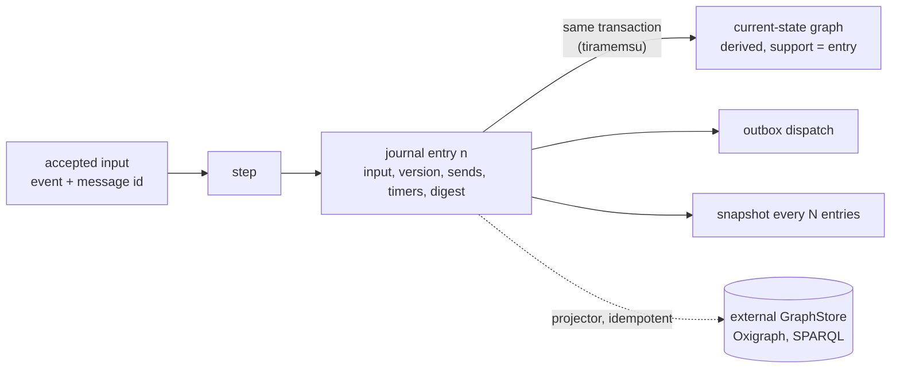

## Journal model

Each virtual actor has an append-only journal of entries numbered from 1 without gaps; snapshots, timers, migrations and dead letters hang off the actor and its entries.

- describes:: [[capabilities#Event journal]]
- describes:: [[decisions#Event-sourced actors]]
- describes:: [[components#vertep-runtime]]

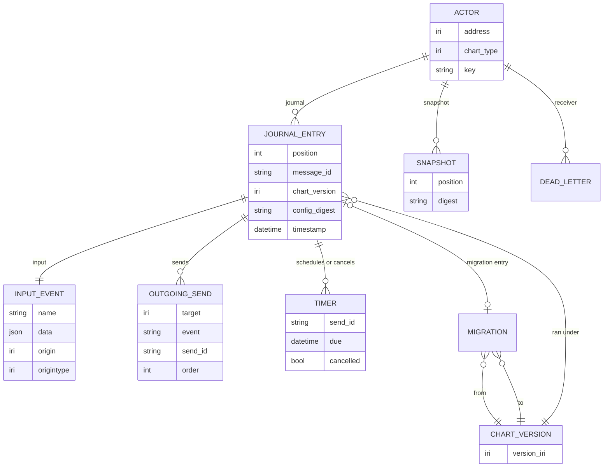

Entry content is fixed by `Journal Of Accepted Inputs` and `Journal Entry Content`: the input (name, payload, message id, origin, origin type), the chart version, the sends with their send ids, the timers scheduled or cancelled, the resulting configuration digest and the position. Entry kinds in practice:

| Kind | Started by | Extra content |
|---|---|---|
| Input entry | an external event, including a fired timer, a reply or an LLM result | the macrostep's effects |
| Migration entry | an accepted migration | snapshot before, migration IRI, snapshot after |
| Self-migration request | `chart-versioning#Self-Migration Requests` | processed as a runtime-internal input in a later turn |

Snapshots are separate records at a position, holding configuration, datamodel, pending deferred events and active timers (`Snapshots`).

## Compare-and-set append

An append succeeds only if the actor's journal is still at the expected position; otherwise it writes nothing, so two activations of one actor can never both extend its history.

- describes:: [[constraints#SPARQL Update has no compare-and-set]]
- describes:: [[decisions#Two storage traits with tiramemsu as default]]

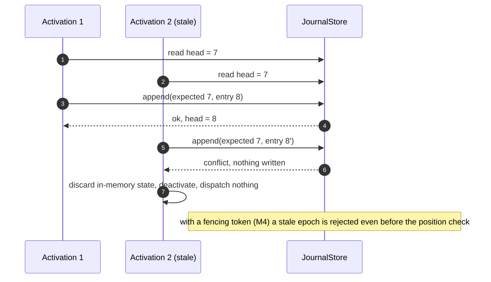

`Compare-And-Set Append` makes the journal linearizable per actor. `Append Fencing Token` adds an optional (scope IRI, epoch) to an append; a store that declares fencing rejects an epoch lower than the highest it has accepted for that scope. M2 never sets the token. M4 uses it to fence a node whose shard lease has moved, so the compare-and-set check is the backstop and the token the first line.

## Deduplication and outbox

Delivery is at least once and processing is effectively once: a message id is accepted once per actor, and sends leave only after the entry that records them is durable.

- describes:: [[constraints#Relays deliver at least once]]

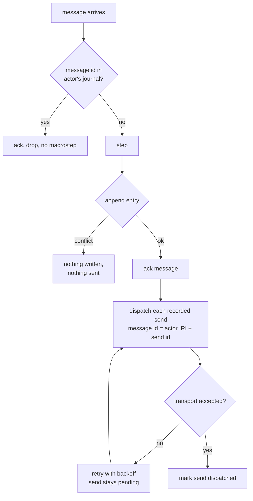

`Message Deduplication` and `Transactional Outbox` together give the property the Lean model states: every recorded send is dispatched at least once and no unrecorded send is ever dispatched. Because a send's message id is derived from the sender's address and send id, a resend after a crash is the same message to the receiver, which deduplicates it.

## Replay and snapshots

Activation loads the latest valid snapshot and replays the entries after it with the chart version each entry recorded; any digest mismatch stops activation instead of running on wrong state.

- describes:: [[decisions#Content-addressed chart versions]]
- describes:: [[capabilities#Chart versioning]]

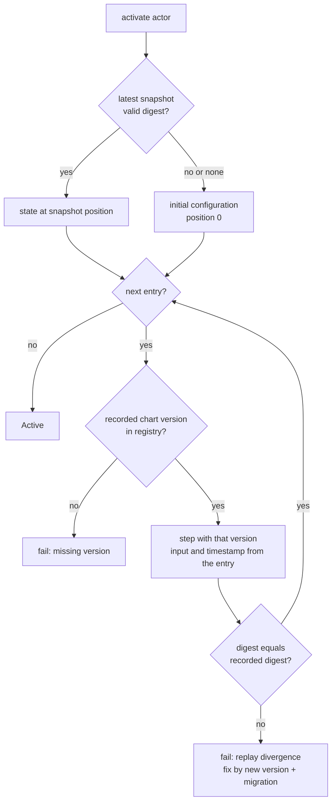

Replay determinism (`Deterministic Replay`) rests on `Inputs Only From The Journal`: no clock, randomness or I/O enters a macrostep except as recorded values. External results, tool outputs and LLM completions are journaled with their full content as inputs (`External Results As Inputs`), so replay never repeats them. `Journal Read Access` lets callers read from any position and rebuild state as of any position without touching the journal.

## Storage traits

Storage is two RDF-agnostic traits: a journal store with linearizable per-actor append, and a graph store that only promises quads and SPARQL, so no backend is asked for a guarantee it cannot give.

- describes:: [[capabilities#Storage]]
- describes:: [[components#vertep-store]]
- describes:: [[decisions#Two storage traits with tiramemsu as default]]

```rust
// crates/vertep-store/src/journal.rs and graph.rs (abridged)
pub trait JournalStore: Send + Sync {
    fn capabilities(&self) -> JournalCapabilities;
    fn supports_fencing(&self) -> bool { self.capabilities().fencing }
    /// Linearizable and all-or-nothing per actor; on any error nothing is written.
    fn append(
        &self,
        actor: &NamedNode,
        expected: Position,
        entries: &[Entry],      // a named entry IRI plus its triples
        meta: &AppendMeta,      // fencing: Option<FencingToken>, state: Option<StateDelta>
    ) -> Result<Position, AppendError>; // Conflict | Fenced | Unsupported | Invalid | Storage
    fn read(&self, actor: &NamedNode, from: Position) -> Result<Vec<JournalRecord>, StoreError>;
    fn head(&self, actor: &NamedNode) -> Result<Position, StoreError>;
    fn actors(&self) -> Result<Vec<NamedNode>, StoreError>;
}

pub trait GraphStore: Send + Sync {
    fn capabilities(&self) -> GraphCapabilities;   // rdf, union_default_graph, ...
    /// RDF 1.2 triple terms, or classic reification fallback.
    fn rdf_capability(&self) -> RdfCapability;     // Rdf12 | Rdf11
    fn insert_quads(&self, quads: &[Quad]) -> Result<(), StoreError>;
    fn remove_quads(&self, quads: &[Quad]) -> Result<(), StoreError>;
    fn clear_graph(&self, graph: &NamedNode) -> Result<(), StoreError>;
    fn query(&self, sparql: &str) -> Result<QueryResults, StoreError>; // Solutions | Boolean | Graph
}
```

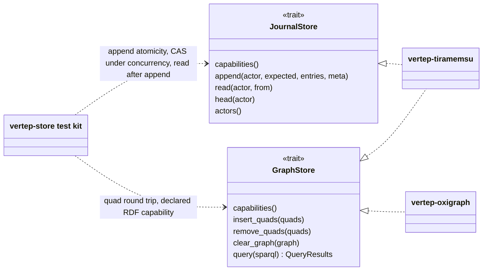

Every backend must pass the shared test kit (`Shared Backend Test Kit`). The graph store is not required to offer compare-and-set or cross-request transactions (`Graph Store Contract`), which is exactly why the journal is a separate trait.

## Tiramemsu mapping

Tiramemsu implements both traits on one file per shard: one append is one `Db::transact` that checks the head, writes the entry, derives the new state with the entry as support and acknowledges the message.

- describes:: [[components#vertep-tiramemsu]]
- describes:: [[constraints#Tiramemsu has a single writer per file]]
- describes:: [[glossary#Shard]]

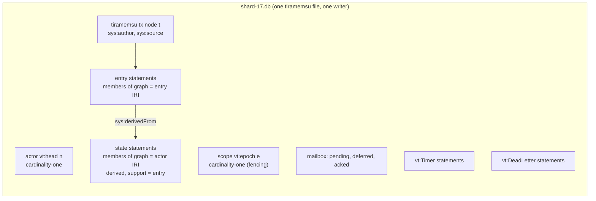

One append, step by step (`Tiramemsu Backend`, `Input And State In One Transaction`, `State Facts Carry Their Cause`):

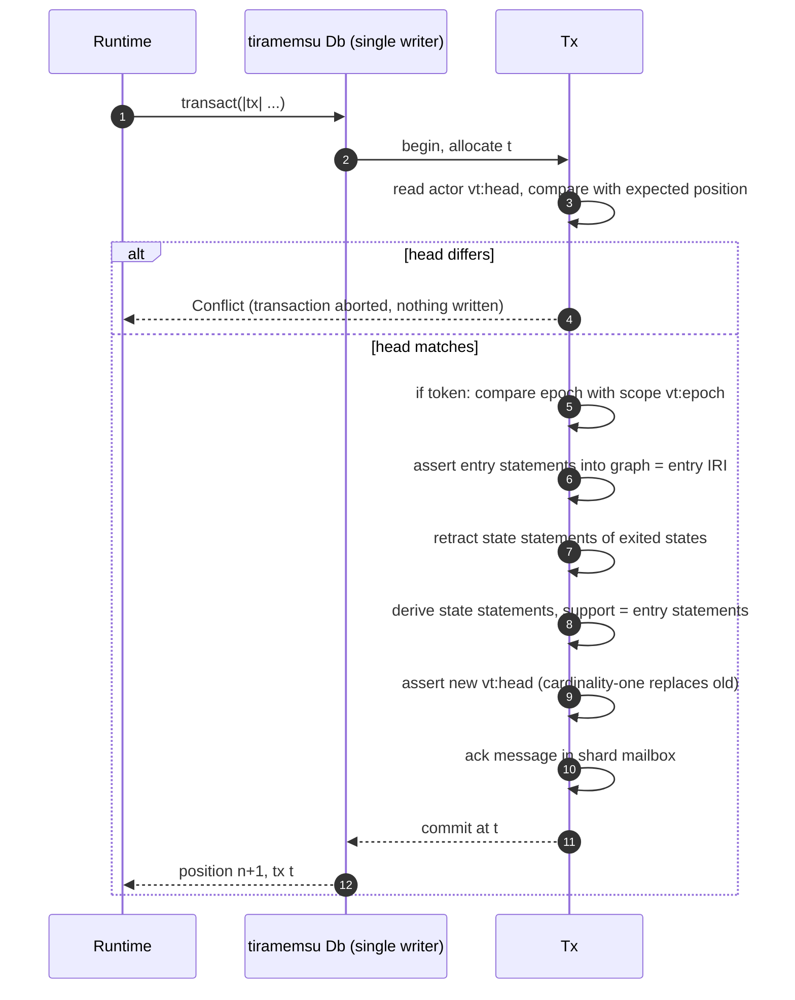

Why tiramemsu fits ([[decisions#Two storage traits with tiramemsu as default]]):

- **Never forget.** Rows are never deleted, so the journal is append-only by construction and history is free.
- **Time travel without replay** (`Time Travel Views`). `db.now()` is the current-state graph and `db.as_of(t)` the graph at any earlier transaction.
- **Cause from state.** A state statement is a derived belief whose support is the entry; `View::dependents` on an entry shows what it caused, and the support path from a state leads back to its input.
- **One file per shard** (`One File Per Shard`). The single writer serializes one shard only; several shards per node keep writes parallel, and M4 moves whole files or leases.

Named graphs follow the runtime module's layout (`Named Graph Layout`): the actor's current state in the graph named by its address, each entry in the graph named by the entry IRI, both with IRIs that replay reproduces (`Stable Runtime IRIs`). On tiramemsu a named graph is a node, and membership is one more statement, so the layout costs no extra tables.

## SPARQL adapter and projection

`vertep-oxigraph` implements only the graph store, on Oxigraph or any SPARQL 1.1 endpoint; a projector copies journal entries into it in order, idempotently, and records how far it got per actor.

- describes:: [[components#vertep-oxigraph]]

```mermaid
sequenceDiagram
    autonumber
    participant J as JournalStore (tiramemsu)
    participant P as Projector
    participant G as GraphStore (SPARQL)
    loop per actor, in journal order
        P->>G: last projected position for actor?
        G-->>P: k
        P->>J: read(actor, from k+1)
        J-->>P: entries k+1..n
        P->>G: insert entry graphs (idempotent, stable IRIs)
        P->>G: replace actor state graph
        P->>G: set projected position = n
    end
    Note over P,G: lag is queryable; consistent reads go to tiramemsu
```

`SPARQL Graph Store Adapter` forbids this backend from implementing the journal store, because SPARQL Update has no compare-and-set. `Eventual Projection To External Graph Stores` makes the projection ordered, idempotent and resumable. When the store lacks RDF 1.2 triple terms, annotations are written with `rdf:Statement` reification and read back unchanged (`RDF 1.1 Reification Fallback`).

## Versions and migrations

Each entry names its chart version, consecutive entries with one version form a segment, actors stay pinned until final, and upgrades are explicit migrations written as journal entries.

- describes:: [[decisions#Content-addressed chart versions]]
- describes:: [[capabilities#Chart versioning]]

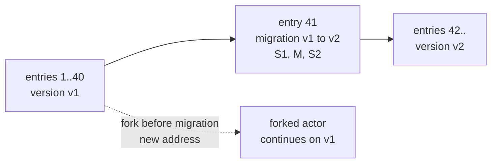

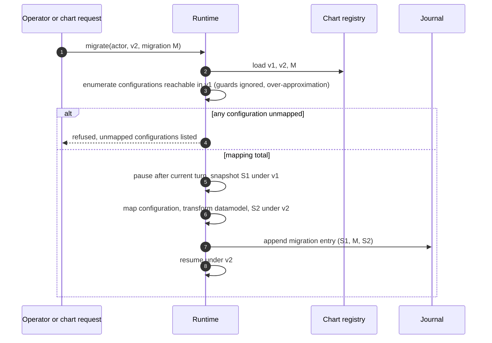

The rules (`Version Recorded Per Journal Segment`, `Replay With Recorded Version`, `Chart Registry`, `Pin Until Final`, `Explicit Migration`, `Migration Compatibility Check`, `Fork Before Migration`):

- Replay uses the recorded version of each segment, never a newer one; a version that cannot be loaded fails activation.
- The registry keeps every version a journal references and refuses to remove one a non-final actor uses.
- New actors of a chart type start on the latest version; existing ones stay on theirs until a top-level final state.
- A migration is refused unless its mapping covers every reachable configuration of the old version.
- Rolling back is forking from before the migration under a new address; history is never rewritten.

## Failure scenarios

Every crash point in a turn leaves either no trace or a complete entry, and every redelivery or retry is absorbed by deduplication.

- describes:: [[constraints#Relays deliver at least once]]
- describes:: [[decisions#Event-sourced actors]]

| Crash or fault | State after recovery | Why |
|---|---|---|
| During `step`, before append | as if the message never arrived; it is redelivered | the append is the commit point (`Actor Failure Isolation`) |
| After append, before ack | entry exists; redelivered message is acked and dropped | deduplication by message id |
| After ack, before dispatch | pending sends found in the entry and dispatched on activation | transactional outbox |
| During dispatch, transport fails | send retried until accepted | outbox retry; receiver deduplicates |
| Two activations of one actor (partition, M4) | one append wins; the other gets a conflict and deactivates | compare-and-set, fencing token |
| Snapshot corrupt or stale | activation falls back to an older snapshot or full replay | snapshot digest check |
| Library upgrade changes executable content behaviour | activation fails with replay divergence | digest per entry; fix by new version and migration |
| Timer due while node was down | fired after restart in due order; a reminder once | `Missed Timers After Downtime` |
| External graph store down | journal unaffected; projection resumes from the last position | projection is derived and idempotent |

## Verification

The journal protocol has a Lean model, and the Rust shell is checked against it with property tests over generated interleavings of crashes, redeliveries and concurrent activations.

- describes:: [[decisions#Lean verification bridge]]
- describes:: [[capabilities#Formal model]]

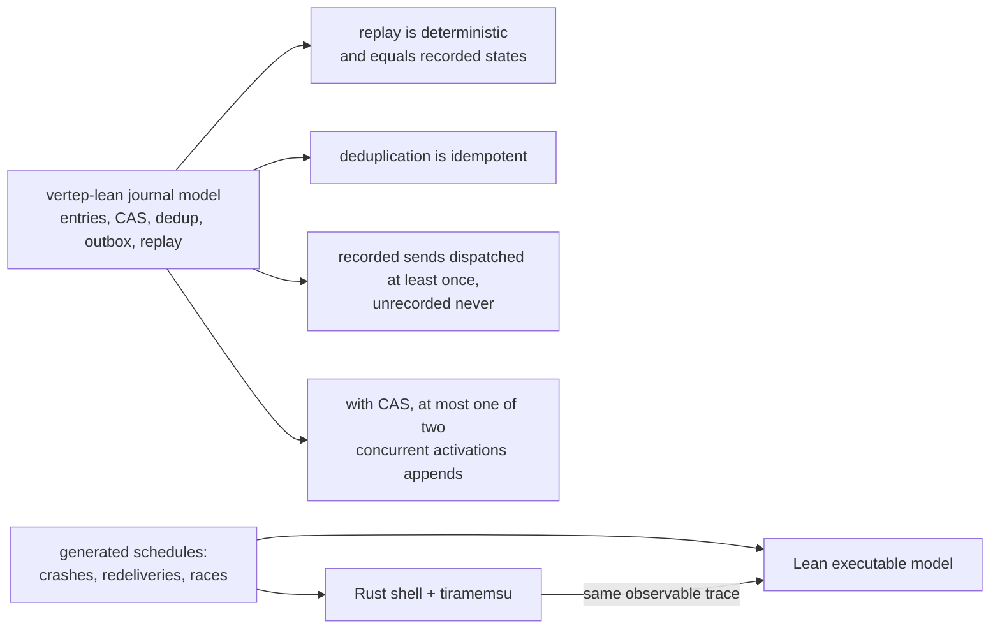

The target theorems come from the M2 design (D9) and are tasks of the `m2-actor-runtime` change; the M4 change adds at most one successful writer per shard epoch.
