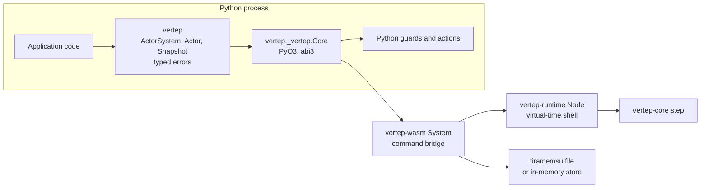
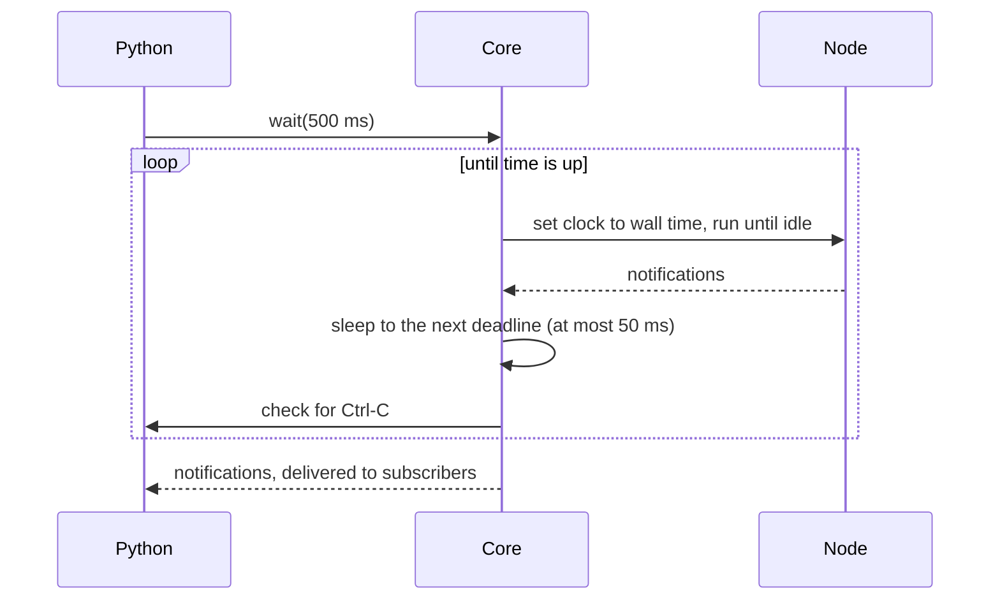
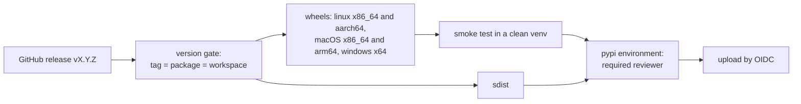

# Python

How Vertep runs from Python: a PyO3 extension over the actor system's command bridge, a plain-Python API on top, an explicit clock and a wheel per platform.

This view explains milestone M11 and the crate `vertep-py`. Requirement names in backticks are from the OpenSpec change `m11-python-bindings` (capability `python-bindings`).

## Shape

The Python API is plain Python over one native class, `Core`, which runs the same JSON commands as the JavaScript worker does on the same `System`.

- describes:: [[components#vertep-py]]
- describes:: [[capabilities#Python bindings]]
- describes:: [[roadmap#M11 Python bindings]]
- describes:: [[decisions#Python bindings wrap the command bridge]]

`Native Extension Module` puts `Core` in `vertep._vertep`; `ActorSystem` and `Actor` encode a call as `(op, JSON)`, decode the reply and raise the exception its error code names (`Typed Errors`). Subscriptions are delivered when the system drains notifications after a call.

## Time

`Explicit Time` has two clocks and no background thread: time passes only inside calls.

- describes:: [[decisions#The Python clock moves only inside calls]]
- describes:: [[decisions#A Python system belongs to one thread]]

On the system clock the binding sets the shell's clock to the wall clock before each call, and `wait` sleeps in slices of at most 50 ms with the interpreter released, so other threads run and Ctrl-C interrupts. On the virtual clock `advance` jumps the clock and every timer that falls due fires in due order. A journal records timestamps, so it replays to the same states under either clock, and an overdue durable timer fires once as a system on that file starts.

## Guards and actions

`Python Guards And Actions` bind callables by IRI.

- describes:: [[decisions#Python callables are the implementations module]]

A guard or action receives the context and the event as plain Python values and returns a bool or an outcome (`context`, `raise`, `send`). The step runs them under the GIL during a call. They must be pure, because the journal is replayed; `dev=True` checks that by replaying each macrostep.

## Distribution

`Package Publishing` ships one `abi3` wheel per platform and an sdist, uploaded by a workflow with Trusted Publishing after a smoke test of each wheel.

- describes:: [[decisions#One abi3 wheel per platform, published with Trusted Publishing]]
- describes:: [[constraints#PyPI releases are immutable]]

