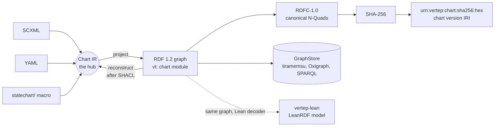
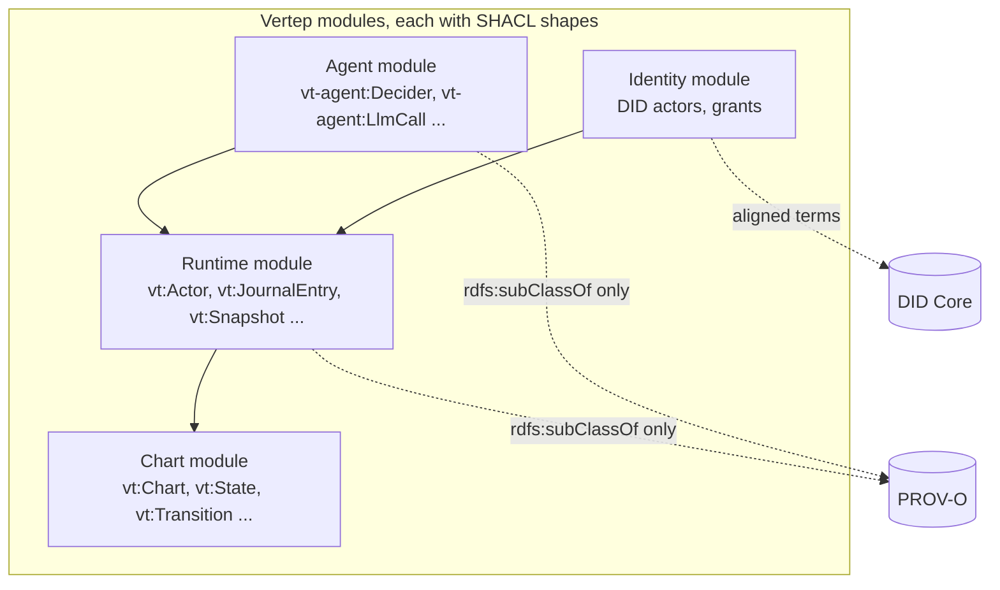
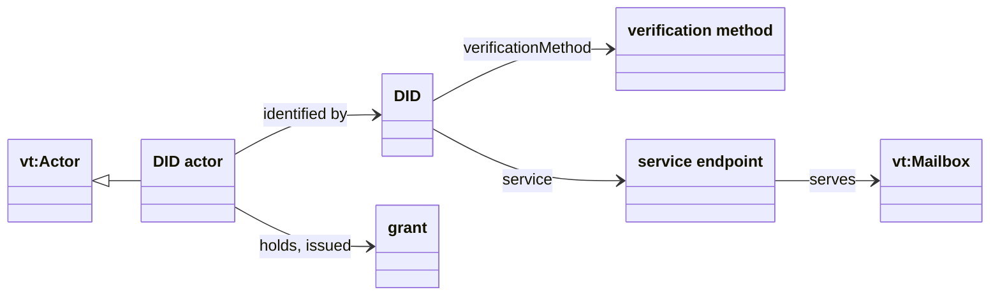
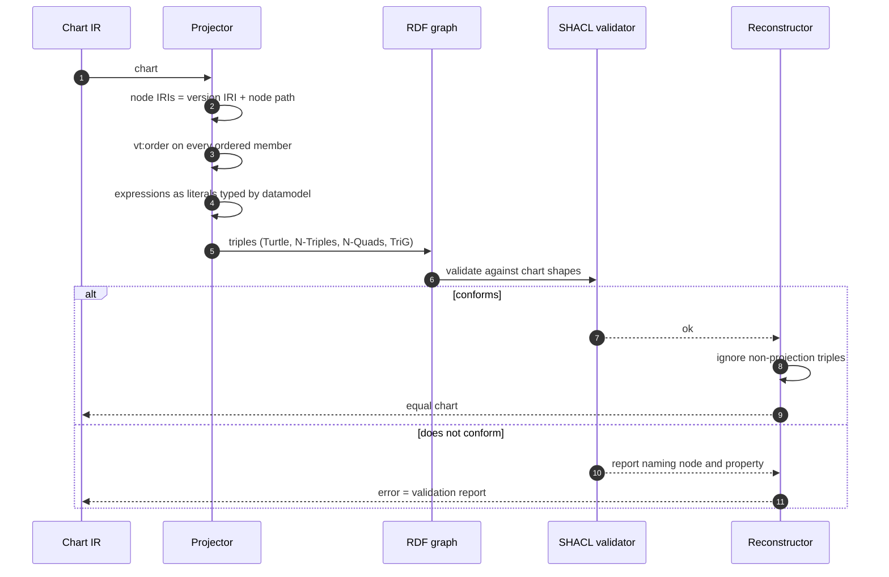
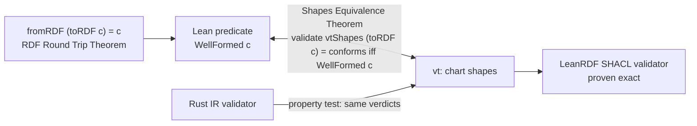
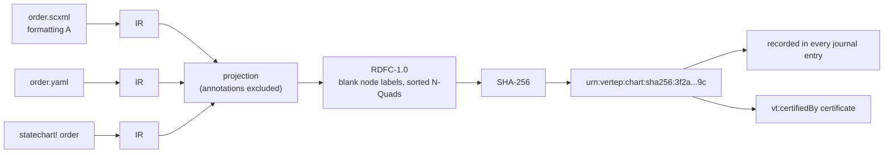
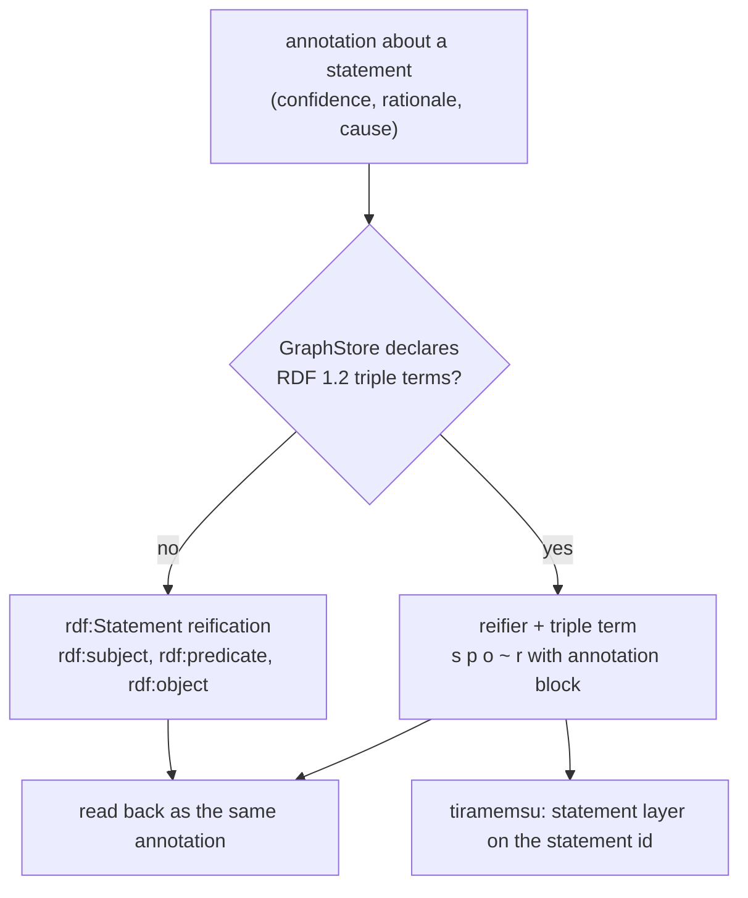
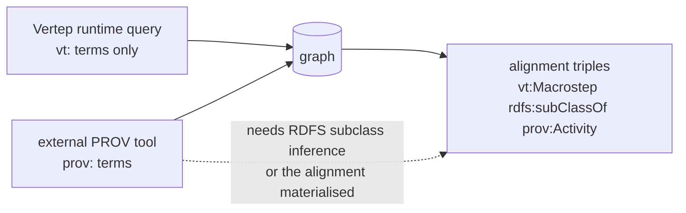

# RDF and Ontology View

How Vertep represents charts, actors, journals, agents and identities as RDF 1.2: the modular `vt:` ontology, the lossless IR projection, SHACL shapes, content addressing and annotations.

The IR is the hub and RDF is a lossless projection of it, never the source the runtime executes. Everything below follows from that split: RDF must carry enough to rebuild the IR exactly, and the shapes must say exactly what a valid chart is, because RDF alone is open-world.



## Ontology modules

Four modules share one design rule: each is its own Turtle file with its own SHACL shapes, and a chart that needs only plain SCXML needs only the chart module.

- describes:: [[decisions#Modular vt ontology on RDF 1.2]]
- describes:: [[components#vertep-rdf]]
- describes:: [[capabilities#Chart RDF]]
- describes:: [[capabilities#Runtime ontology]]
- describes:: [[constraints#RDF is open-world]] {note: "why shapes are normative"}

| Module | Prefix | Namespace | Milestone | Aligned with |
|---|---|---|---|---|
| Chart | `vt:` | `https://w3id.org/vertep/vt#` | M0 | none; mirrors the IR one to one |
| Runtime | `vt:` (separate module file) | same namespace | M2 | PROV-O by `rdfs:subClassOf` |
| Agent | `vt-agent:` | Vertep agent namespace | M3 | PROV-O agents and activities |
| Identity | identity module (prefix `vt-id:` in the decision table) | Vertep identity namespace | M5 | DID Core, Verifiable Credentials |



The arrows to PROV-O and DID Core are alignment triples inside Vertep's own module files. No Vertep query uses a PROV-O or DID Core term to get its answer, and no reasoner runs; dropping the alignment triples breaks nothing (`runtime-ontology#PROV-O Alignment Without Dependency`).

### Chart module

One class per IR node kind and one property per IR attribute or containment, so the module can be checked against the IR's node list mechanically (`Chart Ontology Module`).

```mermaid
classDiagram
    direction LR
    class Chart["vt:Chart"] {
        vt:name
        vt:datamodel
        vt:binding
        vt:initial
    }
    class StateNode["vt:StateNode"] {
        vt:id
        vt:order
    }
    class State["vt:State"]
    class Parallel["vt:Parallel"]
    class Final["vt:Final"]
    class History["vt:History"] {
        vt:historyType
    }
    class Transition["vt:Transition"] {
        vt:event
        vt:cond
        vt:transitionType
        vt:order
    }
    class TargetRef["vt:TargetRef"] {
        vt:order
    }
    class Executable["vt:ExecutableContent"] {
        vt:order
    }
    class Send["vt:Send"]
    class Assign["vt:Assign"]
    class Raise["vt:Raise"]
    class Invoke["vt:Invoke"] {
        vt:type
        vt:src
        vt:autoforward
    }
    class DataItem["vt:DataItem"] {
        vt:id
        vt:expr
    }
    class Extension["vt:ExtensionNode"] {
        vt:namespace
        vt:payload
    }
    StateNode <|-- State
    StateNode <|-- Parallel
    StateNode <|-- Final
    StateNode <|-- History
    Executable <|-- Send
    Executable <|-- Assign
    Executable <|-- Raise
    Chart "1" --> "*" StateNode : vt:child
    State "1" --> "*" StateNode : vt:child
    State "1" --> "*" Transition : vt:transition
    Transition "1" --> "1" StateNode : vt:source
    Transition "1" --> "*" TargetRef : vt:target
    TargetRef --> StateNode : vt:state
    Transition "1" --> "*" Executable : vt:action
    State "1" --> "*" Executable : vt:onentry, vt:onexit
    State "1" --> "*" Invoke : vt:invoke
    Chart "1" --> "*" DataItem : vt:data
    StateNode "1" --> "*" Extension : vt:extension
```

The class and property names are a sketch of the module's shape; the normative list is the Turtle file the `Chart Ontology Module` requirement publishes. What matters architecturally is that every ordered member carries `vt:order` and that targets are reified as `vt:TargetRef` nodes so their order survives.

### Runtime module

The runtime module adds the things a running system needs to say about charts: who runs them, what they received and what it caused (`Runtime Vocabulary`, `Named Graph Layout`).

- describes:: [[components#vertep-runtime]]
- describes:: [[glossary#Virtual actor]]
- describes:: [[glossary#Invoked actor]]
- describes:: [[glossary#Stateless worker]]

```mermaid
classDiagram
    direction LR
    class Actor["vt:Actor"] {
        vt:address
        vt:chartVersion
    }
    class VirtualActor["vt:VirtualActor"] {
        vt:chartType
        vt:key
    }
    class InvokedActor["vt:InvokedActor"] {
        vt:parent
        vt:invokeId
    }
    class Worker["vt:StatelessWorker"]
    class Mailbox["vt:Mailbox"]
    class Activation["vt:Activation"] {
        vt:node
        vt:startedAt
    }
    class Entry["vt:JournalEntry"] {
        vt:position
        vt:messageId
        vt:configDigest
    }
    class Macrostep["vt:Macrostep"]
    class Snapshot["vt:Snapshot"] {
        vt:position
        vt:digest
    }
    class Timer["vt:Timer"] {
        vt:sendId
        vt:due
    }
    class Migration["vt:Migration"] {
        vt:fromVersion
        vt:toVersion
    }
    class DeadLetter["vt:DeadLetter"] {
        vt:reason
        vt:recordedAt
    }
    class ProvActivity["prov:Activity"]
    class ProvEntity["prov:Entity"]
    Actor <|-- VirtualActor
    Actor <|-- InvokedActor
    Actor <|-- Worker
    ProvActivity <|-- Macrostep
    ProvEntity <|-- Snapshot
    Actor --> Mailbox : vt:mailbox
    Actor --> Activation : vt:activation
    Actor --> Entry : vt:journal
    Entry --> Macrostep : vt:macrostep
    Entry --> Timer : vt:schedules, vt:cancels
    Entry --> Migration : vt:migration
    Actor --> Snapshot : vt:snapshot
    DeadLetter --> Actor : vt:receiver
```

### Agent module

The agent module, delivered in M3, records who decided, which model was called with what prompt hash and cost, which tools ran under which grants, and where plans came from.

- describes:: [[capabilities#LLM actors]]
- describes:: [[capabilities#Deciders]]
- describes:: [[capabilities#Plan charts]]
- describes:: [[glossary#Decider]]

```mermaid
classDiagram
    direction LR
    class Decider["vt-agent:Decider"]
    class Decision["vt-agent:Decision"] {
        vt-agent:rationale
        vt-agent:confidence
    }
    class LlmCall["vt-agent:LlmCall"] {
        model
        promptHash
        promptTokens
        completionTokens
        latency
    }
    class Tool["vt-agent:Tool"]
    class ToolCall["vt-agent:ToolCall"]
    class Grant["vt-agent:Grant"]
    class Plan["vt-agent:Plan"] {
        planVersion
        validationOutcome
    }
    class ProvAgent["prov:Agent"]
    class ProvActivity["prov:Activity"]
    ProvAgent <|-- Decider
    ProvActivity <|-- Decision
    ProvActivity <|-- LlmCall
    ProvActivity <|-- ToolCall
    Decider --> Decision : made
    Decision --> LlmCall : prov:used
    ToolCall --> Tool : calls
    ToolCall --> Grant : authorised by
    Plan --> LlmCall : prov:wasGeneratedBy
```

The `llm-actors#Agent Ontology Module` requirement fixes the class list (`Decider`, `Decision`, `LlmCall`, `Tool`, `ToolCall`, `Grant`, `Plan`); property names here are illustrative.

### Identity module

The identity module, delivered in M5, links a DID actor to its DID, verification methods, service endpoints and grants, so reachability and authority become graph queries.

- describes:: [[capabilities#DID identity]]
- describes:: [[decisions#Identity, mailbox and transport layers]]



Only actors that cross a trust boundary get a DID. A `vt:` address and a DID are both IRIs, so the identity module adds facts to an actor; it never replaces the address.

## IR to RDF projection

Projection maps every IR node, attribute, expression and extension to triples with deterministic IRIs; reconstruction runs SHACL first and rebuilds the IR, and the pair is the identity on charts.

- describes:: [[decisions#IR is the hub]]
- describes:: [[capabilities#Chart RDF]]
- describes:: [[constraints#Proc macros run at compile time]] {note: "why RDF cannot be the hub"}



The projection rules, each a requirement of `chart-rdf`:

- **Deterministic node IRIs** (`IR To RDF Projection`). Node IRIs are built from the chart version IRI and the node's identity, so two versions that both contain state `a` have two different IRIs for it (`Chart Version IRI`).
- **Explicit order** (`Explicit Ordering`). Document order decides transition priority and entry order in SCXML, and RDF graphs are sets. Every ordered member gets an integer `vt:order`; RDF collections are not used because they are hard to query and easy to break.
- **Executable content as literals** (`Executable Content As Literals`). A condition is a literal whose datatype names the datamodel, so `x > 1` under ECMAScript and the same text under CEL are different values.
- **Annotations outside the projection** (`Annotations Outside The Projection`). Reconstruction and hashing read only projection triples, so a store can annotate charts freely.

A small chart, two states and one guarded transition, as projected Turtle:

```turtle
@prefix vt:  <https://w3id.org/vertep/vt#> .
@prefix c:   <urn:vertep:chart:sha256:3f2a...9c#> .

c:chart a vt:Chart ;
    vt:name "door" ;
    vt:datamodel vt:EcmaScript ;
    vt:initial c:closed ;
    vt:child c:closed , c:open .

c:closed a vt:State ; vt:id "closed" ; vt:order 0 ;
    vt:transition c:closed-t0 .

c:open a vt:State ; vt:id "open" ; vt:order 1 .

c:closed-t0 a vt:Transition ;
    vt:order 0 ;
    vt:source c:closed ;
    vt:event "door.open" ;
    vt:cond "!locked"^^vt:ecmascriptExpr ;
    vt:target c:closed-t0-target0 .

c:closed-t0-target0 a vt:TargetRef ; vt:order 0 ; vt:state c:open .
```

## SHACL shapes

Shapes are the normative definition of a valid chart in RDF terms; the Lean model proves that a graph conforms exactly when it is the projection of a well-formed chart.

- describes:: [[capabilities#Formal model]]
- describes:: [[decisions#Lean verification bridge]]
- describes:: [[components#vertep-lean]]



Three checks have to agree, and each pair is tied by a proof or a test: the Rust IR validator, the SHACL shapes, and the Lean `WellFormed` predicate (`SHACL Shapes For Charts`, `Shapes Equivalence Theorem`). Each module ships its own shapes graph: chart shapes in M0, runtime shapes in M2 (`Runtime SHACL Shapes`, which every journal entry must satisfy), agent shapes in M3.

A fragment of the chart shapes, the rule that every transition has exactly one source state:

```turtle
@prefix sh: <http://www.w3.org/ns/shacl#> .
@prefix vt: <https://w3id.org/vertep/vt#> .

vt:TransitionShape a sh:NodeShape ;
    sh:targetClass vt:Transition ;
    sh:property [
        sh:path vt:source ;
        sh:minCount 1 ; sh:maxCount 1 ;
        sh:class vt:StateNode ;
    ] ;
    sh:property [
        sh:path vt:order ;
        sh:minCount 1 ; sh:maxCount 1 ;
        sh:datatype <http://www.w3.org/2001/XMLSchema#integer> ;
    ] .
```

Rules that need the whole chart (a target must be a state of the same chart, a parallel state's regions) are SPARQL-based constraints. A rule that SHACL cannot express is a gap the `Shapes Equivalence Theorem` would expose, so the equivalence theorem doubles as a completeness check of the shapes.

## Content addressing

A chart's version IRI is `urn:vertep:chart:sha256:` plus the hex SHA-256 of its RDFC-1.0 canonical N-Quads, so identical charts written in any surface get the same IRI.

- describes:: [[decisions#Content-addressed chart versions]]
- describes:: [[capabilities#Chart versioning]]



The hash is computed over the projection only (`Canonical Chart Hash`, `Annotations Outside The Projection`), so comments, certificates and usage statistics attached to a chart never change its identity. In dataset formats a chart lives in the named graph named by its version IRI (`RDF Serialization Formats`). Certificates from `vt certify` hang off the version IRI as `vt:certifiedBy` with theorem names, Lean toolchain and checker hash (`formal-model#Chart Certificates`).

## Journal entries in RDF

A journal entry is an RDF dataset: its statements live in a named graph named by the entry IRI, while the actor's current state lives in a named graph named by the actor's address.

- describes:: [[capabilities#Event journal]]
- describes:: [[decisions#Event-sourced actors]]

Entry, snapshot, timer and dead-letter IRIs are derived from the actor address and the journal position or send id (`Stable Runtime IRIs`), so replay and re-projection produce the same IRIs. The specs fix determinism, not a layout; the IRIs below are illustrative.

```trig
@prefix vt:   <https://w3id.org/vertep/vt#> .
@prefix prov: <http://www.w3.org/ns/prov#> .
@prefix a:    <https://acme.example/actors/Order/8f3a/> .

# Journal entry 7: the input, the version it ran under, its effects
a:journal-7 {
    a:journal-7 a vt:JournalEntry ;
        vt:actor <https://acme.example/actors/Order/8f3a> ;
        vt:position 7 ;
        vt:messageId "msg-01J9Z" ;
        vt:chartVersion <urn:vertep:chart:sha256:3f2a...9c> ;
        vt:inputEvent a:journal-7-in ;
        vt:configDigest "b81c..." ;
        vt:send a:journal-7-send0 ;
        vt:schedules a:timer-s12 .

    a:journal-7-in vt:name "payment.received" ;
        vt:origin <https://acme.example/actors/Payment/77> ;
        vt:origintype <http://www.w3.org/TR/scxml/#SCXMLEventProcessor> ;
        vt:data "{\"amount\": 120}"^^<http://www.w3.org/1999/02/22-rdf-syntax-ns#JSON> .

    a:journal-7-send0 vt:target <https://acme.example/actors/Shipping/12> ;
        vt:name "ship.request" ; vt:sendId "s11" ; vt:order 0 .

    a:timer-s12 a vt:Timer ; vt:sendId "s12" ;
        vt:due "2026-11-12T10:00:00Z"^^<http://www.w3.org/2001/XMLSchema#dateTime> .
}

# Current state of the actor, derived from entry 7
<https://acme.example/actors/Order/8f3a> {
    <https://acme.example/actors/Order/8f3a> vt:active
        <urn:vertep:chart:sha256:3f2a...9c#paid> .
}
```

## Annotations

Statements about statements, such as which input caused a transition or how confident a decider was, are RDF 1.2 triple-term annotations, with classic reification as the fallback for RDF 1.1 stores.

- describes:: [[capabilities#Storage]]
- describes:: [[decisions#Deciders at choice points]]



The same decision annotation in both encodings (`Triple Term Annotations`, `deciders#Decision Annotations`, `RDF 1.1 Reification Fallback`):

```turtle
# RDF 1.2
a:decision-9 vt-agent:chose a:event-approve ~ a:ann-9 {|
    vt-agent:confidence 0.82 ;
    vt-agent:rationale "invoice matches PO" ;
    vt-agent:model "claude-opus-5-5"
|} .

# RDF 1.1 fallback
a:ann-9 a rdf:Statement ;
    rdf:subject a:decision-9 ; rdf:predicate vt-agent:chose ; rdf:object a:event-approve ;
    vt-agent:confidence 0.82 ;
    vt-agent:rationale "invoice matches PO" .
```

On tiramemsu every statement already has an id, so an annotation is a layer on that id and maps one to one onto an RDF 1.2 reifier.

## Alignment without dependency

PROV-O and DID Core give Vertep standard provenance and identity queries for free; Vertep's own queries use only `vt:` terms, so no reasoner is ever needed.

- describes:: [[decisions#Modular vt ontology on RDF 1.2]]



A provenance question asked in Vertep's own terms, "which inputs led this order to `paid`":

```sparql
PREFIX vt: <https://w3id.org/vertep/vt#>
SELECT ?entry ?event ?origin WHERE {
  GRAPH ?entry {
    ?entry vt:actor <https://acme.example/actors/Order/8f3a> ;
           vt:inputEvent ?in .
    ?in vt:name ?event ; vt:origin ?origin .
  }
}
ORDER BY ?entry
```

On tiramemsu the same question has a shorter answer: the `paid` state statement is a derived belief whose support is the entry that caused it, so `View::dependents` and the support path go straight from state to cause (see [[persistence#Tiramemsu mapping]]).
