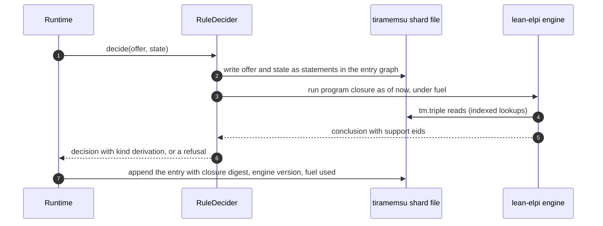
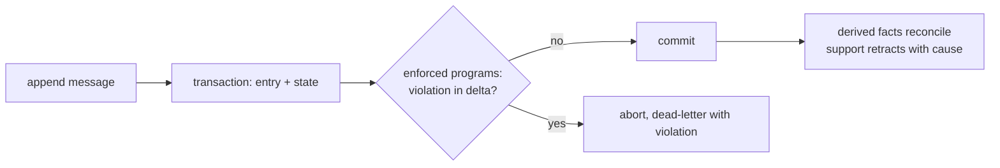
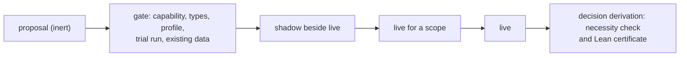

# Rules

How rules would work in Vertep: ELPI programs stored beside the journal by tiramemsu, a rules decider whose rationale is a derivation, enforced invariants, verification and agent-proposed rules.

This view explains milestones M14 to M17 and the planned crate `vertep-rules`. None of it is built. Requirement names in backticks are from the OpenSpec changes `m14-rules-decider`, `m15-rule-invariants`, `m16-verified-rules` and `m17-agent-rules`.

## One rule decision

A rules decider writes the offer and the state as statements, runs the program under fuel and records the support of its conclusion on the decision entry.

- describes:: [[components#vertep-rules]]
- describes:: [[capabilities#Rule decider]]
- describes:: [[capabilities#Rule programs]]
- describes:: [[roadmap#M14 Rules decider]]
- describes:: [[decisions#A rule decision's rationale is the support of its conclusion]]
- describes:: [[decisions#The offer and the state are statements a rule can read]]

`Derivation Is The Rationale` and `Offer And State Are Statements` define the two arrows that matter: the offer goes into the graph before the rule runs, and the support comes out on the entry.

## Versions and counterfactuals

A program is a node edited by supersede, so any earlier transaction sees the rules of its day, and a decision pins its closure by digest.

- describes:: [[decisions#Rules live per shard, in the journal's file]]
- describes:: [[decisions#Rule evaluation is fuel-bounded and pinned to an engine version]]
- describes:: [[constraints#The native rules engine exists for four platforms]]

`Rule Version Is Pinned By The Entry` and `Rule Version Counterfactual` make replay deterministic and let a later policy version be tried on old cases without touching the journal.

## Invariants and derived facts

An enforced program is run in the commit of every append; a refusal aborts the transaction and dead-letters the message.

- describes:: [[capabilities#Rule invariants]]
- describes:: [[capabilities#Derived facts]]
- describes:: [[roadmap#M15 Rule invariants]]
- describes:: [[decisions#A refused append writes no entry and dead-letters the message]]
- describes:: [[decisions#Erasure retracts what depends on the erased]]

## Verification and authorship

M16 makes a derivation checkable and M17 lets agents propose rules without governing themselves.

- describes:: [[capabilities#Rule verification]]
- describes:: [[capabilities#Rule authoring]]
- describes:: [[decisions#A rules profile defines what can be checked]]
- describes:: [[decisions#The rule gate is ordered and its errors are terms]]
- describes:: [[decisions#An actor cannot govern itself]]

