# Runtime View

How `vertep-runtime` runs actors: the actor contract, addresses and the three lifecycle classes, one turn per macrostep, the identity, mailbox and transport layers, requests, deferral, supervision and durable timers.

The runtime is an imperative shell around the pure, `no_std` `step` of `vertep-core`. Everything that waits, retries, stores or talks to the network lives in the shell; nothing inside `step` awaits. That one split is what keeps replay deterministic and the Lean oracle applicable to every macrostep.

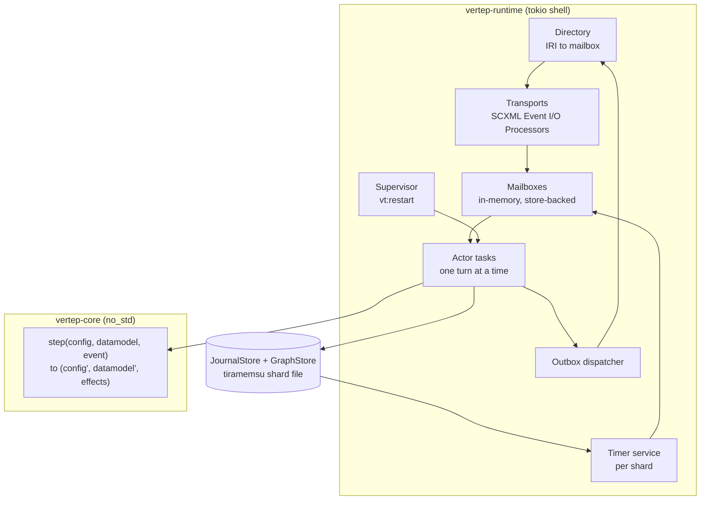

## Actor contract

An actor is anything that receives SCXML events one at a time and produces events; a running chart is the main implementation, and functions, streams, tools and LLM adapters are others.

- describes:: [[decisions#SCXML-native actors with vt extensions]]
- describes:: [[components#vertep-runtime]]
- describes:: [[capabilities#Actor model]]

The `Actor Trait` requirement asks for a single contract so that every kind is interchangeable as a target of `<send>` and `<invoke>`. A sketch of its shape:

```rust
// crates/vertep-runtime/src/actor.rs
/// One event in, zero or more events out. A chart is one implementation.
pub trait Actor {
    /// The address; also the RDF subject of state and journal.
    fn address(&self) -> &Address;
    /// Handle one input. For a chart this is exactly one SCXML macrostep.
    fn turn(&mut self, input: ActorInput) -> Turn;
}

/// Finished at once (a chart's macrostep) or a future the runtime runs in the background
/// (an async function or stream); either way the actor takes no other input until it ends.
pub enum Turn {
    Ready(Result<TurnOutput, ActorFailure>),
    Pending(BoxFuture<Result<TurnOutput, ActorFailure>>),
}

pub struct ActorInput {
    pub event: Event,          // name, data, sendid, origin, origintype
    pub message_id: String,    // dedup key
    pub received_at_ms: i64,   // stamped by the shell's Clock when dequeued, journaled
}

pub struct TurnOutput {
    pub sends: Vec<Outgoing>,  // target, event, delay_ms; dispatched only after the append
    pub cancels: Vec<String>,  // send ids of delayed sends to cancel
    pub done: Option<Value>,   // set when the actor completed, with its done data
}
```

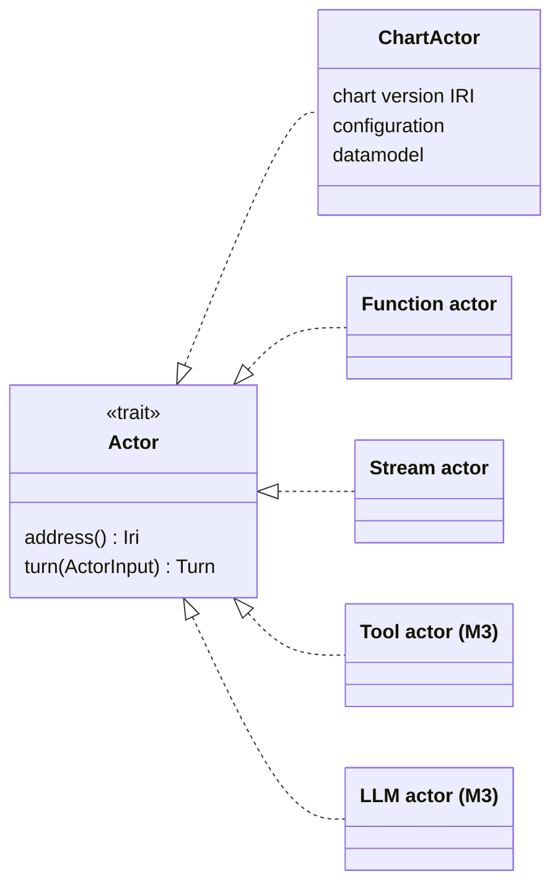

A failure inside a turn leaves the journal unchanged and touches no other actor (`Actor Failure Isolation`): the append is the commit point, and a turn that fails never reaches it.

## Addresses and lifecycle classes

Every actor has exactly one absolute IRI address, and it belongs to one of three lifecycle classes that differ in identity, ownership and persistence.

- describes:: [[decisions#IRI identity and lifecycle classes]]
- describes:: [[glossary#Virtual actor]]
- describes:: [[glossary#Invoked actor]]
- describes:: [[glossary#Stateless worker]]

| | Virtual actor | Invoked actor | Stateless worker |
|---|---|---|---|
| Address | derived from chart type IRI and key | parent address plus invoke id | pool address |
| Exists | always, logically | while the invoking state is active | while the pool is configured |
| Persistence | own journal and snapshots | through the parent's journal (M2) | none; caller journals results |
| Reached by | `<send>`, `vt:request` | parent `<send>`; `#_parent` back | `<send>`, `vt:request` |
| Activations | at most one per node | one | many per address |

A virtual actor cannot be the target of `<invoke>` (`Virtual Actors Are Not Invokable`), because no state owns its lifetime; cancelling a parent state must never "kill" a shared actor.

### Virtual actor lifecycle

A virtual actor is activated by a message or a due timer, restored from its snapshot and journal, and deactivated when idle; its state never depends on staying in memory.

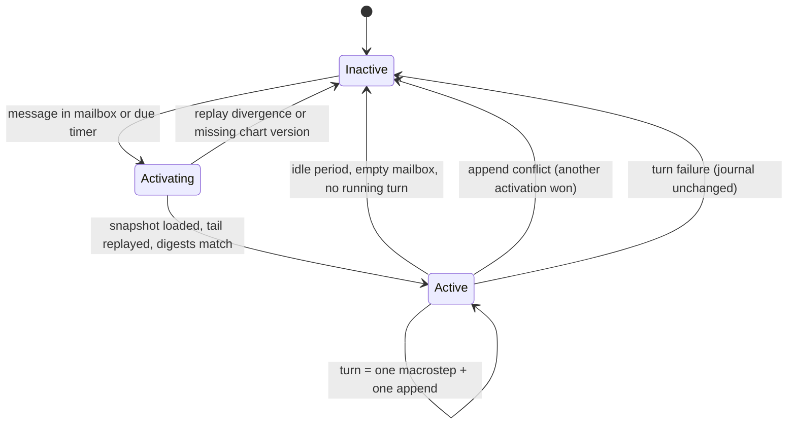

Requirements: `Virtual Actor Identity`, `Virtual Actor Activation`, `Virtual Actor Deactivation`. Single activation is per node in M2; across nodes it comes from shard leases in M4, with the journal's compare-and-set as the backstop.

### Invoked actor lifecycle

An invoked actor starts when its invoking state is entered at the end of a macrostep and is cancelled when that state exits, exactly as SCXML `<invoke>` defines.

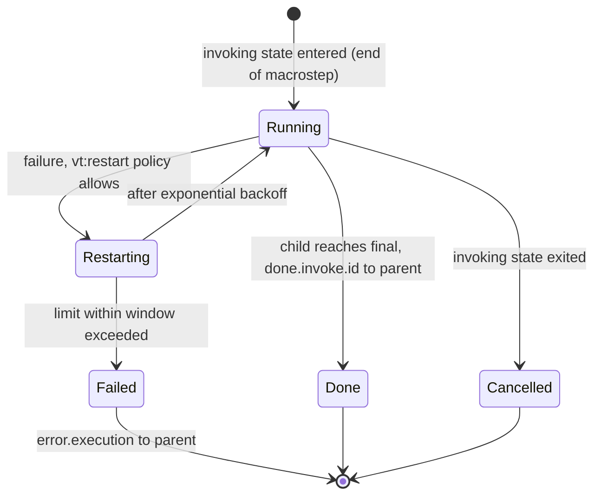

In M2 a chart child has no journal of its own: what it receives from its parent is in the parent's journal, so replaying the parent reproduces the child. A child that must survive the loss of its node is an M4 concern.

### Stateless worker lifecycle

A stateless worker has no journal and no per-instance identity; the runtime may run several activations per address and delivers each message to exactly one of them.

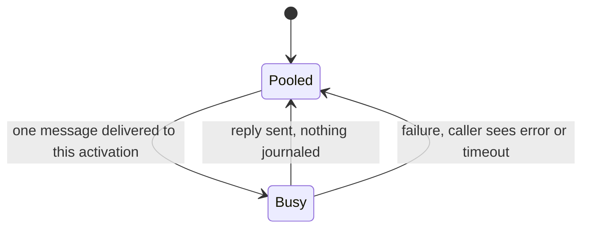

Workers fit LLM calls, tool execution and CPU-heavy work. Their results matter only once they reach a caller, where they are journaled as inputs (`event-journal#External Results As Inputs`), so the caller's replay never repeats the work.

## Turn equals macrostep

A turn dequeues one external event and runs exactly one SCXML macrostep to completion before the next event, which is the same unit as an Orleans turn.

- describes:: [[decisions#Event-sourced actors]]
- describes:: [[decisions#No-std core and tokio shell]]

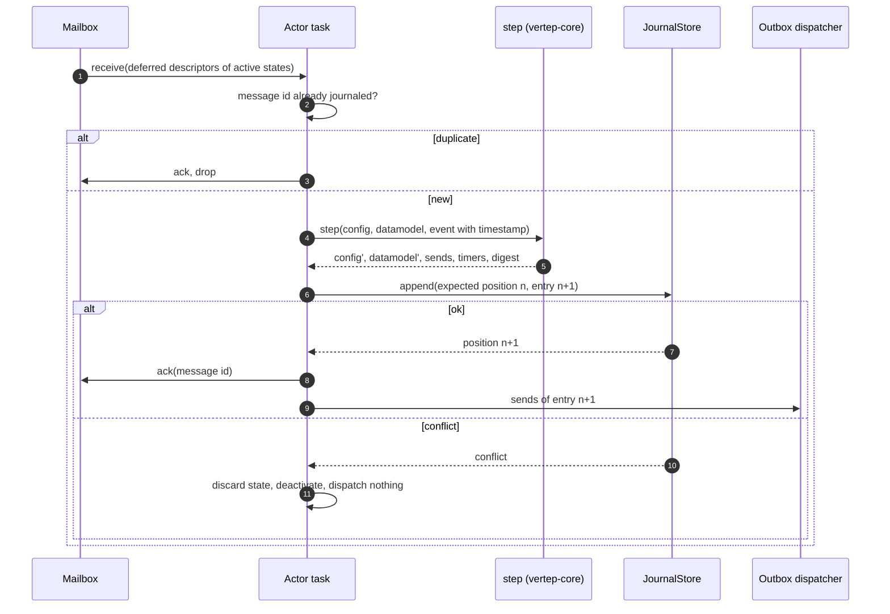

Invariants of a turn (`Turn Is One Macrostep`, `Inputs Only From The Journal`, `Transactional Outbox`):

1. `step` sees only the journaled event and the actor's state. Time arrives as the event's timestamp, stamped by the shell's `Clock` when the event is dequeued.
2. The append is the commit point. Before it, nothing is visible to anyone; after it, every recorded send is dispatched at least once.
3. Deduplication runs before `step`, so a redelivered message never runs a second macrostep.

## Identity, mailbox and transport

An address resolves through a directory to a mailbox, and mailboxes are fed by transports; each of the three layers is a trait with several implementations.

- describes:: [[decisions#Identity, mailbox and transport layers]]
- describes:: [[glossary#Mailbox]]
- describes:: [[capabilities#Messaging]]
- describes:: [[constraints#Relays deliver at least once]]

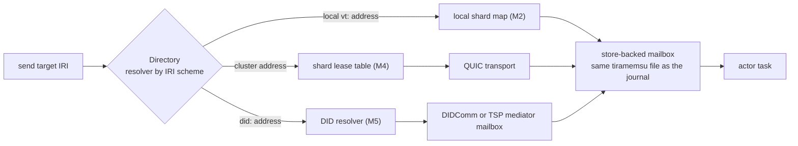

```rust
// crates/vertep-runtime/src/mailbox.rs and transport.rs (abridged)
pub trait Mailbox: Send + Sync {
    fn enqueue(&self, env: Envelope) -> Result<(), MailboxError>;
    /// Oldest message neither in flight nor deferred (its event name matches no
    /// descriptor in `deferred`), now marked in flight.
    fn receive(&self, deferred: &[String]) -> Option<Envelope>;
    fn ack(&self, message_id: &str) -> Result<(), MailboxError>;
    fn release(&self, message_id: &str);   // put an in-flight message back
    fn release_all(&self);
    fn pending(&self) -> Vec<Envelope>;
    // ...
}

pub trait Transport: Send + Sync {
    /// The SCXML Event I/O Processor type IRI that <send type="..."> selects.
    fn type_iri(&self) -> &str;
    fn aliases(&self) -> Vec<String> { Vec::new() }
    fn deliver(&self, mailbox: &dyn Mailbox, env: Envelope) -> Result<(), TransportError>;
}

/// One resolver per address scheme; the Directory dispatches on the scheme.
pub trait Resolver: Send + Sync {
    fn resolve(&self, address: &Address) -> Option<Arc<dyn Mailbox>>;
}
pub struct Directory { /* scheme -> Arc<dyn Resolver> */ }
impl Directory {
    pub fn register(&self, scheme: &str, resolver: Arc<dyn Resolver>);
    /// Depends only on the address, so reactivation or relocation keeps it.
    pub fn resolve(&self, address: &Address) -> Result<Arc<dyn Mailbox>, ResolveError>;
}
```

The rules behind the sketch:

- **Mailboxes outlive activations** (`Mailboxes Outlive Activations`). A message for an inactive virtual actor is stored and its arrival triggers activation; the actor does not need to be running to be addressed.
- **Ordering is per sender and receiver** (`Mailbox Ordering`). No order is promised between different senders, which is what lets relays and clusters exist at all.
- **Resolution depends only on the address** (`Address Resolution`). The directory maps the IRI to wherever the mailbox currently is.
- **Every event carries its origin** (`Event Origin`). `_event.origin` is the sender's address and `_event.origintype` the transport's type IRI, so `<send target="_event.origin">` always replies correctly. In M5 the origin becomes a verified DID.

### Local transport

M2 ships one transport, the local one, registered as an SCXML Event I/O Processor; the cluster QUIC transport and the DIDComm and TSP transports register the same way later.

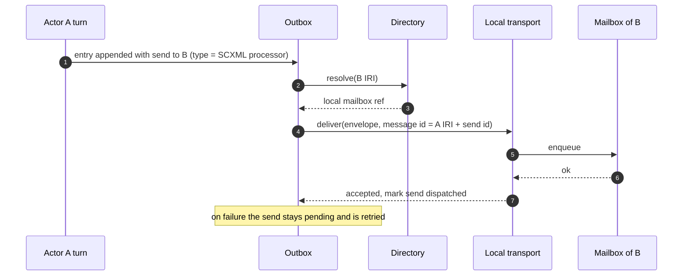

A message id built from the sender's address and the send id is stable across retries, so the receiver's deduplication turns at-least-once dispatch into effectively-once processing.

## Request and reply

`vt:request` is sugar that the IR lowering expands into plain SCXML plus a durable timer, so no part of a request ever blocks a turn and deadlock is impossible by construction.

- describes:: [[decisions#Non-blocking request and deferred events]]

A state declares a request as a `<vt:request>` child element, which `lower` in `crates/vertep-runtime/src/chart.rs` rewrites before compiling (example from `crates/vertep-runtime/tests/messaging.rs`):

```xml
<state id="quoting">
  <vt:request target="https://example.org/charts/pricer/b" event="price.get"
              timeout="5s" reply="priced" ontimeout="failed"/>
  <transition event="ping"/>
</state>
```

The lowering adds a `<send>` on entry, a generated waiting substate, a transition on `vt:reply` to the `reply` target and one on `error.timeout` to the `ontimeout` target; the replier answers with an ordinary send of `vt:reply`.

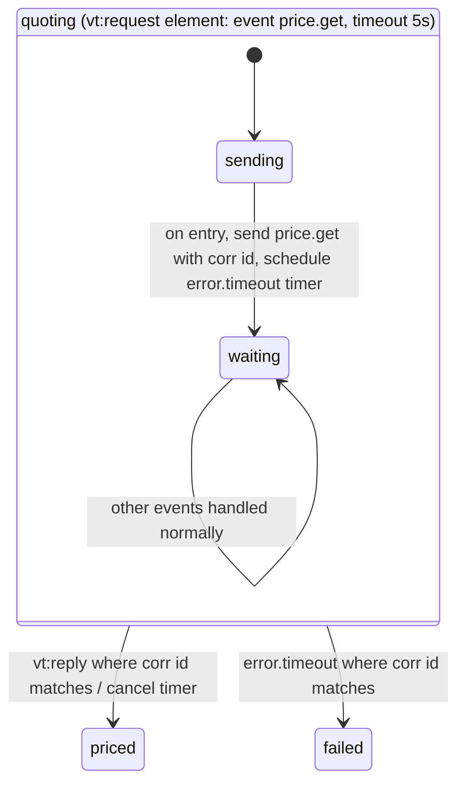

- **Correlation ids** (`Deterministic Correlation Ids`). The id is `<actor IRI>/request/<position>.<k>`: the journal position of the issuing macrostep and the index k of the request in it (`Address::correlation_id` in `crates/vertep-runtime/src/address.rs`). Replay rebuilds the same id without storing it separately.
- **Timeouts** (`Request Timeout`). The timeout is a durable timer in the same journal entry, so it survives deactivation and restarts and fires `error.timeout` with the correlation id.
- **Duplicate replies** (`Duplicate Reply Suppression`). At most one reply per correlation id is delivered; later ones are acknowledged and dropped.
- **Blocking ask only outside** (`External Blocking Ask`). HTTP handlers and tests may `ask(...).await`; executable content never can.

## Deferral and unhandled events

SCXML drops an external event that enables no transition; actors must not lose messages that way, so states can defer events and every chart has an explicit policy for the rest.

- describes:: [[constraints#SCXML discards unmatched events]]
- describes:: [[decisions#Non-blocking request and deferred events]]

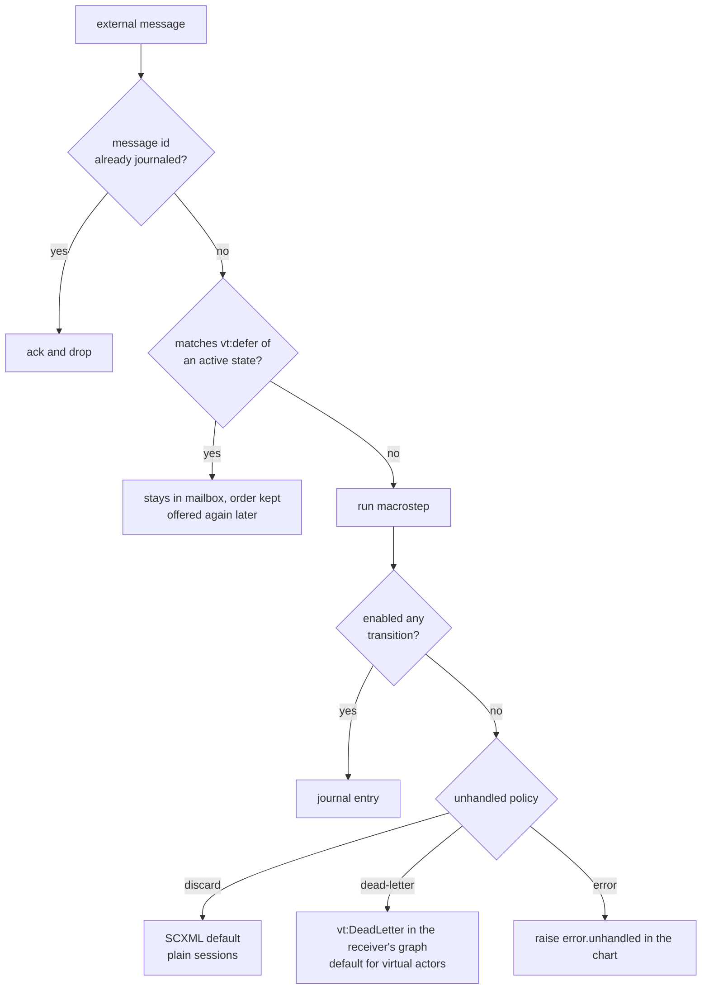

Deferral is implemented in the mailbox, not in `step` (`Deferred Events`): `receive` gets the descriptors deferred by the active configuration and skips matching messages without removing them, so the SCXML core and its conformance suite stay unchanged. Dead letters are graph data, queryable per receiver with sender, event, payload, reason and time (`Unhandled Event Policy`, `Queryable Dead Letters`).

## Supervision

An `<invoke>` may carry `vt:restart` with a policy, a limit within a window and exponential backoff, which the runtime applies when the invoked actor fails.

- describes:: [[decisions#SCXML-native actors with vt extensions]]

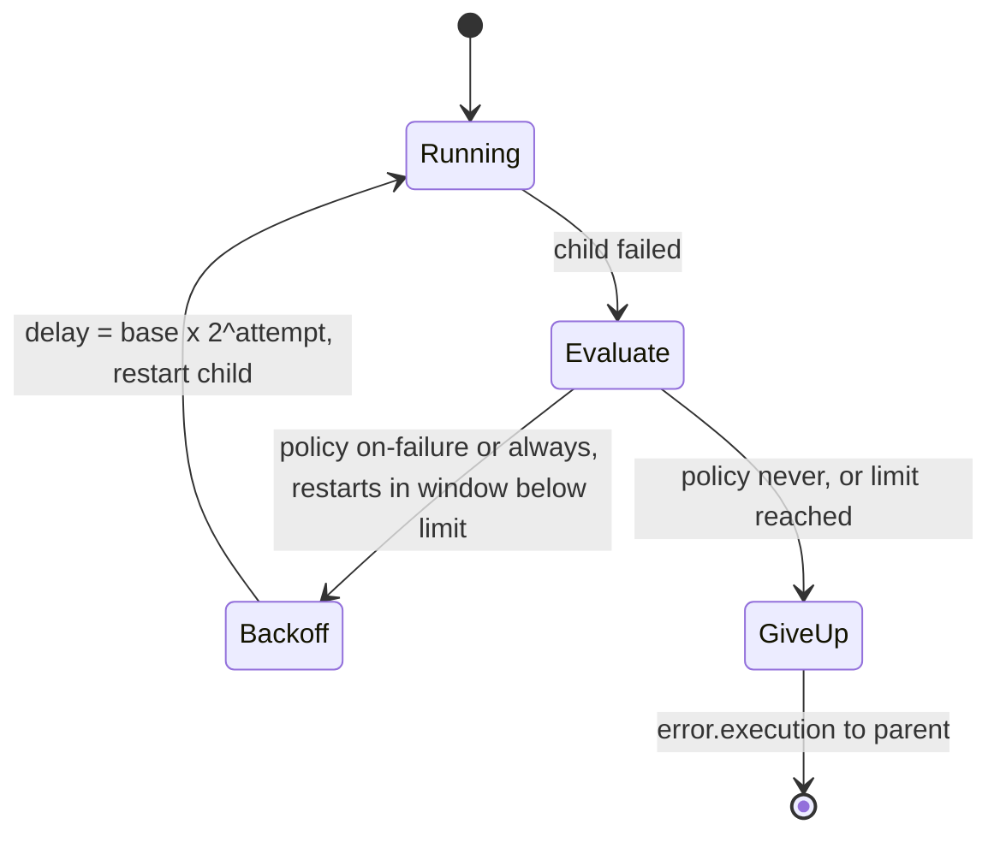

Supervision follows the `<invoke>` hierarchy: a parent state owns its children's lifetimes, so there is no separate supervisor tree to reconcile with SCXML semantics (`Supervision With Restart`). Virtual actors are not supervised this way; a failed turn simply leaves the journal unchanged and the next message reactivates the actor.

## Durable timers

Delayed sends and reminders are recorded in the journal entry that scheduled them and fired as ordinary inputs, so a deactivated actor needs no running process to keep its timers.

- describes:: [[capabilities#Durable timers]]
- describes:: [[decisions#No-std core and tokio shell]]

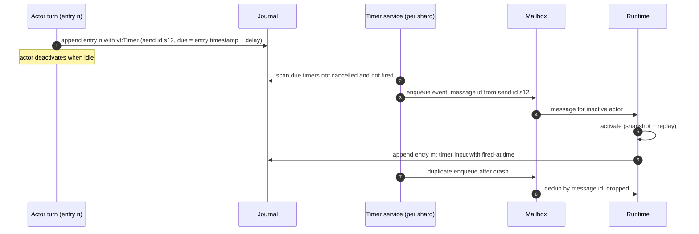

- **Journaled, never only in memory** (`Delayed Send Is Journaled`, `Timer Fires As Input`). Due times are computed from the scheduling entry's journaled timestamp (`Timer Time Source`), so replay never reads a clock.
- **Cancellation is journaled** (`Timer Cancellation`). A cancelled timer never fires, even if the scan saw it before the cancel committed, because the firing would be deduplicated against the cancellation on processing.
- **Reminders** (`Recurring Reminders`). `vt:reminder` fires each period until cancelled by name or until the actor is final.
- **Downtime** (`Missed Timers After Downtime`). After a restart every overdue timer fires in due order, and a reminder fires once for all missed occurrences.

## Shell traits

The shell talks to its async runtime only through small spawn, clock and sleep traits, implemented on tokio in M2 and on the browser in M6.

- describes:: [[decisions#No-std core and tokio shell]]
- describes:: [[components#vertep-core]]
- describes:: [[roadmap#M2 Actor runtime]]

```rust
// crates/vertep-runtime/src/shell.rs
pub trait Spawn: Send + Sync { fn spawn(&self, fut: BoxFuture<()>); }
pub trait Clock: Send + Sync { fn now_ms(&self) -> i64; }   // read only by the shell
pub trait Sleep: Send + Sync { fn sleep_until(&self, at_ms: i64) -> BoxFuture<()>; }
pub struct Shell { pub spawn: Arc<dyn Spawn>, pub clock: Arc<dyn Clock>, pub sleep: Arc<dyn Sleep> }
```

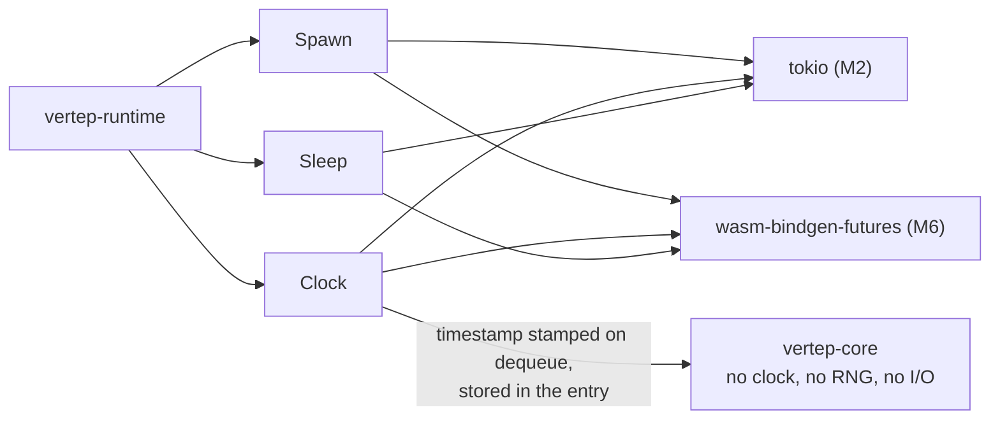

Random values requested by executable content come from a generator seeded from the entry IRI, so replay reproduces them (M2 design D6). Self-migration requests are queued as a runtime-internal input and processed at the start of a later turn, never inside the requesting macrostep (`chart-versioning#Self-Migration Requests`).

## Where requirements live

A map from the requirements this view explains to the module of `vertep-runtime` expected to implement them, as a starting point for `@tg: implements::` annotations.

- describes:: [[components#vertep-runtime]]

| Requirement | Module (planned) |
|---|---|
| `actor-model#Actor Trait`, `Actor Failure Isolation` | `actor` |
| `IRI Actor Addresses`, `Virtual Actor Identity` | `address` |
| `Virtual Actor Activation`, `Virtual Actor Deactivation`, `Turn Is One Macrostep` | `activation`, `turn` |
| `Invoked Actor Lifecycle`, `Supervision With Restart`, `Virtual Actors Are Not Invokable` | `invoke`, `supervise` |
| `Stateless Worker Lifecycle` | `worker` |
| `messaging#Pluggable Mailboxes`, `Mailbox Ordering`, `Mailboxes Outlive Activations`, `Deferred Events` | `mailbox` |
| `Pluggable Transports`, `Event Origin` | `transport` |
| `Address Resolution` | `directory` |
| `Non-Blocking Request`, `Deterministic Correlation Ids`, `Request Timeout`, `Duplicate Reply Suppression` | lowering in `vertep-core`, matching in `request` |
| `Unhandled Event Policy`, `Queryable Dead Letters` | `deadletter` |
| `External Blocking Ask` | `ask` |
| `durable-timers#*` | `timer` |
