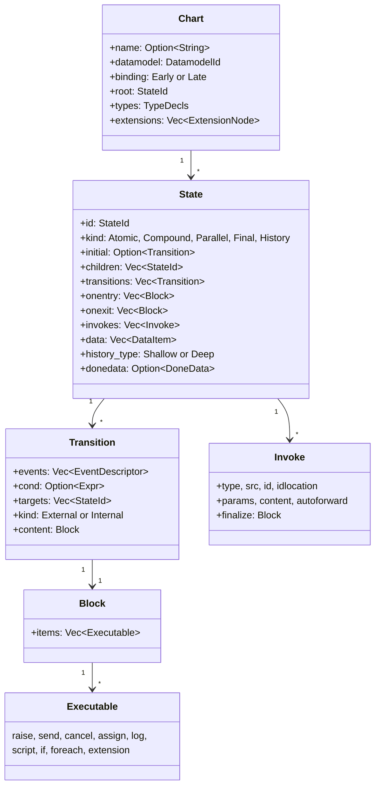
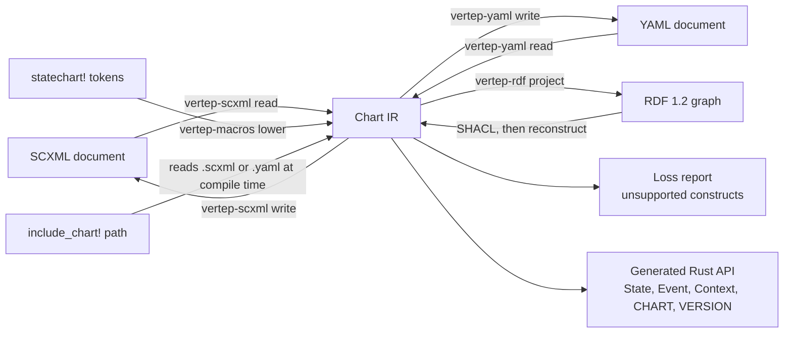
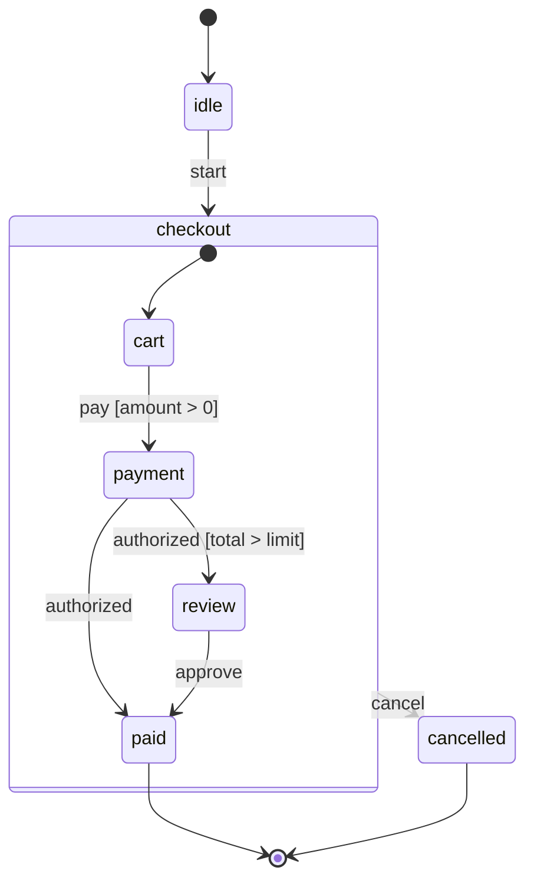
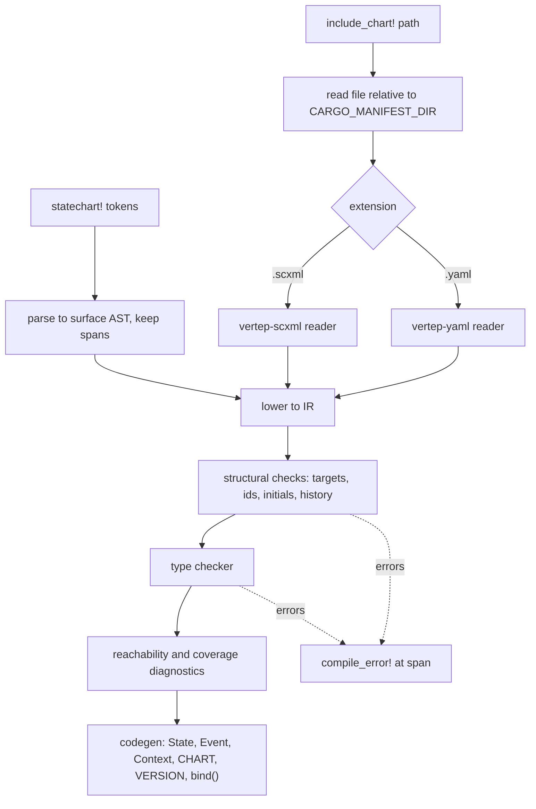
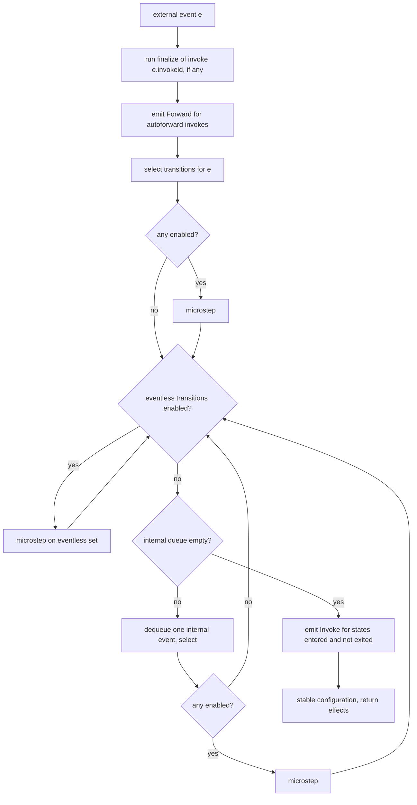
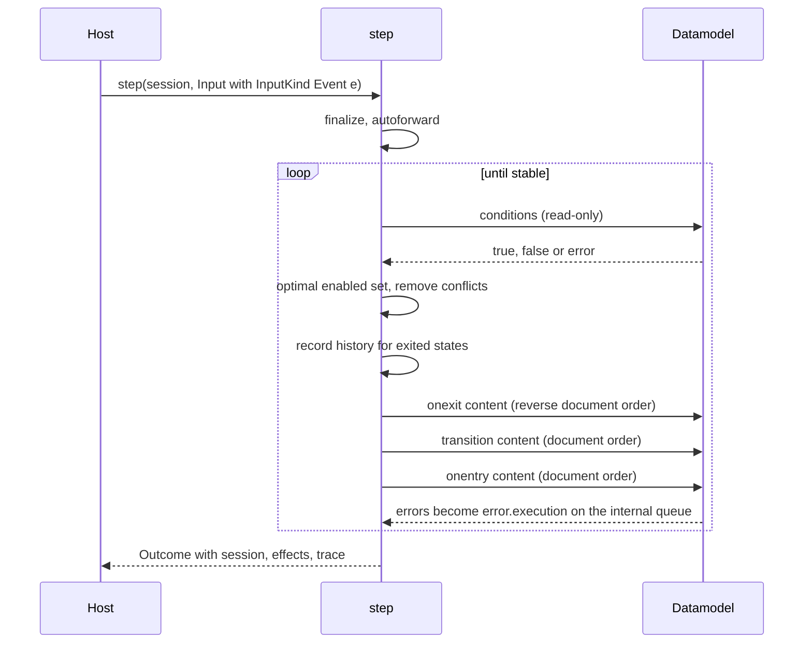
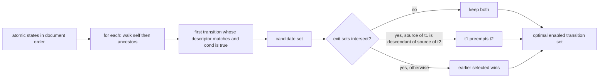
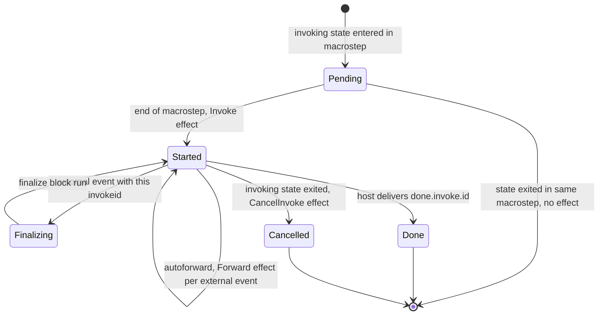
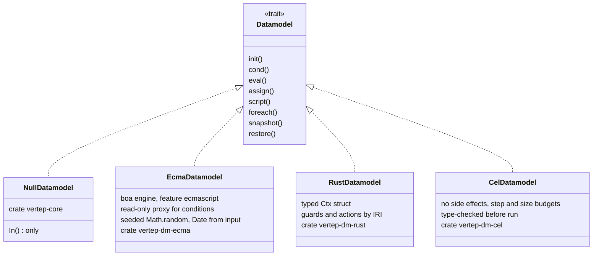
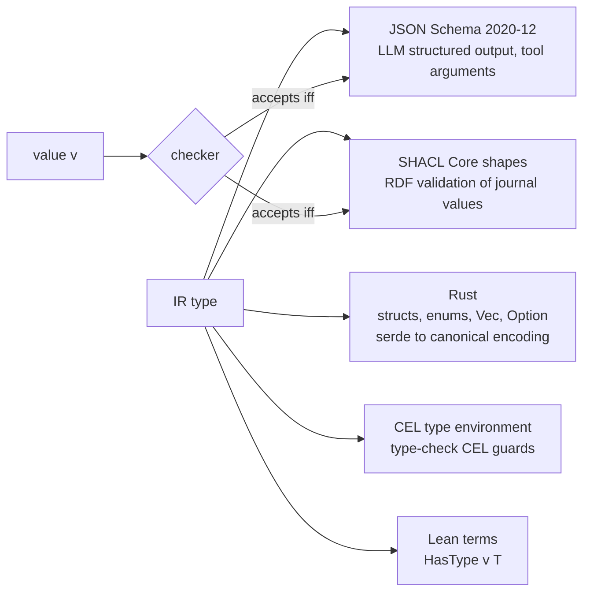

# Statecharts View

How a chart is represented, authored, typed and executed: the IR, the surfaces that lower into it, the pure `step` that implements SCXML, the pluggable datamodels and the type language.

This view covers milestones M0 and M1. The actor runtime that calls `step` is out of scope here; [[views/overview]] shows where it sits, and [[views/verification]] shows how this layer is proven and tested.

## Chart IR

The IR is the canonical chart: a tree of states with transitions, executable content, invokes and data in explicit document order, validated before it can run.

- describes:: [[capabilities#Chart model]]
- describes:: [[components#vertep-core]]
- describes:: [[decisions#IR is the hub]]
- describes:: [[constraints#Proc macros run at compile time]]



Key rules, each a requirement of the chart model:

- **Document order is data** (`Document Order`): children, transitions, targets and content keep their source order, because SCXML priority is document order.
- **Identity** (`State Identity`): states without an `id` get stable generated ids derived from document position that never collide with declared ids.
- **Initial resolution** (`Initial State Resolution`): an `initial` attribute or element wins, otherwise the first child in document order.
- **Extensions survive** (`Extension Nodes`): unknown `vt:` or foreign elements are kept as extension nodes, not dropped.
- **Validation** (`Well-Formedness Validation`): unknown targets, duplicate ids, illegal history placement, a parallel state with an initial, and similar errors are reported all at once.
- **Equality** (`Chart Equality`): structural equality over the IR is what round-trip tests and hashing compare.

```rust
// vertep-core, no_std + alloc (sketch)
pub struct Chart { pub root: StateId, pub states: Vec<State>, pub datamodel: DatamodelId,
                   pub binding: Binding, pub types: TypeDecls, pub extensions: Vec<ExtensionNode> }

pub fn validate(chart: &Chart) -> Result<CompiledChart, Vec<Diagnostic>>;

// Derived, never serialized: dense state indices in document order,
// parent and ancestor tables, transition domains, default entry sets.
pub struct CompiledChart { /* bitsets and tables */ }
```

## Authoring surfaces

Four ways in, one IR: SCXML documents, YAML documents, the `statechart!` macro and `include_chart!` over SCXML or YAML files; RDF is a fifth, lossless projection.

- describes:: [[capabilities#SCXML format]]
- describes:: [[capabilities#YAML format]]
- describes:: [[capabilities#Rust DSL]]
- describes:: [[components#vertep-scxml]]
- describes:: [[components#vertep-yaml]]
- describes:: [[components#vertep-macros]]



| Surface | Reader and writer | Default datamodel | Round trip guarantee |
|---|---|---|---|
| SCXML | `vertep-scxml` on `quick-xml`, with source locations | as declared (`null` if none) | `SCXML Round Trip`: equal IR after read-write-read |
| YAML | `vertep-yaml`, order-keeping, canonical writer | `cel` | `Lossless YAML Round Trip` |
| `statechart!` | `vertep-macros`, spans kept | `rust` | lowers to IR at compile time |
| `include_chart!` | reuses the SCXML and YAML readers inside the macro | from the file | same typed API as `statechart!` |
| RDF | `vertep-rdf` | from the chart | `Round Trip Identity` on well-formed charts |

Unsupported constructs are never silently approximated: SCXML elements outside the supported profile produce a `Declared Loss Report` entry, and `vt:` attributes in the `Vertep Extension Namespace` keep the document valid SCXML for other processors.

### The same machine in YAML and in the macro

An order chart written twice: the YAML uses CEL expressions, the macro binds named Rust functions; both get the same structure and types but different chart version IRIs because their datamodels differ.



```rust
statechart! {
    name: order,
    datamodel: rust,
    types { Pay = { amount: decimal }, Approval = { by: iri } }
    context { total: decimal = 0, limit: decimal = 100 }
    events { start, pay: Pay, authorized, approve: Approval, cancel }
    initial idle;
    state idle { on start => checkout; }
    state checkout {
        initial cart;
        on cancel => cancelled;
        state cart { on pay if positive => payment / record_total; }
        state payment { on authorized if over_limit => review; on authorized => paid; }
        state review { on approve => paid; }
    }
    final paid;
    final cancelled;
}

fn positive(_: &Ctx, ev: &Pay) -> bool { ev.amount > Decimal::ZERO }
fn over_limit(ctx: &Ctx, _: &()) -> bool { ctx.total > ctx.limit }
fn record_total(ctx: &mut Ctx, ev: &Pay, _: &mut Emit) { ctx.total = ev.amount; }
```

```yaml
vertep: 1
name: order
datamodel: cel
types: { Pay: { amount: decimal }, Approval: { by: iri } }
context:
  total: { type: decimal, init: "0" }
  limit: { type: decimal, init: "100" }
events: { start: null, pay: Pay, authorized: null, approve: Approval, cancel: null }
initial: idle
states:
  idle: { on: { start: checkout } }
  checkout:
    initial: cart
    on: { cancel: cancelled }
    states:
      cart:
        on:
          pay:
            - cond: "ev.data.amount > 0"
              target: payment
              actions: [ { assign: { location: ctx.total, expr: "ev.data.amount" } } ]
      payment:
        on:
          authorized:
            - { cond: "ctx.total > ctx.limit", target: review }
            - { target: paid }
      review: { on: { approve: paid } }
  paid: { type: final }
  cancelled: { type: final }
```

### Macro compile pipeline

The macros run the same validation and type checker as the runtime, inside the compiler, and turn every diagnostic into a `compile_error!` at the right span.

- describes:: [[components#vertep-dm-rust]]



Guards and actions bind by IRI (`Functions Registered by IRI`). The generated `bind()` registers user functions with compiler-checked signatures: a guard is `fn(&Ctx, &Event) -> bool` and gets no emitter and no mutable context (`Pure Guards`); an action is `fn(&mut Ctx, &Event, &mut Emit)` and produces effects only as events (`Actions Emit Effects as Events`). The same registry lets a chart loaded from RDF at runtime bind to compiled functions.

## The step function

`step` is the W3C SCXML interpretation algorithm as a pure function: session state and one input in, new session state and an ordered list of effects out, with no I/O, clock or randomness.

- describes:: [[capabilities#SCXML interpretation]]
- describes:: [[decisions#SCXML semantics are normative]]
- describes:: [[constraints#SCXML interpretation algorithm]]
- describes:: [[constraints#Aeneas supports a Rust subset]]

```rust
// crates/vertep-core/src/session.rs (fields abridged)
pub struct Session {
    pub sessionid: String,
    pub status: Status,                 // Running or Terminated
    pub configuration: StateSet,        // bitset over states in document order
    pub history: History,               // shallow and deep records per history state
    pub internal_queue: VecDeque<Event>,
    pub invocations: Vec<Invocation>,   // started, not yet cancelled invokes
    pub data_initialized: StateSet,     // late binding: which states' data is initialized
    pub send_counter: u64,              // deterministic send ids
    pub invoke_counter: u64,
    pub macrosteps: u64,
    pub options: Options,               // microstep budget, send and invoke types
}

pub struct Environment { pub now_ms: i64, pub seed: u64 }   // journaled time, seed from the entry IRI

pub struct StartInput { pub info: SessionInfo, pub env: Environment, pub options: Options,
                        pub data: Vec<(String, Value)>, pub sessions: Option<Vec<String>> }
pub enum InputKind { Event(Event), Cancel }
pub struct Input { pub env: Environment, pub kind: InputKind, pub sessions: Option<Vec<String>> }

pub enum Effect {
    Send(SendRequest),                  // sendid, event, target, type_, delay_ms
    Cancel { sendid: String },
    Invoke(InvokeRequest),              // invokeid, state, type_, src, content, params, autoforward
    CancelInvoke { invokeid: String },
    Forward { invokeid: String, event: Event },   // autoforward
    Log { label: Option<String>, value: Option<Value> },
    SessionDone { data: Value, cancelled: bool },
}

pub struct Outcome { pub session: Session, pub effects: Vec<Effect>, pub trace: MacrostepTrace }

pub fn start(chart: &CompiledChart, input: StartInput, dm: &mut dyn Datamodel)
    -> Result<Outcome, StartError>;     // UnsupportedDatamodel, DatamodelMismatch, Datamodel, BudgetExceeded
pub fn step(chart: &CompiledChart, session: Session, input: Input, dm: &mut dyn Datamodel)
    -> Result<Outcome, StepError>;      // Terminated, BudgetExceeded (with the partial outcome)
```

Starting a session is its own function rather than an input variant, and time and randomness reach the datamodel only through `Input.env` (`now_ms`, `seed`): the runtime takes the time from the entry's journaled timestamp and derives the seed from the entry IRI (`seed_of` in `crates/vertep-runtime/src/address.rs`), so replay gets both back without storing random values.

The datamodel is passed as `&mut dyn Datamodel` because embedded engines such as boa are mutable; purity therefore means "a function of session, input and datamodel snapshot", which `Deterministic Evaluation` and `Datamodel Snapshot` make exact. The spec wording `Pure Step Function` and this signature agree under that reading.

### Macrostep and microstep

One external event per macrostep, run to completion: eventless transitions first, then internal events one at a time, until nothing is enabled and the internal queue is empty.





### Transition selection and conflicts

For each atomic state in document order, pick the first matching transition on it or its nearest ancestor; then remove conflicts, preferring descendants and otherwise earlier selection.



- **Descriptor matching** (`Event Descriptor Matching`): token prefix match, `*` matches all, trailing `.*` ignored.
- **Internal transitions** (`Internal Transitions`): a compound source whose targets are all proper descendants is not exited.
- **Exit and entry order** (`Exit And Entry Order`): exit in reverse document order, descendants first; enter in document order, ancestors first.
- **History** (`History Restoration`): record active children (shallow) or atomic descendants (deep) on exit; restore on entry, or take the history's default transition when nothing is recorded.
- **Done events** (`Final States And Done Events`): `done.state.<id>` for compound and parallel completion with evaluated `donedata`; a top-level final ends the session.

### Queues, errors and effects

Internal events always run before the next external event; errors become events, never panics; every interaction with the outside is an effect returned to the host.

| Mechanism | Rule | Requirement |
|---|---|---|
| Internal queue | fed by `raise`, `send` to `#_internal`, platform events | `Internal And External Queues` |
| `error.execution` | failed expression or bad location; stops the current block | `Execution Errors` |
| `error.communication` | unhandled send target or type | `Execution Errors` |
| Sends | evaluated name, data, target, type, delay, deterministic send id | `Send And Cancel Effects` |
| Invokes | started at end of macrostep, cancelled on exit, finalize before matching event | `Invoke Lifecycle` |
| Termination | exit all, cancel invokes, one `SessionDone`, reject further events | `Session Termination` |

### Invoke lifecycle

An invocation belongs to the state that declares it: started when the macrostep that entered the state completes, cancelled when the state exits, and finished by `done.invoke.<id>` from the host.



## Datamodels

Executable content goes through one `Datamodel` trait; `null` and `ecmascript` arrive in M0, `rust` and CEL in M1, and a host registry picks the one a chart names.

- describes:: [[capabilities#Datamodel]]
- describes:: [[capabilities#CEL datamodel]]
- describes:: [[decisions#Pluggable datamodel]]
- describes:: [[components#vertep-dm-ecma]]
- describes:: [[components#vertep-dm-cel]]

```rust
pub trait Datamodel {
    fn init(&mut self, items: &[DataItem], binding: Binding, sys: &SystemVars) -> Result<(), EvalError>;
    fn cond(&self, expr: &Expr, sys: &SystemVars) -> Result<bool, EvalError>;    // read-only
    fn eval(&self, expr: &Expr, sys: &SystemVars) -> Result<Value, EvalError>;
    fn assign(&mut self, loc: &Location, v: Value) -> Result<(), EvalError>;
    fn script(&mut self, src: &Script, sys: &SystemVars) -> Result<(), EvalError>;
    fn foreach(&mut self, coll: &Expr, item: &Location, index: Option<&Location>,
               body: &mut dyn FnMut(&mut dyn Datamodel) -> Result<(), EvalError>) -> Result<(), EvalError>;
    fn snapshot(&self) -> DatamodelSnapshot;                                       // datamodel-independent
    fn restore(&mut self, snap: &DatamodelSnapshot) -> Result<(), EvalError>;
}
```



| Datamodel | Milestone | Used for | Purity mechanism | Determinism |
|---|---|---|---|---|
| `null` | M0 | protocol and lifecycle charts | no data at all; only `In()` | trivial |
| `ecmascript` | M0 | conformance suite, imported SCXML | conditions run against a read-only proxy; writes throw | `Math.random` seeded, `Date` from input |
| `rust` | M1 | `statechart!` charts | guard signatures take `&Ctx` and no emitter | contract; checked by the Lean oracle |
| CEL | M1 | YAML charts, LLM-written plan charts | language has no effects | no `now`, no randomness, ordered maps, exact decimals |

Shared rules: system variables `_event`, `_sessionid`, `_name`, `_ioprocessors` are read-only (`System Variables`); `In()` exists in every datamodel (`In Predicate`); early and late binding follow SCXML 5.3 (`Data Binding Modes`); a condition that tries to mutate is an error, is treated as false and queues `error.execution` (`Guard Purity`). CEL additionally guarantees termination through step and size budgets (`Guaranteed Termination`) and is the only datamodel allowed for generated charts (`Safe Datamodel for Generated Charts`).

## Type language

One algebraic type language in the IR describes event payloads and context; typing is opt-in per chart, and one checker in the core serves macros, loaders, the CLI and the runtime.

- describes:: [[capabilities#Type system]]
- describes:: [[decisions#One IR type language]]
- describes:: [[decisions#Content-addressed chart versions]] {note: "named types are content-addressed like charts"}

```rust
pub enum Type {
    Bool, Int, Decimal, String, DateTime, Iri,      // primitives
    Record(Vec<(Name, Type)>),
    Union(Vec<(Tag, Option<Type>)>),                 // tagged union
    List(Box<Type>),
    Optional(Box<Type>),
    Named(TypeIri),                                  // content-addressed, RDFC-1.0 hash
    Value,                                           // dynamic, for untyped charts
}

pub fn check_chart(chart: &Chart) -> Result<TypedChart, Vec<Diagnostic>>;   // reports every error
```

- **Primitives** (`Primitive Types`): `bool`, `int` (i64), `decimal` (arbitrary precision), `string`, `datetime` (RFC 3339 with offset, encoded in UTC with `Z`), `iri` (RFC 3987).
- **Named types** (`Named Content-Addressed Types`): the IRI is the hash of the canonical definition, so the chart version IRI covers its types and a type edit is a version change.
- **Recursion** (`Recursive and Cyclic Type Definitions`): only through a list or an optional.
- **Opt-in** (`Opt-In Chart Typing`, `Dynamic Value Boundary`): untyped charts run on `value` exactly as in M0; `value` enters static code only through a checked conversion.
- **System events** (`Event Type Declarations`): `done.state.*`, `done.invoke.*` and `error.*` have predefined types; a wildcard descriptor sees the union of matching payload types.
- **SCXML** (`Typed SCXML Attributes`): `vt:type` on `<data>`, `<send>` and `<param>` plus a `vt:types` element; other processors ignore them and run the chart untyped.
- **Generated values**: the checker also types what the interpreter writes without an expression of the chart: a bare `<assign>` (`undefined`) needs an optional location, `idlocation` a string location, `foreach` item and index locations their element and `int` types, `namelist` entries are keyed by the whole location, and declared `error.*` and `done.state.*` payloads must accept what the platform raises (decision "The chart checker types the values the core generates", found by the Lean type soundness proof).

### Projections

Each IR type projects to four targets whose agreement with the checker is tested on generated values and, for SHACL and JSON Schema, proven in Lean.



The agreement property for each projection P is `check(T, v) = P.accepts(P(T), encode(v))`, where `encode` is the canonical value encoding: tagged unions as `{"tag", "value"}`, decimals as strings, datetimes normalized to UTC and written with a `Z` suffix (`crates/vertep-core/src/types/prim.rs`). `Types Survive Every Surface` makes the round trip SCXML, YAML, IR and RDF type-preserving, with the same chart version IRI at the end.
