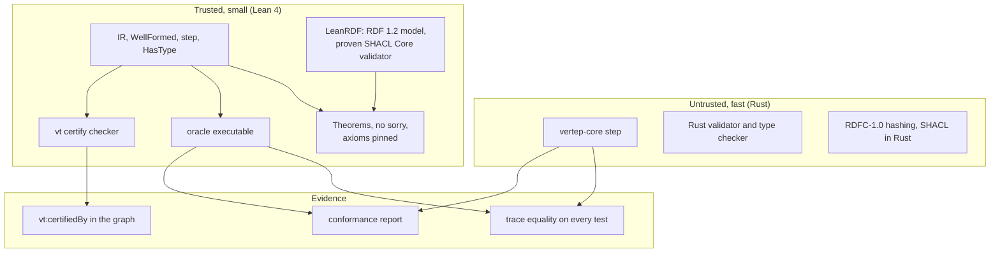
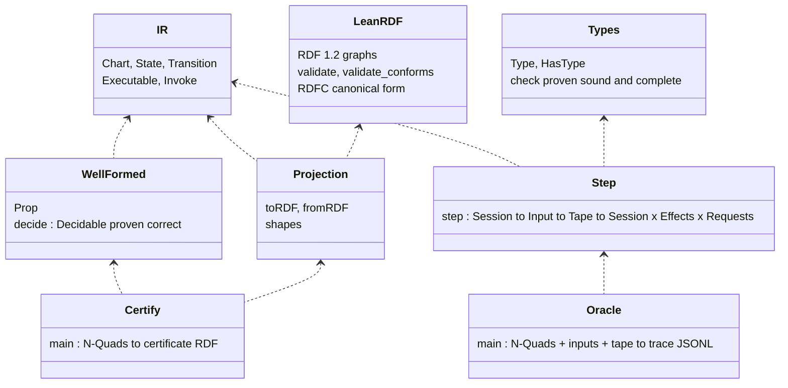
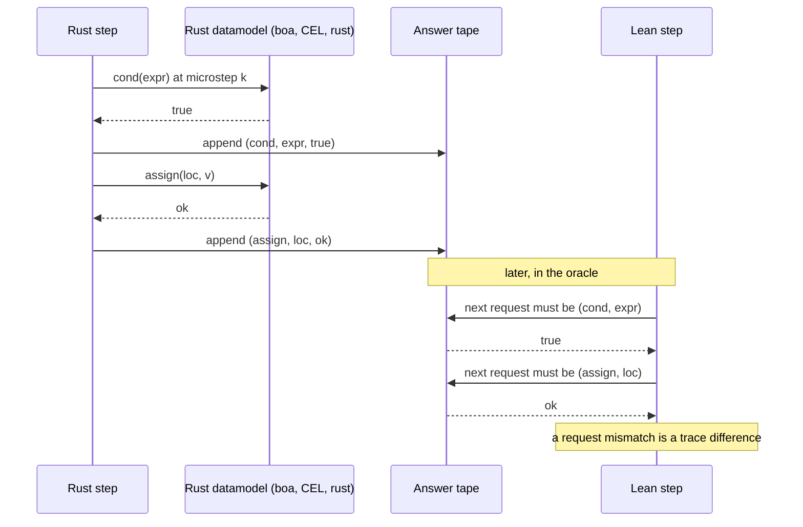
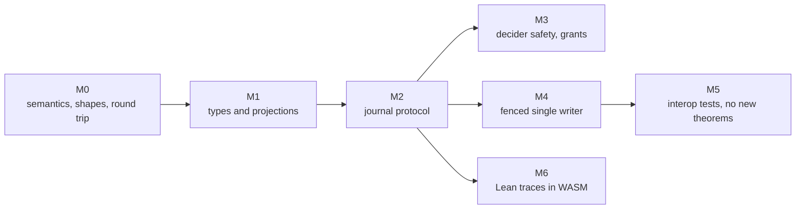
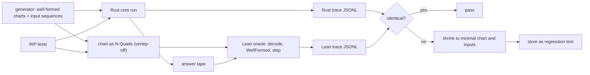
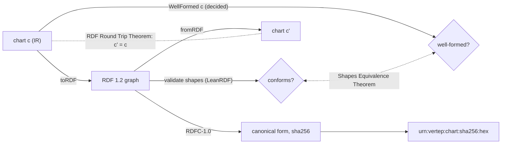
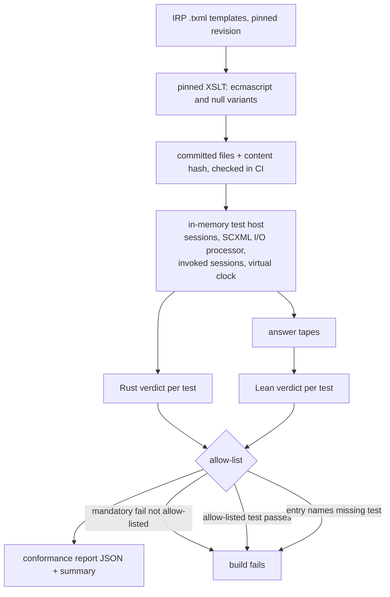
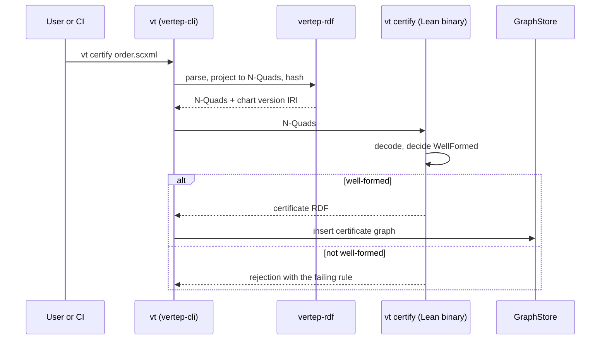
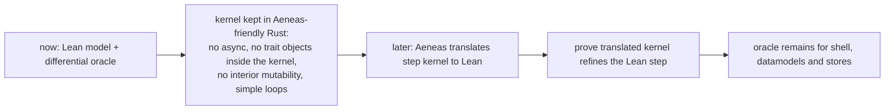

# Verification View

How Vertep earns its claims: a Lean 4 model on LeanRDF carries the proofs, its executable `step` is a differential oracle for Rust, the W3C suite runs on both, and certificates land in the graph.

The pattern follows verification-guided development: the Rust code stays untrusted and fast, the Lean model is small and proven, and agreement between them is tested on every conformance chart and on generated charts. [[views/statecharts]] describes what is being verified; [[views/overview]] shows where it sits.

## Trust architecture

Rust finds answers and Lean checks them: the theorems are about the Lean model, and the bridge to Rust is trace equality, not extraction.

- describes:: [[decisions#Lean verification bridge]]
- describes:: [[components#vertep-lean]]
- describes:: [[capabilities#Formal model]]
- describes:: [[constraints#Aeneas supports a Rust subset]]



What the trust boundary means in practice:

- A bug in Rust shows up as a trace difference or a failed conformance test, never as a wrong theorem.
- A bug in the Lean model shows up as a failed proof, or as a trace difference against Rust that is then investigated against the W3C text.
- The proofs quantify over every datamodel answer tape, so they hold for every datamodel; they do not prove ECMAScript itself correct.

## The Lean package

`vertep-lean` is a Lean 4 lake package with a pinned toolchain, depending on LeanRDF for the RDF 1.2 model and the proven SHACL Core validator; it has no `sorry` and pins its axioms in tests.

- describes:: [[components#vertep-conformance]]
- describes:: [[decisions#Modular vt ontology on RDF 1.2]]



| Requirement | Content |
|---|---|
| `Lean Package` | `lake build` from a clean checkout, pinned toolchain, LeanRDF at a pinned revision |
| `Axiom Hygiene` | only `propext`, `Quot.sound`, `Classical.choice`; a new axiom fails the build |
| `IR Model In Lean` | the chart IR and a `WellFormed` predicate with a decision procedure proven correct |
| `Executable Step Semantics` | `step` with the same inputs and outputs as Rust, datamodel abstracted as an answer tape |

### The datamodel as an answer tape

Lean cannot run ECMAScript, so the Rust run records every datamodel request and its answer, and the Lean run must issue exactly the same requests in the same order while consuming the tape.



For the `null` datamodel Lean evaluates `In()` itself, so null-datamodel charts need no tape.

## Theorem inventory

Each milestone adds proof obligations; M0 proves the semantics, M1 the types, M2 the journal protocol, M3 agent safety, M4 single writers; M5 relies on interop tests and M6 on replaying Lean traces in WebAssembly.

- describes:: [[roadmap#M0 SCXML core]]
- describes:: [[roadmap#M1 Typed authoring]]
- describes:: [[roadmap#M2 Actor runtime]]
- describes:: [[roadmap#M3 Agents]]
- describes:: [[roadmap#M4 Cluster]]

| Milestone | Theorem | Statement | Requirement or task |
|---|---|---|---|
| M0 | Step determinism | equal session, input and tape give equal session, effects and requests | `Step Determinism Theorem` |
| M0 | Configuration well-formedness | from a legal configuration `step` reaches only legal ones: root active, one child per active compound, all children per active parallel, parents active | `Configuration Well-Formedness Theorem` |
| M0 | Transition selection | each microstep's set is enabled, conflict-free and optimal per SCXML 3.13 | `Transition Selection Theorem` |
| M0 | Shapes equivalence | `validate shapes (toRDF c) = conforms` iff `WellFormed c` | `Shapes Equivalence Theorem` |
| M0 | RDF round trip | `fromRDF (toRDF c) = c` on well-formed charts; equal charts have equal canonical forms | `RDF Round Trip Theorem` |
| M0 | Dynamic type soundness | `step` never requests an undeclared location or data item; named extension point for M1 | `Type Soundness Statement` |
| M1 | Checker correctness | `check T v = true` iff `HasType v T` | M1 task 9.1 |
| M1 | SHACL projection agreement | `validate (shapes T) (toRDF v) = conforms` iff `HasType v T`, via `validate_conforms` | M1 task 9.2, `SHACL Projection` |
| M1 | JSON Schema agreement | for the supported keyword subset | M1 task 9.3, `JSON Schema Projection` |
| M1 | Typed step soundness | well-typed chart, configuration and inputs give well-typed context and output events | M1 design, decision 9 |
| M2 | Replay determinism | replaying a journal yields the recorded configurations and effects | M2 task 12.2, `Deterministic Replay` |
| M2 | Dedup idempotence | processing a message id twice equals processing it once | M2 task 12.3, `Message Deduplication` |
| M2 | Outbox | every recorded send is dispatched at least once; no unrecorded send is dispatched | M2 task 12.4 |
| M2 | Single activation by CAS | of two appends at the same expected position at most one succeeds | M2 task 12.5, `Compare-And-Set Append` |
| M3 | Decider safety | any transition taken because of a decision was enabled at offer time | M3 task 8.2, `Decider Safety` |
| M3 | Grant enforcement | a send from an invoked actor is delivered only if its target is in the intersected grants | M3 task 8.3, `Capability Grants` |
| M3 | Replay without deciders | journaled decisions and `llm.result` inputs reach the same state without consulting deciders | M3 task 8.4 |
| M4 | One writer per epoch | per shard and epoch at most one writer's appends are accepted; accepted versions are totally ordered across epochs | M4 task 6.4, `Single Activation Guarantee` |



## Differential oracle loop

The Lean `step` runs as an executable on the same charts and inputs as Rust; any difference in configurations, effects or datamodel requests fails CI and is shrunk into a regression test.

- describes:: [[capabilities#SCXML conformance]]
- describes:: [[components#vertep-rdf]] {note: "charts cross to Lean as N-Quads of their projection"}



Design choices behind the loop:

- **One exchange format.** Charts go to Lean as N-Quads of their RDF projection, decoded by the Lean `fromRDF` that the round-trip theorem covers, so every differential test also exercises the projection (`Differential Oracle`).
- **Trace granularity.** One JSON Lines record per macrostep: configuration, effects, datamodel requests.
- **Budget.** A bounded sample runs on every pull request and the full generated corpus nightly; the oracle is compiled natively.
- **Shrinking.** `Randomized Differential Testing` requires counterexamples to be shrunk and stored, so a found bug stays found.
- **Later milestones reuse it.** M1 compares checker verdicts, M2 replays crash and redelivery histories through the Lean journal model, M3 feeds adversarial decider outputs, M4 replays fault-injection histories through the lease model, M6 runs the same traces in WebAssembly.

## Shapes and round trip

The SHACL shapes for charts are not a second, hand-kept definition of validity: a theorem ties them to `WellFormed`, and the RDF projection is proven reversible.

- describes:: [[capabilities#Chart RDF]]
- describes:: [[constraints#RDF is open-world]]
- describes:: [[decisions#IR is the hub]]



Rules SHACL Core cannot state directly, such as a history default transition targeting descendants of the history's parent, are expressed over containment triples the projection materializes (`vt:ancestor`), so no SHACL-SPARQL is needed. If a rule still cannot be expressed, the equivalence proof fails, which keeps the gap visible. The projection uses no blank nodes, so canonicalization stays linear in practice.

## Conformance suite

The W3C SCXML IRP suite runs on the Rust core and on the Lean oracle for the `null` and `ecmascript` datamodels; every expected deviation is allow-listed with a reason, and an unexpected pass fails.

- describes:: [[constraints#SCXML interpretation algorithm]]
- describes:: [[decisions#Full SCXML first]]



| Requirement | Rule |
|---|---|
| `IRP Suite Import` | pinned revision, per-datamodel variants, IRP classification mandatory, optional or manual |
| `Pass Fail Protocol` | `pass` final state passes; `fail`, budget overrun or interpreter error fails with a reason |
| `Test Host` | in-memory, multi-session, virtual time, no real clock or network |
| `Rust Core Conformance` | every mandatory test gates CI |
| `Lean Model Conformance` | Lean verdict and trace must equal Rust's |
| `Expected Deviation Allow List` | test, datamodel, reason; unexpected pass and dangling entries fail |
| `Optional Test Reporting` | optional tests reported separately, outside the gate |
| `Conformance Report` | per test: datamodel, class, Rust verdict, Lean verdict, reason; totals |
| `Round Trip Corpus Checks` | every corpus chart survives SCXML and RDF round trips and conforms to the shapes |

Known risk: boa's ECMAScript gaps can fail tests unrelated to SCXML; those are allow-listed with the engine issue as reason, and the trait keeps another engine possible. M6 runs the same suite in WebAssembly (`Conformance Suite In WebAssembly`).

## Certificates in the graph

`vt certify` is a Lean-compiled checker: given a chart as RDF it decides `WellFormed` and, when it holds, emits a certificate as RDF attached to the chart version IRI with `vt:certifiedBy`.

- describes:: [[decisions#Content-addressed chart versions]]
- describes:: [[components#vertep-cli]]



```turtle
<urn:vertep:chart:sha256:4be1...> vt:certifiedBy <urn:vertep:cert:sha256:91c0...> .
<urn:vertep:cert:sha256:91c0...> a vt:Certificate ;
    vt:theorem "Vertep.shapes_equiv", "Vertep.step_wf", "Vertep.rdf_roundtrip" ;
    vt:leanToolchain "leanprover/lean4:v4.35.0" ;
    vt:leanRdfRevision "<pinned revision>" ;
    vt:checkerHash "sha256:..." ;
    prov:generatedAtTime "2026-11-11T12:00:00Z"^^xsd:dateTime .
```

Because the chart IRI is a content hash, a certificate can never apply to a different chart; a new version needs a new certificate. Certificates are ordinary graph facts, so "which running actors use uncertified charts" is a SPARQL query over the runtime graph.

## Later - Aeneas for the kernel

Proving the Rust code itself is deferred: the pure `step` kernel is written in a style Aeneas can translate, so the oracle bridge can later be replaced by a proof for that kernel only.

- describes:: [[decisions#No-std core and tokio shell]]



The datamodel trait object at the kernel boundary is the main obstacle; when Aeneas work starts, the kernel will be parameterized by a request and answer interface identical to the answer tape, which is already the Lean abstraction.
