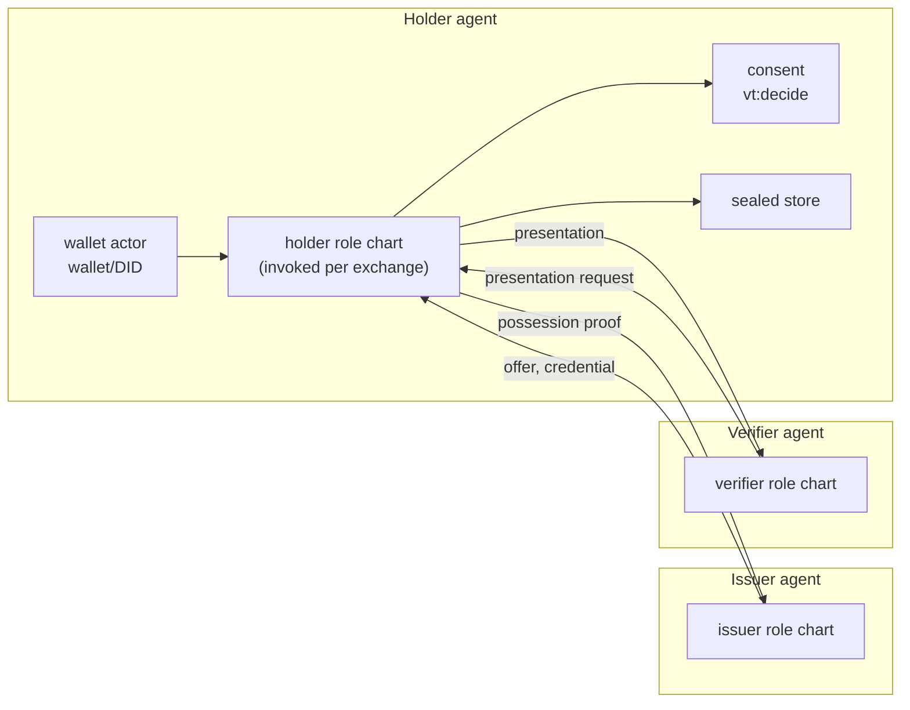
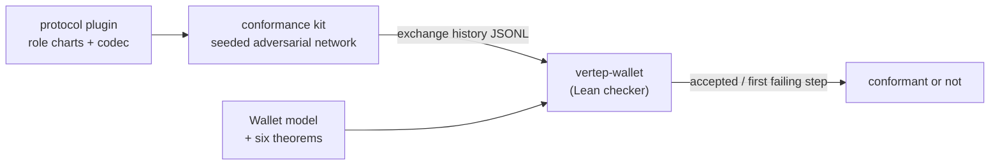

# Wallet

How a Vertep agent receives, keeps, presents, issues and verifies credentials: a wallet actor, role charts per exchange, five plugin interfaces, and one Lean exchange model that every protocol plugin is checked against.

This view explains milestone M9 and the crate `vertep-wallet`. Requirement names in backticks are from the OpenSpec change `m9-agent-wallet`.

- describes:: [[components#vertep-wallet]]
- describes:: [[capabilities#Agent wallet]]
- describes:: [[capabilities#Credential exchange]]
- describes:: [[capabilities#OID4VC]]
- describes:: [[roadmap#M9 Agent wallet]]

## The idea

A credential exchange is a protocol between parties that do not trust each other, which is what Vertep charts, journals and Lean models are for. So the wallet is an actor, every exchange is a chart, and every protocol is held to one model.

- describes:: [[decisions#Wallets are virtual actors and exchanges are role charts]]
- describes:: [[decisions#The wallet is its own crate over federation, agents and the runtime]]

Three properties follow:

- **Protocol-based.** An exchange is a run of a role chart: issuer, holder or verifier. It is journaled turn by turn, replays without its peers, and is certified by `vt certify` like any chart.
- **Pluggable.** Protocols, formats, stores, consent policies and status resolvers are interfaces with built-in implementations an application can extend or replace.
- **Verified.** Every protocol reports its steps in one vocabulary; a Lean model of that vocabulary proves the safety properties, and a Lean checker judges the histories of every plugin under an adversarial network.

## Plugin interfaces

The wallet hard-codes no protocol and no format; a registry maps IRIs to implementations, and every exchange names the protocol and formats it uses.

- describes:: [[decisions#Wallet plugins behind five interfaces registered by IRI]]

| Interface | What it does | Built-in implementations |
| --- | --- | --- |
| `ExchangeProtocol` | role charts, a codec between wire messages and chart events and vocabulary steps, a transport binding | Vertep Credential Exchange over TSP; OpenID4VCI; OpenID4VP |
| `CredentialFormat` | issue, verify, derive a presentation, check holder binding | Data Integrity `eddsa-jcs-2022` and `eddsa-rdfc-2022`; SD-JWT VC |
| `CredentialStore` | put, get, list, erase sealed records | the journal-backed sealed store |
| `ConsentPolicy` | the allowed disclosure candidates for a request | rule policy (default: refuse) |
| `StatusResolver` | fetch and verify a credential's status | Bitstring Status List |

Requirement `Pluggable Wallet Interfaces`.

## The exchange vocabulary

Every protocol maps each message onto one abstract step, and each exchange records its steps as a history; this is the seam between pluggable protocols and one verified model.

- describes:: [[decisions#One exchange vocabulary with value-free histories]]

| Step | Recorded data |
| --- | --- |
| `offer` | issuer, offer nonce |
| `prove-possession` | holder key, nonce, issuer |
| `issue` | credential digest, bound key, offer nonce |
| `store` | digest |
| `request-presentation` | verifier, nonce, audience, requested claim names |
| `consent` | verifier, nonce, consented claim names |
| `present` | digest, signing key, nonce, audience, disclosed claim names |
| `verify` | accept or refuse, with a reason |
| `refuse` | the refusing party |
| `revoke` | digest |

Histories add the network events the conformance kit causes (send, deliver, drop, duplicate, inject). They never carry claim values or keys: names and SHA-256 digests stand in for them.

## Consent

Before any presentation the holder's role chart reaches a `vt:decide` state, and the consent policy computes its candidates when the decision is offered.

- describes:: [[decisions#Consent is a decide state with policy-computed candidates]]

The candidates are the requested claims that the policy allows for this verifier and that a live credential holds, one candidate per allowed disclosure, plus refuse. A rule decider, a human prompt or an LLM picks one. The Agent model's offer-time decider safety means an answer outside the candidates is never taken, so an LLM cannot widen a disclosure. An LLM decider sees claim names, the verifier and the purpose, never claim values.

## Keys and sealed credentials

No private key and no claim value leaves the wallet's sealed store or the key manager.

- describes:: [[decisions#Credentials are sealed under a wallet content key]]
- describes:: [[decisions#Credential formats are implemented over the key manager]]

Holder-binding keys, issuer keys and the wallet's key-agreement key are key-manager keys. Each credential record is encrypted with XChaCha20-Poly1305 under the wallet's content key, which is wrapped with HPKE to the key-agreement key; the RDF in the journal holds the credential's types, issuer, validity, status reference and digest. Deleting a credential erases its record and journals the digest of the deletion.

## The exchange model in Lean

`VertepLean/Wallet.lean` models issuers, holders and verifiers exchanging symbolic messages over a network the adversary controls.

- describes:: [[decisions#The exchange model is symbolic over a network adversary]]

The adversary sees every message, delivers any of them to anyone any number of times, drops and reorders, and builds new messages from what it knows; it signs only with compromised keys. The theorems hold in every reachable state when the issuer's and holder's keys are not compromised:

| Theorem | Statement |
| --- | --- |
| `issue_needs_possession` | an issued credential is bound to a key that signed a possession proof over the issuer's own fresh offer nonce |
| `issue_once_per_offer` | at most one credential is issued per offer |
| `present_needs_consent` | an honest holder's presentation has a consent record for that verifier and nonce |
| `disclosure_within_consent` | disclosed claims are within the consented claims, which are within the requested ones |
| `accept_sound` | a verifier accepts only a genuine, unrevoked presentation, bound to the holder's key, made for it and its nonce |
| `accept_once_per_nonce` | a verifier accepts at most one presentation per nonce |

`WalletUnsafe.lean` removes the verifier's audience check and exhibits a reachable state in which a presentation made for one verifier is accepted by another.

## Conformance

A protocol plugin is conformant when the Lean checker accepts every history the conformance kit records for it.

- describes:: [[decisions#Plugin conformance is trace refinement judged in Lean]]

The kit owns the network between role charts: an in-memory transport for TSP and a loopback HTTP proxy for OpenID4VC. A seeded scheduler drops, duplicates, reorders, replays to the same and to another verifier, and injects messages; every event lands in the history. A deliberately faulty plugin, whose verifier skips the nonce check, must be caught. The guarantee covers the runs tested; the built-in protocols' role charts are also certified.

## Protocols

Three protocols ship as plugins; all map onto the same vocabulary and pass the same kit.

- describes:: [[decisions#The Vertep Credential Exchange is a versioned protocol inside TSP]]
- describes:: [[decisions#OpenID4VC endpoints are bindings of the role charts]]
- describes:: [[decisions#Status lists are published credentials with a bounded cache]]
- describes:: [[decisions#Grant credentials are wallet credentials]]

- **Vertep Credential Exchange 1.0** between DIDs over TSP, direct, routed or through a mediator, for all three roles.
- **OpenID4VCI 1.0**, pre-authorised code flow: Vertep issuers serve metadata, token, nonce and credential endpoints; wallets redeem offers.
- **OpenID4VP 1.0** with DCQL and `direct_post`: Vertep verifiers request, wallets answer through consent.

Issuers publish Bitstring Status Lists over HTTP or a `vertep-webvh` publisher; verifiers cache them no longer than their `ttl`. Grant credentials are ordinary wallet credentials: presented over any protocol, verified with their status, and installed as grants that are still enforced before the journal.
